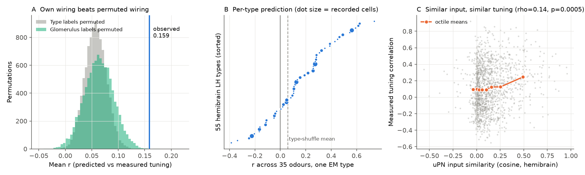
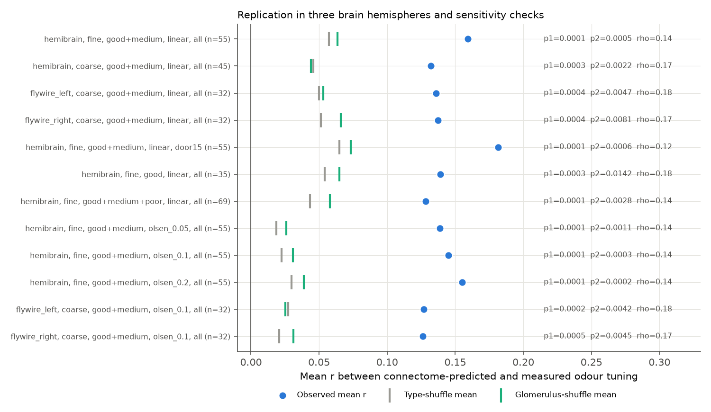
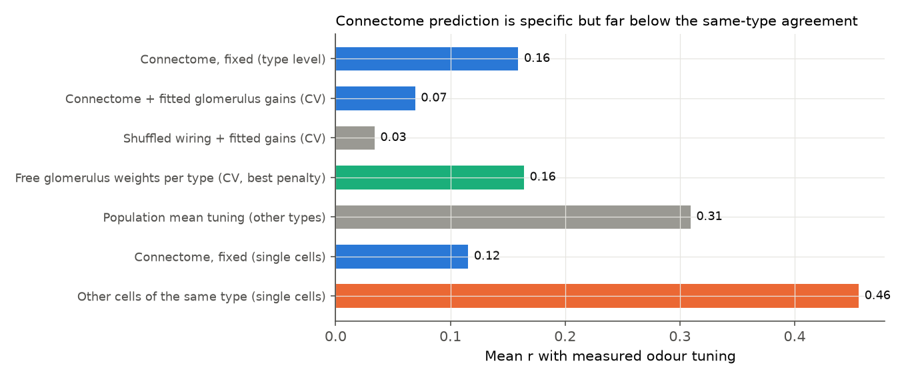

# Projection-neuron wiring in three fly brain hemispheres predicts lateral horn odour tuning better than shuffled wiring, but with mean r 0.16 against 0.46 between cells of the same type

## Summary

We tested if electron-microscopy (EM) wiring predicts the odour tuning of third-order olfactory neurons in the
*Drosophila* lateral horn (LH). We used the whole-cell recordings of Frechter et al. (2019): 117 recorded LH
cells that have a good or medium match to a hemibrain body, in 55 hemibrain cell types, with responses to 35
single odours. For each type, we calculated a predicted tuning: the sum over glomeruli of (signed synapses from
uniglomerular projection neurons, uPNs) x (DoOR receptor response of that glomerulus to the odour). We did
not fit any parameter to the LH recordings.

Main results:

1. The own wiring of a type predicted its measured tuning better than the wiring of other types. Mean Pearson
   r across types was 0.159 (bootstrap 95% CI 0.091 to 0.229). The type-label permutation null mean was 0.057
   (p = 0.0001, 10,000 permutations). The glomerulus-label permutation null mean was 0.064 (p = 0.0005).
2. Types with similar uPN input had more similar measured tuning (Mantel Spearman rho = 0.145, p = 0.0005).
   This test does not use a receptor model.
3. The result repeated with wiring from the right and left FlyWire hemispheres (two other animals):
   mean r 0.136 and 0.137 against null means near 0.05 (p <= 0.0004 for type permutation, p <= 0.008 for
   glomerulus permutation; Mantel rho 0.18 and 0.17). The uPN input vectors of the same type agreed well across
   the three hemispheres (median cosine 0.82 hemibrain vs FlyWire, 0.94 left vs right FlyWire).
4. The prediction is weak. Single cells agree with other recorded cells of the same type at mean r = 0.46.
   The fixed connectome prediction reaches r = 0.12 for the same cells. A free, cross-validated linear readout of
   DoOR glomerulus responses for each type did not do better than the fixed wiring (best r = 0.16). The mean
   tuning of all other types predicted a type better (r = 0.31) than its own wiring did.

Conclusion: in the tested scope, uPN-to-LH wiring carries type-specific information about odour tuning, and this
information is the same in three brain hemispheres. But a linear model of uPN wiring and DoOR receptor
responses explains only a small part of the reproducible, type-specific tuning. Because the wiring is consistent
across brains and a free readout of the same receptor input is not better, the gap is most probably in the input
representation (DoOR receptor responses as a proxy for uPN firing) and in the parts of the circuit that the model
omits (local and non-PN inputs, nonlinearity, shared odour drive), not in variable wiring.

## Question and prior work

The lateral horn is thought to support innate odour responses through stereotyped wiring from uPNs. Frechter et
al. (2019) showed that LH cell types have stereotyped odour responses. Jeanne, Fisek and Wilson (2018) mapped
functional glomerulus-to-LHN connections with optogenetics and predicted many responses from them. Schlegel et al.
(2021) compared hemibrain uPN-to-LHN synapse counts with those functional connections and found no clear
correlation. We did not find a published test that predicts the recorded odour tuning of identified LH cell types
from EM wiring in more than one connectome. Earlier campaign work tested wiring-based odour models in the mushroom
body (cited in sci.json) but not in the lateral horn.

## Data

All inputs are public. They are not in this bundle (see files/NOTICE-external-data.md for sources, versions,
licences and hashes).

- LH odour responses: `lhn_odour_responses` in the R package jefferislab/lhns (commit 7638e3db), from Frechter et
  al. 2019. 249 cells, 36 + 23 stimuli. The table holds non-negative response counts (the package does not state
  the unit; Frechter et al. used spike counts over four trials). We subtracted the mean of the solvent controls
  (Mineral Oil and Water Blank for the main panel; Blank1 and Blank2 for the second panel) from each odour.
- Cell to EM match: `lm_em_matches` in the same package. 145 of 249 recorded cells have a match; 140 have a
  hemibrain body. We used the hemibrain type of the matched body as the analysis unit. Primary: match quality good
  or medium (117 cells, 55 fine types).
- Receptor responses: DoOR 2.0 consensus matrix (ropensci/DoOR.data, commit db323a49). We subtracted the
  spontaneous firing row (SFR). We set receptors without DoOR data to zero.
- Wiring: hemibrain v1.2 traced adjacencies (all regions); FlyWire v783 proofread connections and the Schlegel et
  al. 2024 annotations (uPN glomerulus, top transmitter, hemibrain type, side). We used ipsilateral uPNs in FlyWire.
  uPNs with GABA or glutamate as top transmitter (mainly vPNs) have negative sign. Multiglomerular PNs are excluded.
  Weight = signed uPN synapses per neuron of the type.

Odours (35): trans-2-hexenal, geranyl acetate, propyl acetate, isoamyl acetate, ethyl 3-hydroxybutyrate, nonanal,
11-cis vaccenyl acetate, methyl salicylate, hexyl acetate, phenethyl alcohol, acetoin acetate, ethyl hexanoate,
2-phenethyl acetate, benzaldehyde, beta-citronellol, 1-hexanol, farnesol, cadaverine, spermine, acetoin, methyl
acetate, acetic acid, propionic acid, butyric acid, ammonia, pyridine, phenylacetaldehyde, phenylacetic acid,
geosmin, phenethylamine, putrescine, linalool, 2,3-butanedione, spermidine, CO2. Mixtures, vinegar, fly food, HCl,
ethylamine and the extra low-count stimuli were excluded because DoOR has no entry for them.

## Methods

The analysis plan (files/code/PLAN.md) was written before the first comparison of predictions and recordings.

- Predicted tuning X[t,o] = sum_g W[t,g] PN[o,g]. Primary PN model: linear (DoOR minus SFR). Sensitivity: a
  rectified Olsen-2010-type divisive normalisation with sigma 0.05, 0.1 or 0.2 (DoOR units).
- Measured tuning Y[t,o] = mean over the recorded cells of type t.
- S1: mean over types of r(X_t, Y_t); null = permute type labels of X (10,000 permutations).
- S2: same statistic; null = permute glomerulus labels of the PN responses among glomeruli with any DoOR signal
  (10,000 permutations).
- S3: mean partial r(X_t, Y_t) given the mean tuning of all other types.
- S4: Mantel test, Spearman rho between pairwise uPN input cosine similarity and pairwise measured tuning
  correlation; null = permute type labels (2,000 permutations).
- Noise ceiling: for cells in types with 2 or more recorded cells (90 cells), r between a cell and the mean of the
  other cells of its type (leave one cell out).
- Cross-validated models (leave one odour out; files/code/cv_models.py): connectome weights with fitted gain per
  glomerulus shared by all types; the same with shuffled wiring; a free ridge readout of glomerulus responses per
  type; the leave-one-type-out population mean.
- Replication: hemibrain, FlyWire left, FlyWire right on coarse types (suffix _a, _b removed; 45, 32, 32 types).
- Other checks: leave one odour out; leave one lineage family out; permutation of type labels only within lineage
  families (for example LHPV5); match quality good only, and good + medium + poor; only the 29 odours with 15 or
  more DoOR receptors measured.

## Results

Figure 1. A: observed mean r (blue line) against the two permutation nulls. B: r for each of 55 hemibrain types.
C: pairwise input similarity against pairwise measured tuning correlation (1,485 type pairs).

| Analysis (units) | Types | Cells | Mean r | Type-shuffle null mean (p) | Glomerulus-shuffle null mean (p) | Partial r given population mean | Mantel rho (p) |
| --- | --- | --- | --- | --- | --- | --- | --- |
| hemibrain, fine (primary) | 55 | 117 | 0.159 | 0.057 (0.0001) | 0.064 (0.0005) | 0.124 | 0.145 (0.0005) |
| hemibrain, coarse | 45 | 119 | 0.132 | 0.046 (0.0003) | 0.044 (0.0022) | 0.104 | 0.166 (0.0010) |
| FlyWire left, coarse | 32 | 93 | 0.136 | 0.050 (0.0004) | 0.053 (0.0047) | 0.089 | 0.184 (0.0015) |
| FlyWire right, coarse | 32 | 93 | 0.137 | 0.051 (0.0004) | 0.066 (0.0081) | 0.082 | 0.175 (0.0035) |
| hemibrain fine, 29 well-covered odours | 55 | 117 | 0.182 | 0.065 (0.0001) | 0.073 (0.0006) | 0.145 | 0.117 (0.0020) |
| hemibrain fine, good matches only | 35 | 71 | 0.139 | 0.054 (0.0003) | 0.065 (0.0142) | 0.115 | 0.183 (0.0005) |
| hemibrain fine, include poor matches | 69 | 138 | 0.128 | 0.043 (0.0001) | 0.058 (0.0028) | 0.108 | 0.137 (0.0005) |
| hemibrain fine, Olsen sigma 0.1 | 55 | 117 | 0.145 | 0.023 (0.0001) | 0.031 (0.0003) | 0.134 | 0.145 (0.0005) |

All rows are in files/results/summary.csv (12 analyses, also Olsen sigma 0.05 and 0.2 and FlyWire with Olsen).

Figure 2. Observed mean r (dots) and the means of the two nulls (ticks) for all 12 analyses.

Specificity details (primary). Mean own-wiring r minus mean other-wiring r = 0.104 (bootstrap 95% CI 0.050 to
0.155). The median rank of the own prediction among 55 predictions was 14; 4 types ranked first. 40 of 55 types
had r > 0. Permutation of type labels only within the 9 lineage families gave a null mean of 0.100 (p = 0.0002),
so the result is not only a family-level (lineage) effect. The Mantel relation held for pairs from different
families (rho = 0.121, p = 0.002, 1,274 pairs). Leaving out one odour gave mean r 0.133 (without CO2) to 0.187.
Leaving out one lineage family gave mean r 0.134 to 0.179.

Figure 3. Prediction quality of the connectome compared with fitted models and with the agreement of cells of
the same type. Rows marked CV are leave-one-odour-out predictions.

| Model | Mean r |
| --- | --- |
| Connectome, fixed (type level) | 0.159 |
| Connectome + one fitted gain per glomerulus (CV) | 0.069 |
| Shuffled wiring + fitted gains (CV; 5 shuffles) | 0.034 |
| Free ridge readout per type (CV; penalties 0.01 to 1000) | 0.108 to 0.164 |
| Mean tuning of all other types | 0.309 |
| Connectome, fixed, single cells in types with 2+ cells | 0.116 |
| Other cells of the same type, single cells | 0.456 (partial r given population mean 0.420) |

## Interpretation

- uPN-to-LH EM wiring is not arbitrary with respect to odour tuning: a type's own wiring predicts its tuning
  better than other types' wiring, and better than the same wiring with scrambled glomerulus identities. This
  holds in three hemispheres of two animals and does not depend on the receptor model (Mantel test).
- The size of the effect is small. Recorded cells of the same type agree about 3 to 4 times better than the
  connectome model predicts. This agrees with the report of Schlegel et al. (2021) that synapse counts do not
  clearly predict functional connection strength.
- The free readout result shows that, with 35 odours and DoOR inputs, no linear glomerular model is much better
  than the fixed wiring. Thus a better wiring estimate alone is unlikely to close the gap. Better PN response data
  (measured uPN responses to the same odours), LH local neuron and non-PN inputs, and nonlinear dendritic
  integration are the next candidates.

## Limitations

- The light-to-EM match is a morphological match of one recorded cell to one hemibrain body. Many recorded types
  map to several hemibrain types, and 21 matches are poor. Results with good matches only were similar.
- DoOR is a consensus of many receptor studies at different concentrations. It is a proxy for uPN responses at
  the 2.5 x 10^-4 notional dilution used by Frechter et al. Receptors without DoOR data were set to zero. Odours
  with few DoOR measurements (geosmin, spermine, acetoin acetate) depend on this assumption.
- The response unit in the source table is not stated. Correlations do not depend on the scale, but cells with
  high firing rates have more weight in a type mean.
- Many types have one recorded cell (27 of 55 primary types), so the measured tuning of a type is noisy.
- 35 odours is a small sample for a 47-glomerulus readout; the cross-validated fits are limited by this. The
  glomerulus-gain model selected the smallest penalty in its grid in most folds, so a smaller penalty was not tested.
- FlyWire hemibrain-type annotations are coarser than hemibrain types; we used 32 coarse types there.
- The Mantel p-values use 2,000 permutations (minimum p = 0.0005).

## Reproduction

The code expects this layout: `work/code` (the files in files/code), `work/raw` (downloaded inputs) and the
shared datasets folder at `work/../datasets` (FlyWire v783 connections, FlyWire annotations, hemibrain archive).

1. `bash files/code/fetch_raw.sh ./work ./datasets` downloads the lhns and DoOR files at fixed commits and unpacks
   the hemibrain archive. Compare hashes with files/results/input_sha256.txt.
2. `uv pip install --target work/pylib --no-deps pyreadr` (pyreadr 0.5.9). Python 3.12 with numpy 2.5.4,
   pandas 3.1.1, scipy 1.18.1, matplotlib 3.11.2, pyarrow.
3. `python work/code/prep.py` (about 10 s; writes work/derived, record-level tables that stay local).
4. `python work/code/analyze.py` (12 analyses; a few minutes), `python work/code/extra.py`,
   `python work/code/cv_models.py` and `CV_EXTEND_ONLY=1 python work/code/cv_models.py` (about 20 minutes at high
   host load), `python work/code/figures.py`.

Random seeds are fixed in the code (20261109, 7, 3).

## Provenance

- Campaign 11_07_2026, job sci-1107-dell-neural-structure-and-computation-2a27d4294768, topic
  neural-structure-and-computation, machine dell, account claude-andrii.
- Analysis and text: Claude Opus 5.5 (model ID claude-opus-5-5) acting as an automated researcher, 2026-11-09.
- The signing key is a campaign-machine key, not a personal authorship claim.

## References

- Frechter S. et al. (2019) Functional and anatomical specificity in a higher olfactory centre. eLife 8:e44590.
- Dolan M.-J. et al. (2019) Neurogenetic dissection of the Drosophila lateral horn. eLife 8:e43079.
- Münch D., Galizia C.G. (2016) DoOR 2.0. Sci Rep 6:21841.
- Scheffer L.K. et al. (2020) A connectome and analysis of the adult Drosophila central brain. eLife 9:e57443.
- Schlegel P. et al. (2021) Information flow, cell types and stereotypy in a full olfactory connectome. eLife 10:e66018.
- Dorkenwald S. et al. (2024) Neuronal wiring diagram of an adult brain. Nature 634:124.
- Schlegel P. et al. (2024) Whole-brain annotation and multi-connectome cell typing of Drosophila. Nature 634:139.
- Jeanne J.M., Fisek M., Wilson R.I. (2018) The organization of projections from olfactory glomeruli onto
  higher-order neurons. Neuron 98:1198.
- Olsen S.R., Bhandawat V., Wilson R.I. (2010) Divisive normalization in olfactory population codes. Neuron 66:287.
