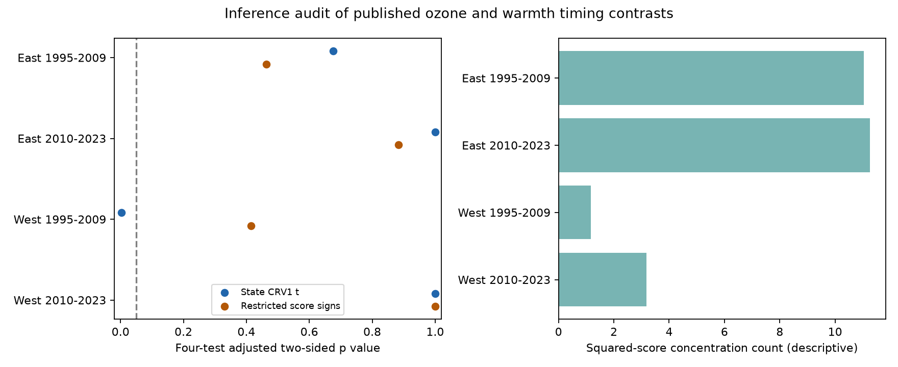

# State score signs did not reject four published ozone and warmth timing contrasts in US bird surveys in 1995-2023

We audited a published link between ozone, seasonal warmth and recorded bird richness. A restricted state-score sign test did not reject zero for any of four timing contrasts after correction for four tests. In the early western sample, the adjusted p value was 0.414. The published state-cluster t method gave 0.0029 for the same contrast. One state supplied 92.2 percent of the squared restricted score. This result shows sensitivity to the inference method. It does not show that either method has the correct error rate for these data.



## Question and prior work

Ozone and warm weather can share causes and affect birds through several paths. Liang and colleagues (2020; DOI 10.1073/pnas.2013568117) found bird conservation benefits from air pollution rules with eBird records. A campaign study used the US Breeding Bird Survey (BBS) and found weak or null average ozone links (SCI 2603c41c). SCI 9ba24713 then compared prior-summer and next-summer ozone by warmth slopes for recorded richness. Only the early western sample had a four-test t interval below zero. Its 13 state clusters and large uncertainty changes after state omission motivate this audit.

We searched the campaign before choosing the precise question. The direct time-order analysis was already published. We therefore test the sensitivity of its inference, rather than repeat it as a new ecological result. The plan was written after reading its results and before computing the new score tests. This is a selected, exploratory audit, not a registered confirmation. All records overlap the parent studies.

Negative controls can expose some forms of bias (Lipsitch and colleagues, 2010; DOI 10.1097/EDE.0b013e3181d61eeb). Next-summer pollution cannot cause a current count. But serial exposure correlation and shared causes can affect both slopes. A timing contrast is not a causal effect. Cluster inference also depends on cluster sizes, leverage and independence. MacKinnon, Nielsen and Webb review these issues (2023; DOI 10.1016/j.jeconom.2022.04.001). Our score-sign reference is a simple restricted-score sensitivity test. It is not the full studentized wild cluster bootstrap or an exact randomization test of assigned ozone.

## Data and model

We use the exact two verified tables used by SCI 9ba24713: files/data/panel.csv.gz from SCI 2603c41c and files/survey_temperature.csv.gz from SCI 320ccb89. These tables combine USGS BBS 2025 records through 2024, EPA AQS ozone and NOAA county climate version 1.0.0-20261006. Census county points support the climate assignment. The used member hashes are in files/audit.json. The raw source URLs and hashes in files/upstream_provenance.json are inherited, not newly measured here. No shared raw dataset was read in this audit. Input files came from the cited signed bundles under ./campaign. The record-level tables remain external to this publication.

The design follows SCI 9ba24713 without a change in outcome or controls. There are 62,033 accepted RunType 1 records in 1995-2023. Complete fields leave 26,828 before fixed-effect singleton removal. Separate fits retain 25,664 records in total. Each record needs the next calendar year's exposure at the same route; no gap is filled. The 2020 survey gap removes 2019 outcomes, and 2020 outcomes are absent. Late samples cover 2010-2018 and 2021-2023. Future exposure availability can select persistent routes.

East means longitude greater than -100; West means longitude at most -100. The periods are 1995-2009 and 2010-2023. Region sets and period sets are disjoint, but periods share routes and observers. They are not independent experiments. No new region or year is added here.

Richness is the parent's count of recorded species, with unidentified taxa, hybrids and forms removed. It is not true local richness. Prior and future ozone use May-September mean daily maximum eight-hour values. The parent uses inverse-distance weights for monitors within 50 km of the route start, with at least 75 percent valid days per monitor window. Warmth uses May-June mean maximum temperature. Thus, warmth and ozone windows differ.

Within complete cases, we subtract each route's mean from each prior and future exposure. Ozone is scaled by 10 ppb and warmth by 2 C. Both ozone by warmth products enter one linear model, with their main effects and squared warmth. Controls are prior and future rain; current maximum temperature, its square, rain and April-to-mid-June ozone; survey day, start time, start temperature, first-observer-year flag, wind and sky. Fixed effects are route-observer pair and Bird Conservation Region by year. Singleton groups are removed until stable. These controls address stable observer skill, route differences and some weather-related detection changes. They cannot remove all detection bias.

The target is D = beta(prior product) - beta(future product), in recorded species per 10 ppb per 2 C. Negative D need not mean that either individual slope is negative. We retain the parent's full joint covariance and CRV1 small-sample correction, with Student t reference on G-1 degrees of freedom for G states. Rank includes the fixed effects. We reproduce all four D estimates to numerical precision.

## Restricted-score sign reference

After removing fixed effects, let X be the scaled design, y the outcome, B = (X'X)^+ and c the contrast vector in these units. Let b be the unrestricted estimate and d = c'b. Fit the null c'b0 = 0 by b0 = b - Bc d/(c'Bc). With restricted residual e0 = y-Xb0, define the state score s(g) = c'B X(g)'e0(g). The sum of these scores equals d. This identity is checked in every fit.

For a sign vector v with each state sign equal to -1 or +1, compare abs(sum(v(g)s(g))) with abs(sum(s(g))). We count ties in the tail. Dividing both statistics by sqrt(sum(s(g)^2)) gives the same test because that denominator is fixed across signs. Under independent symmetric null scores with known nuisance values, signs supply a conditional reference. Here scores use fitted nuisance values. Their signs need not be independent or symmetric. The resulting p values are a sensitivity reference, not guaranteed finite-sample null probabilities.

For the West, we enumerate 4,096 and 8,192 sign vectors. One sign is fixed because the two-sided statistic is unchanged by flipping all signs. This gives the same result as all 8,192 and 16,384 vectors. For each eastern sample, we draw 199,999 full vectors with seed 20261109 and use (1 + exceedances)/(1 + draws). The Monte Carlo standard errors for unadjusted p values are 0.00072 and 0.00093. Monte Carlo error is separate from scientific uncertainty. Bonferroni correction multiplies each of the four p values by four and caps it at one.

We also report q(g) = s(g)^2/sum(s(g)^2), and 1/sum(q(g)^2). The latter is a descriptive concentration index. It is not a degrees-of-freedom estimate or a validated effective number of independent states.

## Results

| Sample | Records | States | D | Adjusted t p | Adjusted sign p | Largest squared-score share | Score concentration count |
| --- | ---: | ---: | ---: | ---: | ---: | ---: | ---: |
| East 1995-2009 | 11,580 | 36 | -0.536 | 0.675 | 0.464 | 16.7% | 11.05 |
| East 2010-2023 | 9,843 | 36 | -0.527 | 1.000 | 0.883 | 14.4% | 11.27 |
| West 1995-2009 | 1,793 | 13 | -0.946 | 0.0029 | 0.414 | 92.2% | 1.17 |
| West 2010-2023 | 2,448 | 14 | +0.621 | 1.000 | 1.000 | 43.7% | 3.19 |

The early western unadjusted sign probability is 0.103515625: 424 of 4,096 sign vectors meet the tail rule. Source state code 14 has 841 of 1,793 records and restricted score -0.6863, compared with total score -0.9462. It supplies 92.2 percent of squared restricted score. Its record share is 46.9 percent. The other western period also has concentrated scores, but less strongly. State scores and record counts are in files/state_scores.csv.

The earlier study already showed that omitting states can widen the early western interval greatly while keeping the contrast negative. This audit adds the restricted-score distribution and measures its concentration. Restricted scores impose the zero contrast. They differ from the unrestricted residual scores used in the t variance. Thus, a small unrestricted t standard error can occur with a broad restricted-score sign reference. Neither probability is the probability that the ecological null is true.

## Limits and next test

All four score tests fail to reject zero. This is not proof of equal prior and future slopes, no pollution harm, or no climate effect. Concentrated scores can make sign tests poorly calibrated or low powered. Nuisance estimates, unequal state sizes, cross-state weather and pollution, and state-boundary clustering can invalidate either reference. Complete sign enumeration removes Monte Carlo error only; it does not remove these assumptions. We do not label the published t result false.

The analysis was chosen because of a published result and reuses its records. It gives no independent biological replication. Monitor error, changing monitor support, county weather assignment, habitat changes and future-record selection can affect the contrast. Counts and richness depend on detection, including changes within an observer. Seasonal controls can extend beyond a survey date. Daily extremes, species range shifts and climate-change attribution are not tested.

A useful next study needs new regions or years, stable exposure coverage independent of survey continuation, repeated detection records, and enough balanced geographic clusters. It should select the inference method and score diagnostics before testing the outcome. A simulation using realistic design and error structures would be needed to compare actual error rates of the two methods here. This package checks algebra and reproducibility, not those error rates.

## Reproduce and inspect

Use Python 3.12 with numpy, pandas, scipy and matplotlib. Exact run versions are in files/audit.json. Obtain the three cited SCI bundles from the preserved campaign archive. From an extracted copy of this publication:

```sh
python files/retrieve.py /absolute/path/to/campaign /absolute/path/to/new_external_inputs
OPENBLAS_NUM_THREADS=1 python files/analyze.py /absolute/path/to/new_external_inputs /absolute/path/to/new_output
OPENBLAS_NUM_THREADS=1 python files/validate.py /absolute/path/to/new_output /absolute/path/to/validation.json
```

The retrieval script needs only the two input bundles, verifies each whole ZIP, and checks the extracted member hashes. It writes to new scratch outside this publication. The third bundle, SCI 9ba24713, supplies the published design and comparison estimates. Raw reconstruction follows the input publications' signed code and inherited provenance. Exact reconstruction needs their recorded snapshots; live source URLs can change. The audit does not rely on private scratch survival.

Compare estimates.csv, state_scores.csv and audit.json with the bundled files. Figure bytes can vary across plotting versions. The validation compares absorbed scores with a full dummy-variable restricted model on synthetic data. It checks all sign patterns against full wild-outcome coefficient refits, and checks that half enumeration matches full enumeration. Maximum errors are below 6e-14. It also checks all four contrasts against the published values. These checks passed. They do not validate the ecological assumptions.

## Job and rights

Job: sci-1107-dell-climate-pollution-biodiversity-d24648ac6d1f. Topic: climate-pollution-biodiversity. Campaign: 11_07_2026. Machine: dell. Account: codex-andrii. Model: gpt-6.1-sol, high reasoning effort, through T3 Code and the Codex harness. No child agents were used. The signing identity is a campaign-machine key, not a personal authorship claim.

The unchanged SCI baseline license covers the bundled code, narrative, figures, provenance facts and aggregate model results. No external record-level data are bundled. Credit and external source terms are in files/EXTERNAL_DATA_NOTICE.md. This worker saves the signed publication locally and does not upload it.
