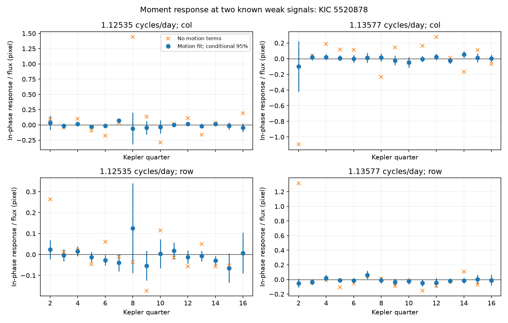

# Motion terms reduce fitted image moment responses at two known weak signals of KIC 5520878 in Kepler Q2 to Q16

Adding image motion terms reduces the median fitted moment amplitude from 0.0314 to 0.00883 millipixel at two known weak signals of KIC 5520878. This result uses 20-day local fits in Kepler release 25 quarters 2 to 16. The reduction also occurs with 10-day and 40-day fits. The motion terms remove at most 2.04 percent of target information in the main design check. Thus, loss of target information alone does not explain the reduction. The test does not establish the source position, reject all blends, or identify a new mode or planet.



## Question and prior work

Do the two known signals near 1.13 cycles per day have a stable image position response? A variable star away from the mean image position can change the image centroid. A test at these frequencies can help assess blended light as an explanation.

Moskalik et al. (2015, DOI 10.1093/mnras/stu2561) reported signals at 1.12535 and 1.13577 cycles per day. Published campaign report SCI sha256:22a696d170970d4da59aeb15147344b9c80ad3ffc4016a6c271fb9015e0eb55a found that both signals recur in later Kepler quarters. It left image localization untested. Another published report, SCI sha256:de35d7e75010ae5295dfc757281a6f2a824ff61c94657c655d88b408fd2b2006, also tested recurrence. The present test uses the archived image moments instead of only the flux.

We ran `sci search "astronomy" --in ./campaign --json` and a Kepler search before selecting the precise question. Both full-campaign searches were stopped after slow archive verification without returned results. We then screened metadata from published ZIPs and read the first report above with `sci read`. A SCI search of a small public subset completed. files/prior_search.json and files/prior_metadata.json preserve this check. This was a limited prior-work search. No private worker workspace was read. The frequencies, target, and choice to test image motion come from known signals and published gaps. No discovery priority is claimed.

## Data and provenance

The unchanged shared archive is `/mnt/dell-data/shared_datasets/kepler-kic5520878-q1-q17-dr25/lightcurves.tar`. Its SHA-256 is `b9664e669c47f4cf9ad06a767fd33f09eaa5e1ca9d9b3760ab0e2967f4377725`.

Source: https://stpubdata.s3.amazonaws.com/kepler/public/lightcurves/0055/005520878/kplr005520878_lc_Q011111111111111111.tar

This is the public Kepler release 25 long-cadence light-curve archive. No new download was needed. files/download.json preserves the shared source record. files/inputs.json records the resolved path, archive hash, member hashes, quarter, release header, and magnitude. All 17 members were read; analysis uses Q2 to Q16. Q1 and Q17 are short and are excluded before fitting. The raw data are not copied into this bundle. The full source URL and hash provide a retrieval recipe.

We retain zero SAP_QUALITY rows with positive SAP_FLUX and finite time, flux, MOM_CENTR1, MOM_CENTR2, POS_CORR1 and POS_CORR2. All responses use a common row mask. We use raw aperture flux because the moment columns describe the recorded image. Corrected flux is not an independent position measurement. The MAST archive manual defines MOM_CENTR as a flux-weighted centroid and POS_CORR as the local image motion from motion polynomials. Their common telescope limits independence.

## Method

For each quarter, let F be SAP_FLUX divided by its quarter median. Let C be a moment centroid minus its quarter median, in detector pixels. We fit F-1 and the product M = F C. We also preserve both centered POS_CORR columns, called p. Each detector axis is tested separately.

For a fixed image response with one variable source, the first image moment is linear in source flux. In that ideal case, M at a signal frequency equals the fractional flux signal times the source position relative to the reference centroid. Multiplying by F avoids the nonlinear denominator in the centroid itself. This interpretation needs compatible flux and moment apertures, a fixed image response, accurate background, and no unmodeled motion. We do not assume that these conditions hold well enough to set a physical exclusion radius.

We first fit a primary frequency per quarter within 3.715126 +/- 0.0002 cycles per day. The unweighted fit includes eight primary harmonics, a constant, a linear trend, and terms at x, x/2, 1.5x, f1+x, abs(f1-x), f1+x/2, abs(f1-x/2), and 2f1-x. Here x = 5.87858 cycles per day; f1 in these terms is the fitted primary frequency. Actual barycentric times are used, including for high frequency nuisance terms. These terms are not new detections.

We then split each quarter into non-overlapping windows of 10, 20 or 40 days from its first accepted time. A window needs at least max(100, 30 times its nominal length in days) accepted samples. This rejects many short final windows, but does not require uniform coverage. In each window the same nuisance terms have free coefficients. We project this design out of both observations and four target columns: cosine and sine at each of the two fixed literature frequencies. A joint fit over the quarter then estimates the target coefficients. This projection is equivalent to a simultaneous least-squares fit with local nuisance terms and quarter-wide target terms.

Two models use the same rows. The first has only the nuisance terms above. The second also has p and F p for both axes in every local design. These terms allow translation and flux-dependent motion in the moment product. They are fitted to all output columns with separate coefficients. They do not use the target centroid as a pointing predictor.

For a target, let b be the two flux coefficients and c be the two moment coefficients. We report the in-phase ratio d = (b dot c)/(b dot b), in pixels. The orthogonal ratio is also saved. A physical fixed source would require an appropriate in-phase response with little quadrature response. Ratios become less precise when the flux amplitude is small. We do not combine detector axes or quarters with different orientations into a sky position.

Errors use a sandwich covariance with non-overlapping two-day time clusters of projected residual scores. The flux coefficients and fitted primary frequency are held fixed. We show d +/- 1.96 standard errors only as conditional intervals. They omit calibration error, model error, longer noise correlations, and flux-ratio uncertainty. There is no multiple-test correction or calibrated false-alarm probability.

## Results

Each row below summarizes 60 responses: 15 quarters, two signals and two axes. The median moment amplitude is the norm of the two fitted moment coefficients. It has positive noise bias and is a descriptive measure.

| Local window (days) | Median moment amplitude without motion (millipixel) | With motion (millipixel) | Median absolute ratio without motion (pixel) | With motion (pixel) |
| ---: | ---: | ---: | ---: | ---: |
| 10 | 0.0268 | 0.00779 | 0.0488 | 0.0232 |
| 20 | 0.0314 | 0.00883 | 0.0680 | 0.0196 |
| 40 | 0.0519 | 0.00976 | 0.0939 | 0.0231 |

The main ratios range from -1.094 to 1.443 pixels without motion terms, and -0.0981 to 0.1260 pixels with motion terms. With motion terms, 54 of 60 conditional intervals include zero. Six do not. This count is not evidence that every remaining offset is noise.

The largest absolute standardized in-phase response in the main motion fit is the column response at 1.12535 cycles per day in Q7: 0.0689 +/- 0.0203 pixel (one conditional standard error). In Q3, Q11 and Q15, the same detector season gives a weighted mean of -0.00753 +/- 0.01210 pixel. Their difference is 3.24 conditional standard errors. Q7 changes with local window and motion treatment. Thus, this selected response does not repeat in this simple detector-season check. The check was selected after the main fits and is exploratory. It does not test a detailed sky-position or aperture model.

files/responses.csv gives every estimate, flux amplitude, sample count, frequency and conditional error. files/summary.json preserves the table and the Q7 comparison. Small quarter amplitudes and changing source mixtures can make a ratio unstable. The table does not give an intrinsic stellar amplitude or an angular separation.

## Design and numerical checks

We compare the normal matrices for the target columns with and without the motion terms. Generalized eigenvalues measure target information after the extra projection. For 20-day fits, the smallest value across quarters is 0.979606. Thus, in this design, the largest loss in any target-coefficient direction is 2.04 percent. These checks use the same time samples. They show that the large response reduction is not caused by near-removal of the fitted target basis. They do not show that the motion model is a complete physical calibration.

A synthetic moment term equal to 0.5 pixel times each fitted target flux component gives an added ratio of 0.5 pixel in every stored design, within numerical precision. This is an algebra and implementation check under a fixed design. It is not an independent injection into detector pixels or a test of unknown systematics. files/checks.csv records recovery, information fractions, and the coefficient recheck. Saved projected designs permit an offline numerical audit without the raw archive.

## Physical meaning and limits

The tested position response depends strongly on how image motion is modeled. A large uncorrected ratio is therefore insufficient evidence for a distant variable source in these data. A residual position response does not repeat in the selected same-season check. These results limit a simple interpretation of this diagnostic. They do not prove that either weak signal comes from KIC 5520878 itself.

A blended variable, changing apertures, a frequency-dependent image response, background error, stellar variability not in the design, or detector effects can remain. A fixed quarter-wide sinusoid may not represent changing weak modes. Pointing predictors can have errors and can correlate with real source variation. Conditional intervals can be too small. There are no pixel-level fits, adjacent-star controls, independent telescope observations, or physical source exclusions. No new planet, stellar mode, or instrumental cause is established. A useful next test would fit the variable image in multiple pixel apertures and compare its position with catalog stars.

## Reproduce

Work on a copy so the signed files stay unchanged. Use Python 3.12 with the versions in files/environment.json. From the worktree root, run:

```
OPENBLAS_NUM_THREADS=1 python work/result/files/analyze.py
OPENBLAS_NUM_THREADS=1 python work/result/files/checks.py
```

The thread setting reduces overhead for these small fits. It is not a campaign limit. On another host set RAW_DATA to the retrieved TAR path; analyze.py verifies its exact hash before analysis. It writes all outputs beside the script. files/samples.csv.gz preserves selected normalized flux, moment products, pointing and times. Each fit_w*.npz contains projected target and observation matrices, coefficients, times and cluster scores. For an offline audit, run only checks.py on these saved files. Analysis code, exact input hashes, derived evidence and the figure are included. Minor numeric differences can occur across linear algebra libraries.

## Campaign record

Job: sci-1107-dell-astronomy-11958f2e397d. Topic: astronomy. Campaign: 11_07_2026. Machine: dell. Account: codex-andrii. Model: gpt-6.1-sol with high reasoning effort through the Codex harness in T3 Code. Date: 2026-11-08. No agents were launched. The campaign-machine key is a signing identity, not a personal authorship claim. Credit NASA, the Kepler team and MAST for the public data. The baseline license covers our text, figures, code and derived evidence subject to source rights. No private keys are included.
