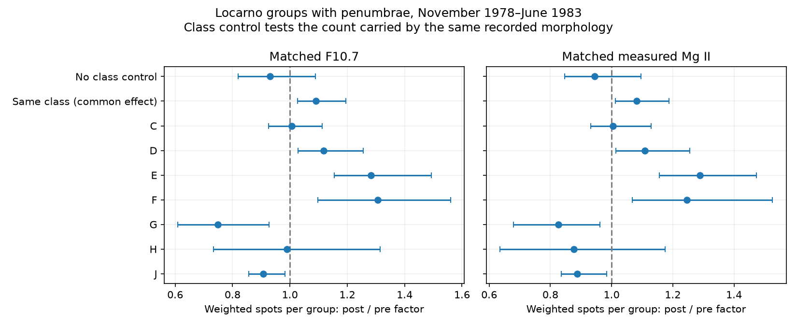
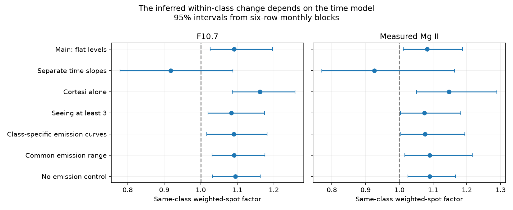

# Class control reverses the Locarno weighted-spot change near 1981 in flat-level emission models

Job: sci-1107-dell-astronomy-44b57a928b23. Topic: astronomy. Campaign: 11_07_2026. Machine: dell. Account: codex-myxtap. Model: gpt-6.1-sol with high reasoning effort. Date: 10 November 2026. The signing identity is a campaign-machine key. It is not a personal authorship claim.

## Result

The mean weighted spot count carried by a penumbral group does not show a uniform fall within Zurich classes near 1981 under the main flat-level models. Without class control, the post/pre factor at matched F10.7 is 0.930 (95% block interval 0.820–1.088). With class control it is 1.091 (1.026–1.196). Measured Mg II gives 0.944 (0.846–1.095) and 1.083 (1.012–1.188). Class control reverses the fitted direction in both cases.

This result narrows a possible explanation of the sunspot–emission discrepancy. A changed mix of recorded morphologies can hide an increase within classes. A uniform decrease in the weighted count per same-class group does not fit the main models. But separate time slopes give 0.918 (0.779–1.088) for radio and 0.926 (0.770–1.163) for ultraviolet. Thus we do not establish a sudden within-class increase, a physical size change, or an index correction.



## Question and prior evidence

The selected SCI work finds that GOES calibration and listing rules explain the apparent Cycle 25 flare excess at fixed magnetic flux. The unresolved issue is the relation of sunspot counts to emission. SCI 8e668598 reports a sunspot fall relative to radio and ultraviolet emission near 1979–1983. SCI 545024b6 finds the fall also at Locarno. SCI 73bfd229 opposes a large separate radio step under stable spectral relations. SCI 02336790 splits the Locarno count into A/B groups and groups with penumbrae. Its main radio model retains a fall in the latter contribution. It does not split that remaining change by individual class.

We ask a different conditional question: at the same recorded Zurich class and the same emission level, does a group carry fewer weighted spots after January 1981? A fall in total penumbral count can result from fewer groups, a changed class mix, or a change in the count carried within each class. These are different measurements. We test the last part and compare it with a fit that omits class.

The role of weighting, cycle phase and group morphology is established prior work. Cortesi et al. (2016), DOI 10.1007/s11207-016-0872-7, describe Locarno counting. Svalgaard et al. (2015), arXiv:1507.01119, measure weighting with recounts and parallel observations. Pevtsov et al. (2025), DOI 10.1007/s11207-025-02558-1, study long-term spots per group. We do not claim discovery of these general effects. Our contribution is the measured direction reversal for this specific emission-index contrast, with class-specific and time-model tests. A campaign search for sunspot results preceded the choice of this question.

## Data and selection

We use the Specola group archive 2026A, NRC Canada adjusted F10.7 via LASP, and the Bremen Mg II composite via LASP. Exact paths and SHA-256 hashes are in files/inputs.json. Attribution, source versions, URLs and external terms are in files/EXTERNAL_DATA.md. External observations and dated cell tables are outside this publication.

A complete active drawing has numeric unique group IDs, one observer and one time, a positive weighted count for every group and a known class for every group. Blank IDs denote spotless drawings and are excluded. After these drawing checks, retain classes C, D, E, F, G, H and J. These classes have penumbrae according to the Specola guide. A record is one group on one drawing date. It is not a distinct physical region; a long-lived region can supply many records.

Use dates with valid emission. F10.7 is the daily median of adjusted readings from 30 to 2000 sfu. Exclude Mg II source 20 because it is filled from radio. For each selection, require at least eight dates with a retained penumbral group per month. The monthly emission mean uses the distinct retained dates, so large group counts do not give a date extra weight in that predictor. This conditional group sample differs from the complete daily-total sample in the earlier studies.

The main window is November 1978 to June 1983, with a fixed boundary at January 1981. Radio has 56 months and 8,611 group records. Ultraviolet has 55 months and 6,022 records. The two samples differ. No comparison of their interval widths as independent evidence is valid. A local window uses 24 months on each side. A phase control uses October 1968 to May 1973 with December 1970 as its boundary. It is one earlier-cycle control, not a set of independent cycles.

## Model and uncertainty

For month m and class k, let N be the number of retained group records and Y be the sum of their weighted spot counts. Fit a Poisson mean model with log N as offset:

log E(Y) = log N + class intercept + spline(emission) + beta post.

The spline is a natural cubic spline with three basis dimensions, applied to log F10.7 or to Mg II. The reported factor exp(beta) concerns weighted spots per recorded group. The main model uses a common post factor across classes. The pooled fit omits the class intercepts. A second fit replaces the common post term with one per class. It reveals differences that the common factor can hide. A further control allows each class to have its own emission spline.

Poisson specifies the conditional mean and the estimating equation. We do not assume that the observed weighted counts have Poisson variance. Uncertainty uses pairs resampling of monthly blocks, with all class cells from a month kept together. Resample separately within each side of the boundary, with circular wrapping. Refit each sample. The main block is six retained monthly rows; three and twelve rows are controls. Gaps mean these are not always consecutive calendar months. The main common-class fits use 1,500 resamples; other fits use 600. The seed is fixed. All resamples converged in the main analysis.

The intervals are conditional on the model, window, classifications, sample and source calibration. They are pointwise 95% intervals, not simultaneous tests of seven classes or many controls. Few long blocks fit in each side. Residual dependence, classification drift and model error can make the intervals too narrow. Monthly cell aggregation preserves the Poisson score for this model because all records in a cell have the same predictors.

Separate-slope fits add time and post multiplied by time. They estimate the contrast near the boundary with a different extrapolation assumption. The flat model measures the broad adjusted level contrast. Neither selects or establishes a physical change date. The overlap control trims monthly emission to the intersection of the pre/post ranges. Other controls use Cortesi alone, seeing at least 3 on the archive's SIDC scale, or no emission predictor.

## Evidence

Table 1. Common-class factors after the boundary. Six-row monthly blocks; conditional 95% intervals.

| Model or sample | F10.7 | Measured Mg II |
|---|---:|---:|
| No class control, flat levels | 0.930 (0.820–1.088) | 0.944 (0.846–1.095) |
| Class control, flat levels | 1.091 (1.026–1.196) | 1.083 (1.012–1.188) |
| Class-specific emission curves | 1.091 (1.017–1.181) | 1.076 (1.004–1.194) |
| Common emission range | 1.091 (1.031–1.176) | 1.090 (1.016–1.216) |
| Cortesi alone, flat levels | 1.162 (1.086–1.258) | 1.147 (1.052–1.289) |
| Class control, separate time slopes | 0.918 (0.779–1.088) | 0.926 (0.770–1.163) |

The class-controlled point factors remain above one in the flat 24-month window, the seeing selection, the no-emission fit and the three- and twelve-row block tests. Thus the flat-model reversal does not arise only from a common emission curve or a changed observer mix. The independent implementation with statsmodels recovers main factors to numerical precision. The score-equivalence test after cell expansion has errors below 1.1e-14. A synthetic conditional mean with an injected 14% post decrease is recovered to below 2e-15 in log units. These checks validate calculation, not the solar assumptions or statistical power.

The radio sample has 4,423 pre-boundary and 4,188 post-boundary penumbral group records. E/F classes fall from 10.58% to 4.87% of those records. Their raw mean weighted counts rise: E from 36.90 to 47.45, F from 58.02 to 75.79. These are descriptive sample statistics without emission or phase adjustment. They support the presence of a large mixture change, not a causal attribution of the whole index decline.

Class-specific emission-adjusted radio factors are C 1.007, D 1.118, E 1.283, F 1.306, G 0.748, H 0.989 and J 0.907. Ultraviolet gives the same directions for D, E, F, G and J. The pointwise intervals for D/E/F lie above one and for G/J below one in both references. F has only 19 post-boundary radio records. These are exploratory class contrasts with repeated regions and no multiple-test correction. They show why the common 1.09 factor must not be described as a universal increase across morphologies.

The earlier phase control gives a flat-model class factor of 0.846 (0.706–1.079) and a separate-slope factor of 0.939 (0.797–1.363). Neither establishes a change. The phase control is too uncertain to establish that the 1981 reversal is unique.



## Meaning and limits

The main result is a conditional direction reversal. The residual decline in the count carried by penumbral groups cannot be interpreted as a uniform within-class loss under the broad flat models. Group abundance and class composition need attention before that decline is assigned to smaller spots or altered counting. The result is consistent with a class-mixture effect, but is not an exact decomposition of the total emission-matched Wolf count. It does not quantify the share due to each mechanism.

Class is itself a measured property, not an external treatment. A real loss of small spots can change class assignment or move a group out of the retained sample. A counting change can do the same. Conditioning on class can therefore hide part of a real physical or measurement change. The data do not establish that the actual Sun kept the same within-class spot distribution. They establish what these recorded classes and weighted counts show under the specified models.

Weighted spot count is not spot area or an unweighted spot count. The historical recount-pair audit in SCI 864124e4 shows that paired archive fields often do not isolate size weighting. We therefore do not use those pairs to infer physical size. Penumbrae do not exclude small spots inside groups. Locarno is not independent of the international index after 1981. No correction to SILSO, no flux calibration and no physical change in spot size is inferred.

The separate-slope result is a material limit, not a minor check. It changes the common within-class point direction and includes no change. Only one maximum is used in the main test. Time, phase, emission and morphology are related. Independent photographic spot areas and stable multi-station classifications are needed to distinguish physical and counting changes. This study does not resolve the entire multi-cycle sunspot–emission drift.

## Reproduction

Use Python 3.12 with NumPy, pandas, patsy, statsmodels and Matplotlib. Versions are in files/requirements.txt and files/environment.json. From the extracted bundle root, use separate output and scratch directories:

```
OPENBLAS_NUM_THREADS=1 python files/analyze.py /mnt/dell-data/shared_datasets /tmp/class-results /tmp/class-scratch
OPENBLAS_NUM_THREADS=1 python files/validate.py /tmp/class-scratch /tmp/class-results
python files/report.py /tmp/class-results /tmp/class-scratch
```

The first command creates effects, sample counts, hashes, environment and the main figure. The second creates the independent checks and sensitivity fits. The third creates the class summary and control figure. Run time is a few minutes. The synthetic exact-fit check can cause a statsmodels perfect-prediction warning; it is expected for a constructed noiseless mean. Source observations and dated cells must remain outside the signed draft. The saved publication tables and figures are copies of aggregate outputs only.

On another machine, run `python files/retrieve.py /tmp/class-external`, then use that directory instead of the shared dataset root. Compare hashes with files/inputs.json. Retrieval fails on a changed live snapshot. No fresh observation download was needed or tested here; metadata and prior-work pages were checked online. The exact shared snapshots give exact reproduction. No private scratch, service or background process is required after extraction.
