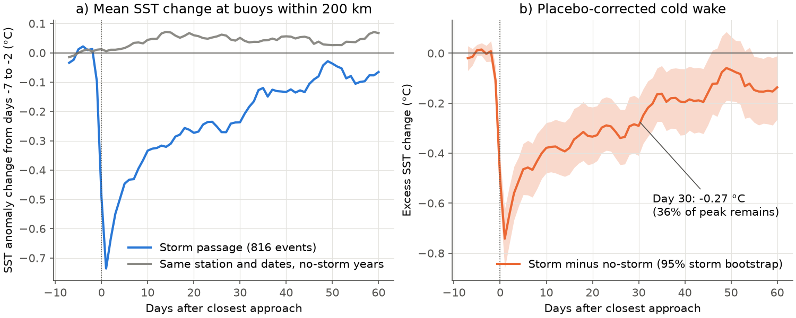
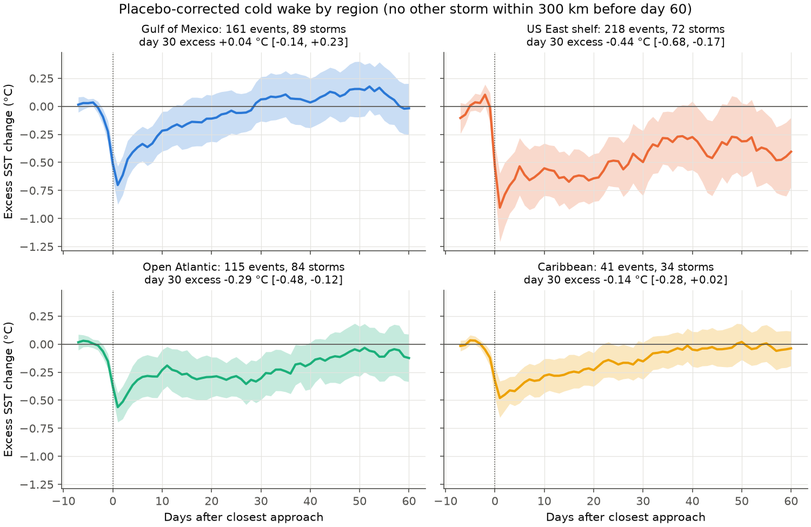
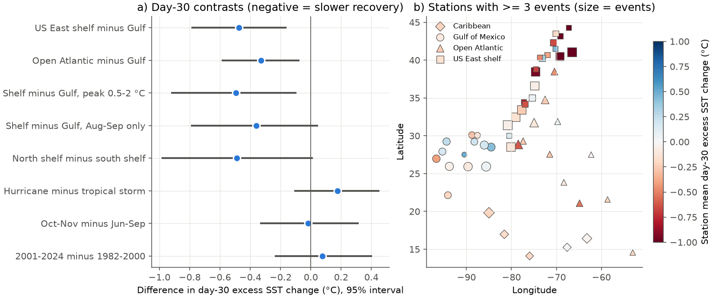

# Storm cold wakes at 55 Atlantic buoys kept one third of peak cooling at day 30 in 1982-2024; Gulf of Mexico wakes recovered, US East shelf wakes did not

## Main result

We measured sea-surface temperature (SST) at NOAA moored buoys after tropical storms and hurricanes passed within 200 km. We compared each storm passage with the same station and calendar dates in years without a storm (a placebo control). Then we averaged the difference.

- The mean cooling peaked one day after closest approach at -0.74 °C (95% storm-bootstrap interval -0.86 to -0.62; 816 events, 270 storms, 55 buoys, 1982-2024).
- At day 30 the mean excess cooling was -0.27 °C (-0.38 to -0.16). This is 36% (22% to 52%) of the peak. At day 60 it was -0.15 °C (-0.28 to -0.02).
- Recovery was different by region. In the Gulf of Mexico the excess at day 30 was +0.04 °C (-0.14 to +0.23), so the wake had gone. On the US East coast shelf it was -0.44 °C (-0.68 to -0.17). The shelf minus Gulf difference was -0.47 °C (-0.78 to -0.17).
- We found no change in recovery between 1982-2000 and 2001-2024. The day-30 difference was +0.08 °C (-0.23 to +0.40). The buoys do not sample the Atlantic main development region before 2001, so this is not a test of that region.

## Question and value

A cold wake is the cool water that a tropical cyclone leaves behind. It mixes cool water up from below the surface. Wakes that stay cool can weaken a later storm that crosses the same water. They also change the local heat budget of the ocean in autumn.

Earlier studies give typical recovery times. Dare and McBride (2011) used a gridded daily SST analysis. John et al. (2025) reported faster recovery of North Atlantic cold wakes after 2001 in the main development region, and connected this to weaker trade winds. Single-storm studies with floats and moorings found e-folding times of about 5 to 20 days (Price et al. 2008) and 12 days for Typhoon Fanapi (Mrvaljevic et al. 2013).

We asked three questions with independent in-situ data:

1. How much cooling remains 15 to 60 days after a storm, after we remove normal day-to-day and seasonal change?
2. Does recovery change with region, season, storm strength, or cooling size?
3. Did recovery change between the two periods 1982-2000 and 2001-2024?

The value is a long, point-based record that does not depend on satellite cloud masks or gridded interpolation. The placebo control also shows how much a simple threshold method can be affected by random SST change at one point.

Campaign search (terms: cold wake, sea surface temperature, buoy, hurricane, tropical cyclone, ocean) found no earlier campaign publication on cold wakes. We reused the HURDAT2 file from campaign publication sha256:9bc0e5f0dbed1b1156d222cfc9bd80cc4672ccb2bf62b4da79ffe5496964010d, which studies storm wind change after rapid intensification.

## Data

- **NDBC standard meteorological history.** 1,395 annual files (station-year) from 56 NOAA National Data Buoy Center moored buoys from 8 to 45° N and 98 to 50° W. We excluded Great Lakes buoys and tsunami stations. We used the water temperature (WTMP) column. Retrieved 2026-11-08 from `https://www.ndbc.noaa.gov/data/historical/stdmet/`. The SHA-256 of each file is in `files/provenance/ndbc_stdmet_sha256.txt`. 55 buoys had at least one usable event.
- **HURDAT2.** NOAA National Hurricane Center Atlantic best-track file `hurdat2-1851-2025-092326.txt`, SHA-256 `75202780ce56c8458f16fbef5fb8a026b99b00878dbb95c458211b3e6ef125b4`. We used storms from 1982 to 2024.
- **Station positions.** NDBC station table, retrieved 2026-11-08 (copy in `files/provenance/`).

We did not use data from the shared campaign dataset store. The NDBC source has many files. We kept the raw files on local scratch disk and did not import them to the shared store. The bundle contains the daily SST table that we derived from them (`files/data/derived/buoy_daily_sst.csv.gz`) and a retrieval script.

## Method

The plan in `files/analysis_plan.md` was written after data download and parsing. We wrote it before we calculated any event or outcome. Changes from the plan are listed below.

1. **Daily SST.** Mean of hourly WTMP for each UTC day. A day needs 12 or more valid hours. We removed values outside -2 to 40 °C.
2. **Tracks.** We interpolated the 6-hourly HURDAT2 fixes linearly to hourly positions and winds. Translation speed is from the hourly track.
3. **Events.** For each storm and buoy, we found the hour of closest approach. An event needs a distance of 200 km or less, status TS or HU, and a wind of 34 kt or more at closest approach. Day 0 is the UTC day of closest approach. Sensitivity tests use 100 km and 300 km.
4. **Anomaly.** For each station, we fit a mean plus three annual harmonics to the daily SST. The fit does not use days 0 to 40 after any storm passage within 300 km.
5. **Event curve.** The anomaly on days -7 to +60 minus its mean on days -7 to -2 (the baseline). The baseline needs 4 or more valid days.
6. **Placebo curve.** The same calculation at the same station, for the same calendar day 0 in up to 5 other years. A placebo year must have no storm within 300 km from 10 days before to 70 days after day 0. The placebo curve removes seasonal drift, errors in the climatology fit, and the selection effect of a minimum.
7. **Excess curve.** Event curve minus the mean placebo curve. We report the peak excess on days 0 to 5 and the mean excess on days 13-17, 28-32, 43-47 and 56-60.
8. **Clean subset.** For contrasts between groups, we used only events with no other storm within 300 km before day 60 (535 events, 204 storms).
9. **Uncertainty.** 95% intervals come from 2,000 bootstrap samples of storms (one storm can pass several buoys). Seeds are 20261108 and 20261109.
10. **Per-event recovery time.** tau50 and tau80 are the days from the coldest day to the first day on which the 3-day mean anomaly regains 50% or 80% of the cooling. We censored at day 60, at a data gap of more than 3 days, or at the next storm. We used Kaplan-Meier estimates and Cox regression with storm-clustered errors. We applied the same method to placebo windows.
11. **Cooling regression.** Ordinary least squares of the cooling on wind, translation speed, distance, side of track, season, region and baseline SST, with storm-clustered errors.

## Results

### Composite recovery

| Sample | Events (storms) | Peak excess (°C) | Day 30 excess (°C) | Fraction of peak at day 30 | Day 60 excess (°C) |
| --- | ---: | --- | --- | --- | --- |
| All, 200 km | 816 (270) | -0.74 [-0.86, -0.62] | -0.27 [-0.38, -0.16] | 0.36 [0.22, 0.52] | -0.15 [-0.28, -0.02] |
| Clean, 200 km | 535 (204) | -0.74 [-0.89, -0.59] | -0.24 [-0.37, -0.09] | 0.33 [0.13, 0.52] | -0.20 [-0.36, -0.03] |
| All, 100 km | 406 (201) | -0.90 | -0.32 | 0.35 [0.20, 0.50] | -0.24 |
| All, 300 km | 1,248 (319) | -0.63 | -0.25 | 0.40 [0.25, 0.56] | -0.16 |

An exponential fit to the mean excess curve gave e-folding times of 14 to 24 days. These fits were not well constrained. For example, the 200 km fit gave 24 days with an interval of 8 to 145 days. Thus we report fractions at fixed days instead.

### Region, season, storm strength and period (clean subset, day 30)

| Region | Events (storms) | Buoys | Peak excess (°C) | Day 30 excess (°C) |
| --- | ---: | ---: | --- | --- |
| Gulf of Mexico | 161 (89) | 14 | -0.70 [-0.87, -0.54] | +0.04 [-0.14, +0.23] |
| US East shelf | 218 (72) | 24 | -0.90 [-1.21, -0.60] | -0.44 [-0.68, -0.17] |
| Open Atlantic | 115 (84) | 12 | -0.56 [-0.70, -0.44] | -0.30 [-0.48, -0.12] |
| Caribbean | 41 (34) | 5 | -0.48 [-0.65, -0.34] | -0.14 [-0.28, +0.02] |

| Contrast at day 30 (B minus A) | Difference (°C) | 95% interval |
| --- | --- | --- |
| US East shelf minus Gulf of Mexico | -0.47 | -0.78 to -0.17 |
| Same, events with peak excess 0.5 to 2 °C only | -0.49 | -0.92 to -0.10 |
| Same, August-September events only | -0.36 | -0.79 to +0.04 |
| Open Atlantic minus Gulf of Mexico | -0.33 | -0.58 to -0.08 |
| North shelf (north of 36° N) minus south shelf | -0.49 | -0.98 to +0.01 |
| Hurricane minus tropical storm | +0.18 | -0.11 to +0.45 |
| October-November minus June-September | -0.02 | -0.33 to +0.31 |
| 2001-2024 minus 1982-2000 | +0.08 | -0.23 to +0.40 |
| 2004-2024 minus 1982-2003 (planned split) | -0.02 | -0.32 to +0.28 |
| 2001-2024 minus 1982-2000, same 24 buoys only | +0.05 | -0.31 to +0.42 |

When we removed one station at a time, the shelf day-30 mean stayed between -0.48 and -0.35 °C. The Gulf mean stayed between -0.00 and +0.07 °C. When we removed events with another storm in the 10 days before day 0, the clean-subset day-30 excess was -0.26 °C (490 events).

### Cooling size (hypothesis H1)

The cooling increased by 0.11 °C per 10 kt of wind (0.08 to 0.15). It decreased by 0.26 °C per 100 km of distance (0.14 to 0.39). It was 0.37 °C larger on the right side of the track (0.22 to 0.52). Cooling was 0.50 °C smaller in October-November (0.30 to 0.70). Translation speed had no clear effect: -0.02 °C per 10 km/h (-0.11 to +0.06). Thus H1 was supported for wind, distance and side, but not for speed. Results with the placebo-corrected peak were almost the same (`files/data/results/results.json`).

### Per-event recovery times (hypotheses H2 and H3)

| Measure | Storm events | Placebo windows |
| --- | --- | --- |
| Median tau50, cooling 0.5 °C or more | 4 days (n = 534) | 4 days (n = 1,289) |
| Median tau80, cooling 0.5 °C or more | 9 days | 7 days |
| Fraction with 80% recovery by day 30 | 0.80 | 0.84 |
| Median tau80, cooling 1.0 °C or more | 11 days (n = 328) | 9 days (n = 651) |

Placebo windows that showed a similar "cooling" by chance also showed "recovery" in about the same time. Thus a threshold time at one buoy is mostly a measure of local SST noise. It is not a good measure of wake recovery.

In the Cox models for storm events (534 events), larger cooling gave slower recovery (H2 supported). The hazard ratio per unit of log cooling was 0.80 (0.67 to 0.95) for tau50 and 0.68 (0.56 to 0.81) for tau80. October-November events had slower tau50 (0.57, 0.40 to 0.82) but not clearly slower tau80 (0.72, 0.51 to 1.01). The composite curve showed no seasonal difference at day 30 (above). Thus H3 is not clearly supported. The period term was 0.93 (0.69 to 1.25) for tau50 and 1.02 (0.74 to 1.40) for tau80. In the Cox models, Open Atlantic and Caribbean events recovered more slowly than shelf events. This is opposite to the composite result. We think that the larger day-to-day SST change at shelf buoys makes threshold crossing faster there. We used the composite curves for our regional conclusions because the placebo removes this effect.

### Independent check

`files/code/check_independent.py` does the calculation again with different code. It uses a 31-day smoothed day-of-year mean as the climatology and all eligible placebo years. It gave a clean-subset day-30 excess of -0.26 °C. The values were -0.00 °C in the Gulf, -0.48 °C on the shelf, -0.25 °C in the Open Atlantic and -0.11 °C in the Caribbean (`files/data/results/check_independent_output.txt`).

## Interpretation

At these buoys, about one third of the mean storm cooling was still present after 30 days. A small part was present after 60 days. This agrees with the long tails of single-storm studies. It is longer than a simple 5 to 12 day e-folding time would give.

The wake recovered in the Gulf of Mexico but not on the US East coast shelf, mostly on the north part of the shelf. We did not test a cause. Possible causes are: (a) on shallow shelves, storm mixing can cool the full water column, so there is no warm layer below to restratify; (b) north of 36° N, the autumn surface heat flux becomes small or negative after the storm; (c) the cool water can move with shelf currents. The August-September comparison had the same sign but a wider interval, so season can explain part of the regional difference.

We did not find faster recovery after 2001 in this buoy network. This does not contradict John et al. (2025). Their result is for the main development region (south of about 20° N), and these buoys did not sample that region before 2001. Our interval for the period difference (-0.23 to +0.40 °C at day 30) is wide, so a moderate change cannot be excluded.

## Changes from the plan and other choices made after the first results

- The plan listed a 1982-2003 versus 2004-2024 period split. After we read John et al. (2025), we used 1982-2000 versus 2001-2024 as the main split. We report both. Both are null.
- The placebo-corrected composite curve became the main recovery measure after we saw the per-event placebo results. The plan named tau50 and tau80 as the recovery metrics. We report both.
- The leave-one-station-out test, the peak-matched test, the August-September test, the north-south shelf split and the same-station period test were added after the first regional result. They are exploratory.
- The regional contrasts (H4) were not directional in the plan. Read them as exploratory.

## Limitations

- **Point data.** A buoy measures at one point. A cold wake can move or change shape. The buoy can be in the wake on some days and out of it on other days.
- **Station position.** We used the current or last position in the NDBC station table. Some buoys moved during 1982-2024. Most moves are small, but we did not use station history files.
- **Sensor depth.** WTMP is measured near 0.5 to 1.5 m depth, and the depth is different for different hulls. We did not correct for this.
- **Other weather.** The excess includes all weather that comes with a storm passage, for example cold fronts after a storm in October. The placebo removes average seasonal weather, not weather that is linked to the storm.
- **Uneven sampling.** The number of buoys increased after 2005. The Caribbean and the tropical Atlantic have few buoys and none before 2001 south of 20° N.
- **Events with missing data.** 1,665 encounters were within 200 km, but only 816 had enough SST data. Buoys can stop working during strong storms, so the strongest events can be missing.
- **Dependence.** The bootstrap resamples storms. It does not include dependence between storms in the same season.
- **HURDAT2.** Interpolated positions and winds have uncertainty, mostly before satellite-era improvements.

## Reproduce

1. Create a Python 3.12 environment with the package versions in `files/provenance/environment.txt`.
2. Set `OMP_NUM_THREADS=1 OPENBLAS_NUM_THREADS=1 MKL_NUM_THREADS=1`.
3. In an empty directory, run `bash <bundle>/files/code/run_all.sh <bundle>/files`. The script downloads the 1,395 NDBC files (about 306 MB) and HURDAT2, checks their SHA-256 values, and runs `hurdat_tracks.py`, `parse_ndbc.py`, `events.py`, `analysis.py`, `supplement.py` and `figures.py`. The full run takes about 10 minutes (download and one CPU core).
4. To skip the download, start from `files/data/derived/` (daily SST, tracks, encounters, events, placebo windows) and run `analysis.py`, `supplement.py` and `figures.py`.

NDBC can revise history files. If a hash check fails, results can be slightly different.

## Files

- `files/analysis_plan.md`: the plan written before outcomes were calculated.
- `files/code/`: all code; `run_all.sh` is the full pipeline; `check_independent.py` is the independent check.
- `files/data/derived/`: daily SST per buoy, hourly tracks, encounters, event metrics (100, 200, 300 km), placebo windows, anomalies and climatology fits.
- `files/data/results/`: composite curves, summary tables, `results.json` (survival, Cox and cooling regression), `supplement.json` (contrasts), per-station summary.
- `files/provenance/`: input hashes, station list, station table copy, environment, and `provenance.json` with job, topic, machine and model.

## Provenance

Job sci-1107-dell-earth-and-ocean-sciences-4fbc609bb057, campaign 11_07_2026, topic earth-and-ocean-sciences, machine dell. The analysis was done by the AI model Claude Opus 5.5 (claude-opus-5-5) in Claude Code. The signature uses a campaign machine key. It is not a personal authorship claim.

## References

- Dare, R. A., and McBride, J. L. (2011). Sea surface temperature response to tropical cyclones. Monthly Weather Review. doi:10.1175/MWR-D-10-05019.1
- John, E. B., Balaguru, K., Leung, L. R., Foltz, G. R., and Hagos, S. M. (2025). Faster recovery of North Atlantic tropical cyclone-induced cold wakes in recent decades. npj Climate and Atmospheric Science 8, 188. doi:10.1038/s41612-025-01029-5
- Landsea, C. W., and Franklin, J. L. (2013). Atlantic hurricane database uncertainty and presentation of a new database format. Monthly Weather Review. doi:10.1175/MWR-D-12-00254.1
- Mrvaljevic, R. K., et al. (2013). Observations of the cold wake of Typhoon Fanapi (2010). Geophysical Research Letters. doi:10.1029/2012GL054282
- Price, J. F., Morzel, J., and Niiler, P. P. (2008). Warming of SST in the cool wake of a moving hurricane. Journal of Geophysical Research. doi:10.1029/2007JC004393
- NOAA National Data Buoy Center historical data: https://www.ndbc.noaa.gov/data/historical/stdmet/
