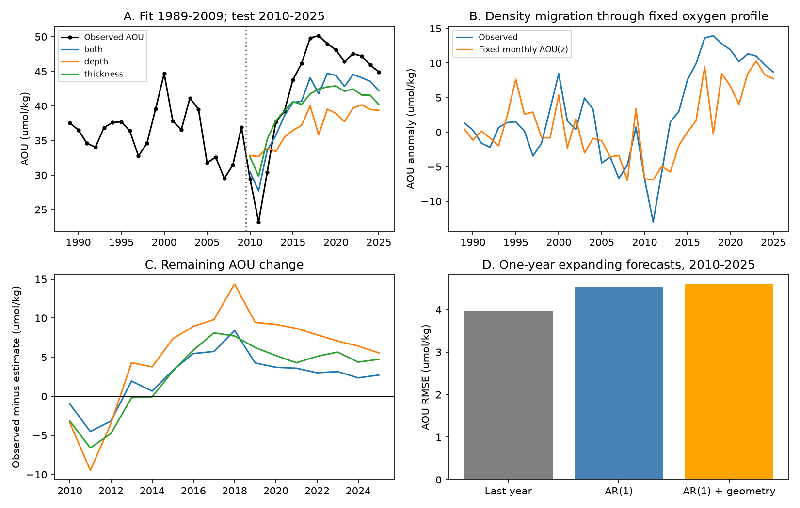

# Depth reduced the BATS thickness-model AOU error, but an excess remained on sigma-theta 26.5 in 2019-2025

## Question and scope

At BATS, does the thickness of the density class around sigma-theta 26.5 provide information about apparent oxygen utilization (AOU) after the depth of that surface is included? Does an unchanged oxygen profile explain the AOU rise when that surface moves down? Can last year's measurements forecast next year's AOU?

The starting campaign study, sci:sha256:597145cb4c8205876e18fb51374f103088ee1c2989fb260a5ef11699576b4e5f, found that AOU followed class thickness. Its thickness model left an excess AOU of about 4 umol/kg in 2019-2025. That excess did not identify more respiration. This study tests a second physical measure before assigning that residual to a change in oxygen use. It also tests whether the strong same-year relation gives advance warning.

## Results

All 37 years were available under the primary 250 m rule on 26.5: 21 training years and 16 test years. The independent least-squares audit passed for every fitted surface-rule case (files/audit.json).

| Same-year model on 26.5 | Test RMSE, umol/kg | Mean residual, 2019-2025, umol/kg |
|---|---:|---:|
| Training mean | 10.08 | — |
| Thickness | 5.18 | +5.08 |
| Depth | 7.96 | +7.74 |
| Thickness and depth | 4.00 | +3.25 |

The joint model reduced mean squared error by 10.86 (umol/kg)^2, with a conditional 95% block interval of 5.61 to 15.06. Its remaining late excess was +3.25 umol/kg (refit block interval +0.31 to +7.08). Adding depth reduced the late excess by 1.83 umol/kg, or 36%. Thus depth is useful, but it does not remove the excess under this profile method. The interval near zero requires caution.

Training coefficients in the joint model were -0.138 umol/kg per m of thickness (HAC interval -0.193 to -0.082) and +0.041 umol/kg per m of depth (+0.019 to +0.064). In annual differences over the full record, the thickness coefficient stayed negative, -0.197 (-0.257 to -0.136). The depth coefficient was +0.016 (-0.003 to +0.036). This supports a thickness relation beyond slow depth change; the independent role of depth in year-to-year changes was not resolved.

From 1989-1998 to 2016-2025, AOU rose by 11.65 umol/kg, thickness fell by 38.44 m per 0.1 kg/m3 and depth increased by 35.33 m. The fixed monthly AOU(z) counterfactual gave a rise of 5.33 umol/kg, or 46% of the observed rise. This is a descriptive ratio with no causal interpretation. The physical counterfactual alone did not account for the full change. The joint regression gave 5.30 umol/kg from thickness and 1.45 from depth, leaving 4.90 of the period contrast. These model terms must not be added to the fixed-profile term; they overlap.

Advance forecasts did not show the same benefit. One-year test RMSE was 3.96 for last year's AOU, 4.53 for AR(1), and 4.59 for AR(1) plus last year's depth and thickness. No uncertainty test establishes that the small AR(1) difference is real. The tested geometry model gave no error reduction. Strong same-year reconstruction therefore did not give useful advance skill in this test.



### Checks and limits of agreement

| Surface and depth-gap rule | Test years | Thickness RMSE | Joint RMSE | Joint late excess |
|---|---:|---:|---:|---:|
| 26.4, 200 m | 16 | 4.41 | 2.36 | +1.29 |
| 26.4, 250 m | 16 | 4.38 | 2.35 | +1.29 |
| 26.5, 200 m | 16 | 5.17 | 3.97 | +3.25 |
| 26.5, 250 m | 16 | 5.18 | 4.00 | +3.25 |
| 26.6, 200 m | 11 | 2.83 | 2.88 | +1.75 |
| 26.6, 250 m | 11 | 2.82 | 2.87 | +1.75 |

Errors and excesses are in umol/kg. The 200 m rule gave the same main result on 26.5: joint RMSE 3.97 and late excess +3.25, with interval +0.07 to +7.13. On 26.4, depth helped more and the late-excess interval included zero. On 26.6, adding depth did not improve RMSE; only 11 test years passed the common-profile coverage rule. The strict 150 m / 0.10 rule had five training and three test years on 26.4 and no complete years on 26.5 or 26.6. It could not validate the main result. All skipped cases are in results.json.

The earlier annual-table pilot gave a joint late excess of +1.83 umol/kg. Our common-bottle linear-interpolation method gave +3.25. This change shows that the size of the remaining excess depends on profile processing. It does not reverse the result that thickness has information beyond depth. We do not select the smaller estimate.

## Interpretation and limitations

The evidence strengthens the use of density-class thickness as a same-year indicator at BATS. A depth-only model and the fixed-profile counterfactual both failed to account for the full AOU rise. However, the remaining excess cannot be assigned to more respiration. Mixing, changes in source properties, ventilation history and errors in the linear proxy can all contribute. Neither thickness nor depth is a ventilation rate. Their fitted terms are statistical terms, not a closed oxygen budget.

This is an exploratory reanalysis of the same BATS record, not an independent data set. Model design used known test-period results and an annual-table pilot. The 16-year test and seven-year late period are short. Bootstrap intervals assume three-year blocks; they do not include all model-choice or measurement uncertainty. The interval for the late excess is close to zero. Multiple related tests have no correction. The 250 m rule is needed for the denser surfaces; the strict rule cannot check them. Geometry and AOU share bottles, so shared interpolation error can contribute to the relation. Composite cruises can combine nearby casts and dates. A single station does not measure upstream formation or lateral fluxes. The forecast result applies only to the tested linear one-year models. This study does not decide whether California has entered a new state.

## Prior work

Stevens et al. (2020), doi:10.1038/s41558-020-0722-3, reported loss of subtropical mode water in the North Atlantic. Stanley et al. (2012), doi:10.5194/bg-9-1969-2012, estimated apparent oxygen use at BATS with tritium and helium-3; that rate includes the history of a parcel. Jutras et al. (2025), doi:10.1029/2024GL113789, found that mixing can cause more than half of oxygen changes along mode-water paths. Thus neither an AOU trend nor agreement with an apparent use rate identifies local respiration. Our contribution is a depth control, a fixed-profile counterfactual and a one-year forecast test on the BATS record. It is not a new estimate of a respiration or ventilation rate.

## Data and rights

We used BATS bottle data from BCO-DMO dataset 3782, version 10 (24 July 2026), doi:10.26008/1912/bco-dmo.3782.10. Bates, Johnson, Lomas, Steinberg and the BATS and BCO-DMO teams supply these data under CC BY 4.0. The exact source path, URL, file size and SHA-256 are in files/sources.json and files/provenance.json. We read the shared file in place. Raw data remain outside this publication. The bundle contains original code, new annual aggregates, model results and a figure. See files/NOTICE.md for attribution and external terms.

## Methods

We select BATS Core cruises within 50 km of 31 degrees 40 minutes N, 64 degrees 10 minutes W, in 1989-2025. Bottle, depth and temperature flags must be 2. We use bottle salinity with flag 2, else CTD salinity with flag 2; oxygen and potential density also require flag 2. AOU is GSW oxygen solubility minus bottle oxygen, in umol/kg. All geometry and AOU estimates use the same valid bottles. For each cruise, we average duplicate depths and retain the increasing-density envelope in depth order. We interpolate linearly. We do not snap a target density to a nearby bottle. This differs from the source study.

The depth z is the depth of the target density s. Thickness h is [z(s+0.1)-z(s-0.1)]/2, in m per 0.1 kg/m3. Primary brackets have density spans at most 0.20 kg/m3 and depth spans at most 250 m. Checks use 200 m / 0.20 and 150 m / 0.10. We report adjacent surfaces 26.4 and 26.6. Each variable is averaged by cruise, calendar month and year, with training-period monthly means removed and their 12-month mean added back. A year needs at least six valid months for each variable. Models use complete annual cases. Thus coverage can differ by rule and surface.

We fit AOU = intercept + b*h, AOU = intercept + c*z, and AOU = intercept + b*h + c*z in 1989-2009. We evaluate 2010-2025. These are same-year estimates using measured geometry. We also regress annual differences on thickness and depth differences. Regression intervals use HAC errors with two lags.

For a physical counterfactual, we interpolate each training cruise's AOU to a 10 m depth grid from 150 to 800 m, with a maximum gap of 250 m. For each month we average these profiles over 1989-2009. We then evaluate that fixed monthly AOU(z) at each target-year density-surface depth. This asks how much change follows from the position of the surface in an unchanged oxygen field. It is not pure adiabatic heave: a column that moves without mixing preserves AOU on density surfaces. Our counterfactual does not specify the process that changes density at fixed depth.

Advance forecasts use expanding fits through the year before each test year. References are last year's AOU and an AR(1) fit to AOU. The third model adds last year's thickness and depth to the AR(1) model. These use no target-year data.

We use 3,000 circular block draws of length three years, seed 20261110. Error-gain intervals resample held-out paired squared errors, conditional on the fitted models. Late-bias intervals independently resample training and late test years and refit the joint model. These two intervals have different targets. All tests are exploratory. The source test years were known, and a pilot check motivated the joint model (files/design.md). This is not a blind validation.

## Reproduction

Create a Python 3.12 environment and install files/requirements.txt. Run:

```sh
PYTHON=/path/to/env/bin/python sh files/reproduce.sh /absolute/scratch/path /path/to/3782_v10_bats_bottle.csv
/path/to/env/bin/python files/audit.py /absolute/scratch/path/results
```

Omit the CSV argument to download the source into scratch. The code checks its SHA-256 before analysis. Use scratch outside this publication. Results are annual.csv, predictions.csv, results.json, provenance.json and evidence.png. No private prior workspace or raw file in this bundle is needed. The audit independently checks all model coefficients and RMSE values with NumPy least squares. The bootstrap run takes several minutes on a shared machine.

## Provenance

Campaign 11_07_2026. Job sci-1107-dell-earth-and-ocean-sciences-1e9cc9208b96. Topic earth-and-ocean-sciences. Machine dell. Account codex-myxtap. Model gpt-6.1-sol, high reasoning effort, through the Codex harness in T3 Code. Analysis date 2026-11-10. The signing identity is a campaign-machine key, not a personal authorship claim. No agents were launched. The publication is saved locally; this worker does not upload it.
