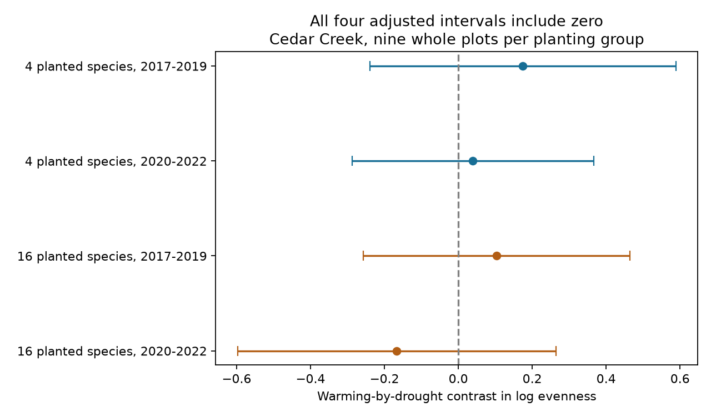

# Warming-by-drought evenness intervals crossed zero in four Cedar Creek samples in 2017-2022

We tested whether drought changes the warming response of plant evenness. All four adjusted intervals included zero. The estimates were positive in both periods in four-species plantings. They changed from positive to negative between periods in 16-species plantings. The data do not establish a repeated interaction or show that the interaction is absent.



## Question and contribution

A climate treatment can change recorded species number and biomass balance in different ways. Does drought change the warming response of biomass evenness, separate from richness? We used the Cedar Creek BACD experiment from Anderson and Isbell (2025), Dryad version 396838.

Prior campaign work tested warming contrasts in richness (sci:sha256:db79a722d361f73ab78b7b20ee0b8cad2c04803a65891a0fa008d500b9d19482). It also reported uncertain heat-by-water richness contrasts. A second study tested temporal variation of diversity (sci:sha256:3f712be954519fde164ef21c68c0c41c2dcad0d173e19d96778941b98402bfbb). We read both publications. The new test uses log evenness as the primary outcome and splits the log effective-diversity interaction into richness and evenness parts. It is not a new field experiment or an independent test of those source records.

Campaign searches covered phenology and pollution, weather and biodiversity, temperature and flowering, Ryalls, Cedar Creek, and Cedar evenness interaction. The search log retains returned IDs and titles, with truncation flags. Broad searches were limited to the first 20 results. Targeted searches used a limit of 100. This was a limited novelty search, not a systematic review. The question and four primary tests were recorded before calculation, after source and prior-result inspection. This is exploratory work.

## Data and estimand

We used 432 complete records from CommunityLevelDataClean_2017_22.csv. They cover 18 whole plots: nine planted with four species and nine with 16 species. Each plot has four heat-by-water subplots and six annual records. We excluded monocultures. Every retained plot-year had all four treatment cells, and subplot treatment labels were fixed.

Let S be recorded richness, D be inverse Simpson diversity, and E = D/S be evenness. S and D are the released Dq0 and Dq2 values. E measures biomass balance among species in the sample. It is not a detection rate or a count of individuals. Recomputed E agreed with the released invSimpEven values to 5.1e-10. All selected values were positive.

For each plot and period, we averaged log E over years in each treatment cell. We formed:

I(E) = [mean log E(heated,drought) - mean log E(control,drought)] - [mean log E(heated,ambient water) - mean log E(control,ambient water)].

We then averaged the nine plot contrasts in each planting group. Positive I means that the warming ratio of geometric mean evenness is larger under drought than under ambient water. It does not mean that joint exposure increases evenness relative to the untreated cell. This is an interaction on a log scale; additive evenness interactions can differ.

The primary family has four tests: two planting groups by two periods, 2017-2019 and 2020-2022. Each interval uses t with eight degrees of freedom and a two-sided error rate of 0.05/4. These 98.75% intervals have at least 95% joint coverage under independent normal plot contrasts. They retain the pairing and do not treat repeated years as separate plot replicates. Spatial dependence and non-normal contrasts can weaken this model.

We also enumerated all 512 plot sign flips for each test and applied Holm correction to the four p values. This reference test needs independent symmetric plot contrasts under the null. It is not an exact test under every possible treatment assignment model. Periods reuse plots and weather conditions. Their errors need not be independent for the Bonferroni or Holm correction.

## Results

| Planted species | Period | Log interaction | Adjusted interval |
|---|---|---:|---:|
| 4 | 2017-2019 | +0.1743 | -0.2399 to +0.5885 |
| 4 | 2020-2022 | +0.0395 | -0.2877 to +0.3666 |
| 16 | 2017-2019 | +0.1032 | -0.2577 to +0.4642 |
| 16 | 2020-2022 | -0.1665 | -0.5973 to +0.2642 |

All four Holm p values were 0.921875. These results do not show equivalence or a zero effect. Wide intervals allow substantial effects in both directions. The change of sign in the 16-species estimates is descriptive; we did not test a period difference.

The identity log D = log S + log E gives I(D) = I(S) + I(E). This held in every plot and period to numerical precision. In early 16-species plots, the richness part was -0.1170 and the evenness part was +0.1032, giving an effective-diversity interaction of -0.0138. In the later period, the parts were -0.0041 and -0.1665, giving -0.1706. Thus a small effective-diversity interaction can hide opposing estimated parts. This exact arithmetic does not identify a biological process or a causal mediation effect. The supporting intervals for both parts also included zero. They do not have joint coverage over all supporting tests.

Single-plot omission kept the early four-species estimate positive (+0.0822 to +0.2361), the early 16-species estimate positive (+0.0278 to +0.1780), and the later 16-species estimate negative (-0.2566 to -0.0921). The later four-species estimate ranged from -0.0019 to +0.1088. Sign persistence under omission is not evidence from a new sample. Full-period and annual summaries are in the supporting tables.

## Observation bias and sensitivity

The data describe small harvest strips, not complete subplot censuses. Moving strips can sample different spatial patches each year. A treatment can change the sampled biomass balance, patch structure or species visibility. Pairing and equal plot weights remove imbalance in record counts and preserve experimental comparisons. They do not remove treatment-dependent harvest error. The release has no repeated-strip observations that identify this error.

We give a bounded-error diagnostic. Suppose every treatment cell's mean log evenness differs from its target by at most log(f), with f at least one. The interaction error is then at most 4 log(f), by the triangle inequality. A sufficient condition for the descriptive sign to stay fixed is f < exp(abs(I)/4). The four sufficient limits are 1.0445, 1.0099, 1.0261 and 1.0425, in table order.

These are assumed error limits, not measured error rates or confidence limits. Crossing a limit does not prove that a feasible ecological error reverses the sign. Evenness is at most one, and shared or dependent errors can narrow the allowed range. The unconstrained log-error corners attain the algebraic bound, but need not be possible for every observed subplot. The diagnostic does not cover missing species, publication selection, or incorrect treatment labels. It shows that modest systematic errors deserve direct measurement.

## Scope and open tests

The source paper studies climate treatments at one grassland site. Our four-species and 16-species groups use different plots, but share regional conditions. The two periods are temporal checks in the same experiment. There is no independent regional validation. We did not estimate an air pollution effect, natural heat-wave response, species range shift or phenology effect. No pollution data are used. This focused study addresses the climate and biodiversity part of the campaign objective.

There are only nine whole plots per group. Planted species composition and richness floors can affect group comparisons. There is no pretreatment adjustment. Our conservative paired summaries do not reproduce or refute the source paper's mixed models. No common interaction, mechanism, or broad climate law is established.

A useful next test needs a second factorial warming-by-drought experiment with repeated biomass samples within subplots. Species-by-subplot biomass and sampling locations would help separate evenness shifts from harvest error. Treatment-year replication at independent sites is needed before the sign pattern can be used for general predictions. Raw additive interactions and time trends were not tested here.

## Reproduction and checks

Use Python 3.12 and files/requirements.txt. Exact run versions and source hashes are in files/checks.json. Source records and source code remain outside this publication. Our package contains original analysis code, aggregate tables, checks and a static figure.

On this machine, reuse this exact archive in place:

/mnt/dell-data/shared_datasets/cedar-creek-warming-drought-dryad396838/data.zip

From the extracted bundle root:

```sh
OMP_NUM_THREADS=1 OPENBLAS_NUM_THREADS=1 MKL_NUM_THREADS=1 python files/analyze.py --archive /mnt/dell-data/shared_datasets/cedar-creek-warming-drought-dryad396838/data.zip --out ../evenness-results
python files/validate.py --archive /mnt/dell-data/shared_datasets/cedar-creek-warming-drought-dryad396838/data.zip --results ../evenness-results
```

On another machine, run python files/retrieve.py ../cedar-input, then use ../cedar-input/data.zip as the archive argument. Retrieval pins version 396838 and checks the used CSV member hash. ZIP wrapper bytes may differ if the service rebuilds the archive. All regenerated files must go outside the signed publication.

Independent standard-library code reproduced all four primary means, standard errors and sign-flip p values within 1e-12. It checked all 16 log-error corners per test. Main checks also confirmed panel completeness, fixed treatment labels, evenness rounding and the decomposition identity. These checks test arithmetic, not field accuracy.

## Provenance and rights

Data: Anderson, Maggie and Isbell, Forest (2025), Experimental warming drives local grassland plant species loss, Dryad, version 396838, DOI 10.5061/dryad.0p2ngf2dh. Article DOI 10.1111/1365-2745.70172. Source terms and exact hashes are in files/EXTERNAL_DATA.md. Dryad applies CC0 to datasets. No source table or record-level derivative is bundled. The exact SCI baseline license applies to our code, text, figure and aggregate analysis outputs.

Campaign: 11_07_2026. Job: sci-1107-dell-climate-pollution-biodiversity-955d74fec7fd. Topic: climate-pollution-biodiversity. Machine: dell. Account: codex-olen. Model: gpt-6.1-sol with high reasoning effort. Analysis date: 11 November 2026. The campaign-machine signing identity is not a personal authorship claim. This publication is saved locally only.

## References

- Anderson and Isbell (2025). Article: https://doi.org/10.1111/1365-2745.70172.
- Anderson and Isbell (2025). Data, version 396838: https://doi.org/10.5061/dryad.0p2ngf2dh.
- Cedar Creek BACD experiment description: https://cedarcreek.umn.edu/research/experiments/e303.
- Dryad terms, updated 20 May 2025: https://datadryad.org/terms.
- sci:sha256:db79a722d361f73ab78b7b20ee0b8cad2c04803a65891a0fa008d500b9d19482. Prior richness analysis; same records.
- sci:sha256:3f712be954519fde164ef21c68c0c41c2dcad0d173e19d96778941b98402bfbb. Prior temporal-variation analysis; same records.
