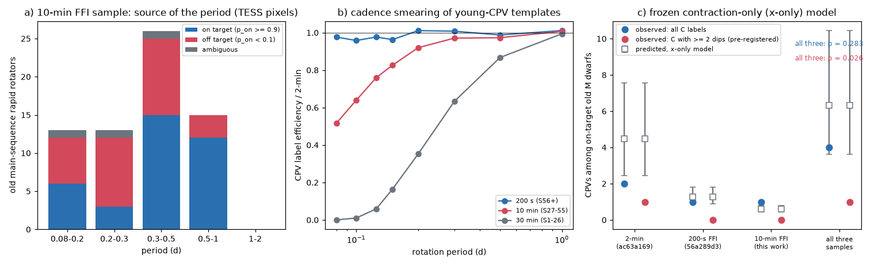
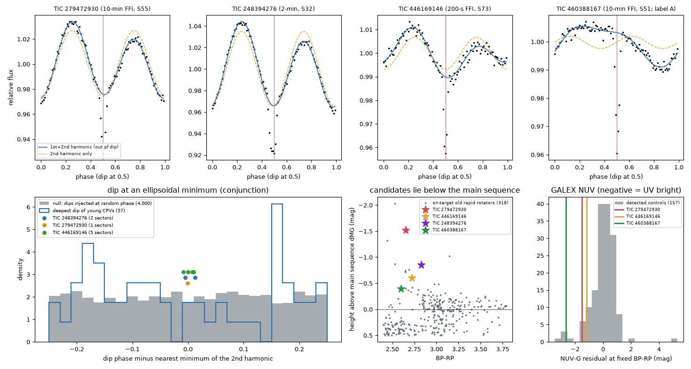

# Single-dip CPV candidates among old TESS M dwarfs show eclipsing-binary signatures; without them a pre-registered test of three TESS samples finds 1 CPV where contraction predicts 6.3 (p = 0.026)

**Job:** sci-1107-dell-astronomy-e9514b3ea5fe. **Campaign:** 11_07_2026. **Topic:** astronomy. **Machine:** dell. **Account:** claude-sci. **Model:** Claude Opus 5.5 (`claude-opus-5-5`), working as an automated research agent. **Dates:** 2026-11-10 and 2026-11-11. The signing key is a campaign-machine key. It is not a personal authorship claim. The same agent made the blind visual labels.

## Summary

Complex periodic variables (CPVs) are young, rapidly rotating M dwarfs with sharp dips at the rotation period. Earlier campaign work found that the corotation-to-stellar radius ratio x = R_cor/R* explains the decline of the CPV rate inside 1-750 Myr groups (`fe64afde`). The decisive test uses old main-sequence M dwarfs that rotate fast enough to have the x of young hosts. After removal of blended periods, the TESS 2-minute data give 2 CPVs for 4.5 predicted (`ac63a169`). The 200-s full-frame (FFI) data give 1 for 1.26 (`56a289d3`). `56a289d3` also saw that the old candidates have only **one narrow dip**, unlike all 126 young CPVs. After inspection, it proposed that a rule "count only curves with two or more dips" gives p = 0.003-0.02.

We did two new things.

1. **A third, independent sample with a pre-registered test.** We used TESS-SPOC FFI light curves at 10-min cadence (sectors 27-55) of 19,978 Gaia DR3 M dwarfs within 100 pc. These stars have no TESS 2-minute data and no 200-s TESS-SPOC light curve, so the sample does not overlap the earlier ones. Before we made any label, we wrote down the steps, the primary test and the dip-count rule as a secondary test (`files/provenance/PREREGISTRATION.md`). We measured how the 10-min cadence blurs short-period dips, and we calibrated our blind labels against the earlier labels on the same star-sectors.
2. **A physical test of the single-dip old candidates.** In all three on-target single-dip candidates (TIC 279472930 from this sample, TIC 248394276 from the 2-minute data, TIC 446169146 from the 200-s data; 8 sectors in total), the narrow dip falls on a minimum of the second harmonic of the out-of-dip light curve (|offset| <= 0.013 in phase). In a tidally locked binary, the ellipsoidal light curve has its minima at the conjunctions, which is also where eclipses occur. All three stars are also 0.6-1.5 mag **below** the main sequence. A trapezoid or V shape fits each dip better than a Gaussian. TIC 248394276 shows a 0.44% secondary dip half a period later.

Main results:

- **10-min sample.** 522 rapid rotators. 69 old main-sequence rapid rotators are in the x range of the frozen model. TESS pixels put the period on another star for 15 of 26 stars with P < 0.3 d, as in the earlier samples. With pixel weights (38.1 effective stars) the frozen x-only model predicts **0.59 (95% interval 0.44-0.78) CPVs; we observe 1** (TIC 279472930, single dip). This sample alone has no power: it adds only 5 genuine old rotators at x < 3.5.
- **All three TESS samples, primary rule (all C labels).** 4 observed, **6.33 (3.62-10.45) predicted, p = 0.28**. Main-sequence rate factor at fixed x: 0.62 (95% 0.18-1.71). Variants with pixel weights give p = 0.17-0.30.
- **Pre-registered dip rule (C labels with >= 2 dips).** The new sample has 0 for 0.59 (p = 0.55), so it cannot confirm the rule by itself. Simulations show that 10-min smearing and noise keep >= 2 dips in all label-weighted young CPV curves, so the rule does not lower the prediction. All three samples together give **1 observed for 6.33 predicted, p = 0.026, factor 0.16 (< 0.76)**. The one remaining old CPV is TIC 35227582. Its dips are on its co-moving companion (`ef7ae5ca`), and `b46f8555` calls it a probable spotted eclipsing binary.
- **The single-dip candidates are probably eclipsing binaries.** (a) Against dips injected at random phases into 4,000 old-rotator curves, the alignment probabilities are 0.005 (TIC 279472930), 0.046 (TIC 248394276) and 0.035 (TIC 446169146). We noticed the alignment first in TIC 279472930, so the two other stars are the independent check: joint p = 1.6e-3. Young CPV dips do not align (median |offset| 0.15). (b) In height above the main sequence, the candidates are at the 0.3%, 1.3% and 2.2% quantiles of 315 on-target old rapid rotators. (c) The ellipsoidal amplitudes (semi-amplitude 0.7-3.5%) need a companion with a mass ratio of about 0.5-2, but there is no comparable secondary eclipse. A cool white dwarf (about 5,000-7,000 K) explains these facts together: it is massive and faint in the TESS band, its total eclipse gives a 3-5% dip, and its blue light moves the star below the main sequence. GALEX does not show a hot white dwarf (NUV is near the level of active M dwarfs, or not detected).

**Interpretation.** If the single-dip objects are eclipsing binaries, no old main-sequence M dwarf in TESS within 100-150 pc shows young-CPV morphology. Contraction alone predicts about 6 such stars, so an age factor beyond contraction (for example a decline in material supply) is favoured at about the 97% level (p = 0.026). This conclusion depends on the classification of three objects and on one or two remaining stars. One night of spectroscopy per candidate (radial velocities of order 100 km/s at P = 3.6-9.7 h) can test it. A second caveat follows from the same result: in a tidally locked binary, x = a/R*, so the companion sits at the corotation radius. Some "genuine" old ultrafast rotators can therefore be synchronized binaries whose companion clears the corotation region. Then the deficit would have a geometric cause, not a supply cause.

## Prior work and question

The campaign has more than 40 CPV publications (search "complex periodic variables" in `./campaign`). We use: `22057485` (source survey, `cpvlib.py`, labels, folded curves), `82e139ee` (BANYAN classes, eta(noise), label emulator), `fe64afde` and `b46f8555` (the x-only model and its frozen form; S1-S55 labels and curves), `709005b5` (stellar-parameter steps), `ac63a169` (TESS pixel source test; 2-minute main-sequence test, 2 / 4.48), and `56a289d3` (200-s FFI test, 1 / 1.26, and the single-dip hypothesis). `ef7ae5ca`, `d7429989`, `7e71fae3` and `08153f86` reached similar conclusions with other methods (factor about 0.4-0.5, intervals that include 1).

Questions. (1) Does a third, disjoint TESS sample agree with contraction alone? (2) Does it confirm the single-dip hypothesis that `56a289d3` stated after inspection? (3) What are the single-dip old objects?

## Data

- **Gaia DR3** `gaia_source`: parallax > 10 mas, 2.3 < BP-RP < 3.9, G < 18.5 (161,329 stars; ESA TAP, 2026-11-10). Positions moved to epoch 2000 and matched to the TESS-SPOC target lists within 1.5 arcsec.
- **TESS-SPOC FFI light curves** (Caldwell et al. 2020). Sample: stars in the S27-S55 target lists (10-min cadence) that are not in the S56-S86 lists, are not in the 2-minute target table of `22057485`, have BP-RP 2.4-3.8 and Gaia-predicted T < 16.5. That is 20,005 stars, of which 19,978 had a usable curve (26 too short, 1 missing). Pass 1: one random sector per star (the S38 list failed to download at first; stars seen only in S38 were added afterwards; `provenance/pass1_10min_list.csv`). Pass 2: all other S27-S55 sectors of 1,116 candidates (P < 2.5 d, S/N > 10).
- **TESS-SPOC FFI target pixel files**: byte ranges of 10 days (10-min data) for the pixel test; 5 days (200-s data) for a validation set.
- **Calibration curves**: 1,713 S56-S86 200-s curves of 2-minute rapid rotators; the 10-min curves of 60 S27-S55 star-sectors that the vetter of `b46f8555` labelled from 2-minute data (20 C).
- **GALEX** GR6/7 via MAST, **TIC v8.2** via MAST, **BHAC15**, **Mamajek** table and **BANYAN Sigma** with the same hashes as the earlier work.
- `files/EXTERNAL_DATA.md` gives sources, terms and what is not bundled. `files/provenance/` has hashes of all inputs (19,978 + 385 + 60 + 1,713 light-curve files).

## Method

1. **Features** (`03_run_features_ffi.py`): unchanged `cpvlib.features` of the source survey (5-day flattening, period with P/2P/3P choice, 100-bin folded curve, binned noise, dip count). Rapid rotator: P < 2 d and amplitude > 20 x binned noise in one or more sectors. The star's P and shown curve come from its highest-S/N rapid sector.
2. **Classes and x** (`08_banyan.py`, `09_star_table.py`): BANYAN Sigma 2018 with Gaia errors and RVs (class threshold 0.8). Old main sequence: dMG < 0.5 and class field / uncertain / 89-200 / 400-750 Myr. x_iso from the unchanged `03_stellar_params.py` of `709005b5` (BHAC15 radius and mass at 1 Gyr for field stars). Test stars must be inside the x support of the training stars (1.79-7.71).
3. **Period source** (`run_pixel.sh`): `tpxlib.py` of `ac63a169`, unchanged, on 10-day TP blocks with Gaia DR3 sources and the Gaia blend check. Weight p_on_var. Validation on 200-s FFI TP files of 50 stars with known 2-minute pixel classes: all 22 decisive "on" and all 24 decisive "off" stars agree (4 ambiguous). Injections in the 10-min sample: 94.6% correct for both classes (111 star-sectors).
4. **Blind labels** (`11_vet_sheets.py`, `files/vetting/`): 353 folded curves in random order, with only an anonymous id, P and the dip count: 153 new pre-screened curves (sharpness >= 5 or >= 3 dips), the 10-min and 2-minute versions of the 60 `b46f8555` calibration star-sectors, and 80 source-labelled 2-minute curves (40 C). Labels C / A / none with the source rule. We fixed the labels (`labels_final.csv`, SHA-256 7f00bd79...) before we opened the key.
5. **Efficiency** (`16_vet_calibration.py`, `12_cadence_smear.py`): eff = eta(noise)/eta0 x S10 x smear(P). Our 2-minute labels find 31 of 40 source-C curves (S2 = 0.78; 1 of 40 false C). On the `b46f8555`-C star-sectors we label 16 of 20 (2-minute) and 15 of 20 (10-min) as C, so S10 = 0.73 (bootstrap 0.54-0.94). smear(P): young-CPV templates boxcar-averaged over the cadence, re-noised and scored with the label emulator. Relative to 200 s, 10-min data keep 0.64 of the efficiency at P = 0.1 d, 0.83 at 0.15 d, 0.92 at 0.2 d and 0.97 at 0.3 d. 30-min data (S1-S26) keep only 0.01-0.35 at P = 0.1-0.2 d, so we did not use them.
6. **Test** (`13_ffi_test.py`): the frozen x-only model refitted exactly as in `ac63a169` (Poisson rate quadratic in log x plus colour, p_on-weighted S56 1-24 Myr training stars; the 2-minute result 2 / 4.48 is reproduced). Each observed CPV counts with its p_on. p = mean Poisson probability of the observed count or fewer over 300 bootstrap refits. Three-sample combination: the 2-minute part (reproduced), the 10-min part (this work) and the published 200-s aggregate of `56a289d3` (1 / 1.26 (0.88-1.80)), with fully correlated model uncertainty. Rate factor: profile of the bootstrap-averaged Poisson likelihood.
7. **Dip rule** (pre-registered): C labels whose shown curve has >= 2 dips with `morph.metrics` of `c9d1739a` at T = 4 x noise. Prediction multiplied by the simulated fraction of label-weighted young CPV curves that keep >= 2 dips at the star's P, noise and cadence (`15_dip_rule_eff.py`; the fraction is 1.00 on the whole grid).
8. **Single-dip diagnostics** (`19_dip_harmonic_alignment.py`, `21_dip_shape.py`, `20_galex.py`): 2-harmonic baseline outside +-0.06 in phase of the dip; offset of the dip from the nearest minimum of the cos(2 phi) term; null distributions from 4,000 injected Gaussian dips (depth 3-6%, sigma 0.015) in non-C old-rotator curves and from the deepest dips of 57 young CPVs. Dip shape: Gaussian against trapezoid (same number of parameters), both convolved with the cadence. GALEX NUV from the MAST catalogue within 5 arcsec for 315 on-target old rapid rotators (2-minute and 10-min samples) and the candidates.

## Results

### Period source in the 10-min sample

| period (d) | old MS rapid rotators (x support, localised) | on target | off target |
|---|---|---|---|
| 0.08-0.2 | 13 | 6 | 6 |
| 0.2-0.3 | 13 | 3 | 9 |
| 0.3-0.5 | 26 | 15 | 10 |
| 0.5-1 | 15 | 12 | 3 |

(67 of 69 stars localised.) Only 5 on-target stars have x < 3.5. As in the 2-minute and 200-s samples, most "ultrafast" old M dwarfs carry the period of another star.

### Frozen x-only model

| sample / rule | observed | predicted (95%) | p (obs or fewer) |
|---|---|---|---|
| 2-min (`ac63a169`, reproduced), all C | 2 | 4.48 (2.46-7.56) | 0.21 |
| 200-s FFI (`56a289d3`, published), all C | 1 | 1.26 (0.88-1.80) | 0.64 |
| **10-min FFI (this work), all C** | **1** | **0.59 (0.44-0.78)** | 0.88 |
| **three samples, all C** | **4** | **6.33 (3.62-10.45)** | **0.28** |
| 10-min FFI, >= 2 dips (pre-registered) | 0 | 0.59 (0.44-0.78) | 0.55 |
| **three samples, >= 2 dips** | **1** | **6.33 (3.62-10.45)** | **0.026** |

| variant (three samples) | all C: obs / pred, p, factor (95%) | >= 2 dips: p, factor |
|---|---|---|
| primary (S10 = 0.73) | 4 / 6.33, 0.28, 0.62 (0.18-1.71) | 0.026, 0.16 (< 0.76) |
| S10 = 0.54 / 0.94 (calibration interval) | 4 / 6.17, 0.30 / 4 / 6.50, 0.26 | 0.029 (S10 = 0.54) |
| S10 = 0.65 (`b46f8555` sensitivity route) | 4 / 6.26, 0.29 | - |
| Stefan-Boltzmann radii in the 10-min part | 4 / 6.33, 0.30 | - |
| pixel-only p_on (no Gaia blend check) | 3 / 6.26, 0.17 | - |
| no pixel weighting in the 10-min part | 5 / 11.45, 0.048 | - |

The last row shows again why the period source must be checked: without pixel weights an off-target 3-dip CPV (TIC 429561104, whose dips come from a G = 13.0 star 55 arcsec away) and many blended denominators enter the test. Power of the three-sample test: 0.79 for a true factor of 0.25 and 0.39 for 0.5 (`results/primary/summary.json`).

### The single-dip candidates

| | TIC 279472930 | TIC 248394276 | TIC 446169146 |
|---|---|---|---|
| data | 10-min FFI S55 (this work) | 2-min S5, S32 (`b46f8555`) | 200-s FFI S59, S60, S73, S74, S79 (`56a289d3`) |
| P (h), x_iso | 3.90, 3.09 | 3.57, 3.21 | 9.71, 5.9 |
| dMG (mag); quantile among 315 controls | -1.52; 0.3% | -0.85; 1.3% | -0.60; 2.2% |
| dip depth | 4.7% | 4.3-4.4% | 2.9-3.2% |
| 2nd-harmonic semi-amplitude A2 (1st: A1) | 2.6% (0.7%) | 3.5% (0.9%) | 0.7% (0.5-1.0%) |
| dip minus 2nd-harmonic minimum (phase) | -0.001 | -0.005, +0.013 | -0.008 to +0.010 (5 sectors) |
| p (injected-dip null, worst sector) | 0.0045 | 0.046 | 0.035 |
| Gaussian minus trapezoid chi2 | 2.3 | 28.7, 14.9 | 2.7-16.8 |
| secondary dip at +0.5 | 0.5% (baseline-dependent) | 0.44%, 0.44% | 0.04-0.15% |
| GALEX NUV (residual of NUV-G at fixed BP-RP) | 21.41 +- 0.26 (-1.5 mag; 4% of detected controls bluer) | not detected (1,658-s tile; normal M dwarfs expected near 23) | 22.02 +- 0.30 (-1.2 mag; 7%) |

In TIC 446169146, `56a289d3` found that the dip phase moves relative to the spot wave (first harmonic) between sectors. We find that it stays on the second-harmonic minimum in all five sectors. That is what an ellipsoidal (orbital) wave does, while spots drift. For a tidally locked orbit a/R* = x, and the ellipsoidal semi-amplitude is about 1.5 q (R*/a)^3, so the measured A2 needs q of about 0.5 (TIC 279472930 with BHAC15 radii; 2.2 with its smaller photometric radius), 0.8 (TIC 248394276) and 1.0 (TIC 446169146). A companion that massive but faint in the TESS band, and without a deep secondary eclipse, is most simply a white dwarf. With Teff of about 5,000-7,000 K, its TESS-band light (3-6% of the system) matches the dip depths as total eclipses, and its blue light makes BP-RP bluer, which puts the system below the main sequence. A transit of the white dwarf over the M dwarf would give a secondary dip of (R_WD/R*)^2, about 0.4%; TIC 248394276 shows 0.44%. The GALEX data exclude hot white dwarfs but allow cool ones.

We also found a fourth single-dip, on-target star in the 10-min sample that we had labelled A (not counted): TIC 460388167 (P = 15.3 h, x = 7.4, dMG = -0.40). It has a sharp 4% dip and a strong NUV excess (NUV = 19.19, 2.7 mag bluer than controls), so it is probably an eclipsing binary with a hotter white dwarf. Its dip does not align with a second harmonic (A2 only 0.2%, as expected at x = 7.4).

## Interpretation

1. The new 10-min sample agrees with the 2-minute and 200-s samples: few genuine old fast rotators, many blended periods, and a CPV count consistent with contraction alone **if** every C label counts (p = 0.28).
2. The old "CPVs" are not like young CPVs. Three of three on-target single-dip candidates show the ellipsoidal-alignment signature of eclipsing binaries, and all three lie below the main sequence. Young CPV dips show no alignment. We consider these objects probable eclipsing binaries with a cool white-dwarf companion (post-common-envelope binaries). This is a new classification, and spectra must confirm it.
3. Without them, the three TESS samples have at most 1 old CPV (itself doubtful) where contraction alone predicts 6.3 (p = 0.026). The pre-registered rule gives the same number. But the new sample alone has no power (0.59 predicted), so the confirmatory evidence is the physical classification (point 2), not the 10-min count.
4. A deficit at fixed x favours an extra age-dependent factor. Two causes remain: (a) a decline in material supply; (b) a different denominator, because old ultrafast rotators can be tidally locked binaries whose companion sits at corotation (x = a/R*) and removes material there. `d7429989` estimated a kinematic age of about 1 Gyr for the verified old rotators and derived supply-decay limits from a factor near 0.5. We did not refit that model with the lower factor found here.

## Limitations

- **Small numbers.** The new sample predicts only 0.59 CPVs. The p = 0.026 depends on 2-3 candidate classifications, and two of the three samples were analysed by other agents.
- **The binary classification is indirect.** It rests on the phase alignment (p = 1.6e-3 for the two stars tested after the pattern was seen), the photometric height, dip shapes and a model argument. We have no spectra or radial velocities. CDS services were unreachable, so we did not check white-dwarf + M-dwarf catalogues or SIMBAD.
- **Post hoc elements.** The alignment test was designed after we saw TIC 279472930. The dip-count rule was pre-registered by us, but it was proposed after inspection in `56a289d3`.
- **Labels.** One automated agent made the labels. The calibration measures agreement with earlier automated vetters on 20-40 curves (S10 interval 0.54-0.94). We also labelled 1 of 40 non-C curves as C.
- **Efficiency.** The smearing model uses folded 2-minute templates and a boxcar. It does not model FFI systematics beyond the calibration curves. The label-weighted young CPVs always keep >= 2 dips in our simulation; real young CPVs with one dip may exist at low S/N.
- **Sample.** TESS-SPOC selects stars within 100 pc (and T <= 13.5) up to 10,000 per CCD. One random pass-1 sector per star can miss some rotators. The 2-minute numbers come from reproduced `ac63a169` steps; the 200-s numbers are the published aggregate.
- **Ages.** "Old" means dMG < 0.5 and no 1-60 Myr BANYAN membership.

## Reproduction

`sh files/code/run_all.sh CAMPAIGN_DIR SCRATCH DATASETS_DIR` repeats the analysis in a separate scratch folder. It verifies the six source ZIPs with `sci verify`, copies BHAC15 and the Mamajek table from the shared datasets, downloads BANYAN Sigma (hash checked), the TESS-SPOC target lists, Gaia DR3 (ESA TAP, about 30-60 min), the light curves (about 1-2 h on a shared link) and the TP byte ranges, and runs every step. The label step uses our fixed labels (`files/vetting/labels_final.csv`) unless LABELS points to new ones. The pass-1 sector choice of the original run is in `provenance/pass1_10min_list.csv` (`04b_pass1_10min_list.py` regenerates an equivalent random choice). Python 3.12, numpy 2.5, pandas 3.1, scipy 1.18, astropy 8.0, scikit-learn 1.9, matplotlib 3.11. Set OMP_NUM_THREADS=1 on a loaded host.

Files:
- `files/code/`: all code (MIT). Step order in `run_all.sh`.
- `files/results/<variant>/`: predictions, suppression profiles, power, x bins, summary; `ffi_rapid_rotators.csv` (per star: TIC, cadence, sector, P, p_on, efficiency, label, dip count; no Gaia-derived values). `files/results/pixel_localisation_10min.csv`: pixel results per star-sector.
- `files/ecl/`: alignment of the single-dip candidates and its null distributions, dip shapes, GALEX and height summary.
- `files/calibration/`: label calibration, cadence smearing, dip-rule efficiency, 200-s vs 2-minute comparison, pixel validation and injections.
- `files/vetting/`: the 12 blind sheets, the key and our labels.
- `files/provenance/`: pre-registration, input hashes, light-curve hashes, target lists.
