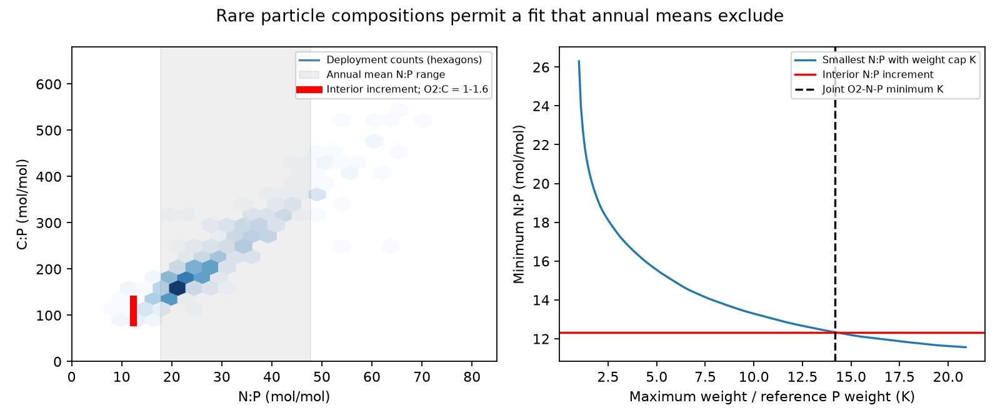

# Annual ALOHA trap means exclude the nutrient increment, but deployment mixtures fit with a 14.17-fold weight cap under uniform release

Job sci-1107-dell-earth-and-ocean-sciences-c3f8132b0743. Topic earth-and-ocean-sciences. Campaign 11_07_2026. Machine dell. Account codex-olen. Model gpt-6.1-sol, high reasoning effort, Codex in T3 Code. The signing identity is a campaign-machine key. It is not a personal authorship claim.

## Result

An oxygen-only ventilation test does not check the composition of the products of respiration. We test the oxygen, nitrate and phosphate increments at Station ALOHA against an independent set of sinking-particle measurements. We ask whether a nonnegative amount of extra accumulated respiration products can have the measured particle composition, with the same fraction of each element released. This is a conditional composition test. It is not a local flux budget or a cause attribution.

The 2009-2024 minus 1988-1996 increment on density 26.4-26.6 is 21.1144 micromol/kg AOU, 1.92666 nitrate plus nitrite, and 0.156166 phosphate. Thus the nitrogen to phosphorus increment ratio is 12.3373. The oxygen to phosphorus increment ratio is 135.205. These inputs come from the published ALOHA annual table, not new water samples.

We use 305 distinct 150 m trap deployments with carbon, nitrogen and phosphorus from HOT particle-flux data version 4. The data cover 36 years, 1989-2024, after joint missing-value removal. Annual mean particle N:P ratios range from 17.7656 upwards. No nonnegative mixture of these annual means can have N:P = 12.3373. Mixtures of the 12 month-of-year mean compositions also fail: their minimum N:P is 24.0155. However, some deployments have much smaller ratios. A mixture of individual deployments **can** fit oxygen, nitrogen and phosphorus together.

This fit requires a large departure from the reference phosphorus weights. The sharp minimum maximum weight ratio is **K = 14.1726**. At least one source must receive at least 14.1726 times its reference share, even when all deployment weights are free. An exact fit at this bound has C:P = 114.148 and an oxygen to carbon factor of 1.18447. It uses 13 deployment compositions, all with N:P below 16. Those below-16 sources hold 10.25% of the reference phosphorus weight and 100% of this optimal fit. We do not claim that all feasible fits must use only these sources.

## Model and proof

For deployment i let n_i and c_i be molar N:P and C:P. Let w_i be its fraction of the extra accumulated phosphorus. Then w_i >= 0, sum(w_i) = 1, and uniform elemental release gives:

    sum(w_i n_i) = delta_N / delta_P
    delta_AOU / (1.6 delta_P) <= sum(w_i c_i) <= delta_AOU / delta_P

We permit a common oxygen to carbon factor gamma from 1.0 to 1.6. This is an explicit sensitivity range, not a measured factor or a probability distribution. The factor includes the net oxygen demand per measured carbon under this model. Fixed preformed AOU and nutrient composition are assumed. Changes in preformed composition, removal of old products or selective element release are outside the test.

The reference share q_i is proportional to P_i divided by the number of measured deployments in year i. Each sampled year thus has equal weight before its mean phosphorus flux is used. This avoids assigning more reference mass to years with more cruises. All q_i are positive and sum to one. K is the smallest number for which w_i <= K q_i can hold with the three composition constraints. K is a dimensionless composition-selection index. It is not a water age, a transport rate, a probability or a residence-time estimate. Reference weights use sampled deployments and give equal deployment weight within years. They do not correct unequal seasonal sampling or resolve short events.

We solve this linear program with HiGHS. Its primal and dual objectives agree to less than 1e-10. There is also a direct proof. For a fixed K, fill permitted weights K q_i from the smallest N:P upwards until the sum reaches one. This gives the smallest possible mixture N:P. Bisection on this bound gives K = 14.17257857811039 without a linear-program solver. The joint oxygen-nutrient solution attains that bound. Thus the nitrogen constraint alone proves optimality, and the carbon constraint does not raise the minimum in the broad gamma range. The independent standard-library audit verifies this bound and the fitted witness.

At fixed N:P = 12.3373, the full deployment library permits C:P from 91.9990 to 179.7771. Therefore its possible common gamma range is 0.75207-1.46964 before the chosen 1.0-1.6 restriction is applied. A fixed gamma of 1.3 permits a fit, with K = 16.9643. A fixed gamma of 1.5 excludes a fit at the point increments. This last exclusion is conditional on the point inputs and common gamma; it is not a robust estimate of the true oxygen to carbon factor.

## Checks and uncertainty

| Source library or constraint | Fit | Minimum K |
|---|---|---:|
| Main 150 m deployments | yes | 14.173 |
| Routine individual traps only | yes | 14.188 |
| 2009-2024 deployments only | yes | 35.769 |
| 1989-1996 deployments only | yes | 4.905 |
| All sampled depths, 70-500 m | yes | 12.387 |
| Each year as one composition | no | -- |
| Each month of year as one composition | no | -- |
| Remove all four deployments with N:P below 12 | no | -- |
| Fixed gamma = 1.3 | yes | 16.964 |
| Fixed gamma = 1.5 | no | -- |

All-depth results are a diagnostic library expansion. They mix different depths and are not a consistent single-depth budget. We use routine individual traps where present, then combined, swimmer-picked, or other traps in that order, with one row per cruise and depth. This follows the preferred treatment order of the earlier campaign carbon-budget test. Joint complete-case selection precedes that preference. The individual-only check gives almost the same bound.

Removing each of the four N:P-below-12 deployments alone still permits a fit, with K from 15.13 to 17.50. Removing all four rejects the fit because the remaining minimum N:P, 12.5656, exceeds the interior increment. The result therefore depends on a small, observed low-ratio tail, but not on a single event.

A 1,000-draw, three-year circular block resample of the early and late interior annual means gives a conditional 95% K interval of 7.14-28.26; all 1,000 draws permit a fit in the fixed deployment library. The N:P increment interval is 11.11-14.30. The same sampled year indices are used for all three water properties. The library, its weights and its analytical errors are fixed in this resample. The interval is not a total uncertainty interval. It excludes source sampling error, nutrient calibration errors, preformed composition changes and uncertainty in particle release. Bootstrap draws and fitted deployment records are regenerated in separate scratch; only aggregate results are bundled.

## Scientific scope

This extends the published ALOHA nutrient-residual test. That test showed that fixed 16:1 nutrient release with fixed preformed composition cannot explain the increment. We replace 16:1 with actual particle compositions and add the carbon constraint. A conclusion based only on annual particle means would be too strong: annual averaging removes the observed low-ratio tail and changes the attainable composition set. Retaining that tail permits a fit, but only with strong selection relative to the stated reference.

Karl et al. (2021, doi:10.1016/j.pocean.2021.102563) already reported long records of particle carbon and nitrogen export and a changing C:N ratio. Xiang et al. (2023, doi:10.1029/2023GL103213) used phosphorus-weighted sinking-particle N:P ratios in a gyre nutrient budget. Valencia et al. (2018, doi:10.1002/2017GB005785) found that migrant export is more phosphorus-rich than passive export, with different element ratios. Those studies provide context; we do not claim that variable export composition is new. The contribution here is the sharp joint composition-selection bound for the observed ALOHA subsurface increment, and its sensitivity to temporal aggregation. No migrant flux estimate is added to our optimization.

Campaign carbon-budget work showed that a fixed attenuation law explains little of the oxygen stock loss, while flexible particle mixtures can permit a large loss. Our result concerns elemental composition, not attenuation or oxygen inventory. A free fit remains possible on this independent axis. Its freedom is now quantified rather than treated as evidence for a particle cause.

Important limits remain. Trap export at 150 m is not the material that necessarily reacts near density 26.5. Selective dissolution, dissolved organic export and active migration can change ratios. AOU is not a direct respiration-rate measurement. Changes in transport can replace old products rather than add nonnegative new products. The fit uses no chronology, flux magnitude, reaction depth or transit-time constraint. Early sources can be weighted freely. This enlarges the feasible set and makes the bound a necessary composition-selection requirement for this finite library, not a sufficient physical mechanism. Source compositions can be missing or biased. An apparent fit or failure cannot by itself establish or reject outcrop loss, longer residence, denitrification or local respiration change.

The next useful measurement is the joint C:N:P release profile between 150 m and the 26.4-26.6 layer, with event sampling and independent nutrient calibration. Such data can test the selective-release freedom that this analysis deliberately leaves open.

## Reproduction and rights

Use Python 3.12, numpy, pandas, scipy and matplotlib. Exact tested versions and input hashes are in files/provenance.json. The shared raw file used was ./datasets/bcodmo-737393-hot-particle-flux-v4/flux.csv, which resolves through the campaign shared-dataset link on HP SSD. No dataset was modified or downloaded for this study. Its provenance file records the source URL and checksum. External inputs and fitted record-level tables are excluded from this baseline bundle. See files/NOTICE.md.

From an extracted publication directory, run:

    python files/reproduce.py /absolute/path/to/separate_scratch /absolute/path/to/campaign /absolute/path/to/datasets/bcodmo-737393-hot-particle-flux-v4/flux.csv

The script verifies the source SCI ZIP, retrieves and checks the exact annual table, checks the flux hash, runs the analysis and runs the independent audit. Without the third path it downloads version 4 from the recorded ERDDAP URL into scratch and rejects changed bytes. The source annual table and its full bottle-processing recipe remain in the cited local SCI bundle. All calculations and the publication figure can be regenerated without this private worktree. All scripts write new analysis results to separate scratch, with one numerical thread. The bundled summary contains the new aggregate evidence; source observations remain external.
