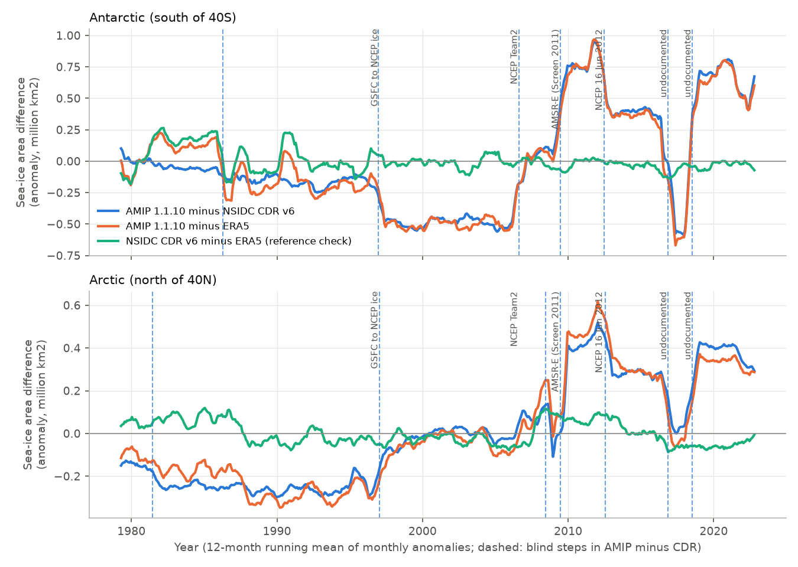

# The AMIP sea-ice forcing of CMIP6 and CMIP7 has NCEP input steps: after 2009 it adds about 1 million km2 of Antarctic ice and makes the 1979-2022 Arctic ice-area decline about 40% too slow; with 11 AMIP models as a check, this biases AMIP historical feedback estimates by about -0.2 W m-2 K-1

## Summary

Earlier campaign work found step artifacts in the **sea surface temperature (SST)** part of the AMIP boundary conditions (PCMDI-AMIP 1.1.x, from NOAA OI SST v2 after November 1981). These steps change pattern-effect and feedback estimates. The **sea-ice concentration** (`siconc`) part of the same forcing was not examined. Sea ice controls surface albedo and air-sea heat flux. Thus errors in it go directly into the radiation of AMIP runs.

We compared AMIP 1.1.9 (CMIP6Plus) and 1.1.10 (CMIP7) `siconc` with two independent sea-ice records: the NOAA/NSIDC passive-microwave Climate Data Record (CDR) version 6 and ERA5 (whose sea ice after September 2007 comes from OSTIA/EUMETSAT OSI SAF). We put all products on one 1-degree mask (13,402 ocean cells poleward of 40 degrees). We searched the monthly differences for steps without date information (optimal partitioning, penalty from autocorrelated null simulations). Then we calculated the consequences for sea-ice trends and for top-of-atmosphere (TOA) shortwave radiation, with two radiative kernels. Last, we checked the kernel emulation against the actual TOA shortwave of 11 CMIP6 `amip` model runs.

Main results:

1. **The AMIP sea ice is the NOAA OI v2 sea ice, with its source changes.** AMIP `siconc` equals OI v2 `icec` after 1981 (mean absolute difference 0.003). It is the same in 1.1.9 and 1.1.10, except December 2022, which 1.1.10 corrects. Thus every AMIP run from CMIP6 (1.1.3-1.1.6) to CMIP7 (1.1.10) uses this ice.
2. **Blind search: the AMIP-minus-CDR difference has steps at the dates of NCEP input changes.** In the Antarctic, the steps are 1996-12, 2006-08, 2009-06, 2012-06, 2016-11 and 2018-07 (plus 1986-04, which is a reference step, see item 4). Four occur within 1 month of documented changes: GSFC-to-NCEP ice in January 1997 (Reynolds et al. 2002), the NCEP NASA-Team-to-Team2 change in August 2006 and the 16 June 2012 NCEP implementation (Grumbine 2012, NCEP technical note 321), and the SSM/I-to-AMSR-E change in mid-2009 (Screen 2011). With 7 random step months, the expected number of such matches is about 0.2. The Arctic difference has steps at almost the same months (1997-01, 2009-06, 2012-07, 2016-11, 2018-07). We found no documentation for the November 2016 and July 2018 changes.
3. **Size.** Antarctic steps in AMIP minus CDR (million km2 of sea-ice area; annual / October-January mean): 2006-08 +0.53 / +0.62; 2009-06 +0.77 / +1.12; 2012-06 -0.43 / -0.53; 2016-11 -0.94 / -1.37; 2018-07 +1.22 / +1.54. Relative to the NCEP Team1 period (1997-01 to 2006-07), the AMIP forcing has +1.31 / +1.73 million km2 more Antarctic ice in 2009-06 to 2012-05, +0.88 / +1.20 in 2012-06 to 2016-10, -0.06 / -0.17 in 2016-11 to 2018-06 and +1.15 / +1.37 in 2018-07 to 2022-12. The mean Antarctic sea-ice area on the mask is 8.3 million km2. In October-January of 2009-2016, the extra ice is +0.53 million km2 where the CDR shows open water (concentration below 15%), +0.53 at the ice edge (15-80%) and only +0.20 in the pack. Thus the forcing moves the spring and summer ice edge into open water.
4. **The two references agree with each other.** CDR minus ERA5 has no Antarctic step after 1991-04 except +0.016 million km2 at 2007-04 (the ERA5 change from HadISST2 to OSTIA). In the Arctic its steps are at most 0.11 million km2. Before 1992 the references differ by 0.1-0.4 million km2 (sensor and reference changes), so the 1986-04 Antarctic step is a reference step. HadISST1 has the same 1997, 2009, 2012, 2016 and 2018 steps as AMIP (it also takes NCEP ice).
5. **Consequence for sea-ice trends in the forcing.** Antarctic sea-ice area trend (million km2 per decade), AMIP / CDR / ERA5: annual 1979-2014 +0.32 / +0.21 / +0.24; October-December 1979-2014 +0.49 / +0.19 / +0.25; annual 1979-2022 +0.18 / +0.03 / +0.05; October-December 1979-2022 +0.27 / -0.05 / -0.00. The AMIP Antarctic extent trend for 1979-2022 is +0.22, against +0.02 in the CDR on our mask and +0.02 in the NSIDC Sea Ice Index. Arctic annual sea-ice area trend: AMIP -0.22 / -0.23 (1979-2014 / 1979-2022), CDR -0.40 / -0.40, ERA5 -0.39 / -0.38. The AMIP Arctic decline is 40-43% too slow.
6. **Radiative effect (kernel emulation).** With the CAM5 and HadGEM3-GA7.1 surface-albedo kernels and an ice-minus-water albedo contrast of 0.5 per unit concentration, the Antarctic steps change the global-mean annual TOA net shortwave by -0.07 to -0.09 W m-2 (2009-06), +0.08 to +0.11 (2016-11) and -0.10 to -0.13 (2018-07). The Arctic 2009-06 step adds -0.06 to -0.08 W m-2.
7. **AMIP models confirm the effect and its size.** In 11 CMIP6 `amip` runs (1979-2014), we regressed the monthly TOA reflected shortwave poleward of 50S (September-March) on two kernel emulations: one of the artifact (AMIP minus CDR) and one of the real ice variability (CDR). The model response to the artifact is 0.94 to 1.87 times the CAM5 emulation (median 1.36; standard errors 0.15-0.35); for the HadGEM3 kernel it is 1.24-2.54 (median 1.84). Thus all 11 models respond to the spurious ice, and the kernel estimate is conservative. In October-January, the models reflect 0.23-0.55 W m-2 (global-mean equivalent, median 0.36) more in 2009-2013 than in 1997-2008. The emulation of the artifact gives 0.26 and of the real ice change 0.06.
8. **Consequence for feedback and TOA trend estimates.** With the model-calibrated Antarctic response (median ratio; the Arctic stays kernel-only), the artifact adds a TOA trend of -0.035 to -0.043 W m-2 per decade in 1979-2014, -0.08 to -0.09 in 2001-2022 and -0.18 to -0.19 in 2001-2014 (ranges over references and kernels; over models -0.03 to -0.25 in all windows). Its regression on Berkeley Earth global-mean temperature gives a bias of an AMIP (amip-piForcing type) feedback estimate of -0.16 to -0.20 W m-2 K-1 for 1979-2014 (model range -0.13 to -0.24) and -0.17 to -0.21 for 1979-2022 (model range -0.13 to -0.25). Per K of 60S-60N SST it is -0.20 to -0.27 (1979-2014). The bias is negative: the forcing has too little Arctic ice loss and too much Antarctic ice gain, so AMIP runs absorb less extra sunlight as the world warms.

Consequence: AMIP-based historical feedback estimates (amip-piForcing) are too negative by about 0.2 W m-2 K-1 because of the sea-ice forcing alone. This is the same sign as the "pattern effect" that these runs are used to measure, and it is of the same order as the SST-forcing artifacts found earlier in the campaign (0.07-0.17 W m-2 K-1). The historical pattern effect in the literature is of order 0.5-1 W m-2 K-1. Thus a sizable fraction of it in AMIP runs can come from the sea-ice boundary data. The AMIP forcing also exaggerates the 1979-2014 Antarctic sea-ice expansion by a factor of 1.3-2.6 and keeps a positive 1979-2022 expansion that the references do not show. AMIP studies of Southern Ocean cloud, shortwave and temperature trends after 2009 are affected.

## Context in the campaign and prior work

The campaign found SST artifacts in NOAA DOISST v2.1 and in the AMIP SST forcing: the July 2018 Southern Ocean SST step of OI v2 in PCMDI-AMIP 1.1.9 and 1.1.10 (sci:sha256:0ce555cd, 744ca398), the November 1981 HadISST1-to-OI v2 splice (36b3c230), the slow HadISST1/AMIP warming (a44b3670) and their Green's-function feedback effects (78d7f2e0, 990a6603, c0ad230d, 642d8851). Those studies used SST over ice-free water between 60S and 60N. They excluded sea ice. This study covers the sea-ice part of the same forcing.

Screen (2011, GRL, doi:10.1029/2011GL047553) found a sudden increase of Antarctic sea-ice area in HadISST, NOAA OI and NCEP in 2009-2010. He attributed it to the change from SSM/I to AMSR-E, mostly in the inner pack in winter and spring, and showed that it inflates the 1979-2010 winter and spring area trends. Our new results are: (a) the artifact is still in the current CMIP7 AMIP forcing (1.1.10) and in all CMIP6 AMIP forcing versions; (b) after AMSR-E stopped in October 2011, the excess continued until October 2016, stopped from November 2016 to June 2018, and returned in July 2018; (c) the August 2006 Team2 step, the 2012 step and the Arctic steps of 1997 and 2009, which make the Arctic decline trend about 40% too slow; (d) in spring and summer, the excess is mostly at and outside the ice edge, not in the pack; (e) the radiative and feedback consequence, checked with 11 AMIP models.

## Data

All inputs are external. Paths, URLs and SHA-256 hashes are in `files/provenance/data_provenance.json`. Licences are in `files/NOTICE_external_data.md`.

- PCMDI-AMIP 1.1.9 `siconc`, `tos` and `sftof` (input4MIPs, CMIP6Plus) and PCMDI-AMIP 1.1.10 `siconc` (CMIP7), 1-degree monthly.
- NOAA OI SST v2 monthly `icec` (1-degree, NOAA PSL).
- NOAA/NSIDC CDR of passive-microwave sea-ice concentration, G02202 version 6, monthly 25-km polar stereographic aggregates (November 1978 to October 2026), with its ancillary grids.
- ERA5 `sea_ice_cover` at 12 UTC on days 5, 15 and 25 of each month (1,584 fields), from the public ARCO-ERA5 Zarr store.
- HadISST1 sea ice (Met Office), for attribution only.
- NSIDC Sea Ice Index version 4 monthly extent and area, for a cross-check only.
- CAM5 surface-albedo kernel (Pendergrass et al. 2018) and HadGEM3-GA7.1 TOA surface-albedo kernel (Smith et al. 2020).
- CMIP6 `amip` monthly `rsut` of 11 models (first member r1i1p1f*): CESM2, CNRM-CM6-1, CanESM5, E3SM-1-0, GFDL-AM4, HadGEM3-GC31-LL, IPSL-CM6A-LR, MIROC6, MPI-ESM1-2-LR, MRI-ESM2-0, NorESM2-LM (Pangeo cloud copy).
- Berkeley Earth Land_and_Ocean_complete (global monthly temperature, air temperature over sea ice), for the per-K conversion only.
- NCEP MMAB technical note 321 (Grumbine 2012) for documented NCEP change dates.

## Methods

**Common grid and mask.** We binned the 25-km CDR ocean cells (surface type "ocean") into the AMIP 1-degree cells (mean concentration of valid cells). ERA5 0.25-degree points were averaged into the 1-degree cells (12 interior points each). HadISST1 and OI v2 are on the same 1-degree grid. A cell enters the mask if it is AMIP ocean (`sftof` > 0), contains CDR ocean cells, and is valid in at least 99% of months in every product (13,402 cells; 5,950 north, 7,452 south). Sea-ice area is the sum of concentration times ocean area; extent is the area of cells with concentration of at least 0.15. Three months with CDR data gaps (1984-07, 1987-12, 1988-01) are excluded from series statistics. On this mask, the CDR Antarctic extent trend for 1979-2014 (+0.205 million km2 per decade) agrees with the NSIDC Sea Ice Index on its own grid (+0.208).

**Step search.** For each difference series (product minus reference, monthly sea-ice area, by hemisphere), the model in each segment has one mean for each calendar month, so a step can depend on the season. Exact optimal partitioning (dynamic programming, minimum segment 12 months) minimises the residual sum of squares plus a penalty per step. The penalty is the 95th percentile of the largest single-split reduction in 200 simulations of AR(1) noise with the seasonal residual standard deviation and the lag-1 autocorrelation of the fitted residuals. We repeated the fit until the segmentation did not change (at most four passes).

**Radiative effect.** For a concentration difference dc (AMIP minus reference) in a cell, the change of TOA net shortwave is K x 100 x alpha x dc, where K is the monthly surface-albedo kernel (W m-2 per 0.01 albedo; CAM5 FSNT or HadGEM3 `albedo_sw`, nearest-neighbour on the 1-degree grid) and alpha is the albedo contrast of ice and open water (0.5; 0.35 and 0.65 as variants). Global means divide by the area of the Earth.

**Model check.** For each model and hemisphere, we used the monthly anomalies (calendar-month means removed) of the area integral of `rsut` poleward of 50 degrees, as a global-mean flux. We regressed them on the kernel emulations (CAM5 and HadGEM3, alpha 0.5) of (a) the AMIP-minus-CDR anomaly (artifact) and (b) the CDR anomaly (real ice variability), in the sunlit months (September-March south, March-September north), 1979-2014, with Newey-West (lag 6) standard errors. The artifact is a change of the boundary data that the SST anomalies do not know about, so its coefficient measures the response of the model to the spurious ice.

**Trends and feedback bias.** Trends are ordinary least squares of annual means; standard errors use an AR(1) effective sample size. The feedback bias is the slope of the regression of the annual artifact flux on annual temperature: on Berkeley Earth global-mean temperature (as in amip-piForcing feedback estimates, which regress TOA flux on global temperature) and on the 60S-60N ice-free SST of the AMIP forcing (as in the earlier campaign Green's-function studies). For the model-calibrated values, the Antarctic part is multiplied by the median (and minimum and maximum) model response ratio of the same kernel. The Arctic part stays kernel-only because the models do not constrain it (ratios -1.7 to 1.9 with large errors; the Arctic artifact is slow and the region has land snow).

## Results tables

Antarctic regimes of AMIP 1.1.10 minus CDR (million km2 of sea-ice area; `files/results/steps.json`):

| Segment | Annual mean | October-January mean | Documented change at segment start |
|---|---|---|---|
| 1979-01 to 1986-03 | -0.06 | -0.08 | HadISST1 to Nov 1981, then OI v2 (GSFC ice) |
| 1986-04 to 1996-11 | -0.19 | -0.21 | reference step (also in CDR minus ERA5) |
| 1996-12 to 2006-07 | -0.52 | -0.41 | January 1997: GSFC to NCEP ice |
| 2006-08 to 2009-05 | +0.02 | +0.20 | August 2006: NCEP Team1 to Team2 |
| 2009-06 to 2012-05 | +0.79 | +1.32 | mid-2009: SSM/I to AMSR-E (Screen 2011) |
| 2012-06 to 2016-10 | +0.36 | +0.79 | 16 June 2012: NCEP implementation (F-15, AMSR-E grid, F-17) |
| 2016-11 to 2018-06 | -0.58 | -0.58 | not documented |
| 2018-07 to 2022-12 | +0.63 | +0.96 | not documented |

Sea-ice area trends (million km2 per decade; `files/results/sea_ice_area_trends.csv`):

| Region, season, period | AMIP 1.1.10 | CDR v6 | ERA5 |
|---|---|---|---|
| Antarctic, annual, 1979-2014 | +0.32 | +0.21 | +0.24 |
| Antarctic, Oct-Dec, 1979-2014 | +0.49 | +0.19 | +0.25 |
| Antarctic, annual, 1979-2022 | +0.18 | +0.03 | +0.05 |
| Antarctic, Oct-Dec, 1979-2022 | +0.27 | -0.05 | -0.00 |
| Arctic, annual, 1979-2014 | -0.22 | -0.40 | -0.39 |
| Arctic, annual, 1979-2022 | -0.23 | -0.40 | -0.38 |

The AR(1) standard errors of the AMIP Antarctic trends are large (0.14-0.25), because the residuals contain the steps. A linear-trend test is not the right test for a step artifact; the evidence for the artifact is the step search, the dates and the agreement of the two references.

Artifact effect on TOA net shortwave and on feedback (Antarctic part calibrated with the median model ratio; `files/results/headline_radiative.csv`; ranges over CDR/ERA5 references and CAM5/HadGEM3 kernels, model range in brackets):

| Period | TOA trend (W m-2 per decade) | Feedback bias per K of global temperature (W m-2 K-1) | per K of 60S-60N SST |
|---|---|---|---|
| 1979-2014 (CMIP6 amip) | -0.035 to -0.043 [-0.028 to -0.053] | -0.16 to -0.20 [-0.13 to -0.24] | -0.20 to -0.27 [-0.17 to -0.33] |
| 1979-2022 (CMIP7 amip) | -0.038 to -0.046 [-0.030 to -0.057] | -0.17 to -0.21 [-0.13 to -0.25] | -0.25 to -0.32 [-0.20 to -0.38] |
| 2001-2022 (CERES era) | -0.081 to -0.088 [-0.060 to -0.114] | -0.18 to -0.21 [-0.13 to -0.27] | -0.15 to -0.19 [-0.11 to -0.23] |
| 2001-2014 | -0.18 to -0.19 [-0.13 to -0.25] | not reliable (global temperature trend only 0.09 K per decade) | -0.04 to -0.07 |

Kernel-only values (no model calibration) are 15-30% smaller; with alpha 0.35 or 0.65 they change by -30% or +30%.

Model check (south of 50S, September-March, CAM5 kernel; `files/results/amip_model_check.csv`):

| Model | Response ratio to artifact (SE) | Ratio to real ice anomalies | Oct-Jan shift 2009-13 minus 1997-2008 (W m-2) |
|---|---|---|---|
| CESM2 | 1.63 (0.29) | 0.58 | -0.51 |
| CNRM-CM6-1 | 1.32 (0.15) | 0.41 | -0.35 |
| CanESM5 | 1.32 (0.15) | 0.28 | -0.34 |
| E3SM-1-0 | 1.26 (0.27) | 0.40 | -0.23 |
| GFDL-AM4 | 1.36 (0.23) | 0.32 | -0.37 |
| HadGEM3-GC31-LL | 1.62 (0.18) | 0.58 | -0.42 |
| IPSL-CM6A-LR | 1.32 (0.22) | 0.23 | -0.33 |
| MIROC6 | 1.40 (0.17) | 0.54 | -0.36 |
| MPI-ESM1-2-LR | 1.38 (0.26) | 0.27 | -0.49 |
| MRI-ESM2-0 | 0.95 (0.16) | 0.34 | -0.27 |
| NorESM2-LM | 1.87 (0.35) | 1.15 | -0.55 |

The emulated October-January shift is -0.26 W m-2 from the artifact and -0.06 from real ice change. The response to real ice anomalies is smaller than the response to the artifact. A probable cause is that real ice anomalies come with SST and cloud anomalies that partly compensate, and that much real variability is inside the pack. Another probable cause of ratios above 1 is that the AMIP SST under the spurious ice is set near freezing, which cools the air and adds low cloud. We did not test these causes.

## Figures

- `files/figures/fig1_amip_minus_references.png`: AMIP 1.1.10 minus CDR, AMIP minus ERA5 and CDR minus ERA5 (12-month running means of monthly sea-ice area anomalies), Antarctic and Arctic, with the blind steps (dashed) and documented changes.
- `files/figures/fig2_regime_maps_south.png`: October-January AMIP-minus-CDR concentration in the three regimes after 2009, relative to January 1997 - May 2009.
- `files/figures/fig3_trends.png`: Antarctic October-December and Arctic annual sea-ice area in AMIP, CDR and ERA5, and trends with 95% intervals.
- `files/figures/fig4_radiative_and_models.png`: emulated global-mean TOA shortwave effect of the AMIP-minus-CDR difference; response ratios of 11 CMIP6 amip models to the artifact and to real ice anomalies.

## Limitations

- **The references have their own errors.** The CDR and ERA5 differ by 0.1-0.4 million km2 before 1992, and ERA5 before September 2007 uses HadISST2. Our statements about steps after 1992 rest on the agreement of the two references there (CDR minus ERA5 steps at most 0.016 million km2 in the Antarctic and 0.11 in the Arctic). The absolute level of the AMIP-minus-reference difference depends on the algorithm (NASA Team, Bootstrap, OSI SAF) and is not an error estimate by itself; only its changes are.
- **Causes of two steps are not documented.** We did not find NCEP or NOAA documentation of the November 2016 and July 2018 changes. They occur in both hemispheres at the same months, in OI v2, AMIP and HadISST1, and not in the references. Thus they are changes of the common NCEP input, but their technical cause is unknown.
- **The radiative effect is an emulation.** Kernels and one albedo contrast cannot represent snow on ice, melt ponds, the SST that AMIP sets under ice, or cloud responses. The 11-model check calibrates the Antarctic part (ratio 0.94-1.87), but only for 1979-2014 and only for TOA reflected shortwave poleward of 50S. The Arctic part is not checked with models. Longwave and surface turbulent-flux effects (large in winter over spurious ice) are not included.
- **Feedback bias is a regression, not a model experiment.** It shows how much the artifact adds to the regression slope of TOA flux on temperature in the stated windows. It is not from AMIP runs with corrected ice. The value for short windows (2001-2014) is not reliable.
- **Model member and version.** We used one member of each model and the CMIP6 forcing (to 2014). The CMIP7 forcing has the same ice to 2022 except December 2022.
- **Scope.** Monthly data, ocean cells poleward of 40 degrees on our mask, 1979-2022. We did not examine `siconcbcs` (the daily-interpolation version), but its monthly means equal `siconc`. We did not examine the CMIP7Plus OI2p1 (DOISST-based) forcing, because its sea ice was not on the ESGF node that we used.

## Reproduction

`files/code/run_all.sh` runs everything from a work directory W that has the shared dataset store at `W/../datasets` and a private venv `W/venv` (numpy, numcodecs, cftime) for the two network fetchers. `files/code/get_external.sh` downloads all external inputs into the dataset store or `W/scratch`, never into the draft. Steps, in order: `fetch_era5_ice.py` (ERA5, 5-10 min), `fetch_amip_rsut.py` (CMIP6, about 10 min; parallel byte ranges, because single streams are throttled), `build_grids.py`, `series.py`, `steps.py`, `consequences.py`, `maps.py`, `model_check.py`, `summary.py`, `figures.py`, `provenance.py`, `export.py`. Analysis time on the campaign machine is about 20 minutes. Python 3.12 with numpy, pandas, netCDF4, cftime, matplotlib.

To check results without downloads, use `files/results/` and `files/data/`:
- `data/sea_ice_area_series.csv`: monthly sea-ice area and extent on the common mask for AMIP 1.1.9, AMIP 1.1.10, OI v2, CDR v6 and ERA5, by hemisphere and Antarctic sector (HadISST1 columns are removed because of its licence).
- `data/toa_sw_artifact_monthly.csv`: monthly emulated TOA flux of AMIP minus CDR and minus ERA5 for each kernel, alpha and hemisphere, and the 60S-60N SST anomaly of the AMIP forcing.
- `data/regime_maps_amip_minus_cdr.npz`: regime-mean AMIP-minus-CDR concentration maps and the mask.
- `results/`: steps, trends, radiative trends and feedback bias, model check, model calibration, step radiative sizes, excess by concentration class.

## Provenance

- Job sci-1107-dell-earth-and-ocean-sciences-9e4dccc69ef7, campaign 11_07_2026, topic earth-and-ocean-sciences, machine dell. Analysis and text by the AI model Claude Opus 5.5 (claude-opus-5-5). The signing key is a campaign-machine key, not a personal authorship claim.
- `files/provenance/data_provenance.json`: dataset names in the shared store, source URLs, recorded and recomputed SHA-256, byte counts; hashes of the Sea Ice Index files and of the NCEP technical notes; the Zarr stores of the CMIP6 runs.
- `files/provenance/era5_ice_chunk_sha256.txt.gz` and `files/provenance/cmip6_amip_rsut_chunk_sha256.txt.gz`: SHA-256 of each downloaded chunk.
- `files/NOTICE_external_data.md`: licences and attribution of external data.

## References

- Grumbine, R. W. (2012). Automated sea ice concentration analysis history at NCEP: 1996-2012. MMAB Technical Note 321. https://polar.ncep.noaa.gov/mmab/papers/tn321/MMAB_321.pdf
- Hurrell, J. W. et al. (2008). A new sea surface temperature and sea ice boundary dataset for the Community Atmosphere Model. J. Climate 21, 5145-5153. doi:10.1175/2008JCLI2292.1
- Reynolds, R. W. et al. (2002). An improved in situ and satellite SST analysis for climate. J. Climate 15, 1609-1625.
- Screen, J. A. (2011). Sudden increase in Antarctic sea ice: Fact or artifact? Geophys. Res. Lett. 38, L13702. doi:10.1029/2011GL047553
- Eisenman, I., Meier, W. N., Norris, J. R. (2014). A spurious jump in the satellite record: has Antarctic sea ice expansion been overestimated? The Cryosphere 8, 1289-1296. doi:10.5194/tc-8-1289-2014
- Andrews, T. et al. (2018). Accounting for changing temperature patterns increases historical estimates of climate sensitivity. Geophys. Res. Lett. 45, 8490-8499. doi:10.1029/2018GL078887
- Hersbach, H. et al. (2020). The ERA5 global reanalysis. Q. J. R. Meteorol. Soc. 146, 1999-2049. doi:10.1002/qj.3803
- Rayner, N. A. et al. (2003). Global analyses of sea surface temperature, sea ice, and night marine air temperature since the late nineteenth century. J. Geophys. Res. 108, 4407. doi:10.1029/2002JD002670
- Pendergrass, A. G. (2017). CAM5 radiative kernels. Zenodo record 997902.
- Smith, C. J. et al. (2020). HadGEM3-GA7.1 radiative kernels. Zenodo record 3594673.
- PCMDI AMIP boundary conditions (amipbcs), release notes 1.1.9 and 1.1.10. https://github.com/PCMDI/amipbcs
