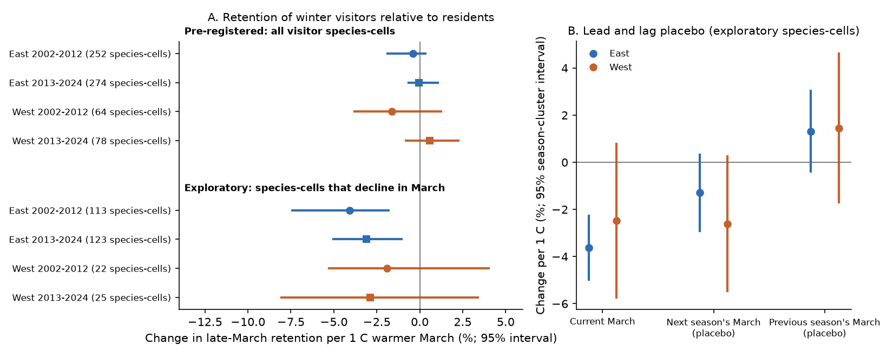
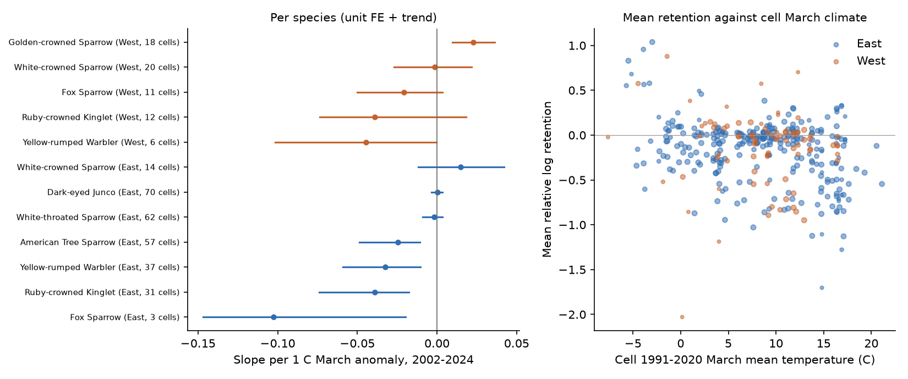
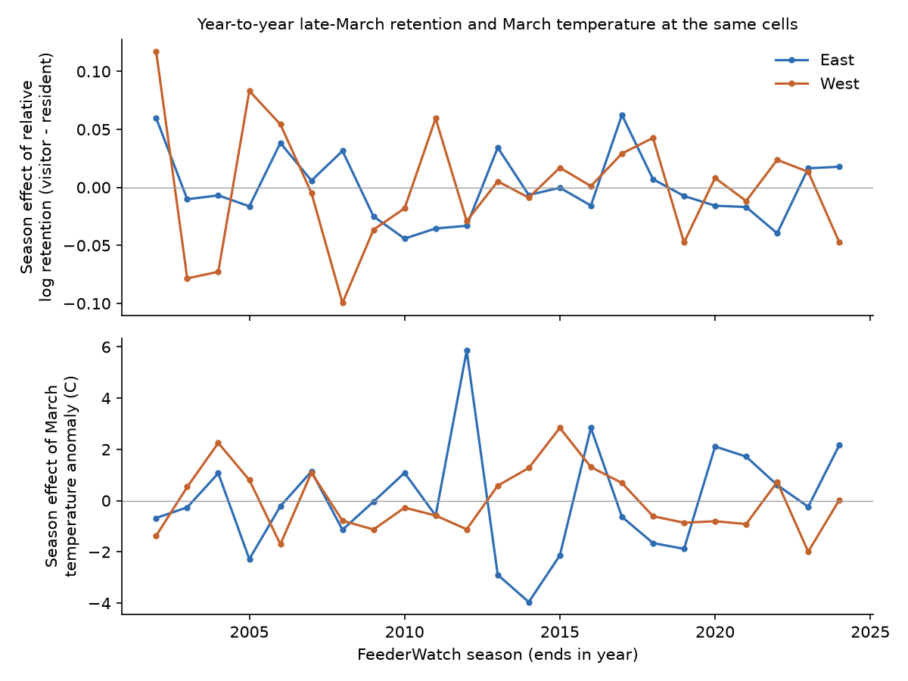

# Warm Marches lowered late-March feeder reports of departing winter-visitor birds in eastern North America in 2002-2024, but the pre-registered all-species test was null

Job `sci-1107-hp-climate-pollution-biodiversity-11408a90631f` · topic climate-pollution-biodiversity ·
machine hp · model claude-opus-5-5 (Anthropic) · campaign 11_07_2026 · 2026-11-09.
The signing key is a campaign-machine key. It is not a personal authorship claim.

## Summary

Question. Short-distance migrant birds spend the winter at feeders south of their breeding range. Do they
leave earlier in spring after a warm March? We used Project FeederWatch (PFW) checklists, seasons 2002-2024, and
NOAA GHCN_CAMS temperature. We measured "retention": the reporting rate of a winter-visitor species in 15-31 March
divided by its rate in 15 January-14 February, at the same sites. We subtracted the same quantity for resident
feeder birds in the same 2 x 2 degree cell and season. This control removes changes in feeder use, effort and
detection that all species share. Breeding Bird Survey (BBS) data removed cells where a visitor species also breeds.

Main results:

1. **The pre-registered test was null.** Over all 356 eligible species-cells, a 1 C warmer March changed relative
   log retention by -0.004 (East, 2002-2012; 95% season-bootstrap interval -0.019 to +0.003), -0.001 (East, 2013-2024;
   -0.007 to +0.011), -0.016 (West, 2002-2012; -0.038 to +0.012) and +0.006 (West, 2013-2024; -0.008 to +0.023).
   No interval was below zero, so the pre-registered rule for a repeated result (3 of 4 samples) failed.
2. **The reason is low sensitivity in most species-cells.** At most wintering cells, Dark-eyed Junco,
   White-throated Sparrow and White-crowned Sparrow do not decrease at feeders before 31 March. A 15-31 March window
   cannot detect an earlier departure that occurs in April. The common window must end on 31 March, because PFW
   seasons before 2020 ended in early April. Junco and White-throated Sparrow slopes were near zero with narrow
   intervals (+0.000, -0.004 to +0.004; -0.002, -0.009 to +0.003).
3. **Exploratory: where species do leave in March, warm Marches lowered retention in the East.** We kept species-cells
   whose pooled reporting rate fell by at least 0.005 log units per day from mid-February to the end of March
   (123 East and 26 West species-cells). In the East, a 1 C warmer March lowered retention by 4.1% in 2002-2012
   (interval 1.8 to 7.4%) and by 3.1% in 2013-2024 (1.1 to 5.0%). Pooled over 2002-2024 this is -0.035 log units per C
   (-0.052 to -0.024), equal to a departure about 3.5 days earlier per 1 C (2.3 to 5.1 days), from the mean seasonal
   decline rate of these cells. In the West the estimates were negative but uncertain (-1.9% and -2.9% per C;
   intervals include zero; only 22-25 species-cells).
4. **Checks of the East exploratory result.** Next season's March anomaly (a placebo) gave -0.013 (-0.029 to +0.003)
   and the previous season's gave +0.013 (-0.004 to +0.030). With all three in one model the current March kept
   -0.036 (-0.046 to -0.026). Control for recorded late-March snow depth kept -0.031 (-0.043 to -0.019). Without
   Ruby-crowned Kinglet and Yellow-rumped Warbler (insectivores that may use feeders less in warm weather) the
   estimates were -0.037 and -0.031, both with intervals below zero. Leave-one-species-out and leave-one-season-out
   estimates were in the range -0.042 to -0.032.
5. **No departure trend.** Relative retention had no clear trend in 2002-2024: East -0.005 per decade (-0.022 to
   +0.013), West -0.004 (-0.028 to +0.022). March at the same cells did not warm clearly in this period (East
   +0.44 C per decade, -0.68 to +1.60; West -0.20, -1.04 to +0.67). Thus the data cannot test whether departure
   advanced with long-term warming.

Conclusion. In eastern North America, the winter visitors that leave feeders during March (mainly American Tree
Sparrow, Ruby-crowned Kinglet and Yellow-rumped Warbler, and Dark-eyed Junco at some cells) left earlier, or used
feeders less, after warm Marches. The size is about 3.5 days per 1 C. This result is exploratory: we chose the
species-cell subset after the pre-registered test failed. The subset rule used only the mean seasonal curve, not the
temperature data. The pre-registered all-species test did not detect this effect, because most species-cells do not
change during the window.



## Data

| Input | Shared path (campaign host) | Source and version | SHA-256 |
| --- | --- | --- | --- |
| PFW checklists, 5 files, seasons 2001-2024 | `/mnt/dell-data/shared_datasets/feederwatch-pfw-all-{2001-2005,2006-2010,2011-2015,2016-2020,2021-2024}-may2024/` | https://cdn.feederwatch.org/data/202406/ (May 2024 public release) | see `files/data/input_provenance.json` |
| PFW species translation table | `/mnt/dell-data/shared_datasets/feederwatch-pfw-spp-translation-may2024/PFW_spp_translation_table_May2024.csv` | same | `99bacf22bab550e688bcfae0774357b689c1463b1d165cb44d19b5a925d98ad1` |
| GHCN_CAMS monthly 2 m air temperature, 0.5 degree, 1948-2026-10 | `/mnt/dell-data/shared_datasets/psl-ghcncams-air-mon-mean-20261105/air.mon.mean.nc` | https://downloads.psl.noaa.gov/Datasets/ghcncams/air.mon.mean.nc | `8dbe8e8ce86729f56a2234dec7420b94aecba804aa7df599c8fea68ade70802b` |
| BBS 2026 release, 50-stop data | `/mnt/dell-data/shared_datasets/bbs-2026-release-50stopdata-6a0b0b0a/50-StopData.zip` | USGS ScienceBase item 6a0b0b0ab66b0188da36aedd | `eed5fc264a1af6074783685de96b433b1d5ce4a1f8e09528449dbd4f9ba03204` |
| BBS routes | `/mnt/dell-data/shared_datasets/bbs-2026-release-routes-6a0b0b0a/Routes.csv` | same | `8ac35620930b0bc758ed3fcb33c689ebe08840edd04f840050b13dd1a56e8362` |
| BBS species list | `/mnt/dell-data/shared_datasets/bbs-2026-release-specieslist-6a0b0b0a/SpeciesList.csv` | same | `e54e4b5b1eb6fc5fc5941a8e31876ecc17675f229265f60c4dbfed742fb35274` |

All ten input hashes were checked on 2026-11-09 (`files/data/input_provenance.json`, with URLs). The raw data and
record-level derived tables are **not** in this publication. See `files/EXTERNAL_DATA_NOTICE.md`.

## Methods

The analysis plan (`files/PREREGISTRATION.md`) was written before any outcome model was fit.

- **Checklists.** PFW checklists in the US and Canada, seasons 2002-2024 (season s ends in year s). Species records
  with VALID = 0 count as not reported.
- **Windows.** Base: day of year 15-45. Late: day 74-90 (15-31 March). The window uses the start date of the 2-day
  count. A site-season is used only with at least 2 checklists in each window (107,467 site-seasons at 32,698
  sites before cell filters).
- **Cells and regions.** 2 x 2 degree cells with at least 5 matched sites in the season. East: longitude -100 or
  more. West: less than -100.
- **Species.** Visitors (fixed list): Dark-eyed Junco, American Tree Sparrow, White-throated Sparrow, Fox Sparrow,
  White-crowned Sparrow, Golden-crowned Sparrow, Yellow-rumped Warbler, Ruby-crowned Kinglet, Varied Thrush. A
  visitor is used in a cell if it is on at least 10% of base checklists there and BBS routes in the cell (at least
  20 route-years, 1997-2024) detect it on less than 5% of route-years. Varied Thrush had no eligible cell.
  Residents (fixed list of 14 species): used where they are on at least 10% of base checklists.
- **Outcome.** L = log((x_late+0.5)/(n_late+1)) - log((x_base+0.5)/(n_base+1)) per species, cell and season.
  C = mean L of the residents in the cell-season (at least 2). Y = L - C. About 100 x a change in Y is a percent
  change in retention.
- **Temperature.** March mean of the 0.5-degree GHCN_CAMS cells of the matched sites, as an anomaly from 1991-2020.
- **H1 model.** Y on species-cell fixed effects, the March anomaly and a linear season term, weighted by
  1/(binomial approximation of the variance of Y), fitted in four samples (East, West x 2002-2012, 2013-2024).
  Intervals: season-cluster bootstrap (1,000 draws); cluster-robust errors by season are also in the tables.
- **H2.** Season effects of Y with species-cell fixed effects, then a linear trend with a 3-season moving-block
  bootstrap. The same for the March anomaly.
- **Days.** Departure shift = beta / s, where s is the weighted mean slope of log reporting rate against day
  (days 46-90, pooled seasons) for the same species-cells.
- **Exploratory analyses** (decided after the H1 result): the active-decline subset (s at most -0.005 per day),
  lead and lag placebos, snow-depth control, leave-one-out, and per-species fits.

## Results

### Pre-registered H1 and sensitivity variants (per 1 C March anomaly; 95% season-bootstrap interval)

| Variant | East 2002-2012 | East 2013-2024 | West 2002-2012 | West 2013-2024 |
| --- | --- | --- | --- | --- |
| Primary (Y, unit FE + trend) | -0.004 [-0.019, 0.003] | -0.001 [-0.007, 0.011] | -0.016 [-0.038, 0.012] | 0.006 [-0.008, 0.023] |
| Unit + season FE (H1b) | -0.009 [-0.024, 0.009] | 0.009 [-0.006, 0.024] | -0.016 [-0.064, 0.020] | 0.023 [-0.009, 0.060] |
| No resident control (L) | -0.009 [-0.021, 0.001] | -0.001 [-0.009, 0.012] | -0.029 [-0.042, -0.002] | -0.015 [-0.027, -0.003] |
| Unweighted | -0.017 [-0.042, 0.000] | -0.018 [-0.033, 0.006] | -0.001 [-0.045, 0.074] | -0.021 [-0.049, 0.010] |
| February-March temperature | -0.003 [-0.016, 0.005] | 0.008 [0.000, 0.016] | -0.027 [-0.066, 0.007] | 0.006 [-0.008, 0.020] |
| Exclude 2020-2021 | -0.004 [-0.019, 0.003] | -0.000 [-0.009, 0.016] | -0.016 [-0.038, 0.013] | 0.008 [-0.007, 0.030] |
| At least 10 sites per cell-season | -0.004 [-0.020, 0.004] | -0.001 [-0.006, 0.011] | -0.016 [-0.042, 0.025] | 0.002 [-0.017, 0.019] |
| Resident composite C as outcome | -0.005 [-0.009, 0.001] | -0.001 [-0.006, 0.007] | -0.002 [-0.011, 0.005] | -0.009 [-0.012, -0.004] |

Rows: 6,454 species-cell-seasons, 356 species-cells, 162 cells. Without the resident control, the West slopes were
negative. Part of that signal is shared by residents (last row), so it is not specific to departure.

### Exploratory active-decline subset

| Sample | Species-cells | Beta [95% bootstrap] | Unit + season FE |
| --- | --- | --- | --- |
| East 2002-2012 | 113 | -0.041 [-0.074, -0.018] | -0.064 [-0.084, -0.038] |
| East 2013-2024 | 123 | -0.031 [-0.050, -0.011] | -0.034 [-0.064, -0.013] |
| West 2002-2012 | 22 | -0.019 [-0.053, 0.040] | 0.023 [-0.101, 0.132] |
| West 2013-2024 | 25 | -0.029 [-0.081, 0.034] | 0.042 [-0.151, 0.296] |
| East pooled 2002-2024 | 123 | -0.035 [-0.052, -0.024]; 3.5 days per C [2.3, 5.1] | |
| West pooled 2002-2024 | 26 | -0.023 [-0.053, 0.020]; 2.1 days per C [-1.7, 4.7] | |

Active species-cells in the East: American Tree Sparrow 35, Yellow-rumped Warbler 28, Ruby-crowned Kinglet 27,
Dark-eyed Junco 19, White-throated Sparrow 7, White-crowned Sparrow 5, Fox Sparrow 2.

### Per species, all eligible cells, 2002-2024 (`files/results/h1_by_species_2002_2024.csv`)

East: American Tree Sparrow -0.025 [-0.049, -0.011]; Ruby-crowned Kinglet -0.039 [-0.074, -0.018]; Yellow-rumped
Warbler -0.033 [-0.059, -0.011]; Fox Sparrow -0.103 [-0.147, -0.020] (3 cells); Dark-eyed Junco 0.000 [-0.004,
0.004]; White-throated Sparrow -0.002 [-0.009, 0.003]; White-crowned Sparrow 0.015 [-0.012, 0.042].
West: Golden-crowned Sparrow +0.023 [0.010, 0.036]; other species intervals include zero.
Golden-crowned Sparrow had a positive slope. We have no tested explanation for this.



### Spatial benchmark

Across cells, mean relative retention fell with the cell's March climate: East -0.029 per C (-0.038 to -0.020),
West -0.010 (-0.025 to +0.006). The year-to-year slope of all East species-cells (-0.003) was about 10% of this
spatial slope. The East active-decline slope (-0.035) was similar to it.



## Limitations

- **Feeder use versus departure.** A lower late-March reporting rate can come from departure or from less feeder use
  when natural food is available. The resident control removes changes that residents share, but not changes
  specific to visitors. For Ruby-crowned Kinglet and Yellow-rumped Warbler, feeder use may depend on cold weather.
  The East result stayed without them, but American Tree Sparrow then gives most of the weight.
- **Post hoc subset.** The active-decline subset was chosen after the pre-registered test. The rule used only the
  pooled seasonal decline, not temperature. Units with steeper declines are expected to be more sensitive to a
  shift, so this subset shows where a test can work, but its error rate is not controlled by the plan.
- **Window truncation.** The 31 March end of the common window comes from the PFW season end before 2020. Species
  that leave in April (most juncos and White-throated Sparrows at wintering cells) were not testable.
- **Breeding mask.** The BBS mask works at 2-degree cells and only where at least 20 route-years exist. Some cells
  can contain both wintering and breeding birds. Partial migrants were not separated by population.
- **Temperature.** Monthly 0.5-degree GHCN_CAMS data do not show warm spells, wind or the weather on the route north.
- **West.** The West had few eligible species-cells, so its results are uncertain, not negative.
- **Citizen-science observation.** Participants choose sites and count days. Matched windows, the resident control
  and fixed effects reduce, but do not remove, effort and reporting changes.

## Reproduction

```
# from the worktree root (holds work/ and datasets/)
bash work/result/files/code/run_all.sh
```

`00_fetch_inputs.sh` downloads (or reuses) the inputs, checks SHA-256 hashes, and writes unzipped copies and a
PFW parquet file to `work/scratch/` (not the publication). `01_build_tables.py` builds matched site-season tables,
the BBS breeding mask and site temperatures. `02_analysis.py` runs the pre-registered and exploratory models
(about 35 minutes for the bootstraps). `04_placebo.py` runs the lead/lag, snow and leave-one-out checks.
`03_figures.py` makes the figures from `files/results/`. Python 3.12 with pandas 3.1, numpy, duckdb 1.3, xarray
2026.9, matplotlib. The random seed is fixed (20261109). The bundled `02_analysis.py` differs from the run that made
the results only in the output folder of one record-level table (now written to scratch).

## Files

- `files/PREREGISTRATION.md`: analysis plan written before the outcome models.
- `files/code/`: all code. `files/logs/`: printed output of the analysis runs.
- `files/results/`: model results and aggregate statistics (no PFW records).
- `files/figures/`: figures (`figS1_all_variants.png` shows every H1 variant).
- `files/data/input_provenance.json`: URLs, shared paths and hashes of the inputs.
- `files/EXTERNAL_DATA_NOTICE.md`: attribution and terms for external data.

## Prior work

This work adds a timing test to the campaign result that winter feeder communities became warmer-adapted in
2002-2024 without tracking winter temperature (`sci:sha256:c94acf78273342e4059d41fb6b8494821e7960ffeaf617f2c1e88631488fe9f2`). That result tested community composition in
December-February. This result tests late-winter departure and finds a short-term temperature response in species
that leave during March.
