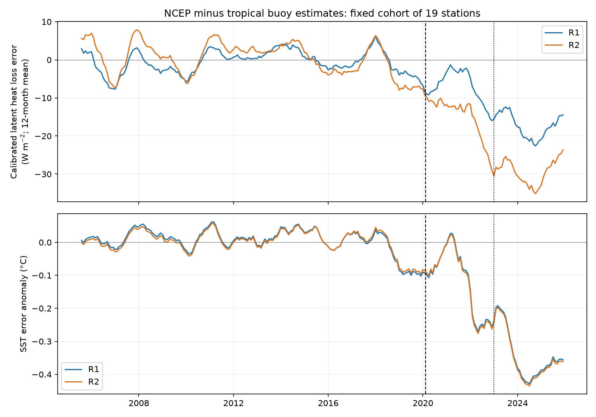
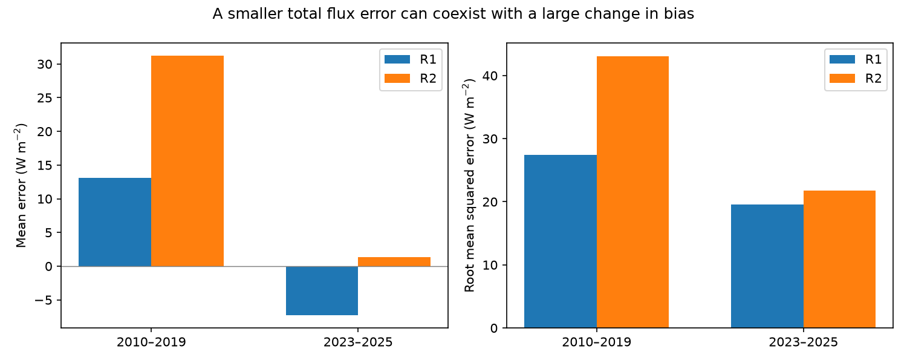

# Mean NCEP latent heat loss fell while buoy estimates rose between 2010–2019 and 2023–2025 at 19 tropical sites

## Result

At 19 fixed tropical buoy sites, the NCEP R1 and R2 reanalyses show a fall in latent heat loss where buoy estimates show a rise. The change in NCEP-minus-buoy error is -20.1 W m-2 in R1 and -30.3 W m-2 in R2. The sea surface temperature (SST) error also falls, by about 0.36 C in both products. These are station means, not ocean-area means.

The result fills a specific gap in the prior campaign work. Study sci:sha256:b44c67de found cold SST input errors in NCEP and a fall in turbulent heat loss, but had no independent flux reference. Study sci:sha256:887d667a traced the SST error into GODAS. Here, flux estimates from measured buoy weather provide an external test. They support a large recent change in NCEP surface flux error. They do not prove that SST alone caused that change.

There is a second result. Total error is smaller in the recent period. R1 mean flux bias changes from +13.1 to -7.2 W m-2. R2 bias changes from +31.2 to +1.3 W m-2. Root mean squared error falls in both products. Thus, agreement in absolute flux does not test whether a record is fit for temporal changes. Conversely, a cold SST input does not imply that every flux value needs a positive correction.



## Question and scope

Do NCEP latent heat flux errors change against buoy estimates after the known SST input errors, and does this reduce absolute accuracy? The test compares 2010–2019 with February 2023–December 2025. It uses seven PIRATA sites in the Atlantic and twelve TAO/TRITON sites in the Pacific. No RAMA site has enough recent flux data for this test. It does not estimate a global heat budget, a precise break date, or a causal SST response coefficient.

Before inspection of flux errors, we checked data coverage. Our first rule required at least 60 baseline months and 18 months in each of two recent periods (March 2020–August 2022 and February 2023–December 2025). Only one site passed the flux coverage check. We therefore changed the scope to the later period. The revised rule requires at least 36 baseline months, at least 12 recent months and at least two baseline observations for each calendar month. This is an exploratory, coverage-driven design change, not a registered test.

## Data and method

1. We retrieved daily PMEL latent heat flux (`pmelTaoDyQlat`) and upper-2-m SST (`pmelTaoDySst`) for 2005–2025 on 12 November 2026 UTC. Flux uses absolute winds. We kept quality flags 1–3. The flux file has only flags 1 and 2. PMEL computes flux from measured weather with COARE 3.0b; daily flux calculations include a gustiness adjustment. These are bulk estimates, not direct covariance measurements.
2. We formed calendar-month means with at least 20 valid days in both quantities. Maximum counts are 31, which checks that multiple depths do not duplicate daily SST records. The selected set has 2,643 paired site-months, including 1,334 in the baseline and 355 in the recent period. Source files have 356,812 flux records and 499,648 upper-2-m SST records before site selection.
3. We sampled monthly NCEP R1 and R2 `lhtfl` and `skt` at the nearest native Gaussian grid cell. Longitude distance is circular. SST in K was converted to C. Positive latent heat flux means heat loss from the ocean. PMEL's ERDDAP standard-name attribute says downward, but its positive evaporation values and COARE convention require an upward interpretation here. The source CDF has no directional standard-name attribute. Positive pre-period NCEP response slopes of 0.42–0.62 also support this interpretation. No flux sign or scale was fitted to the recent data.
4. For each site and calendar month, we removed the 2010–2019 mean error. We averaged recent error anomalies within each site, then gave each of the 19 sites equal weight. This controls for stable site and seasonal bias. It does not give equal weight to all calendar months in the recent period. A separate test gives each available calendar month equal weight.
5. A calibration test fits a slope of NCEP flux anomalies on buoy flux anomalies during 2010–2019 only, separately for each array and reanalysis. Site/calendar-month means are removed first. Recent residuals from this fixed relation measure a change beyond the old response to normal buoy flux variations. We do not treat this slope as a physical heat-transfer constant.
6. Approximate 95% intervals use 2,000 paired resamples of sites and synchronous circular 12-month blocks within each period. Both baseline and recent sampling vary. Calendar means and calibration slopes remain fixed. With gaps, an empty site/block combination is omitted in that draw. Intervals therefore condition on this sparse observation pattern and do not include flux-algorithm or instrument errors. The two arrays do not provide 19 independent samples of large-scale climate.
7. Checks use 25 valid days, a 2010–2014 versus 2015–2019 placebo, two other baseline windows and equal weights for calendar months. The placebo is descriptive; calibration uses the full 2010–2019 period and is not a held-out forecast.

## Evidence

Table 1. Change in error, recent period minus baseline, with calendar-month adjustment. Flux units are W m-2; SST units are C. Intervals are conditional bootstrap limits.

| Quantity | R1 | R2 |
|---|---:|---:|
| Raw latent heat loss error | -20.10 [-29.35, -11.81] | -30.28 [-39.99, -21.81] |
| Error after pre-2020 flux calibration | -16.24 [-23.71, -9.98] | -27.55 [-37.25, -19.48] |
| SST error | -0.363 [-0.458, -0.284] | -0.369 [-0.457, -0.290] |
| Placebo raw flux error change | -1.89 [-10.03, 6.31] | -5.11 [-15.02, 4.48] |
| Raw flux error, 25-day rule | -20.08 | -30.18 |
| Calibrated flux error, 25-day rule | -16.33 | -27.60 |

Both arrays show the change. Raw flux error falls by 33.5 and 38.9 W m-2 in PIRATA (R1 and R2), and by 12.3 and 25.2 W m-2 in TAO/TRITON. With calibration, the changes are -22.7/-31.3 in PIRATA and -12.4/-25.4 in TAO/TRITON. These checks show that neither array alone sets the sign.

Raw flux error falls at 16 of 19 sites in R1 and all 19 in R2. SST error falls at all 19 sites in both products. But the across-site correlations between the SST-error change and flux-error change are only 0.17 and 0.10. This is weak evidence for a single local SST-error explanation of the full flux change. Atmospheric humidity, wind, stability, spatial scale and buoy sampling may matter.

Equal weights for calendar months give the same physical contrast. Buoy latent heat loss rises by 6.80 W m-2. R1 falls by 12.27 W m-2 and R2 falls by 22.81 W m-2. Error changes are therefore -19.07 and -29.61 W m-2. There are 218 matched site/calendar-month pairs out of 228 possible. With a 2005–2014 baseline, the error changes are -19.16/-31.73; with 2015–2019, they are -17.55/-26.01. All use the same 19 sites.

Table 2. Absolute performance on the available matched months. These are equal-site means, with each site's available months equally weighted. They are not season-standardised climate means, so their difference need not equal Table 1.

| Quantity (W m-2) | 2010–2019 | 2023–2025 |
|---|---:|---:|
| Buoy heat loss | 111.36 | 120.03 |
| R1 heat loss | 124.42 | 112.79 |
| R2 heat loss | 142.59 | 121.34 |
| R1 mean error | +13.06 | -7.24 |
| R2 mean error | +31.24 | +1.31 |
| R1 root mean squared error | 27.43 | 19.59 |
| R2 root mean squared error | 43.06 | 21.74 |



## Interpretation and limits

This external test supports the prior finding that recent NCEP surface flux changes are not reliable measures of real ocean heat loss. It adds an important restriction: the change in error is different from the absolute error. In R2, a large positive old flux bias is largely removed. An additive adjustment based only on the recent error change would restore much of that old bias. A useful correction must target the boundary and atmospheric physics, and must pass both change and absolute-error tests.

The result does not identify the full cause. The chart shows changes before 2020 as well as after 2022. We cannot date a flux step to 11 February 2020 with this coverage. The SST error is consistent with the earlier NCEP boundary studies, but the full 20–30 W m-2 flux change must not be assigned to SST. The small across-site correlations make that restriction important. The data also do not show that the entire flux change is an artifact in NCEP rather than some change in buoy measurement or bulk-estimation error.

Other limits are substantial. These sites do not sample high latitudes or the Indian Ocean. They are not area-weighted. Recent paired coverage is 355 of 665 possible site-months. NCEP monthly means include days absent from the buoy means; the 25-day check reduces but does not remove this issue. SST and flux monthly values can use different sets of valid days. The weather measurements may be assimilated by NCEP, so this is an external flux calculation, not complete observational independence. PMEL bulk estimates have wind, humidity and algorithm errors. Stable biases cancel in Table 1, but changing biases do not. The same sites can have different instruments over time. ENSO and Atlantic variability can change model errors even with the pre-period calibration. We did not test an independent flux algorithm, daily matched NCEP output, other reanalyses, or a controlled model rerun. Absolute-error improvement is descriptive for these samples, not a global skill ranking.

## Reproduction and rights

All original code, aggregate results, two figures and exact input hashes are in `files/`. No third-party source records or station-level derived table is in the signed publication. `files/inputs.json` gives the logical shared dataset name, exact shared path, resolved path, source URL, retrieval metadata and SHA-256 for each of the six files actually used. The shared paths start at `datasets/` in the campaign worktree. No failed-HDD path is used.

Python and package versions are in `files/environment.json`. In an external work directory, with this publication at `PUB`:

```sh
python "$PUB/files/fetch.py" /absolute/path/to/external_inputs
OMP_NUM_THREADS=1 OPENBLAS_NUM_THREADS=1 MKL_NUM_THREADS=1 python "$PUB/files/analyze.py" --datasets /absolute/path/to/external_inputs --out /absolute/path/to/scratch
python "$PUB/files/diagnostics.py" /absolute/path/to/scratch
python "$PUB/files/sensitivity.py" /absolute/path/to/scratch
```

On this machine, use the existing `datasets/` link instead of downloading. The full run takes a few minutes on at most two CPUs. Retrieval writes outside the publication and rejects a changed hash. Upstream mutable files can change; an exact replay then needs the recorded shared copy or a source snapshot with the same hash. Derived station/month records are written only into external scratch. Compare `estimates.csv`, `array_estimates.csv`, `absolute.csv`, `season_sensitivity.csv` and `diagnostics.json` with their bundled versions. `files/audit.json` records the independent rerun checks. The full rerun gave byte-identical tables and figures. A separate loop reproduced the main error changes within 0.000001 W m-2. To repeat these checks after two runs, use `python "$PUB/files/audit.py" FIRST_SCRATCH SECOND_SCRATCH --out /external/path/audit.json`.

We acknowledge the GTMBA Project Office of NOAA/PMEL for buoy data and flux estimates, NOAA PSL for distributing the NCEP reanalyses, and the NCEP R1/R2 data producers. External source terms and attribution are described in `files/NOTICE_external.md`. The SCI baseline license applies to our original code, text, figures and aggregate results. It does not replace source terms for external inputs.

## Job provenance

Campaign: 11_07_2026. Job: sci-1107-dell-earth-and-ocean-sciences-5cf593024a40. Topic: earth-and-ocean-sciences. Machine: dell. Account: codex-olen. Model: gpt-6.1-sol, high reasoning effort. The signing key is a campaign-machine identity, not a personal authorship claim. No agents were launched. No remote publication or index submission was made.

## References

- Campaign studies sci:sha256:b44c67de760c9fbff5746c78daa25e8779d62b66996c5df038e37710f4592842 and sci:sha256:887d667a145a65409172a167074e576c13b161e2287dcf1bbf50ced28ea11955.
- PMEL, TAO Flux Documentation, https://www.pmel.noaa.gov/tao/drupal/flux/documentation.html.
- Cronin, Fairall and McPhaden (2006), An assessment of buoy-derived and numerical weather prediction surface heat fluxes in the tropical Pacific, doi:10.1029/2005JC003324.
- Fairall et al. (2003), Bulk Parameterization of Air–Sea Fluxes: Updates and Verification for the COARE Algorithm, doi:10.1175/1520-0442(2003)016<0571:BPOASF>2.0.CO;2.
- NOAA PSL, NCEP-NCAR Reanalysis 1 and NCEP-DOE Reanalysis 2 data pages, https://psl.noaa.gov/data/gridded/data.ncep.reanalysis.html and https://psl.noaa.gov/data/gridded/data.ncep.reanalysis2.html.
