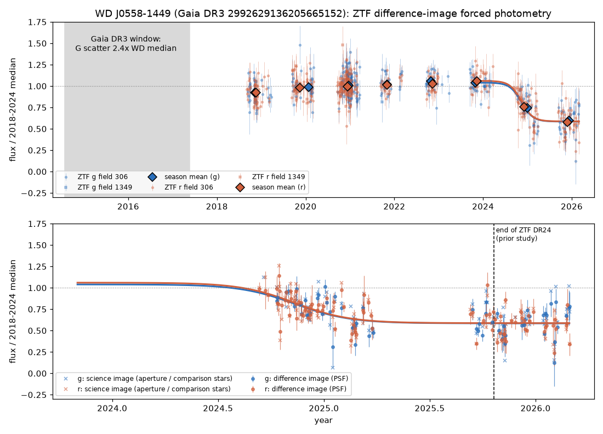
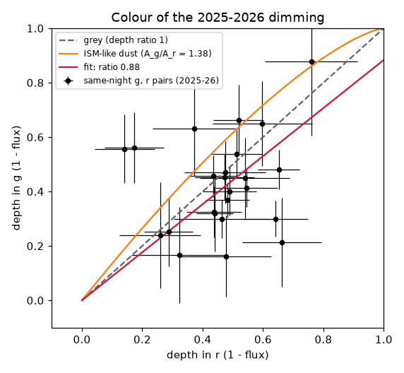
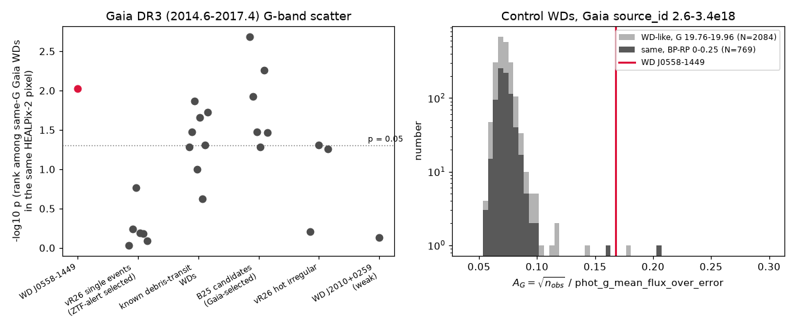

# WD J0558-1449 stays about 45 % dimmed with grey colour until March 2026 in ZTF difference images, and its Gaia DR3 photometry already had excess scatter in 2014-2017, unlike six one-off dimming white dwarfs

Job `sci-1107-dell-astronomy-e166ab0384aa` (campaign 11_07_2026, topic astronomy, machine dell, model Claude Opus 5.5 `claude-opus-5-5`, account claude-olen). The signing key is a campaign-machine key. It is not a personal authorship claim.

## Summary

**Question.** The campaign study sci:842147d0 found a new deep dimming event of the white dwarf (WD) WD J0558-1449 (Gaia DR3 2992629136205665152, G = 19.86, about 190 pc). That study used ZTF DR24 PSF-catalogue light curves to 2025-10-30. These light curves contain detections only. The study asked for independent photometry. We asked four questions:

1. Is the event real when we measure it with a different method that does not depend on the catalogue (forced photometry on difference images, and aperture photometry on science images)?
2. What is the true depth, the onset time and the colour of the dimming, and does it continue after 2025-10-30?
3. Did the WD show variability before the event?
4. Is the earlier variability usual for WDs with deep one-off dimming events?

**Data.** We downloaded 150-arcsec cutouts of 1,013 ZTF science images, 993 difference images and the difference-image PSFs from IRSA (2018-09-03 to 2026-03-30, fields 306 and 1349). We used the ZTF reference PSF catalogues for the reference flux. ZTF public images after DR24 (2025-10 to 2026-03) are on IRSA, so we extend the light curve by 5 months. We used Gaia DR3 `gaia_source` for the 2014.6-2017.4 photometric scatter.

**Main results.**

- **The event is real.** Forced PSF photometry on the difference images and reference-free aperture photometry on the science images give the same light curve (Figure 1). In the event (MJD > 60720), the WD is at 0.578 +/- 0.015 (g) and 0.582 +/- 0.013 (r) of its 2018-2024 median flux. All 27 comparison-star series on the same CCD quadrant stay at 0.96 to 1.03. A second field (1349, a different CCD and reference image) also shows the fade in late 2024.
- **Onset, depth and duration.** A logistic fit gives the onset at MJD 60626 +/- 12 (2024-11-24) with an e-folding time of 47 days (35-64 days). The fitted depth is 0.45 +/- 0.05 in g and 0.47 +/- 0.04 in r. The WD is still faint at the end of the data (2026-01 to 2026-03: 0.63 +/- 0.03 in g, 0.53 +/- 0.03 in r). We find no recovery trend in the 2025-26 season (+0.06 +/- 0.11 per year). The event has continued for at least 1.3 years.
- **Grey colour.** In 24 nights with g and r data, the colour exponent k = ln f_g / ln f_r is 0.85 (95 % range 0.68 to 1.08). Interstellar-type dust gives k = 1.38. This is excluded at 5.4 sigma. The occulter is grey between 0.48 and 0.63 um: grains larger than about 1 um, or optically thick clumps that cover part of the star.
- **Variability before the event.** The Gaia DR3 G-band scatter proxy A_G = sqrt(n_obs) / (flux/flux_error) is 0.168, 2.4 times the median of white-dwarf-like Gaia sources of the same G. Only 2 of 2,084 such sources (1 of 769 with the same BP-RP colour, 0 to 0.25) have a value as high. If this is intrinsic, it is about 15 % rms variability in 2014.6-2017.4. In ZTF, the 2018 season is 8 % below the 2019-2021 level (0.92 +/- 0.02 in g and in r), and the 2022-2023 seasons are 3-6 % above it. The season-to-season scatter (chi2/dof 4.7 in g, 5.3 in r, with empirical errors) is larger than for all 12 (g) and 15 (r) comparison stars of similar flux. Same-night pairs show no excess short-timescale scatter in 2018-2024.
- **Comparison with one-off events.** We used the same Gaia test on 24 other WDs with debris transits or deep dimming. None of the six WDs with single deep events of van Roestel et al. (2026, found with ZTF alerts) has excess Gaia scatter (p = 0.17 to 0.92). WD J0558-1449 has p = 0.009. Seven of 8 known debris-transit WDs have A_G 1.6 to 3.8 times the median (5 of 8 at p < 0.05). WD J0558-1449 is therefore more similar to the known, persistently active debris-transit systems than to the one-off events from quiet WDs.

**Main limitations.** We have only ZTF and Gaia data. No spectrum, no second telescope in the event, and no high-cadence light curve exist for this G = 19.9 WD. The Gaia scatter proxy is an average: a few strongly deviant transits can make it, as can continuous variability, and we cannot tell which from the public DR3 data. Gaia DR3 epoch photometry does not exist for this star. ZZ Ceti pulsation can also increase the Gaia scatter at this temperature, but colour-matched WDs in the same range almost never have such a high value, and ZTF same-night pairs show no excess scatter. ZTF i-band data (19 science images, most in 2026, no i-band reference image) are too noisy to measure the i-band depth. The mass estimate in Section 5 rests on an assumed geometry.

## 1. Background and what is new

Dust from disrupted planetesimals can pass in front of a WD and dim it. Some systems dim for minutes to weeks and repeat (WD 1145+017, ZTF J0139+5245, ZTF J0328-1219, ZTF J0923+4236). van Roestel et al. (2026, vR26; arXiv:2609.08923) used negative ZTF alerts and found six WDs with single, deep events that last months to years. For ZTF J2327+0019 they saw a short, shallow precursor dip a year before the main event, and they proposed collisions in a debris disc as the cause.

The campaign study sci:842147d0 searched ZTF DR24 PSF-catalogue light curves of 91,009 Gaia WDs. It recovered three of the vR26 events and found one new event, WD J0558-1449 (fade from 2024-09; median flux 0.68 in g and 0.72 in r from 2024-11-26 to 2025-10-30). That study stated these limits: the light curves contain detections only (so depths are lower limits), the WD has only ZTF data from one field, and it needs independent photometry and spectroscopy.

This work adds:

- an independent measurement of the event with forced photometry on ZTF difference images (non-detections included) and with reference-free aperture photometry;
- 5 more months of data (to 2026-03-30) from public ZTF images that are not in DR24;
- the onset time, depth, duration and colour of the event, with uncertainties;
- evidence of variability before the event, from Gaia DR3 (2014.6-2017.4) and from ZTF (2018-2024);
- a comparison with 24 other dimming and debris-transit WDs under the same Gaia test.

We did not find other recent photometry. No ZTF alert broker (ALeRCE) has an object within 5 arcsec: the fade is below the alert limit. The NOIRLab archive has public DECam images of the field only before 2023-01. NEOWISE ended in 2024-08.

## 2. Data

| Data | Source and version | Use |
| --- | --- | --- |
| ZTF science images, difference images (`scimrefdiffimg.fits.fz`) and difference-image PSFs (`diffimgpsf.fits`) | IRSA ZTF image service, `https://irsa.ipac.caltech.edu/ibe/data/ztf/products/sci/...`, 150-arcsec cutouts, retrieved 2026-11-12. 1,016 image entries in the metadata search; 3 have no products (HTTP 404). 993 g and r images have a difference image; 20 images (19 i-band, 1 g) have only a science image. | Forced photometry |
| ZTF reference PSF catalogues (`refpsfcat.fits`) | IRSA `.../products/ref/000/field000306/...` and `field001349`. Field 306 g and r references use 15 images from 2018-09/11. | Reference flux of each star |
| Gaia DR3 `gaia_source` | ESA Gaia archive TAP (`https://gea.esac.esa.int/tap-server/tap/sync`), queried 2026-11-12 | Positions, proper motions, comparison stars, G-band scatter proxy, control samples |
| ALeRCE ZTF broker | `https://api.alerce.online/ztf/v1/objects/?ra=89.7148&dec=-14.8208&radius=5`, 2026-11-12: no objects | Check for alerts |
| NOIRLab Astro Data Archive | SIA `vohdu`, 0.02 deg: 79 DECam HDUs, 2019-02 to 2023-01 | Check for independent images in the event (none) |
| vR26 target list | arXiv:2609.08923v1 Table 1 (coordinates of nine WDs) | Gaia comparison test |
| Prior campaign result | sci:842147d0 `files/results/reference_status.csv` (Gaia IDs of 8 known debris-transit WDs and 6 B25 candidates) | Gaia comparison test |

The SHA-256 of every raw file that we used is in `files/results/raw_sha256.txt`. The raw files are not bundled (see `files/NOTICE_external_data.md`).

## 3. Methods

### 3.1 Forced photometry on difference images (`03_forced_phot.py`, `05_lightcurve.py`)

For each image, we propagated the Gaia DR3 position of each star with its proper motion to the epoch. We shifted the 25 x 25 pixel difference-image PSF to the sub-pixel position (cubic spline) and normalised it. We subtracted the median of a 20-35 pixel annulus. The flux is sum(P D) / sum(P^2). The error is sigma_pix / sqrt(sum(P^2)), with sigma_pix the robust (MAD) pixel scatter of the cutout. We converted to microjansky with the image MAGZP.

The total flux is F = F_ref + dF. F_ref is the PSF-catalogue flux of the star in the reference image (within 1.5 arcsec). For the WD, F_ref is 48.5 (g) and 45.9 (r) microjansky in field 306.

Each epoch has a comparison ensemble of the stars with F_ref 30-600 microjansky (8-13 stars). Their median dF / F_ref measures a zero-point error, and we subtract it from all stars. We kept an image if infobits = 0, seeing < 4 arcsec, limiting magnitude > 19.0, at least 5 ensemble stars, |ensemble median| < 0.10 and ensemble MAD < 0.25. This keeps 706 of the 993 g and r images with a difference image. The relative flux is F divided by the median F of good images before MJD 60450 (2024-05), per field and filter.

### 3.2 Reference-free check (`06_aperture_check.py`)

On the science-image cutouts we measured aperture flux (radius 0.75 x seeing) with a 12-20 pixel background annulus. We divided the WD flux by the summed flux of 11 isolated comparison stars (G 17.3-19.5, no Gaia neighbour within 8 arcsec). We normalised to the pre-event median. This method does not use the reference image or the difference-imaging pipeline.

### 3.3 Event statistics (`07_event_stats.py`, `09_physics.py`)

- Logistic fit: f(t) = b_band - D_band / (1 + exp(-(t - t0) / tau)), with a common t0 and tau for g and r, on data after MJD 60050, with a soft-L1 loss.
- Colour: g and r flux from the same night (24 nights after MJD 60720), error-weighted. Depth ratio (1 - f_g) / (1 - f_r) and exponent k = ln f_g / ln f_r. For dust with A_lambda proportional to the interstellar law (R_V = 3.1), k = A_g / A_r = 1.38. For grey extinction, k = 1. Bootstrap over nights (4,000 resamples).
- Pre-event variability (field 306, MJD < 60450): for the WD and each comparison star with F_ref 15-200 microjansky, the per-epoch chi2 about the median, and the chi2/dof of season means about their weighted mean. The season-mean errors are empirical (standard deviation / sqrt(n)), so they include all short-timescale noise. Seasons need at least 8 points.
- Same-night pairs: the difference of two points in the same band within 0.2 days, divided by the combined error.

### 3.4 Gaia DR3 scatter test (`04_gaia_scatter_rank.py`)

A_G = sqrt(phot_g_n_obs) / phot_g_mean_flux_over_error is close to the per-CCD fractional scatter of the Gaia G-band photometry (2014-07-25 to 2017-05-28). For each target we selected control sources with |G - G_target| < 0.1, BP-RP < 0.9, parallax > 1 mas, parallax_over_error > 5 and M_G > 10.5 (white-dwarf-like), RUWE < 1.4 and ipd_frac_multi_peak < 5. The controls come from the same nested HEALPix pixel as the target (level 2; level 1 or 0 if fewer than 150 controls), so that the scanning law is similar. p = (number of controls with A_G at least the target value + 1) / (N + 1). For WD J0558-1449 we also used a larger control set (Gaia source_id 2.6e18 to 3.4e18, G 19.65-20.05, BP-RP < 0.6, M_G > 11) and a colour-matched subset (BP-RP 0 to 0.25).

The targets are WD J0558-1449, the weak case WD J2010+0259 from sci:842147d0, the 6 single-event and 3 hot irregular WDs of vR26, the 8 known debris-transit WDs and the 6 candidates of Bhattacharjee et al. (2025, B25) (`files/results/targets_gaia_rank.csv`).

## 4. Results

### 4.1 The event in independent photometry

**Table 1.** Season means of the WD (field 306 and 1349, good images, empirical errors). Seasons start in July. From `files/results/J0558_seasons.csv`.

| Season | g: n | g: mean flux | r: n | r: mean flux |
| --- | --- | --- | --- | --- |
| 2018-19 | 36 | 0.923 +/- 0.019 | 48 | 0.922 +/- 0.017 |
| 2019-20 | 35 | 0.988 +/- 0.023 | 52 | 0.984 +/- 0.016 |
| 2020-21 | 99 | 1.009 +/- 0.013 | 125 | 0.995 +/- 0.011 |
| 2021-22 | 25 | 1.017 +/- 0.021 | 22 | 1.012 +/- 0.017 |
| 2022-23 | 22 | 1.060 +/- 0.024 | 25 | 1.029 +/- 0.018 |
| 2023-24 | 26 | 1.036 +/- 0.018 | 34 | 1.059 +/- 0.019 |
| 2024-25 | 30 | 0.745 +/- 0.035 | 55 | 0.759 +/- 0.022 |
| 2025-26 | 32 | 0.596 +/- 0.029 | 40 | 0.580 +/- 0.024 |

Checks (`files/results/J0558_extra_checks.txt`):

- **Comparison stars.** In the event window (MJD > 60720), 27 comparison-star series (17 stars, F_ref 15-200 microjansky) have mean relative flux 0.961 to 1.028. The WD is at 0.578 (g) and 0.582 (r).
- **Second field.** In MJD 60570-60700, field 306 gives 0.820 +/- 0.018 (g) and 0.771 +/- 0.016 (r). Field 1349 (CCD 6, its own reference from 2018-2020) gives 0.858 +/- 0.037 (r, 7 images). The fade is present in both fields. vR26 note that a star in two ZTF fields can in rare cases show false variability; here each field has its own normalisation, and both show the fade.
- **Aperture photometry.** The reference-free method gives season medians 0.89-0.91 (2018-19), 0.96-1.07 (2019-2024), 0.74-0.78 (2024-25) and 0.58-0.64 (2025-26). This agrees with Table 1.
- **Deepest 20-day bins.** 0.52 +/- 0.03 (2025-02-10), 0.55 +/- 0.04 (2025-09-10) and 0.56 +/- 0.04 (2026-02-28).

The depth from forced photometry (0.42 in g and r, mean in the event) is deeper than the median of the catalogue light curve in sci:842147d0 (0.32 in g, 0.28 in r). The catalogue light curve misses faint epochs, and its window started earlier.

### 4.2 Onset, duration and colour

The logistic fit (217 points) gives t0 = MJD 60626 +/- 12, tau = 47 days (35-64), depth D_g = 0.45 +/- 0.05 and D_r = 0.47 +/- 0.04, from a level of 1.04 (g) and 1.06 (r) in 2023-24. The fade from 90 % to 10 % of the depth takes about 4.4 tau = 210 days. This is slower than the onset of some vR26 events, which may be very fast. The flux then stays at about 0.58 from 2025-02 to 2026-03. A linear fit to the 2025-26 season gives a slope of +0.06 +/- 0.11 per year, so there is no significant recovery.

In 24 nights with g and r data, the weighted flux is f_g = 0.593 and f_r = 0.539. The exponent k = 0.85 (95 %: 0.68-1.08) and the depth ratio (1-f_g)/(1-f_r) = 0.88 (95 %: 0.76-1.06). Interstellar-type reddening (k = 1.38) is excluded at 5.4 sigma. The prior study gave a depth ratio of 1.13 (0.80-1.34) from catalogue fluxes. Our result agrees with grey extinction, and it makes the r band no shallower than the g band.

### 4.3 Variability before the event

**Gaia DR3 (2014.6-2017.4).** The WD has A_G = 0.168 (phot_g_n_obs = 345). WD-like Gaia sources at the same G have median 0.071 and 99th percentile 0.092. In the large control set, 2 of 2,084 have A_G at least 0.168. In the colour-matched subset (BP-RP 0-0.25, which contains the ZZ Ceti temperature range), 1 of 769. In the HEALPix control set, 5 of 638 (p = 0.009). The excess corresponds to sqrt(0.168^2 - 0.071^2) = 0.15 (15 %) rms per CCD observation. The BP and RP scatter proxies are not unusual (88th and 80th percentiles), but at this brightness their noise is about 0.3-0.4 per observation, so a 15 % signal adds little. The WD has no Gaia neighbour within 19 arcsec, ipd_frac_multi_peak = 0 and RUWE = 1.02.

**ZTF (2018-09 to 2024-05).** The 2018-19 season (mostly 2018-09 to 2018-12) is 8 % below the 2019-2021 level in both g and r (about 4 sigma each with empirical errors), and 2022-24 is 3-6 % above it. The chi2/dof of the season means is 4.7 (g) and 5.3 (r). The 12 (g) and 15 (r) comparison stars have at most 3.7 and 3.0. The per-epoch chi2 (1.79 in g, 1.37 in r) is high but 2 (g) and 1 (r) comparison stars have larger values. Same-night pairs of the WD have rms z = 1.05 (125 pairs), equal to the comparison stars (1.05, 1,770 pairs). So in 2018-2024, we see slow, low-amplitude changes, not fast variability.

**Pulsation as an alternative.** GF21 give T_eff = 10,800 K and M = 1.14 M_sun. This is near the red edge of the ZZ Ceti strip for massive WDs, so pulsation can add scatter. But: (a) only 1 of 769 colour-matched WDs has as much Gaia scatter; (b) ZTF same-night pairs show no excess in 2018-2024; (c) pulsation cannot make the 8 % season-level changes or the 45 % event. We cannot fully exclude pulsation as the cause of the Gaia excess without a high-speed light curve.

### 4.4 Comparison with other dimming and debris-transit WDs

**Table 2.** Gaia DR3 A_G against same-G WD-like controls in the same HEALPix pixel (`files/results/gaia_rank.csv`). ratio = A_G / control median.

| Group | Objects | ratio | p |
| --- | --- | --- | --- |
| This event | WD J0558-1449 | 2.36 | 0.009 |
| vR26 single events (found with ZTF alerts) | J0015+3038, J0313+5206, J0436+5728, J1944-2451, J1946+5543, J2327+0019 | 0.91-1.07 | 0.17-0.92 |
| Known debris-transit WDs | WD 1145+017, ZTF J0139+5245, ZTF J0328-1219, WD 1054-226, WD J0107+2107, WD J0347-1802, ZTF J0923+4236, WD 1232+563 | 1.08-3.82 (7 of 8 above 1.6) | 0.014-0.24 (5 of 8 below 0.05) |
| B25 candidates (selected partly on Gaia variability) | 6 WDs | 1.26-10.0 | 0.002-0.052 |
| vR26 hot irregular | J0115+4014, J0744+3803, J1046+2021 | 0.97-2.01 | 0.05-0.62 |
| Weak case of sci:842147d0 | WD J2010+0259 | 0.95 | 0.74 |

The six vR26 single-event WDs had normal Gaia photometry 2-8 years before their events. Under the hypothesis that WD J0558-1449 is like them (quiet before the event), the chance of p <= 0.009 is 0.009. Many known debris-transit WDs have excess Gaia scatter. Some of them (and all B25 candidates) were found with Gaia or ZTF variability, so that group is biased toward high scatter, and we use it only as a qualitative reference.

## 5. Physical interpretation

These numbers come from `09_physics.py` and are order-of-magnitude values.

- **WD.** For M = 1.14 M_sun the zero-temperature radius is 0.0063 R_sun (4,400 km). The tidal disruption radius of a rocky body is about 1.2 R_sun. The orbital period there is 3.4 hours. Grains at 1,500 K sublimate inside about 0.16 R_sun. Dust can therefore survive where planetesimals break up.
- **Geometry.** The event lasts more than 1.3 years, which is more than 3,000 orbits at the tidal radius. Material that orbits there spreads along the orbit in days. A steady 42 % dimming therefore needs a structure along the whole orbit (a ring or a thick disc seen edge-on) that covers about half of the stellar disc, or a cloud at a much larger distance that moves slowly across the star.
- **Grains.** The grey colour needs grains larger than about 1 um, or opaque clumps with partial cover. Small (sub-micron) grains, as in interstellar dust, are excluded.
- **Mass.** For a ring screen at 1.2 R_sun with height 2 R_WD and optical depth 0.54 (flux 0.58), the dust mass is about 4e16 g for 1-um grains and 4e17 g for 10-um grains (Q_ext = 2, density 2.5 g/cm3). These are the masses of rocky bodies of 1.6-3.4 km radius. This is a lower bound for that geometry. It does not include the mass in large fragments or the dust that sublimates or falls onto the WD over 1.3 years.
- **Activity history.** The Gaia excess in 2014-2017, the 8 % low state in late 2018 and the 2024-2026 deep event suggest that this WD has had debris in its line of sight for at least 11 years, with a large increase in 2024. This is different from the vR26 single events, which started from quiet WDs. A collisional cascade in an existing debris disc, as vR26 propose, is one possible cause.

## 6. WD J2010+0259 (weak case of sci:842147d0)

sci:842147d0 listed WD J2010+0259 (Gaia DR3 4244000568366230656, G = 19.53, BP-RP = 1.12, a cool WD at 79 pc) as a weak 10-20 % fade in the 2023 season, not confirmed. We measured it with the same forced photometry in ZTF field 490 (all 619 g images from 2018-04 to 2026-09 and the 347 r images from 2022-2024; 961 have products and 791 pass the cuts; difference images only).

This WD has a proper motion of 145 mas/yr. It moved about 0.6-1.1 arcsec between the 2018 reference images and 2022-2026. The difference images then contain a dipole, and forced photometry at the new position gives a false, slow rise (Figure 4: g rises to 1.24 by 2026). We do not interpret this rise. To remove a smooth trend, we compare the 2023 season with the mean of the 2022 and 2024 seasons (5-MAD clipped means). For a Gaussian PSF with FWHM 2 arcsec, the curvature of the dipole term biases this difference by less than 1 %.

- The 2023 season is 0.128 +/- 0.020 below the 2022-2024 mean in g and 0.078 +/- 0.010 in r.
- For comparison stars with a reference flux within a factor 3 of the WD, the robust spread of the same quantity is 0.019 (g, 33 stars) and 0.017 (r, 38 stars). One star in each band is lower than the WD. It is the same star, Gaia DR3 4244000572662297088 (G = 20.14, BP-RP = 0.53, parallax and proper motion consistent with zero, probably a quasar), 18.6 arcsec from the WD, so it cannot contaminate the WD photometry.
- The depth ratio g/r is 1.6 +/- 0.4. This does not separate grey from interstellar-type extinction.
- The Gaia DR3 scatter of this WD is normal (ratio 0.95, p = 0.74).

**Result.** WD J2010+0259 had a real, shallow dimming in the 2023 season (about 13 % in g, 8 % in r) that ended by 2024. The detection is at about 4-7 times the comparison-star spread. The data do not tell whether it is a debris transit. A shallow, one-season event like this is near the limit of the method.

## 7. Open questions and next steps

- **Spectroscopy.** A spectrum would show if WD J0558-1449 accretes metals (DAZ) and would give a spectroscopic mass and T_eff. At G = 19.9 this needs a 4-8 m telescope. The star is observable from October to March.
- **High-speed photometry.** Minute-cadence photometry during the event would show if transits of individual clumps occur (as in WD 1145+017) and would test ZZ Ceti pulsation.
- **More data.** ZTF images after 2026-03-30 and Rubin LSST data (the field, at Galactic latitude -18 deg, is probably in the LSST footprint) will show when the event ends. The next ZTF season starts in about 2026-09. IRSA also has a 2026 zi reference image for some fields; for field 306 there is no zi reference.
- **Infrared.** NEOWISE ended in 2024-08, before the onset. SPHEREx (2025-) may give a 0.75-5 um measurement in the event; at this brightness the S/N per channel is low.
- **Population test.** The Gaia scatter proxy can rank all GF21 WDs. A prospective test is to follow WDs with high A_G and normal colours with ZTF and Rubin for later deep events. We did not do this test.
- **Not done.** We did not search ZTF for other new events. We did not model the onset shape physically. We did not use ZTF data from field 1349 after 2024 (only 1 image).

## 8. Reproduction

1. Run `bash files/code/run_all.sh` in an empty folder. It writes all downloads into `./scratch` and never into the bundle. The ZTF cutout step makes about 3,000 requests to IRSA; IRSA sometimes returns HTTP 503, and the script logs failures to `scratch/ztf/<name>_failed.txt`. Run the cutout step again to fill gaps (it skips files that exist).
2. Use Python 3.12 with numpy 2.5.4, scipy 1.18.1, pandas 3.1.1, astropy 8.0.2 and matplotlib 3.11.2. Set OMP_NUM_THREADS=1.
3. `files/results/raw_sha256.txt` lists the SHA-256 of the files that we used. IRSA may reprocess products; compare the hashes to see if a product changed.

The full analysis needs about 30 minutes of CPU on one core; the downloads take 1-2 hours because of IRSA rate limits.

## 9. Files

| File | Content |
| --- | --- |
| `files/code/00_gaia_queries.sh` | Gaia DR3 queries (neighbours, control sample) |
| `files/code/01_ztf_meta.py`, `02_ztf_cutouts.py` | IRSA image metadata and cutout download |
| `files/code/03_forced_phot.py` | PSF forced photometry on difference images, aperture photometry on science images |
| `files/code/04_gaia_scatter_rank.py` | Gaia A_G rank against HEALPix controls |
| `files/code/05_lightcurve.py` | Total flux, quality cuts, ensemble correction, relative flux |
| `files/code/06_aperture_check.py` | Reference-free aperture check |
| `files/code/07_event_stats.py` | Pre-event variability, onset fit, colour, same-night scatter, seasons |
| `files/code/08_figures.py` | Figures |
| `files/code/09_physics.py` | Colour exponent and physical scales |
| `files/code/10_j2010.py`, `11_fig_j2010.py` | WD J2010+0259 season test and Figure 4 |
| `files/code/run_all.sh` | Full pipeline |
| `files/results/J0558_lc_target.csv` | Per-image forced photometry of WD J0558-1449 (our measurements) |
| `files/results/J0558_aperture_lc.csv` | Per-image reference-free relative flux of the WD |
| `files/results/J0558_seasons.csv` | Season means (Table 1) |
| `files/results/J0558_event_stats.json` | Onset fit, colour, pre-event and same-night statistics |
| `files/results/J0558_physics.json` | Colour exponent and physical scales |
| `files/results/J0558_pre_event_variability.csv` | Pre-event statistics of the WD and comparison stars |
| `files/results/J0558_event_gr_pairs.csv` | Same-night g and r fluxes in the event |
| `files/results/J0558_extra_checks.txt` | Field, comparison-star, 2026 and trend checks |
| `files/results/gaia_rank.csv` | Gaia A_G ranks of 25 WDs (Table 2) |
| `files/results/targets_gaia_rank.csv` | Input list for the Gaia test |
| `files/results/J2010_*` | WD J2010+0259 results |
| `files/results/raw_sha256.txt` | SHA-256 of raw downloaded files and query results |
| `files/NOTICE_external_data.md` | External data sources, terms and acknowledgements |

## References

- sci:sha256:842147d01deb9a8eeb192929bda102a857d8df4c984c432d57c261a06d6eff17 (campaign): discovery of the WD J0558-1449 event in ZTF DR24 catalogue light curves.
- van Roestel J. et al. 2026, arXiv:2609.08923 (vR26).
- Bhattacharjee S. et al. 2025, arXiv:2502.05502 (B25).
- Gentile Fusillo N. P. et al. 2021, MNRAS 508, 3877 (GF21).
- Gaia Collaboration, Vallenari A. et al. 2023, A&A 674, A1 (Gaia DR3).
- Bellm E. C. et al. 2019, PASP 131, 018002; Masci F. J. et al. 2019, PASP 131, 018003 (ZTF and its data system).
- Nauenberg M. 1972, ApJ 175, 417 (WD mass-radius relation).
