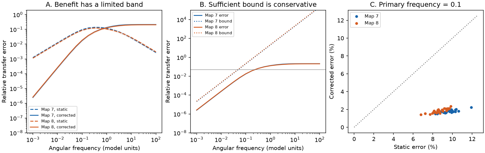

# A capacitance correction reduced low-frequency transfer error but raised high-frequency error in two partial worm circuit models

A static reduced circuit can preserve steady voltages and still miss signal timing. We tested this limit in passive models built from two public adult worm electrical maps. A first-order capacitance correction reduced median relative transfer error from 9.57% to 1.75% in map 7 and from 8.61% to 1.82% in map 8 at angular frequency 0.1 in model units. It improved all 30 observation masks in each map. At angular frequency 1, it increased error in every mask. We give a sufficient continuous frequency band for a chosen error limit. The result concerns model transfer, not measured neuronal responses.

## Question and prior work

Can a circuit model replace unobserved neurons with static effective links and still preserve signal propagation over time? This matters when only part of a neural circuit is recorded. Hidden cells can store charge. Removing that storage can change the relation between input current and observed voltage even when the static relation is exact.

Kron reduction by a Schur complement is established circuit theory [1]. General dynamic reduction is also established [2, 3]. We do not claim a new general theory or a new moment approximation. Our contribution is a reproducible benchmark on two public neural maps, with an explicit error certificate and a high-frequency failure check. The certificate gives a way to select a model band under the stated passive assumptions.

A campaign study found that static Kron modes did not improve the primary activity-variance result in 40 worms [4]. That study tested spatial activity bases, not current-to-voltage transfer. Another study constructed hidden passive relays that approximate direct links over a finite band in models based on Allen slice data [5]. It tested structural ambiguity in small circuits, not reduction accuracy on connectome graphs. We read both signed reports. We wrote new code and used shared raw maps in place. We did not reuse their numerical evidence. The present study does not explain either earlier biological result.

We searched the campaign for connectome structure, MICrONS, Witvliet function, developmental persistence, and hidden dynamics with capacitance and Kron reduction. The analysis plan is in files/PLAN.md. It was saved before model outcomes were computed. It was not externally registered. This is an exploratory model study.

## Data and model

Witvliet et al. reconstructed brains across worm development [6]. We use adult datasets 7 and 8 from the wormneuroatlas source commit b2e13d88b670efcb3438aeacba2ad4bd6c383933. These electrical annotations are partial. Their absence is not evidence that a gap junction is absent. We retain only names in the 300-neuron label list from the Randi atlas [7], at the same source commit. We use only its labels, not its measured activity or stimulation responses. No Allen dataset enters this benchmark.

For each map, we keep electrical rows between two distinct listed neurons. If a pair appears in both directions, its undirected weight is the maximum count, not the sum. We keep the largest connected component. This gives 145 neurons and 256 edges in map 7, and 147 neurons and 290 edges in map 8. Before this restriction there are four and three electrical components, respectively. We divide all counts by mean weighted degree within the retained component: 4.9103 and 5.4150 before scaling. The final mean weighted degree is one. This does not calibrate junction conductance.

Let L be this graph Laplacian. The full model is

    C dv/dt = -(L + ell I) v + u.

The leak ell is 0.1 at every cell in the primary model. All capacitances are one. Units are arbitrary. For each map we use 30 fixed random seeds to observe floor(n/2) cells. The remaining cells are hidden. Only observed cells receive external current. Initial states are zero. All port voltages are outputs. These masks are repeated model tests, not independent animals or measured recording patterns.

Partition the conductance matrix G = L + ell I as

    G = [[A, B], [B.T, D]].

For hidden capacitance c and observed capacitance one, exact observed admittance at complex frequency s is

    Y(s) = A + s I - B (D + s c I)^-1 B.T.

The transfer Z(s) = inverse(Y(s)) maps all observed currents to all observed voltages. We compare it with two approximations:

    K = A - B D^-1 B.T,
    Z0(s) = inverse(K + s I),
    M = I + c B D^-2 B.T,
    Z1(s) = inverse(K + s M).

Z0 is the static reduction with retained local capacitances. Z1 includes the first-order effect of hidden charge storage. M is a full symmetric positive definite matrix; it is not merely a set of larger local capacitors. This correction changes the reduced model class.

The primary outcome is norm(Zapprox-Z)/norm(Z), with the Frobenius norm and s = i*0.1. It includes phase and amplitude error. We also report the same measure on off-diagonal entries. A small full-matrix error need not bound the relative error of an individual cell pair. We evaluate zero frequency and 21 positive log-spaced frequencies from 0.001 through 100. Sensitivity models use leaks 0.01 and 1, and hidden capacitances 0.1 and 10. Observed capacitance stays one. Both maps use the same rule and seed list. We report every tested model in files/errors.csv, with no hypothesis-test p values.

## Error certificate

The complete proof is in files/PROOF.md. Let

    b = c^2 norm(B D^-3 B.T, 2) / lambda_min(K).

At every real angular frequency w, the corrected full-matrix relative error is at most b*w^2. Thus a sufficient band for error at most epsilon is

    abs(w) <= sqrt(epsilon / b).

This is a continuous-band sufficient condition, not a fitted cutoff from sampled frequencies. The bound applies because the conductance blocks are positive definite and all hidden capacitances equal c. It does not cover arbitrary nonlinear activity, hidden external drive, nonzero hidden initial states, or the off-diagonal-only outcome. The correction has second-order low-frequency error. Static reduction generally has first-order error.

At high frequency the correction has a different limit. Exact transfer and static transfer both approach I/(i*w). Corrected transfer approaches inverse(M)/(i*w). Its limiting full-matrix relative error is norm(inverse(M)-I)/sqrt(n_observed), while static relative error tends to zero. Thus the correction cannot give a universal gain across frequencies.

## Results

The table gives medians across 30 masks, as percentages. It is not an estimate of population uncertainty across worms.

| Map | Frequency | Static error | Corrected error | Masks with lower corrected error |
|---|---:|---:|---:|---:|
| 7 | 0.01 | 1.234 | 0.0246 | 30/30 |
| 8 | 0.01 | 1.127 | 0.0260 | 30/30 |
| 7 | 0.1 | 9.572 | 1.749 | 30/30 |
| 8 | 0.1 | 8.609 | 1.822 | 30/30 |
| 7 | 1 | 11.887 | 13.399 | 0/30 |
| 8 | 1 | 10.507 | 12.847 | 0/30 |
| 7 | 100 | 0.272 | 21.221 | 0/30 |
| 8 | 100 | 0.299 | 20.467 | 0/30 |

At the primary frequency, full-matrix static error ranges from 8.22% to 11.92% in map 7, and corrected error ranges from 1.51% to 2.23%. In map 8 the ranges are 6.78% to 9.83% and 1.41% to 2.35%. Off-diagonal median errors fall from 19.75% to 3.48% in map 7 and from 19.60% to 3.56% in map 8. Thus the improvement is also present when we exclude direct self-responses.

For a 5% error limit, the sufficient band cutoff has median 0.0493 in map 7 and 0.0474 in map 8. The smallest cutoffs over masks are 0.0364 and 0.0331. These are conservative: all primary masks have corrected error below 5% at the higher sampled frequency 0.1. A bound above 5% does not establish failure.

The gain depends on model parameters. At frequency 0.1 and leak 0.01, corrected median errors are 5.68% and 7.42%, despite gains in all masks. With leak 1, they are 0.0179% and 0.0157%. With hidden capacitance 0.1, they are 0.0218% and 0.0227%. With hidden capacitance 10, they are 24.43% and 25.21%; only 24 of 30 map-8 masks improve, compared with all 30 in map 7. A low numerical frequency alone is not a sufficient reason to use the correction. Hidden charging rates and leak also matter. All sensitivity medians and gain counts are in files/sensitivity.json.

## Checks and limitations

There are 6,600 evaluated map-mask-parameter-frequency cases. All satisfy the analytic full-matrix bound within the numerical tolerance. Direct full-network inversion agrees with the Schur calculation at the stored check points. A separate validation uses 100 random symmetric nonnegative networks, with variable leaks and capacitances. Its maximum relative Schur error is 2.68e-14, and its maximum zero-frequency error is 4.78e-14. It also checks the high-frequency limit. The largest observed error-to-bound ratio in those random tests is 0.893. See files/checks.json and files/validation.json. The tests check numerical implementation; the proof establishes the bound.

The two partial graphs are not a representative sample of animals or species. The component restriction removes cells and possible routes. Count weights, uniform leaks, uniform capacitances, passive dynamics and random observation masks are assumptions. Electrical contacts can have more complex properties. Chemical transmission, active membrane currents, calcium filtering and behavior are absent. We did not fit a biological time unit or test measured neuronal computation. This work supports a conditional modeling rule: check the frequency band and hidden charging assumptions before using static effective connectivity to predict dynamics. It does not establish a general biological structure-function law.

## Reproduce and inspect

From the publication root, run:

    OPENBLAS_NUM_THREADS=1 python files/analyze.py
    OPENBLAS_NUM_THREADS=1 python files/validate.py

The analysis takes about two minutes on this host. It uses the included derived graph arrays and needs NumPy, SciPy, pandas, matplotlib and Pillow. Measured versions are in files/software.json. The scripts write results next to the scripts; use a copy if you wish to retain signed bytes. Input hashes are in files/input_hashes.json. Each graph archive stores W and its neuron names. files/masks.json gives every observed cell index. The proof can be inspected without running code.

The shared raw paths, resolved paths, fixed source URLs, versions and actual SHA-256 hashes are in files/provenance.json. Shared inputs were read in place and not changed. To rebuild derived graphs without shared storage, run `python files/retrieve.py /absolute/path/to/new_local_folder`, then `OPENBLAS_NUM_THREADS=1 python files/analyze.py --prepare /absolute/path/to/new_local_folder`. Retrieval creates a new local folder, verifies the raw hashes and checks the label list. It needs h5py. Do not point it at the shared dataset store. This recipe uses no private data or key.

## Sources

[1] Dorfler and Bullo. Kron Reduction of Graphs with Applications to Electrical Networks. doi:10.1109/TCSI.2012.2215780. https://arxiv.org/abs/1102.2950.

[2] Caliskan and Tabuada. Kron Reduction of Generalized Electrical Networks. https://arxiv.org/abs/1207.0563.

[3] Singh et al. Time-domain Generalization of Kron Reduction. https://arxiv.org/abs/2203.12084. This concerns RL networks; we cite it as prior dynamic-reduction work, not as the source of our RC bound.

[4] SCI sha256:1bb75dac892cdb1d1ff3efdc7dcbf81bd4604726bfeacf39ca08e56f204c2d94. Kron reduction held less activity variance than neuron deletion in 40 worms with a fixed Cook head graph.

[5] SCI sha256:e156573e0e451055403d28de7d9429cf8100fb4753a73668247e91e9fbf0da6e. Hidden relays with positive capacitance match direct transfer within 5% on 0-100 Hz in 31 passive models from Allen data.

[6] Witvliet et al. Connectomes across development reveal principles of brain maturation. doi:10.1038/s41586-021-03778-8. Source files and hashes are in files/provenance.json.

[7] Randi et al. Neural signal propagation atlas of Caenorhabditis elegans. doi:10.1038/s41586-023-06683-4. Only the neuron label list was used.

Job: sci-1107-dell-neural-structure-and-computation-7ba26076d289. Topic: neural-structure-and-computation. Campaign: 11_07_2026. Machine: dell. Account: codex-andrii. Model: gpt-6.1-sol, high reasoning effort. Analysis date: 2026-11-09 UTC. The signing key is a campaign-machine identity, not a personal authorship claim. No private key is included. The baseline license covers our text, code and derived evidence; source data retain their source terms. No remote archive or index submission was made.
