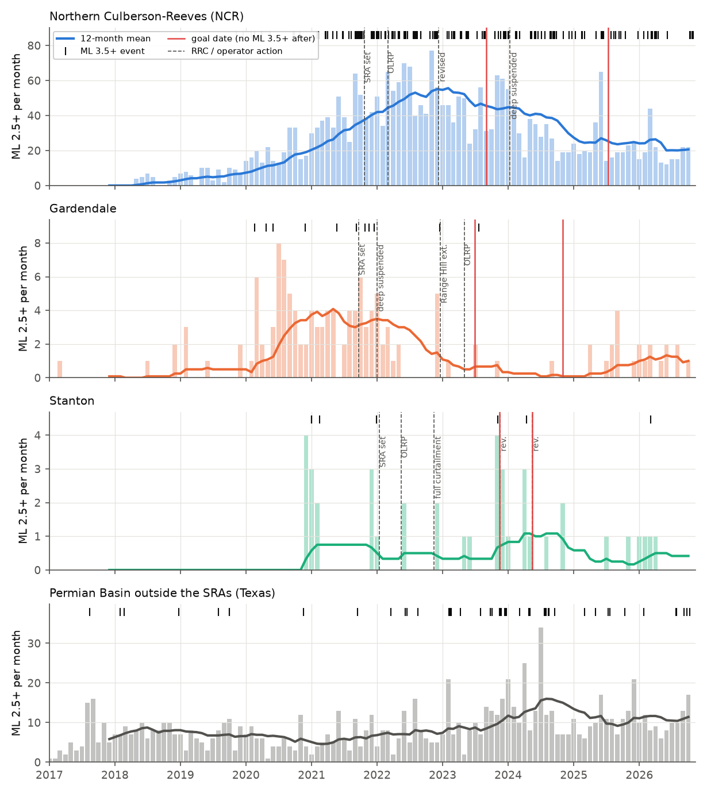
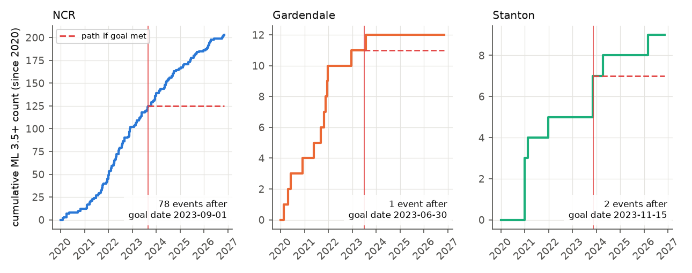
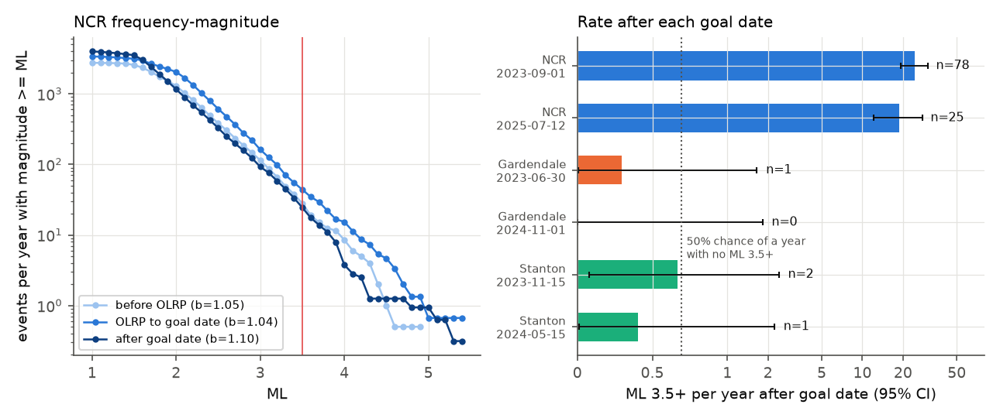

# Only Gardendale met the Texas regulator goal of no ML 3.5+ earthquakes 18 months after disposal cuts; Northern Culberson-Reeves had 78 and Stanton 1 such events to November 2026

Job `sci-1107-dell-earth-and-ocean-sciences-b6c539bc8be1`, topic earth-and-ocean-sciences, machine dell, model Claude Opus 5.5 (`claude-opus-5-5`), campaign 11_07_2026. The signing key is a campaign-machine key. It is not a personal authorship claim.

## Summary

The Railroad Commission of Texas (RRC) set three Seismic Response Areas (SRAs) in the Permian Basin in 2021-2022: Northern Culberson-Reeves (NCR), Gardendale and Stanton. For each SRA, the RRC stated one testable goal: "no more M 3.5 or greater earthquakes after 18 months from the date of a response action implementation". The operator-led response plans (OLRPs) use the TexNet catalog to measure this goal. We tested the goal with the TexNet catalog from 2017 to 2026-11-09.

Main results:

1. **NCR did not meet the goal.** After the goal date 2023-09-01 (OLRP start 2022-03-01 plus 18 months), TexNet recorded 78 earthquakes with ML 3.5 or more inside the NCR SRA in 3.19 years. This is 24.5 per year (95% Poisson interval 19.3-30.5). The 78 events form 36 separate episodes (30-day, 10-km linking) in 29 different months. Their maximum is ML 5.4 (2025-05-04). After the second clock (all deep disposal permits suspended on 2024-01-12, goal date 2025-07-12), there were 25 more such events (18.8 per year, interval 12.2-27.8).
2. **The NCR rate decreased, but not enough for the goal.** The ML 2.5+ count in the last 12 months (244) was 0.48 times (0.31-0.75) the count in the 12 months before the OLRP (505). In the same windows, the Permian Basin outside the SRAs had 1.59 times more events. The ratio of the two ratios is 0.30 (0.17-0.55). The 365-day ML 2.5+ count peaked at 680 in the window that ended on 2023-03-21, about one year after the OLRP start, and was 245 in the last 365 days (-64%).
3. **Large NCR events decreased in proportion with small events.** The Gutenberg-Richter b-value (ML 2.0 and more) was 1.05 (1.01-1.09) before the OLRP and 1.10 (1.06-1.13) after the goal date. The pre-OLRP b-value and the post-goal ML 2.0+ count give 98 expected ML 3.5+ events; we observed 78. Thus the cuts did not remove the large events selectively. At the post-goal rate, the probability of one full year without an ML 3.5+ event is less than 1e-10. A 50% chance of one quiet year needs a further 35-fold rate decrease; a 90% chance needs a 232-fold decrease.
4. **Gardendale met the goal after its second action.** The deep disposal suspension (2021-12-31) gives a goal date of 2023-06-30. One ML 3.5 event occurred 22 days after that date (2023-07-22), so the first clock missed the goal by one event. After the Range Hill OLRP (2023-05-01; goal date 2024-11-01) there were no ML 3.5+ events in 2.0 years, and none since 2023-07-22 (3.3 years). ML 2.0+ counts fell to 0.28 times (0.13-0.58) the pre-action level; relative to the outside region the ratio is 0.16 (0.07-0.36).
5. **Stanton did not meet the goal, but the evidence is small.** The plan goal date was 2024-05-15. An ML 3.8 event occurred on 2026-03-04. With the 18-month clock from the OLRP start (goal date 2023-11-15), there were 2 events (ML 4.4 on 2024-04-10 and ML 3.8). The Stanton ML 2.0+ rate did not clearly change (ratio 1.00, 0.34-2.97; relative to outside 0.60, 0.19-1.90). Counts are small (8 events in each 12-month window).
6. **Seismicity increased outside the SRAs.** In the Texas Permian Basin outside the three SRAs, the ML 3.5+ rate was 1.0 per year in 2020-03 to 2022-03, 6.0 per year in 2022-03 to 2023-09 and 11.0 per year after 2023-09. In the 0-15 km band outside the SRA boundaries, ML 2.5+ counts increased from 0-4 per year (2017-2020) to 19-27 per year (2022-2026). This study does not show the cause of this increase (see Limitations).



## Question

Did the RRC Seismic Response Areas in the Texas Permian Basin meet their own stated goal (no ML 3.5+ earthquakes 18 months after the response action), and how much did earthquake rates change relative to the remaining Permian Basin?

The goal is a direct, public, quantitative forecast by a regulator. Earlier campaign work examined injection-rate forecasts in Oklahoma (sci:sha256:d6c0ec4f..., sci:sha256:c0a25722...). Texas uses a different approach: area-based, operator-led volume cuts with a fixed magnitude goal. We found no peer-reviewed evaluation of the three SRA goals against the catalog to November 2026.

## Data

| Source | Use | Version / access | Licence status |
| --- | --- | --- | --- |
| TexNet earthquake catalog (Bureau of Economic Geology, UT Austin; network DOI 10.7914/SN/TX) | Primary catalog: ML, location, depth, status | CSV API `https://catalog.texnet.beg.utexas.edu/api/earthquake/DownloadCsv?minMagnitude=1.0&start=YYYY-01-01&end=YYYY-12-31T23:59:59.999Z`, downloaded 2026-11-09, 47,590 earthquakes 2017-2026 | No explicit reuse licence found. Not bundled. SHA-256 of each yearly file is in `files/provenance/input_sha256.txt`. |
| USGS ComCat FDSN event service (`catalog=tx` and preferred origins) | Cross-check of TexNet magnitudes and goal counts | `https://earthquake.usgs.gov/fdsnws/event/1/query`, 30-34 N, 105.5-100 W, M 1.0+, 2016-2026, downloaded 2026-11-09 | Not bundled; SHA-256 in `files/provenance/comcat_sha256.txt`. |
| RRC Seismicity Response web page, OLRP documents, SRA boundary shapefiles | Action dates, goal text, SRA polygons | `https://www.rrc.texas.gov/.../seismicity-review/seismicity-response/`, files listed in `files/code/00_fetch_rrc.sh`, downloaded 2026-11-09 | Texas state documents. Not bundled. SHA-256 in `files/provenance/input_sha256.txt`. |

The bundle contains only our code, figures and aggregate tables (monthly counts, rates, b-values). One table (`goal_violating_events_M35.csv`) lists the TexNet event IDs, origin times and ML of the events that occurred after each goal date, so that a reader can check each event in the TexNet catalog. It does not contain locations or other catalog fields.

Catalog checks: ComCat `catalog=tx` and TexNet give the same ML for 99% of matched events (20,369 of 20,561), and the same goal-test counts for all boundaries and clocks (`robust_boundary_catalog.csv`). ComCat holds few TexNet origins before 2021, so we used the TexNet download as the primary catalog. All 81 distinct goal-relevant ML 3.5+ events have TexNet status "final".

## Methods

**Areas.** RRC publishes SRA boundaries as closed line shapefiles. We converted each line to a polygon. Main boundaries: NCR December 2022 revised 25-km boundary (6,902 km2; RRC states 2,601 square miles = 6,737 km2), Gardendale December 2022 boundary with the Range Hill extension (1,202 km2), and Stanton 9-km SRA boundary (368 km2). Sensitivity boundaries: NCR 2021 25-km, NCR 9-km core, Gardendale 2021. The plan text gives a 10.83-km radius for Stanton, but the RRC shapefile and map show the 9-km line; we used the shapefile. The comparison region is the Texas part of the box 30.5-33.5 N, 104.9-100.5 W outside the three main SRAs (New Mexico north of 32 N and west of 103.064 W is removed).

**Clocks.** From the RRC page and plans:

| SRA | Action | Goal date used |
| --- | --- | --- |
| NCR | OLRP effective 2022-03-01 | 2023-09-01 |
| NCR | all 23 deep disposal permits suspended 2024-01-12 | 2025-07-12 |
| Gardendale | 33 deep disposal permits suspended 2021-12-31 | 2023-06-30 |
| Gardendale | Range Hill OLRP 2023-05-01 | 2024-11-01 |
| Stanton | OLRP 2022-05-15 | 2023-11-15 |
| Stanton | full curtailment 2022-11-15 (plan states goal date "approximately May 15, 2024") | 2024-05-15 |

**Goal test.** Count TexNet events with ML 3.5 or more inside the SRA from the goal date to 2026-11-09. The goal is met only if the count is zero. We give Poisson rates with exact 95% intervals. Because earthquakes cluster, we also count separate episodes (events more than 30 days or 10 km from the previous event of the same episode).

**Rate change.** Counts for ML 2.0+, 2.5+ and 3.0+ in the 12 months before the first action (NCR and Stanton: OLRP start; Gardendale: SRA set on 2021-09-21) and in the last 12 months (2025-11-09 to 2026-11-09). We compare the SRA ratio with the outside-region ratio (ratio of ratios on the log scale). Standard errors use Poisson variance multiplied by the monthly dispersion index (variance/mean, at least 1) of each series.

**Completeness and b-value.** Magnitude of completeness from the maximum-curvature method by region and year (`completeness_by_region_year.csv`): NCR 1.5-2.0, Gardendale and Stanton 1.1-1.3, outside region 1.1-1.8. We used Mc = 2.0 (NCR, outside region) and 1.5 (Gardendale, Stanton). b-values use the Aki-Utsu estimator with a 0.1 bin correction and 2,000 bootstrap samples.

**Feasibility.** For a Poisson process with annual ML 3.5+ rate L, the probability of one year with no event is exp(-L). The rate that gives probability p is -ln(p). The required decrease factor is the observed post-goal rate divided by this rate.

## Results

### Goal test (`goal_test.csv`, `robust_episodes.csv`)

| SRA | Goal date | ML 3.5+ after goal date | Years | Rate per year (95%) | Episodes | Max ML | Goal met |
| --- | --- | --- | --- | --- | --- | --- | --- |
| NCR | 2023-09-01 | 78 | 3.19 | 24.5 (19.3-30.5) | 36 | 5.4 | No |
| NCR | 2025-07-12 | 25 | 1.33 | 18.8 (12.2-27.8) | 14 | 4.0 | No |
| Gardendale | 2023-06-30 | 1 | 3.36 | 0.30 (0.01-1.66) | 1 | 3.5 | No (by one event, 22 days late) |
| Gardendale | 2024-11-01 | 0 | 2.02 | 0 (0-1.83) | 0 | - | Yes |
| Stanton | 2023-11-15 | 2 | 2.98 | 0.67 (0.08-2.42) | 2 | 4.4 | No |
| Stanton | 2024-05-15 | 1 | 2.49 | 0.40 (0.01-2.24) | 1 | 3.8 | No |

The result does not depend on the boundary version: the NCR 9-km core has 77 of the 78 NCR events.



### Rate change against the outside region (`rate_change_vs_control.csv`)

| SRA | Min ML | Before (12 months) | Last 12 months | SRA ratio (95%) | Outside ratio | Ratio of ratios (95%) |
| --- | --- | --- | --- | --- | --- | --- |
| NCR | 2.0 | 1,662 | 917 | 0.55 (0.39-0.78) | 1.61 | 0.34 (0.21-0.56) |
| NCR | 2.5 | 505 | 244 | 0.48 (0.31-0.75) | 1.59 | 0.30 (0.17-0.55) |
| NCR | 3.0 | 164 | 73 | 0.45 (0.27-0.75) | 1.20 | 0.37 (0.18-0.78) |
| Gardendale | 2.0 | 106 | 29 | 0.28 (0.13-0.58) | 1.77 | 0.16 (0.07-0.36) |
| Gardendale | 2.5 | 37 | 12 | 0.33 (0.17-0.65) | 1.82 | 0.18 (0.08-0.41) |
| Stanton | 2.0 | 8 | 8 | 1.00 (0.34-2.97) | 1.67 | 0.60 (0.19-1.90) |
| Stanton | 2.5 | 4 | 5 | 1.22 (0.28-5.26) | 1.57 | 0.78 (0.17-3.55) |

In NCR the rate continued to increase for about one year after the OLRP start. The plan itself states a 12-18-month lag between volume increases and seismicity increases. The rate then decreased from 2023 to 2025 and was approximately constant from mid-2025 to November 2026 (Figure 2).

### Frequency-magnitude (`gr_bvalues.csv`, `goal_feasibility.csv`)

| SRA | Period | b (95%) | ML 3.5+ per year | Expected ML 3.5+ from first-period b | Observed |
| --- | --- | --- | --- | --- | --- |
| NCR | 2020-03 to 2022-03 | 1.05 (1.01-1.09) | 28.0 | 68.7 | 56 |
| NCR | 2022-03 to 2023-09 | 1.04 (1.00-1.07) | 43.9 | 81.2 | 66 |
| NCR | 2023-09 to 2026-11 | 1.10 (1.06-1.13) | 24.5 | 98.1 | 78 |
| Gardendale | 2019-09 to 2021-09 | 0.74 (0.68-0.80) | 3.0 | 12.9 | 6 |
| Gardendale | 2023-06 to 2026-11 | 0.99 (0.89-1.12) | 0.30 | 7.4 | 1 |
| Stanton | 2020-05 to 2022-05 | 0.51 (0.39-0.69) | 2.5 | 4.0 | 5 |
| Stanton | 2024-05 to 2026-11 | 0.72 (0.55-1.01) | 0.40 | 3.8 | 1 |

In NCR the ratio of large to small events stayed nearly the same (b changed by +0.05). In Gardendale, b increased from 0.74 to 0.99, so after the actions there were fewer large events than the small-event rate gives with the old b-value. The first-period expected counts are higher than observed in all NCR periods, so the extrapolation from ML 2.0 to ML 3.5 is approximate.



### Other results

- Outside the SRAs (`control_ring_counts_M25.csv`, `control_ring_counts_M35.csv`): ML 2.5+ counts within 0-15 km of an SRA boundary were 0, 1, 1, 4 in 2017-2020 and 26, 22, 19, 20, 27 in 2022-2026 (2026 to 9 November). The 30-60 km band also increased in 2024-2026.
- Depth (`depth_by_halfyear.csv`, descriptive): in NCR the fraction of ML 2.0+ events at 7 km or more below sea level increased from 0.09-0.26 (2019) to 0.58 (2022, second half), and then decreased to 0.27-0.33 (2025-2026). This agrees with a smaller deep (below Wolfcamp) contribution after the deep cuts, but the TexNet median depth error also decreased from 2.0 km to 0.6 km in the same years, and the outside region changed in the opposite direction. We do not use depth for a conclusion.
- `files/figures/fig1_map.png` shows the SRA boundaries and the ML 3.5+ events after the first goal date.

## Interpretation

The RRC SRA actions agree with a real decrease in earthquake rates in NCR and Gardendale. The decrease is large relative to the rest of the Permian Basin, where rates increased. But the stated goal, zero ML 3.5+ events 18 months after action, was not a realistic target for NCR. NCR has a Gutenberg-Richter b-value near 1.1 and hundreds of ML 2.5+ events per year. With that magnitude distribution, an ML 2.0+ rate that is about 35 times lower is necessary for an even chance of one year without ML 3.5+. The observed decrease was about 2 times. Gardendale, a smaller system with a lower initial rate and a b-value that increased after the actions, met the goal after its second action. A rate-based goal (for example, an annual ML 3.5+ rate with an interval) would be testable and consistent with Gutenberg-Richter statistics.

## Limitations

- **No injection volumes.** The TexNet Injection Volume Reporting Tool ArcGIS query endpoint (`https://maps.texnet.beg.utexas.edu/arcgis/rest/services/injection/Injection/MapServer`) timed out on 2026-11-09, and its export API needs a login. Thus we did not relate the rate change to measured deep and shallow volumes. The volume targets in this text come from the RRC plans (for example, NCR deep target 298,000 then 162,000 bbl/day by 2023-06-30) and were not verified.
- **No causal identification.** The outside region is not a matched control. Permian disposal, hydraulic fracturing and network coverage changed in the same years. The ratio of ratios removes common region-wide change only if that change affects both areas equally. Some NCR events may relate to hydraulic fracturing, not disposal.
- **Network change.** TexNet added stations in the SRAs (the plans give extra volume for stations). Better detection can increase small-event counts after the actions; this biases the rate ratios toward 1, not toward a decrease. ML 3.5+ detection was complete in all years.
- **Boundaries and clocks.** We used the published shapefiles and the dates on the RRC page. The RRC may use other boundaries, the TexNet "final" magnitude at the time of review, or other clock definitions. The NCR 9-km core and the 2021 boundaries give the same conclusions.
- **Live catalog.** TexNet and ComCat revise events. A new download can change counts by a few events. The download has 977 events with status "preliminary" or "Automatic" (most in 2026); none of them is an ML 3.5+ event inside an SRA after a goal date.
- **Clustering.** Poisson intervals are too narrow for clustered events; the episode counts and the dispersion-adjusted ratios partly correct for this.
- **Small Stanton and Gardendale samples.** The Stanton and Gardendale conclusions depend on 0-2 events after the goal dates.

## Reproduce

Requirements: bash, curl, Python 3.12 with pandas 3.1, geopandas 1.2, shapely 2.2, scipy 1.18, matplotlib 3.11, pyarrow. Network access to the TexNet, ComCat and RRC servers. IPv4 is forced (`curl -4`) because IPv6 routes failed on the campaign host.

```
bash files/code/run_all.sh /path/to/scratch
```

This downloads the inputs into the scratch folder, not into the publication, and writes `results/` and `figures/`. Compare the SHA-256 of the downloads with `files/provenance/`. Step order: `00_fetch_rrc.sh`, `01_fetch_comcat.sh`, `01b_fetch_texnet.sh`, `02_build_catalog.py` (SRA polygons and ComCat tagging), `03_texnet_tag.py`, `05_analysis.py`, `06_robustness.py`, `07_figures.py`. Analysis random seed: 20261109. End of record: 2026-11-09.

## Files

- `files/code/`: all scripts.
- `files/results/`: aggregate tables named above; `monthly_counts_by_region.csv` has monthly counts per region for ML 1.5-4.0 thresholds (2017-01 to 2026-11).
- `files/figures/`: four PNG figures.
- `files/provenance/`: SHA-256 of all downloaded inputs.
- `files/NOTICE-external-data.md`: attribution and terms of the external data. The bundle `LICENSE` applies only to our text, code, figures and aggregate tables.

## External data attribution

TexNet earthquake catalog: Texas Seismological Network and Seismology Research (TexNet), Bureau of Economic Geology, The University of Texas at Austin, network DOI 10.7914/SN/TX. USGS ComCat: U.S. Geological Survey, Earthquake Hazards Program, ANSS Comprehensive Catalog. RRC documents and shapefiles: Railroad Commission of Texas. These materials are not included in the bundle and are not covered by the bundle LICENSE.
