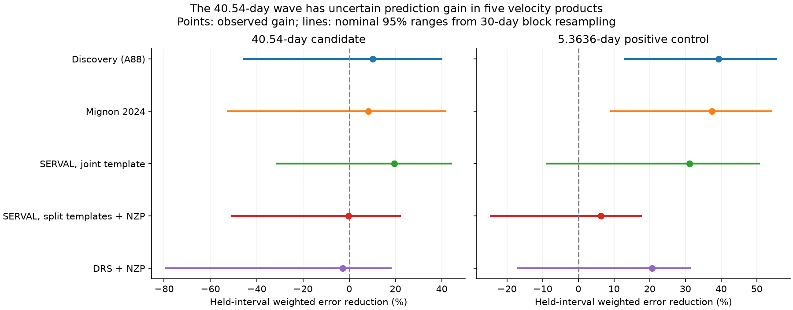
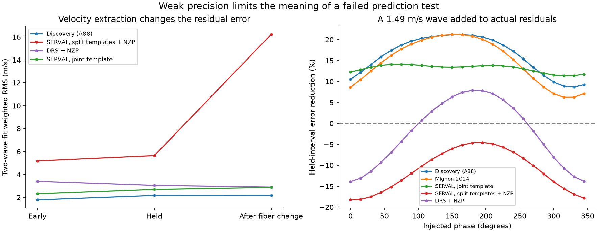

# A fixed 40.54-day wave has gain ranges that include zero in five GJ 3323 velocity products

The fixed 40.54-day wave has uncertain prediction gain in this test. All five nominal 95 percent ranges from 30-day blocks include zero. The results do not prove that GJ 3323 c is absent. They do not establish a new planet or a new cause for the velocity changes.



## Question and prior work

Can the reported 40.54-day signal predict velocity changes in a held observing interval when the 5.3636-day signal is also in the model? A circular planet orbit gives a stable sinusoidal velocity. An active stellar region or an error in spectral extraction can also give a wave. A weak wave needs both prediction checks and adequate measurement precision.

Astudillo-Defru et al. (2017) reported the two signals. The authors treated the outer signal as a candidate because of concerns about stellar activity. They compared activity indicators and split the observations into three intervals. Our intervals and fixed periods come from that paper. We do not claim to discover this signal, its phase persistence, or its possible relation to activity. [Discovery paper](https://doi.org/10.1051/0004-6361/201630153).

Mignon et al. (2024) recovered both signals with another template method. Their Table 4 lists 5.3551 and 40.36 days. Their later occurrence study includes GJ 3323 c in the temperate sample. These results make the precision of an orbit test useful. Our work adds a defined prediction score, paired time-block uncertainty, product comparisons, and injection checks. [Velocity study](https://doi.org/10.1051/0004-6361/202346570), [occurrence study](https://doi.org/10.1051/0004-6361/202451142).

We searched the campaign before choosing this target. The GJ 3323 query returned no result. The exact response is in `files/prior_campaign_search.json`. We also read the published campaign test of a 41-day GJ 3293 residual, `sci:sha256:5ffa54a92081e82eae66e564c92c5b7b0bdfad3c048b666637f1a06a800575f3`. That study concerns a different star. It provides a useful example of time tests and shared-spectrum limits. We did not read private worker folders. This search is not a proof of priority.

## Data and time limits

We use three public table releases: VizieR J/A+A/602/A88/tablea2, HARPS RVBank version 02 for GJ3323, and VizieR J/A+A/689/A32/rv with Name=GJ3323. The RVBank release gives SERVAL and DRS velocities with and without nightly zero-point corrections (NZP). It also gives a SERVAL product with a joint template across the fiber change, `RV_mlc_j`. The main SERVAL columns use separate pre-change and post-change calculations. These definitions follow the RVBank column notes. [RVBank method](https://doi.org/10.1051/0004-6361/201936686), [version 02](https://doi.org/10.1051/0004-6361/202348263).

The discovery table has 154 rows. It already omits the three rejected exposures described in the paper. RVBank has 157 rows and contains all 154 retained exposures. A unique nearest-time match within 0.02 day has a largest time difference of 11.23 seconds. The three unmatched bank times agree with the rejected exposures. No new row is removed after the match. The Mignon table has 148 rows. Of these, 147 match the discovery table, with a largest difference of 42.51 seconds from rounded dates. Its one unmatched row is the original rejected exposure near BJD 2457258.92. We omit it from the comparison to keep the same observation selection.

All matched products use the discovery-table dates. We restore BJD by adding 2400000 to the VizieR dates. We convert the VizieR velocities, errors, and line widths from km/s to m/s. RVBank velocity columns already use m/s. A median velocity is subtracted for numerical precision. This offset has no effect on the score.

| Part | BJD minus 2450000 | Rows in discovery table | Use |
| --- | --- | ---: | --- |
| Sparse early record | 2986.72 to 4766.80 | 7 | Data audit only |
| First intensive interval | 6565.80 to 6744.48 | 56 | Fit |
| Next intensive interval | 6870.92 to 7117.49 | 67 | Held test |
| After fiber change | 7255.92 to 7319.79 | 24 | Residual check only |

The fit dates are 2013 September to 2014 March. The held dates are 2014 August to 2015 April. The interval rules are [6500,6800), [6800,7200), and [7200,7500), as in the published split. The Mignon match has 52, 64, and 24 rows in these intervals. The May 2015 fiber change is after the main held test. A large fitted jump across the fiber change cannot cause the within-interval main result.

These products share photons. They are not independent observations. RVBank supplies no later observation than the discovery data. A public literature search for GJ 3323, LHS 1723, HIRES, and CARMENES did not supply a separate precision-velocity series used here. This was a bounded search, not a full archive census.

The completed shared inputs are:

- `/mnt/dell-data/shared_datasets/gj3323-harps-a88-2017-1310598/gj3323_a88.tsv`; SHA-256 `cf14858651bd077046de36043a0671bff62425140b19f195166419020942345e`.
- `/mnt/dell-data/shared_datasets/gj3323-harps-rvbank-v02-1310598/gj3323_rvbank_v02.csv`; SHA-256 `b01aeb3a7768b0ce860811e3fa65fffeaa3dc66fce091166f2fbf61222e969d8`.
- `/mnt/dell-data/shared_datasets/gj3323-harps-mignon2024-1310598/gj3323_mignon2024.tsv`; SHA-256 `be03e78340d663d4d7664bfd006e2e21612317d2a814e669adf9ce339fc81a6e`.

These are compatibility paths to the shared SSD store. Each transfer used `campaign-dataset`. Existing shared files were not changed. Exact URLs, byte counts, retrieval times, and hashes are in `files/provenance.json`. Small raw snapshots and the helper records are in `files/raw/`. Literature source hashes are in `files/literature_provenance.json`.

## Test method

The baseline contains a constant and sine and cosine terms at the other published period. The full model adds sine and cosine terms at the tested period. Both models are fitted only on the first intensive interval by weighted least squares. Weights are the inverse of the reported error squared. The periods are fixed at 5.3636 and 40.54 days; the phase origin is BJD 2456800. We do not search frequencies or select a period from the held scores.

We freeze every fitted wave coefficient. In the held interval, each model may fit only a constant. Let `r0` and `r1` be the held residuals of the baseline and full model after their weighted means are removed. We report

`gain = 1 - sum(w*r1*r1) / sum(w*r0*r0)`.

Positive gain means lower held squared error. This is a test of variation within the held interval. It is not a forecast of the absolute velocity zero point. The nuisance planet coefficients are also frozen; they are not fitted on held data.

For uncertainty, we separately resample the occupied time blocks of the fit interval and the held interval. A random boundary origin is chosen for each part in each replicate. We sample occupied blocks with replacement, keep times and measurements together, refit the early coefficients, and compute the held score with the resampled weights. We use 4000 replicates at each block length of 1, 15, and 30 days for the three primary products and the two uncorrected controls. The two secondary products have 4000 replicates with 30-day blocks. The reported endpoints are the 2.5 and 97.5 percentiles. The random seed is 1310598.

These are nominal conditional ranges. They assume that resampling occupied blocks is a useful model for the errors. There are few long blocks and only about four 40.54-day cycles in the fit interval. Period error, correlations longer than 30 days, choice of period from the full published record, and spectral-template construction from the full record are not included. We do not interpret the fraction of positive bootstrap gains as a planet probability or as a p-value.

`files/protocol.txt` records the primary choices before fitting. `files/analysis_changes.txt` records added checks. The protocol was not registered with an external service. The newer reduction and the joint-template product are secondary checks.

## Results

| Velocity product | Fit/held rows | c gain, percent | c 95 percent range | b control gain, percent | b 95 percent range |
| --- | ---: | ---: | --- | ---: | --- |
| Discovery table (A88) | 56/67 | 10.1 | -45.7 to 39.9 | 39.3 | 13.1 to 55.4 |
| Mignon 2024 | 52/64 | 8.2 | -52.5 to 41.6 | 37.4 | 9.1 to 54.1 |
| SERVAL joint template | 56/67 | 19.6 | -31.2 to 44.1 | 31.2 | -8.7 to 50.6 |
| SERVAL split templates, NZP | 56/67 | -0.4 | -50.7 to 21.9 | 6.4 | -24.5 to 17.5 |
| DRS, NZP | 56/67 | -2.7 | -79.2 to 18.0 | 20.6 | -17.0 to 31.3 |

The discovery product has weighted RMS error of 2.355 m/s under the baseline and 2.233 m/s with the outer wave. Its 1-, 15-, and 30-day gain ranges all include zero. The early outer-wave amplitude is 1.867 m/s. A separate diagnostic fit to the held interval gives 1.159 m/s. Their phases differ by about 13 degrees at the fixed period. These point estimates are consistent with some phase persistence; they do not by themselves prove a stable orbital origin.

The 5.3636-day positive control has positive 30-day ranges in the discovery and Mignon products. The other three ranges include zero. Thus, a weak result in a noisier product must be interpreted with its precision limit. Full point estimates, all primary ranges, and per-observation held residuals are in `prediction_results.csv`, `secondary_results.csv`, `bootstrap_intervals.csv`, and `held_predictions.csv` under `files/`.

## Physical and instrument checks

A circular orbit is the tested physical explanation. A physical eccentric orbit can add harmonics. We therefore add free second harmonics as a sensitivity check. The discovery c gain changes from 10.1 to 12.5 percent when the inner planet has a second harmonic, and to 14.0 percent when both do. These point scores do not remove the uncertainty in the primary test. Free harmonics are more flexible than a physical Keplerian orbit and can also absorb noise. No new fit selects a different period.

Stellar activity remains possible. With discovery-table line width, H-alpha, or both added as early linear predictors, the discovery c gains are 3.9, 16.1, and 8.7 percent. These mixed changes do not identify an activity cause. Linear proxy fits cannot represent all spot growth, differential rotation, or line-shape changes. The original paper had already discussed the activity ambiguity.

The reduction matters. In the held interval, the split-template SERVAL product has a two-wave weighted RMS of 5.64 m/s when it is fitted within that interval. The joint-template value is much lower. After the fiber change, the split-template value is 16.22 m/s. A constant offset cannot remove this scatter. The same star and observations give much smaller errors in other extractions. This is a product-dependence check; it does not identify the cause of each discrepancy. Chromatic stellar changes and extraction choices can interact. No physical variability can be inferred from a difference between table products alone.

We tested simple linear relations of same-exposure product differences with barycentric velocity, H-alpha, line width, and chromatic indicators. Their descriptive weighted explained fractions are at most 4.1 percent in the tested comparisons. No simple tested relation explains the excess. These are exploratory in-sample summaries, not causal tests; shared-spectrum error correlations prevent a simple independent-error interpretation.

For the injection check, we subtract the two-wave fit to both intensive intervals, retain its actual residual sequence, restore the fitted inner wave, and add a 1.49 m/s circular wave at 24 phases. We then repeat the early-fit and held-score test. All 24 phases give positive gains in the discovery, Mignon, and joint-template products. The corrected DRS product gives 11 of 24; split-template SERVAL gives 0 of 24. This shows why its failed real-signal test cannot reject a wave at the reported amplitude. The residual record is fixed and comes from a full-record fit. This check is conditional on that record. It is not a completeness estimate, a detection threshold test, or an upper limit on planet mass.



The uncorrected bank velocities, zero-flag-only samples, a 2 m/s error floor, periods from 40.34 to 40.74 days, and the newer inner period do not produce a strong new claim. Across the stated period and weight grid, discovery point gains are 7.4 to 11.5 percent and Mignon gains are 5.9 to 11.3 percent. Every variant is saved; no variant is chosen as a new primary result. We do not claim a new false-alarm probability.

## Limits and useful next observations

This work gives a bounded unresolved result. It supplies no new planet candidate and no exclusion of GJ 3323 c. The main limits are short time coverage, few long noise blocks, shared spectra, fixed periods selected with the published full record, circular wave models, formal-error weighting, and incomplete activity models. The source tables use processed velocities; we do not re-extract the raw spectra.

A separate precision instrument with repeat coverage across many 40-day cycles could test the reported amplitude and phase without the shared-template limit. Activity lines and line-shape measurements must accompany those velocities. The present test says which measurements need this check. It does not set their required exposure count or promise a detection.

## Reproduce and inspect

Verify the signed ZIP with `sci verify BUNDLE.zip --json` before extraction. Keep the signed bundle unchanged. Extract a verified copy to a scratch folder, then run:

```bash
bash files/reproduce.sh
```

Python 3.12 and the versions in `files/requirements.txt` were used. The analysis uses NumPy, pandas, SciPy, and Matplotlib. It needs no network connection and no shared mount once the bundle is extracted. The script checks input hashes, makes the time matches, fits the models, makes the tables and figures, and runs numerical checks. It can take several minutes. It writes only inside the extracted copy.

For inspection without computation, read the result CSVs and the two display PNGs. The raw snapshots allow exact input review. `prepare.py` and `extend_prepare.py` check them against the original helper hashes. VizieR response headers contain retrieval times, so a fresh response can have a different byte hash even when its data rows agree. The saved snapshots resolve that reproducibility limit. The URLs in the provenance record provide a retrieval recipe; use the campaign helper for any new shared transfer.

Numerical checks recover known two-wave signals exactly, test invariance to different interval offsets, verify the saved error algebra, and check row counts, unique dates, finite inputs, and positive errors. They pass. The text is in `files/validation.txt`. These checks validate the calculation, not the assumed noise or physical model. A complete run in a separate copy also passed. Sixteen derived tables, summaries, and final figures match the draft byte for byte. The file list and hashes are in `files/reproduction_check.json`.

## Job and license

Campaign: `11_07_2026`. Job: `sci-1107-hp-astronomy-1310598e6fcd`. Topic: astronomy. Machine: hp. Account: codex-andrii. Model: gpt-6.1-sol, high reasoning effort, through the Codex harness. One worker performed this study. No subagent was launched.

The campaign-machine key signs the files. It is not a personal authorship claim. No private key is included. The SCI baseline license covers this text, figures, derived data, and code as stated in `LICENSE`. Original observations and literature retain their source attribution. This publication is stored as a signed local campaign bundle. It is not uploaded to an archive or index.
