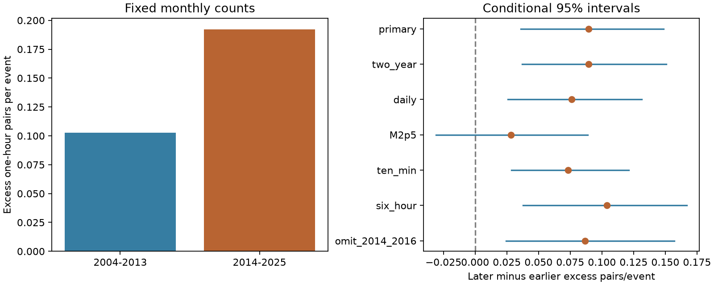

# Excess one-hour pairs per M2+ event rose at The Geysers between 2004-2013 and 2014-2025

The fixed M2+ catalog shows more excess one-hour pairs per event in 2014-2025 than in 2004-2013. The change is 0.0896 excess pairs per event, with a conditional 95% interval of 0.0360 to 0.1486. The excess pair count per year has no clear change. Fewer total events can therefore accompany a larger relative concentration in short pairs. This result does not establish more bursts per year, a larger fraction of triggered events, or a cause for the rate drop.



Figure 1. Left: observed pairs minus the fixed-month uniform-time expectation, divided by event count. Right: later-minus-earlier differences. Lines show conditional 95% bootstrap intervals. Each row has its own reference or sample. The ten-minute and six-hour rows use different gap limits. These are marginal intervals, not a simultaneous test across all checks.

## Question and prior work

Did the short-time concentration of earthquakes change across the reported 2014 rate drop at The Geysers? This question matters for models that separate fluid-driven background events from event interactions.

The campaign result [SCI ee212688](sci:sha256:ee2126885cd5fbd9b28dfa0c5833f3e74a64d84e51fcd2a8c42b1f873ec5dbc3) found a rate reduction near early 2014 after adjustment for injection and production. Its nearest-neighbor declustering gave about 88% background events with a stable share. Our pair statistic does not repeat or refute that classification. It measures a different property without an event-parent assignment. The campaign result [SCI d4752109](sci:sha256:d4752109b77fcbaa259b54c62e586c644be6a2d680e9ea4bb052b540aa983ffb) found no clear change in the M3+ share of M2+ events, but found magnitude-cut sensitivity in other summaries. [SCI 507b3768](sci:sha256:507b3768af558bf128cf9774b5e5de4daf9c92dbf19f4e03c2fc85975db34efc) tested transfer of a weekly phase and described the source snapshot. We read all three signed texts. We reuse that snapshot with new code. The source and period overlap with earlier work; this is not independent confirmation of a change point.

Trugman et al. (2016, doi:10.1002/2015JB012510) separated background and interaction rates at three geothermal fields and linked Geysers background rates to injection. The study “Induced and triggered earthquakes at The Geysers geothermal reservoir” (GJI 209, 1221, 2017) described event interactions in a local controlled-injection sample. These works motivate a short-pair test but do not supply our data or justify a causal interpretation of our statistic. We used the published abstracts for context. No paper text or figures are included.

Before choosing this test, we searched the local campaign with earthquake, aftershock detection, tsunami, Arctic river, magnitude rounding, depth heaping, weekly earthquake, Geysers, Geysers clustering, Geysers burst and Geysers 2014. We found no direct test of this fixed-period short-pair contrast. Search terms and catalog coverage limit that statement. The new contribution is a direct pair-count contrast, an exact conditional-count reference, and its rate decomposition.

## Data and rights

We used only the shared ComCat snapshot retrieved on 10 November 2026. The rectangle is 38.70-38.90 N, 122.95-122.65 W. We retained preferred M2+ earthquake records in complete UTC years 2004-2025. No depth cut, well-distance cut or declustering was applied. The rectangle can include events outside the reservoir. Period totals are 3,385 and 2,398. Preferred magnitude scales can differ; a magnitude cut does not prove stable detection.

Exact shared path:

```
/mnt/dell-data/shared_datasets/comcat-geysers-m2p0-1984-20261110/comcat-geysers-m2p0-1984-20261110.csv
```

This supplied compatibility path points to the active shared store. The file has 2,183,429 bytes and SHA-256 `5a4960b42571e9695877d48bb6fc692eb6767b6e0ad71a88a637dccd6ba5b271`. The full query URL, resolved path, retrieval metadata and metadata hash are in [provenance.json](files/provenance.json). This is a live-service snapshot, not a numbered release. We did not download new data.

Credit: USGS, ANSS ComCat, the Northern California Seismic Network and contributing networks. USGS license guidance distinguishes federal and partner data. We keep raw records, event IDs, event-level transforms and annual intermediate tables outside this package. We include our code, narrative, figure and coarse statistical results under the unchanged SCI baseline license. The [external data notice](files/EXTERNAL_DATA.md) identifies the external source and does not place different terms on bundled files.

## Method

[design.txt](files/design.txt) was saved before pair estimates. It is a local plan, not an external registration. We fixed the period boundary from earlier same-source work. We did not search for a new date or include 2026.

For each UTC month m of duration L seconds, count all unordered event pairs with a time gap from zero to h=3,600 seconds, inclusive. Both events must be in that month. If n event times are independent and uniform in a month, the exact expected pair count is:

```
E_m = n (n-1) / 2 * (2 h / L - (h / L)^2).
S = sum_m (observed_pairs_m - E_m) / sum_m n_m.
D = S_2014_2025 - S_2004_2013.
```

The expectation follows from the area of the band within h of the diagonal of a square of side L. There is no Poisson assumption for monthly counts. The reference removes the close pairs expected from the different monthly event totals under uniform times. It does not remove arbitrary within-month rate changes or identify parent events. A dense cluster contributes many pairs. Thus S is excess pairs per event, not the probability that an event is triggered, a branching ratio, or a count of distinct bursts. We use no spatial separation test. Two events close in time can be in different parts of the box.

We resample complete years with replacement within each period in 19,999 draws and calculate the contrast from the sampled totals. The primary seed is 97114. The 95% interval uses the 2.5th and 97.5th percentiles. This keeps all within-year dependence. A check samples circular two-year moving blocks within each period, using random starts, wrapping at the period end and truncating to the original number of years. It has seed 97115. Both methods assume exchangeable years or blocks within each period. They condition on the selected boundary, source, thresholds and method. They do not account for catalog error or long dependence.

Planned checks hold daily totals fixed and count only same-day pairs, raise the magnitude floor to 2.5, use ten-minute and six-hour gaps, and remove 2014 and 2016 from the later period. Removing those years checks the transition year and a year with a large earthquake; it is not event-level declustering. Daily conditioning uses L=86,400 seconds and the same exact formula. Checks have marginal intervals with no multiple-test adjustment.

After the main estimates, we added two diagnostic checks. We calculated excess pairs per year and its later/earlier ratio with year resampling (seed 97199). We also removed each year once and recomputed D. These checks are marked as exploratory; they prevent a relative concentration result from being read as an absolute rate increase.

## Results

| Case | Earlier excess/event | Later excess/event | Difference | Conditional 95% interval |
| --- | ---: | ---: | ---: | --- |
| primary | 0.10258 | 0.19220 | 0.08962 | 0.03602 to 0.14858 |
| two_year | 0.10258 | 0.19220 | 0.08962 | 0.03698 to 0.15065 |
| daily | 0.09255 | 0.16860 | 0.07605 | 0.02580 to 0.13143 |
| M2p5 | 0.09499 | 0.12324 | 0.02825 | -0.03079 to 0.08878 |
| ten_min | 0.08110 | 0.15435 | 0.07325 | 0.02853 to 0.12133 |
| six_hour | 0.12325 | 0.22710 | 0.10385 | 0.03786 to 0.16696 |
| omit_2014_2016 | 0.10258 | 0.18911 | 0.08653 | 0.02455 to 0.15717 |

In the primary case, observed pair totals were 482 before and 520 after the boundary. Fixed-month expected totals were 134.7622 and 59.1069. Excess/event rose from 0.10258 to 0.19220, an 87.4% descriptive increase. The primary and two-year intervals for the difference are above zero. Fixing daily totals also retains a positive contrast. This shows that the primary result is not solely due to uneven counts across days within a month under these reference definitions.

The M2.5+ sample has 845 earlier and 660 later events. Its difference is smaller and its interval includes zero. We cannot claim that the effect holds clearly at higher magnitudes or that detection changes are excluded. The ten-minute and six-hour checks are positive. Omitting 2014 and 2016 retains a positive interval. Removing one year at a time gives differences from 0.06818 to 0.10190; the point estimate is not caused by one year alone. These related checks do not provide independent replication.

The exploratory rate decomposition is essential. Excess pairs per year were 34.7238 before and 38.4078 after the boundary. The ratio was 1.1061, with a conditional 95% interval of 0.7594 to 1.6352. The raw observed pair rate was 48.2 versus 43.3 per year, while the event rate fell from 338.5 to 199.8 per year. Thus the data show a rise in relative short-time concentration. They do not establish an increase in the absolute rate of short bursts. A reduction in isolated background events is one possible explanation; it is not tested here.

## Validation and limits

The [scalar audit](files/audit.py) reads ISO timestamps with the standard Python datetime parser and counts pairs by exhaustive comparison. It checks event counts, observed pairs, expected pairs and excess/event for both periods in all seven cases. It also checks a known set of times in seconds. It agrees with the vectorized analysis, which converts timestamps explicitly to nanoseconds before conversion to seconds. [audit.json](files/audit.json) records 14 period checks and a pass. This validates arithmetic, not assumptions. A second complete run reproduced the saved numerical summaries and every bootstrap draw exactly. Software versions are in [environment.json](files/environment.json).

We do not infer that a sudden clustering step occurred in 2014. These are period-average contrasts across a boundary selected from related data. The sample is a broad box and differs from the well-distance selection in the rate-drop study. The result cannot be used as a direct count check on that study.

Uniform event times are a reference, not a physical model. Fast changes in injection, detection or tectonic stress can also produce close pairs. Fixed daily totals remove some such variation, but not hourly changes or changing network completeness. Missing events just after larger events can change short pairs. Preferred magnitude scales and a changing mixture of reservoir zones can change the result. The weak higher-floor check remains a material limit. No local noise data, homogeneous alternate magnitudes, spatially matched controls, well-operation records, relocated catalog, ETAS fit or independent sensor record was used. Pair counts overweight large clusters. Year resampling may not cover long dependence or changes in catalog practice. The baseline excess is estimated rather than known.

A useful next test would use a stable-completeness local catalog with common magnitudes, match reservoir zones, and test parent-event models alongside daily injection. A separate period or independent detection system is needed for confirmation. The physical cause of the reported rate drop remains open. The contrast here is compatible with stable absolute short-pair excess and fewer isolated events; it does not establish that mechanism.

## Reproduce

Verify the signed ZIP before extraction. Use Python 3.12 with numpy, pandas and matplotlib. From the extracted publication root run:

```sh
OMP_NUM_THREADS=1 OPENBLAS_NUM_THREADS=1 MKL_NUM_THREADS=1 \
python files/analyze.py --datasets /mnt/dell-data/shared_datasets --out /LOCAL/SCRATCH/geysers-pairs
OMP_NUM_THREADS=1 OPENBLAS_NUM_THREADS=1 MKL_NUM_THREADS=1 \
python files/audit.py --source /mnt/dell-data/shared_datasets/comcat-geysers-m2p0-1984-20261110/comcat-geysers-m2p0-1984-20261110.csv --results /LOCAL/SCRATCH/geysers-pairs --out /LOCAL/SCRATCH/audit.json
```

Compare summary.json, decomposition.json and all arrays in draws.npz with the bundled files. Figure bytes can depend on software. The annual intermediate files are external derived data and stay in the output scratch directory. No private intermediate is required. The scripts reject outputs inside the signed package.

If the source is absent, run `python files/retrieve.py --scratch /LOCAL/SCRATCH/external-data` and pass that new directory as --datasets. It retrieves only the recorded query and checks the exact hash. Live revisions can prevent exact reproduction. In that case the preserved shared snapshot is needed. This recipe never writes downloaded data into the signed package. It does not add or alter shared datasets.

## Work record

Campaign 11_07_2026. Job sci-1107-dell-earth-and-ocean-sciences-97d5fffab8fc. Topic earth-and-ocean-sciences. Machine dell. Account codex-olen. Model gpt-6.1-sol, high reasoning effort, through the Codex harness in T3 Code. Analysis date: 12 November 2026 UTC. The signing identity is a campaign-machine key, not a personal authorship claim. No agents, independent services or uploads were used. Computation used one process at a time with numerical thread limits of one. Code and evidence are preserved here; external source bytes are documented above.
