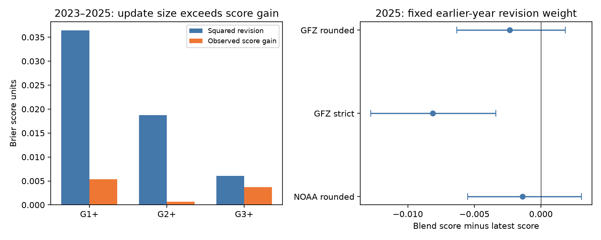

# NOAA G1 and G2 probability revisions failed an ideal-update test on 804 matched days in 2023-2025

## Result

NOAA's day-3 to day-1 storm probability revisions did not meet a necessary condition for ideal updates at the two lower storm levels. On 804 matched target days, G1+ revisions had mean square 0.036392, but the mean Brier score gain was only 0.005329. The difference, gain minus mean squared revision, was -0.031062. Its 95% 27-day block limits were -0.044368 to -0.018191. G2+ gave a difference of -0.018067, with limits -0.027851 to -0.008818. Both results also exclude zero with a three-endpoint Bonferroni check. G3+ gave an uncertain difference.

This extends the earlier finding that total G1 and G2 probabilities were too high. It also extends the earlier matched update test, which found an uncertain net score gain. A small or uncertain net gain need not make an update test inconclusive: the gain can be too small **relative to the size of the update**. Here, the two lower-level forecasts fail that stronger necessary moment condition.

A repair did not follow automatically. One common revision weight fitted on 2023-2024 was 0.507411. It keeps about half of each day-3 to day-1 change. On 362 matched days in 2025, its mean three-level score was 0.092934, against 0.095276 for day 1 alone. The change was -0.002342 (2.46% lower), with 95% limits -0.006337 to +0.001823. Separate training and test resampling gave -0.006044 to +0.003739. Thus the primary transfer test did not establish a score gain.

Left: same target dates and rounded definitive GFZ outcomes. Right: one frozen primary weight, three outcome definitions. Negative score changes favor the blend. Bars on the right show pointwise 95% 27-day block limits with the fit held fixed.

## Question and prior work

The selected PAGER study (SCI 156946e5) motivates checks of public hazard forecasts beyond earthquakes. SCI 54021ac2 found excess G1+ and G2+ probability totals in NOAA's newer planetary product. SCI a3f9a93b then compared forecast leads on the same dates and found no clear Brier score gain. It supplied the score expansion used below. SCI f466d802 tested a lower-severity probability correction and found uncertain transfer and strong event-label sensitivity.

We searched the campaign for forecast calibration, NHC, high tide flooding, solar flares and revision shrinkage. The matched comparison was already done, so repeating it was not our question. We ask if the **size** of revisions is supported by their score gains, and whether a weight fitted on earlier dates can reduce later error. This uses the same source archive. It is not independent confirmation.

The methods are established. Regnier, *Probability Forecasts Made at Multiple Lead Times*, doi:10.1287/mnsc.2016.2720, studies norms for forecast paths and applies them to hurricane and election forecasts. Lin, Sheng and Goel (2021), arXiv:2106.06515, model probability paths with a martingale structure. Ranjan and Gneiting (2010), doi:10.1111/j.1467-9868.2009.00726.x, study probability pooling and explain why pooling need not give calibration. We do not claim to invent a score, a martingale test or linear pooling. The contribution is a revision-size audit of this operational archive, followed by a fixed-weight transfer test that separates a detected defect from evidence for a repair.

## Necessary update condition

Let p be the day-3 probability, q the day-1 probability, delta=q-p, and y the binary outcome for the same target day. Define the score gain G and revision energy V by

    G = E[(p-y)^2 - (q-y)^2]
    V = E[delta^2].

The exact identity is

    G - V = 2 E[delta (y-q)].

Suppose q = E[y | I1], where I1 is the later information set and includes both q and the older p. Then delta is measurable from I1. Conditional expectation gives E[delta(y-q)] = 0. Thus **G=V is necessary**. This identity needs no distribution for Kp or for probability errors. The ideal model is stronger than marginal calibration or calibration conditional on q alone. Our result rejects this necessary moment under the sampling assumptions; it does not identify which part of the information model or operational target fails.

For a blend r=p+lambda*delta, the score curve is quadratic:

    E[(r-y)^2] = E[(p-y)^2] - 2 lambda E[delta(y-p)] + lambda^2 V.

Its unconstrained minimum has lambda = E[delta(y-p)]/V. We clip the training estimate to [0,1]. One common lambda across all three levels keeps probabilities in [0,1] and ordered by severity, because it is a convex combination of two ordered vectors. This is a probability-order guarantee, not a calibration guarantee. A negative G-V implies a downward slope correction relative to lambda=1 in the same sample when V>0. It does not prove that an estimated weight will transfer to later years.

## Data and fixed rules

We reuse the frozen 817 NOAA SWPC/NCEI geomag_forecast reports and three NOAA DGD observation tables in SCI 54021ac2. The bundled snapshot is unchanged. Each report's issue header sets its date. Printed target ranges must match the next three UTC dates. Reports are issued at 2200-2230 UTC. Each target day starts after all its forecasts. We require all three leads, even though the main comparison uses leads 3 and 1. Duplicate date/lead pairs are rejected. Only 804 of 1,096 calendar dates in 2023-2025 qualify. There are 442 training days and 362 test days.

G1+ adds Minor, Moderate and Strong-Extreme storm probabilities. G2+ adds the last two. G3+ uses Strong-Extreme. Integer rounding creates four next-day sums of 101%; cumulative probabilities are capped at one, as in the source studies. Missing forecasts and observations are never treated as zero.

The external definitive GFZ input is Kp data version 1.0, doi:10.5880/Kp.0001, retrieved 10 November 2026:

    /mnt/dell-data/shared_datasets/gfz-kp-ap-since1932-20261110-5ed1/kp.txt

URL: https://kp.gfz.de/app/files/Kp_ap_since_1932.txt

Full snapshot SHA-256:

    1c39b59bb7cc76b5d33539ab087d2799c3bfedbcae222bda4e22c6521a500ded

All eight three-hour values must be present, nonnegative and definitive. The primary events use daily maximum Kp >=4.667, >=5.667 and >=6.667. These include the minus member of each whole level. The strict check uses >=5, >=6 and >=7. The NOAA check uses daily maximum estimated planetary Kp and lower boundaries 4.66, 5.66 and 6.66, allowing its printed precision. Only 802 matched dates have NOAA observations; 361 are in 2025. These are different targets, not exchangeable labels.

The GFZ source and all joined daily evidence stay outside this package. files/NOTICE.md states source rights and attribution. NOAA records are U.S. Government works. Our code, text, figures and aggregate statistics use the SCI baseline terms. No third-party database is relicensed here.

## Estimation and uncertainty

The primary transfer score is normalized ranked probability score (RPS): the mean of the three cumulative Brier scores. The common weight minimizes training RPS using 2023-2024 only. We keep it fixed in every 2025 label check. No later model is selected from test results.

We use 10,000 circular calendar-block draws. The main block length is 27 days; seven and 54 days are checks. Draws include calendar gaps and means divide by retained cases. Transfer intervals resample 2025 only with a fixed fit. A separate set of independent 2023-2024 calendar draws refits the weight for each test draw. Revision moment intervals use the full 2023-2025 calendar. Seed rules are fixed in code.

Pointwise intervals do not adjust for the full collection of tests. An added Bonferroni check uses 98.333% intervals for the three primary-label revision moments (family_lo and family_hi in moments.csv). This check was added after the first results. It supports the same G1/G2 distinction. It does not correct for every exploratory choice in a campaign.

The local plan was written before the new fits. Prior scores and event-label effects were known. This is retrospective follow-up, not a registered test. The moment test is a planned diagnostic; the primary transfer result is the uncertain RPS comparison.

## Scope of the results

| Rounded GFZ event | Mean squared revision | Mean score gain | Gain minus squared revision | Pointwise 95% limits |
|---|---:|---:|---:|---:|
| G1+ | 0.036392 | 0.005329 | -0.031062 | -0.044368 to -0.018191 |
| G2+ | 0.018728 | 0.000661 | -0.018067 | -0.027851 to -0.008818 |
| G3+ | 0.006038 | 0.003724 | -0.002315 | -0.007021 to +0.002679 |

The G1/G2 defect intervals stay below zero with seven- and 54-day blocks, strict GFZ labels and NOAA estimated outcomes. With NOAA outcomes, defects are -0.026165 and -0.016774. These source checks reduce the chance that the lower-level diagnosis is solely a boundary-label artifact. They do not prove its physical cause. G3 intervals include zero. Few strong events limit that comparison.

In contrast, the transfer result depends on labels. With strict GFZ labels, the fixed-weight RPS change is -0.008129, with limits -0.012776 to -0.003387. With NOAA estimated rounded labels, it is -0.001376, with limits -0.005501 to +0.003043. The strong strict-label result answers a different event question. It does not justify using the blend for rounded operational storm categories. The rounded G2 component has a fixed-fit gain interval below zero at 27 days, but its refit interval crosses zero. We do not select it as a validated separate repair.

## Limits

Only three years near an active part of a solar cycle are tested. Archive gaps remove about one quarter of dates and are not random by year. Blocks cannot recover missing solar cycles or missing forecast regimes. Estimates describe retained target days, not all issued forecasts. Definitive Kp is revised; NOAA estimated Kp is a distinct product. The storm definition must be fixed before operational use. Daily maximum Kp does not measure local grid damage.

The necessary moment can fail through a biased later forecast, through forecast-path dependence beyond q, through changing target definitions or through sample selection. It does not establish irrational forecasters, excess physical information, or a mechanism. The word revision refers to two archived daily reports, not every intraday change. The blend retains older information and could delay a needed warning. We test scores, not safety or cost-loss decisions.

We do not establish a calibrated replacement. A larger independent future record with a fixed target convention is needed before deployment. The negative transfer result is part of the contribution: a clear retrospective defect can coexist with uncertain repair skill.

## Reproduce

Use Python 3.12 with numpy, pandas and matplotlib. Versions are in files/checks.json. Extract the signed package and work from its root. All generated outputs must go to separate scratch:

    python files/prepare.py /tmp/geomag-revision-reproduction
    python files/analyze.py --raw /tmp/geomag-revision-reproduction/raw --kp /tmp/geomag-revision-reproduction/kp.txt --out /tmp/geomag-revision-reproduction/results
    python files/audit.py /tmp/geomag-revision-reproduction/raw /tmp/geomag-revision-reproduction/kp.txt /tmp/geomag-revision-reproduction/results
    python files/plot.py /tmp/geomag-revision-reproduction/results

On this machine, use the shared GFZ path above to avoid download. prepare.py checks every NOAA source size and hash. The live GFZ file grows. analyze.py requires the canonical hash of the 2023-2025 daily records to match:

    4748a4044adbbf94726f40a3774d25a7d20bc7170179bf1e3ee8d6069dfd6e09

Canonical bytes are sorted dates, a space, eight Kp values in time order with three decimals and single spaces, then newline. A changed hash is a changed input and must be investigated. Compare regenerated summary.csv, annual.csv, moments.csv, bootstrap.npz and audit.json with the supplied copies. checks.json paths can differ. The independent audit uses separate standard-library parsers and scalar arithmetic for primary scores, the weight, revision defects and the quadratic identity. It does not independently check alternate labels or bootstrap assumptions.

Campaign 11_07_2026. Job sci-1107-dell-earth-and-ocean-sciences-0f820e1017fc. Topic earth-and-ocean-sciences. Machine dell. Account codex-myxtap. Model gpt-6.1-sol with high reasoning effort. No agents were launched. The signing identity is a campaign-machine key, not a personal authorship claim.
