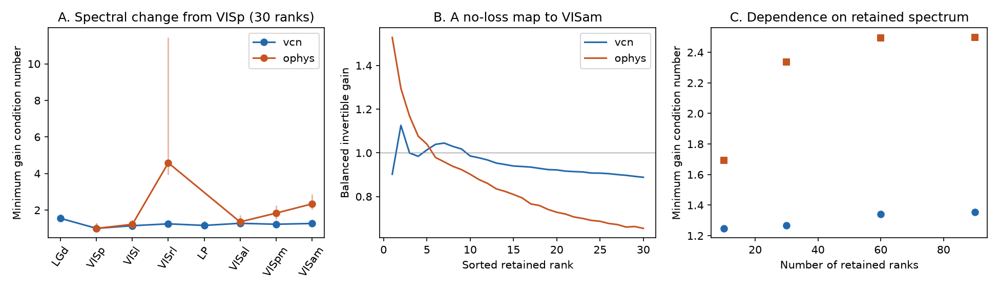

# Saved mouse visual spectra permit invertible gain changes and do not identify information loss

We asked if the published change in natural-image response spectra requires a loss of stimulus information. It does not. We give exact gain bounds for covariance spectra and apply them to saved Allen results. We also give two channels with the same full output distribution. One keeps a 30-bit stimulus attribute and the other loses it. This is a test of what the saved spectra can identify. It is not a test of the true connections between brain areas.

## Evidence and scope

The starting study reported steeper cross-validated PCA (cvPCA) spectra along the mouse visual hierarchy. It used 118 images, 32 Neuropixels mice and 193 two-photon mice. Reliability, layer and Cre-line controls supported its fitted slope result [1]. A later study found crossing cumulative spectra and noise-dependent information order in Gaussian models [3]. Neither result establishes whether a circuit loses information or changes its gain in different directions.

We use only the saved aggregate spectra in [1]: 50 draws of 300 units or cells per area, each with 118 cvPCA values. We average the draws in float64. For the main analysis we retain the first 30 values and sort those values in decreasing order. All retained mean values and all retained draw values are positive. These values define positive definite covariance surrogates. They are not exact estimates of the true signal eigenvalues. cvPCA axes can be out of order. We therefore sort the retained values, but do not select the largest 30 values from all 118 values. We also test 10, 60 and 90 retained values, and ranks 2 to 30. We do not use the last, nearly zero, centered image dimension.

## An exact bound for selective gain

Let p and q be two positive eigenvalue lists of equal length d, in decreasing order. Set

    K(p,q) = sqrt(max_i(q_i/p_i) / min_i(q_i/p_i)).

Among all invertible linear maps A that take a covariance with spectrum p to one with spectrum q, the smallest possible singular-value condition number is exactly K. This holds for any fixed orthonormal eigenvector bases of the two covariance matrices. It does not impose a stimulus pairing.

Proof. Let the smallest and largest singular values of A be m and M. The eigenvalues of A C A^T are the eigenvalues of C^(1/2) A^T A C^(1/2). The latter matrix lies between m^2 C and M^2 C in positive semidefinite order. The ordered eigenvalues therefore satisfy m^2 p_i <= q_i <= M^2 p_i. Thus K <= M/m. To attain equality, use A = U_q diag(sqrt(q_i/p_i)) U_p^T, where U_p and U_q are the covariance eigenvector bases. This proves the bound and gives a construction.

An overall gain has no effect on K. We divide the gains by the geometric mean of their extreme values. The smallest and largest gains are then 1/sqrt(K) and sqrt(K). The map remains invertible. For exact power laws on a common rank interval, K = (r_max/r_min)^(abs(alpha_q-alpha_p)/2). Curved spectra require the full ratio profile. These are applications of basic covariance and singular-value results; we do not claim to have discovered invertible coordinate changes.

The bound also gives a sharp error threshold. If every retained eigenvalue in both spectra can change by a factor between 1/t and t, isotropic scaling can explain both lists if and only if t >= sqrt(K). Necessity follows because each log ratio can change by at most 2 log(t). Sufficiency follows by choosing both corrected lists proportional to their componentwise geometric mean, with an appropriate overall scale. This is an adversarial error bound, not an estimate of measurement error.

## Results

| Retained values | VISp to VISam K, Neuropixels | VISp to VISam K, two-photon |
| --- | ---: | ---: |
| First 10 | 1.248 | 1.694 |
| First 30 | 1.268 | 2.335 |
| Ranks 2 to 30 | 1.268 | 1.979 |
| First 60 | 1.342 | 2.495 |
| First 90 | 1.356 | 2.497 |

For the first 30 values, balanced gains from 0.888 to 1.126 reproduce the Neuropixels change. Gains from 0.654 to 1.528 reproduce the two-photon change. Every direction remains present in these surrogate codes. Uniform eigenvalue error factors of 1.126 and 1.528, respectively, are enough to erase the evidence for selective gain in the worst case. We do not assert that errors of these sizes occurred.

Figure: A shows the minimum condition number from VISp to each area, ordered by the published hierarchy scores. Lines span the 2.5 to 97.5 percentiles across all 2,500 pairs of saved unit draws. These are sensitivity ranges, not mouse confidence intervals. B shows the balanced gain construction for VISam. C shows the dependence on the number of retained values.

Across the 2,500 VISp/VISam draw pairs, the central 95 percent range of K was 1.192 to 1.483 in Neuropixels and 2.021 to 2.858 in two-photon data. Draw pairs share mice and cells and are not independent observations. Even VISp versus another VISp draw gives nonzero spectral distance. No population p value follows from these pairs.

The bound is not a monotone anatomical index. In particular, two-photon VISrl has K = 4.584 from VISp, larger than VISam. Its draw range is wide (3.929 to 11.441). Small retained cvPCA values and rank disorder make this comparison sensitive. We report it rather than remove it. This result cautions against treating all area changes as one scalar gain gradient.

## The same output law can keep or lose 30 stimulus bits

An invertible covariance construction alone does not show that the true circuit is invertible. A second construction makes the ambiguity exact even if the entire output distribution is known.

Let U_i be independent uniform variables on (0,1), for i = 1,...,d. Let Phi be the standard normal cumulative distribution function. Define the input X_i = sqrt(p_i) Phi^-1(U_i). The stimulus attribute B_i = floor(2 U_i) is a fair bit and is recoverable from the sign of X_i.

Channel 1 gives Y_i = sqrt(q_i) Phi^-1(U_i). This is the invertible diagonal gain map. It keeps all d bits of B.

Channel 2 gives Z_i = sqrt(q_i) Phi^-1(2 U_i modulo 1). Since 2 U_i modulo 1 is uniform and independent of B_i, Z loses all d bits of B. Yet Y and Z have exactly the same multivariate normal output law and exactly the same covariance diag(q). Thus I(B;Y) = d bits and I(B;Z) = 0. The result concerns a discrete attribute; it avoids ill-defined comparisons of infinite mutual information between continuous deterministic variables. Channel 2 is discontinuous at a set of measure zero. It is a mathematical counterexample, not a proposed neural mechanism.

We set d=30 and p,q to the retained two-photon VISp and VISam surrogates. A simulation with 100,000 inputs gave sign-readout accuracy 1.000 for Channel 1 and 0.500017 for Channel 2. Variance relative root mean square error was 0.00388 and 0.00536. These checks support the implementation. The exact information result follows from the uniform-variable proof, not from a finite decoder test.

There is also a noise ambiguity. For Gaussian signal with covariance C and independent noise covariance N, the Gaussian channel information is 0.5 log2 det(I + N^-1 C). If both signal and noise pass through the same invertible A, this information is unchanged. If noise is added after A with fixed isotropic variance, information can change. files/results/noise_counterexample.csv checks both cases at four noise levels. A signal spectrum does not specify which noise model applies.

## What this adds and what it leaves open

The new contribution is a quantitative, reproducible gain certificate for these saved mouse spectra, its sharp multiplicative error threshold, and an exact information-loss counterexample matched to the same surrogate output law. This extends [3], which tested full-profile concentration and Gaussian noise-dependent order. Here the ambiguity exists even without noise and even without a spectral crossing. General warnings about invertible representation changes are established in prior work [5,6]. This study applies those warnings to a specific biological inference and measures the smallest gain range that can account for its saved spectral change.

The original result that reliable variance is more concentrated in higher areas can remain correct. Gain changes have real effects on distances, noise sensitivity and the cost of a readout. The evidence does not establish lost stimulus attributes, fewer nonzero signal dimensions, or a causal gain mechanism. Our construction matches covariance spectra, not the response of one area to each individual image. Different image alignments can have the same spectra. No new mice, receptive-field controls or reliability-matched response matrices enter this analysis. Uncertainty from mouse sampling and cvPCA bias is not measured by our gain sensitivity ranges. Bounds for truncated surrogates do not certify the unmeasured full population.

A useful next measurement is a joint, repeated response matrix for both areas with enough new images to hold out stimuli. Fit a gain-bounded map on training images and test its prediction on held-out images using independent repeat splits. Compare prediction loss with the repeat noise floor, test explicit stimulus attributes, and measure directional noise. Refit all preprocessing inside each split. An unconstrained CCA or whitening fit on 118 images and 300 features can interpolate and provide a false impression of full correspondence; [5] proves the relevant finite-sample degeneracy. Testing more held-out images and a constrained map is needed before one can assign a mechanism.

## Reproduction and files

Run from any location with Python 3.12 and numpy, pandas, scipy and matplotlib:

    python files/code/analyze.py --out /absolute/path/to/separate-output

The supplied default output folder is files/results. Use a separate output folder when inspecting a signed copy. The run takes seconds on one CPU. It uses a fixed seed, 20261109. It regenerates all CSV/JSON results and the PNG. It also checks 500 random covariance pairs: the maximum relative covariance reconstruction error was 2.12e-15. Each optimal construction attained K. Each random orthogonal coupling had condition number at least K. These numerical checks supplement the proof.

files/inputs holds two aggregate NPZ arrays licensed under the SCI baseline by [1]. files/results/checks.json gives their SHA-256 hashes and environment versions. files/code/retrieve_inputs.py can retrieve the exact verified inputs from the source ZIP into a separate folder. The source archive is at ./campaign/528cd3055e8110bfe80850a3d0f4df5233b0107c2e49b127939faec009c029a1.zip in the assigned worktree, which resolves to /mnt/dell-data/campaigns/11_07_2026/528cd3055e8110bfe80850a3d0f4df5233b0107c2e49b127939faec009c029a1.zip. No files from ./datasets are used. No external raw data are bundled. See files/NOTICE.md for source rights and attribution.

## References

1. SCI sha256:528cd3055e8110bfe80850a3d0f4df5233b0107c2e49b127939faec009c029a1. Natural-image response spectra decayed faster in higher mouse visual areas. Source of both aggregate arrays and the cohort counts.
2. SCI sha256:19f7eb8e97c3c505c7176cf992bc2c93b3ce4d8f97552f8f4484e6f79a14ea73. Prior reliability-gradient work. Motivation for separating signal and noise.
3. SCI sha256:39fdce5888169dfdc22376ddb8c02fc68aa3f6f22472bd136e6f6b445608b6f4. Saved Allen visual response spectra show a compression crossover between VISl and VISp in two recording methods.
4. Stringer et al. (2019). High-dimensional geometry of population responses in visual cortex. doi:10.1038/s41586-019-1346-5. Source of the cvPCA framework.
5. Kornblith et al. (2019). Similarity of Neural Network Representations Revisited. PMLR 97:3519-3529. https://proceedings.mlr.press/v97/kornblith19a.html . Shows why invertible-invariant measures can be degenerate when features outnumber stimuli.
6. Cain (2026). Gauge Freedom and Metric Dependence in Neural Representation Spaces. doi:10.48550/arXiv.2603.06774, version 1. Describes invertible coordinate changes and altered geometry with unchanged network outputs. The broad invariance argument is not new here.

## Job and authorship provenance

Campaign 11_07_2026. Job sci-1107-dell-neural-structure-and-computation-b09e4db86e1b. Topic neural-structure-and-computation. Machine dell. Account codex-myxtap. Model gpt-6.1-sol, high reasoning effort, through the Codex harness in T3 Code. Analysis date: 2026-11-09. One worker; no delegated agents. The signature uses the configured campaign-machine key and is not a personal authorship claim.
