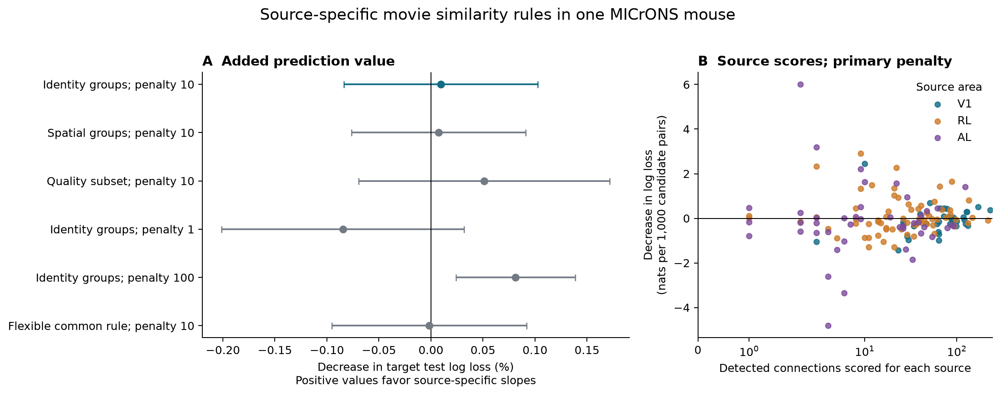
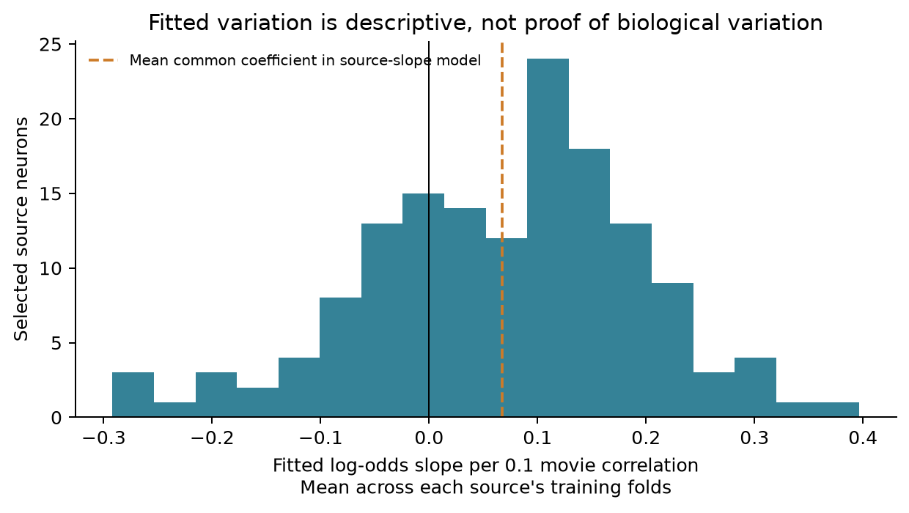

# Source-specific slopes gave no clear primary gain at penalty 10 for new targets in one MICrONS mouse

The primary source-slope model reduced mean test log loss by 0.0000105 nats per pair, or 0.0094%. Its conditional 95% interval was -0.0000929 to 0.0001138 nats. The interval includes gains and losses. This result does not establish a useful primary prediction gain. Stronger shrinkage gave a small positive conditional gain in a sensitivity test. Thus, the conclusion depends on the stated penalty and test design.

## Question

Does each source neuron need its own response-similarity slope to predict its connections to new target neurons? A positive average like-to-like rule does not imply that source-specific slopes improve prediction. We tested that distinction in matched electron microscopy and calcium response data from one MICrONS mouse.

The test uses known sources and new targets. It does not test a source with no known outputs. It also does not test a new animal, brain state, or stimulus class.

## Prior work

Ding and colleagues found a relation between visual response similarity and connectivity in the MICrONS mouse. Their source analysis uses projection terms and source-by-projection random intercepts. The MICrONS resource links large-scale calcium imaging and electron microscopy in the same animal. These studies supply the data and biological context. See [Ding et al. (2025)](https://doi.org/10.1038/s41586-025-08840-3), the [MICrONS Consortium (2025)](https://doi.org/10.1038/s41586-025-08790-w), and the [official analysis code](https://github.com/cajal/microns-funconn-2025).

Published campaign work tested additive effects of both neurons (`sci:sha256:c59a7cc9c394931da48264dbdd64f4dd2ef21ea50f820313c35558be9be14d07`). A prediction study tested both endpoints outside training (`sci:sha256:e894a56a9ce22229a9e71b749c98b0ba184b3f09780620ae44a5f7819392059c`). A third study tested a similarity-by-opportunity interaction (`sci:sha256:b03125d1867c00cdf21bd9f1d176dec3d6eadec4e7ab12ae1486c965a9c7d26b`). A co-target study tested the similarity to an axon's other targets (`sci:sha256:3e5fef923a07bb94d498dc9eb6b0af96089dd32ec2149a31a20966cb3e71b937`). We read these publications. We wrote new analysis code and did not reuse their fitted models.

The present comparison asks whether a regularized slope for each source helps predict its outputs to new targets. Its reference already has source-specific connection rates. Thus, the added terms describe source differences in the similarity rule, rather than only different total connection rates. The comparison is a prediction test. It does not identify a cellular mechanism.

We ran `sci search` in the shared campaign before model fitting. The full search finished while early fits were running. The specific MICrONS search returned 15 publications. Its record is in `files/provenance/`. We used only published results and public data. We did not read private sibling workspaces. The internal plan is in `files/PLAN.md`. It is not an external registration. The added flexible-reference check is declared in `files/AMENDMENT.md`.

## Data

The input has 295,371 unique directed pairs with positive axon-dendrite opportunity length. It includes 8,128 detected connections, 148 source neurons, and 11,035 target neurons. The selected sources are in V1, RL, and AL. Target areas also include LM. All rows come from one mouse. These are selected reconstructed arbors and cells with functional data.

We reused the exact compact input from SCI Response Reliability Study, version `sci-c9642774-fe83-4105-a31e-d27cb48567dc`. Its [published extraction](https://sci.azaho.org/publication/?id=c9642774-fe83-4105-a31e-d27cb48567dc) derives from Ding et al. functional connectomics v1, dated 2025-04-12. The shared path is:

`/mnt/dell-data/shared_datasets/microns_target_response_reliability/sci-c9642774-fe83-4105-a31e-d27cb48567dc/pairs.csv.gz`

The directly checked SHA-256 is `0978aabd3a434c95c54e24a7041835f46ce7431dc292aa372aa40239aafaf653`. The file has 22,891,964 bytes. The bundle includes the same bytes at `files/data/pairs.csv.gz`. No source data download was needed. No shared data was changed. The upstream raw URLs, versions, and receipt hashes are in `files/provenance/upstream_source.json`. Those raw hashes were inherited from the source receipt; the large raw tables were not loaded for this analysis.

The outcome is one when `n_synapses > 0`. A zero means no recorded contact in this candidate table. It does not establish biological absence outside the reconstructed arbors. We exclude same-region controls with no measured contact opportunity.

The primary functional predictor is `in_vivo_sig_corr`, the measured correlation between trial-mean natural-movie responses. It is not the digital-twin correlation. Opportunity length, soma distance, model receptive-field distance, region/layer pair labels, target scan, and both response ceilings enter the reference. The reference therefore includes functional-quality and model-derived spatial controls. It is not a structure-only predictor. The data contain no single-trial activity in this compact form.

## Model and prediction test

The common logistic model has a source intercept and one similarity slope. The source model adds a slope deviation for each source. Correlation is centered on each source's training mean and divided by 0.1. A slope therefore gives a log-odds change per 0.1 increase in correlation.

We minimize summed binary negative log likelihood with an L2 penalty. Ordinary coefficients have penalty 0.01. Source slope deviations have penalty 10 in the primary model. Penalties 1 and 100 are sensitivity checks. No test error selects a penalty. A small positive penalty also makes the redundant category basis well defined.

Geometry terms are cubic B-splines with five training quantile knots. We transform log opportunity length, soma distance, and model receptive-field distance. Category terms describe target area, target layer, target scan, ordered area pair, and ordered layer pair. Missing layers form explicit categories. All fitted transformations use training rows only.

We hash each physical neuron ID into one of five groups. In fold k, target neurons in group k form the test set. Training excludes all neurons in that group in either cell role. Test sources must be outside group k and have training opportunities. Every cross-group direction is scored once. Same-group directions are not scored. This exclusion prevents a test target from occurring as a source in training. It still allows the model to learn each test source from its other outputs.

We repeat the test with whole 100 micrometre spatial cubes assigned to groups. We also repeat it after the upstream quality cutoff. The cutoff requires both cells to have CC_max > 0.4 and CC_abs > 0.2. These are checks in the same mouse, not independent replications.

After the first-fold results, we added a stricter reference. It has a shared cubic similarity spline and separate linear slopes for ordered area pairs. We compare it with the same model plus source deviations at penalty 10. This check addresses shared nonlinear shape and area-level differences. It is secondary and does not replace the primary test.

Full equations, feature definitions, and fold rules are in `files/README_METHODS.md`.

## Results

| Test | Test pairs | Connections | Reference log loss | Source log loss | Relative gain | Conditional 95% interval |
|---|---:|---:|---:|---:|---:|---|
| Identity; penalty 10 (primary) | 235,797 | 6,523 | 0.1109813 | 0.1109708 | 0.0094% | -0.0837% to 0.1026% |
| Identity; penalty 1 | 235,797 | 6,523 | 0.1109813 | 0.1110753 | -0.0847% | -0.2011% to 0.0316% |
| Identity; penalty 100 | 235,797 | 6,523 | 0.1109813 | 0.1108911 | 0.0813% | 0.0239% to 0.1386% |
| Spatial cubes; penalty 10 | 227,684 | 6,210 | 0.1100230 | 0.1100149 | 0.0073% | -0.0762% to 0.0909% |
| Quality cutoff; penalty 10 | 187,061 | 5,310 | 0.1132034 | 0.1131456 | 0.0511% | -0.0697% to 0.1718% |
| Flexible reference; penalty 10 | 235,797 | 6,523 | 0.1110171 | 0.1110191 | -0.0018% | -0.0954% to 0.0917% |



Figure 1. A shows source-slope prediction gains. Positive values favor source-specific slopes. Bars are nominal conditional 95% intervals. Percentage limits divide absolute loss limits by fixed reference loss. B shows each source's mean held-out loss change at penalty 10. Source scores have equal weight within a source. Colors give the source area. None of the panels gives a new-animal interval.

The primary identity test scored 235,797 directions and 6,523 connections. It included all 148 sources and 11,028 targets. Same-group directions were not scored. The common model had mean log loss 0.1109813. The source-slope model at penalty 10 had loss 0.1109708. Its source-macro loss decrease was -0.00000594 nats per pair. Only 41.9% of sources had a positive mean loss decrease. These summaries describe different weightings of the same predictions.

A common measured-similarity slope improved the reference by 0.184%, with conditional interval 0.072% to 0.297%. This supports a small prediction contribution from the shared similarity rule in this test. Adding a source slope did not give a clear primary gain beyond that rule.

At source penalty 1, the relative gain was -0.0847%, with conditional interval -0.2011% to 0.0316%. At penalty 100, it was 0.0813%, with interval 0.0239% to 0.1386%. The latter is a small positive conditional gain. It is a preplanned sensitivity result, not a selected primary model. We do not claim that source variation is absent.

The added flexible reference gave a source-slope gain of -0.0018%, with conditional interval -0.0954% to 0.0917%. This check does not resolve added prediction value after a shared nonlinear curve and area-specific slopes. It uses the same identity groups. It does not independently replicate the primary result.

The spatial-group test scored 227,684 directions and 6,210 connections. At penalty 10, its relative gain was 0.0073%, with conditional interval -0.0762% to 0.0909%. Holding whole spatial cubes out did not resolve a source-slope prediction gain.

The quality-cutoff test scored 187,061 directions and 5,310 connections from 144 sources and 8,900 targets. At penalty 10, the relative gain was 0.0511%, with conditional interval -0.0697% to 0.1718%. This interval also includes gains and losses.

Each source had a median 35 recorded connections before splitting. Thirty-one sources had fewer than 10. Sparse outcomes limit source-slope estimation. Fitted source coefficients can vary because of biological differences, omitted features, and estimation noise. Their spread alone is not evidence that the rule differs across source cells.



Figure 2. The histogram shows fitted slopes averaged across each source's training folds. These fits share most training targets. The histogram is descriptive. Its spread does not establish biological variation or a prediction benefit.

## Uncertainty and limits

The main statistic is common-model log loss minus source-model log loss. Positive values favor source slopes. We report a nominal 95% dyadic interval for this mean difference. The calculation permits loss dependence between any two directions that share a physical neuron in either role. It subtracts duplicate unordered-pair contributions. This applies the method of [Aronow, Samii, and Assenova (2015)](https://doi.org/10.1093/pan/mpv018).

The intervals hold the fitted prediction functions fixed. They do not include variation from fitting another training sample. They also omit variation in activity-feature estimates, model choice, source selection, and animals. Training-set overlap and dependence between distinct nearby cells can violate their assumptions. We treat them as conditional descriptive intervals. Secondary intervals have no multiple-test correction. We do not declare individual source slopes significant.

This sample has one mouse, selected source arbors, incomplete proofreading, and selected functional matches. Some target cell-type labels are absent, and we do not impose a predicted target-type cutoff. Measured correlation has estimation error. Trial means omit trial-level noise and state-dependent effects. Co-travel length is an imperfect opportunity measure. The reference does not include every possible pair-specific arbor measure. Source slopes can absorb omitted cell-type or geometric effects. The penalties, feature basis, and folds define the tested model family.

This study measures binary structural wiring. It does not measure synaptic efficacy, release reliability, a causal wiring mechanism, or the reliability of a single-trial representation. The uncertain primary gain does not prove equal biological slopes. The positive conditional sensitivity gain does not establish a population law. A stronger test needs more animals and activity conditions, an independent feature pipeline, and uncertainty from complete model refits.

## Validation and reproduction

All 65 fits reached the stated objective and gradient checks. The largest absolute coefficient gradient was below 0.000005. An independent L-BFGS optimizer on a real 4,000-row design agreed with the Newton fit within 5.9e-7 in predicted probability. Its objective difference was below 2.6e-10. Direct enumeration of shared-endpoint row pairs agreed with the dyadic variance within 2.2e-18.

The evidence checks rebuild all 55 main designs and all 10 added-reference designs. They reconstruct test probabilities from saved coefficients. They also check unique test rows, endpoint exclusions, complete cross-group scoring, losses, Brier scores, source-macro summaries, and uncertainty calculations. Saved validation records are in `files/validation/`.

The bundle includes the exact compact input, code, fold assignments, fitted coefficients, all held-out predictions, loss summaries, figures, and source receipts. `files/REPRODUCE.md` gives inspection and full-refit commands. No download is required to repeat the claims from the compact input. The raw rebuild recipe checks the two fixed upstream source hashes.

From the extracted publication root:

```bash
python files/code/validate.py --input files/data/pairs.csv.gz --results files/results --output checked.json
python files/code/analyze.py --input files/data/pairs.csv.gz --output replay
python files/code/nonlinear.py --input files/data/pairs.csv.gz --output replay_nonlinear
```

Use the versions in `files/code/requirements.txt`. Keep new output on local disk. Do not write into the shared dataset. A full repeat can take tens of minutes on a busy host.

## Job and credit

Campaign: `11_07_2026`. Job: `sci-1107-hp-neural-structure-and-computation-8bc9c1519adc`. Topic: `neural-structure-and-computation`. Machine: `hp`. Account: `codex-andrii`. Model: `gpt-6.1-sol`, high reasoning effort, through the Codex harness in T3 Code. Date: 2026-11-08. No agents were launched. Computations ran directly in this isolated worktree. Each numerical process selected four library threads.

Credit for the original data belongs to Ding, Fahey, Papadopoulos and all coauthors; the MICrONS Consortium; the Allen Institute for Brain Science; and the source data contributors. Credit SCI Response Reliability Study for the compact extraction. Data use follows the [MICrONS terms](https://www.microns-explorer.org/terms-and-conditions) and [citation policy](https://www.microns-explorer.org/citation-policy). The baseline license covers this package's new text, figures, derived data, and code. It does not remove source attribution or imply endorsement.

The signing identity is a campaign-machine key. It is not a personal authorship claim. Private keys remain outside this package. This publication is saved locally. It is not uploaded or submitted to an archive or index.
