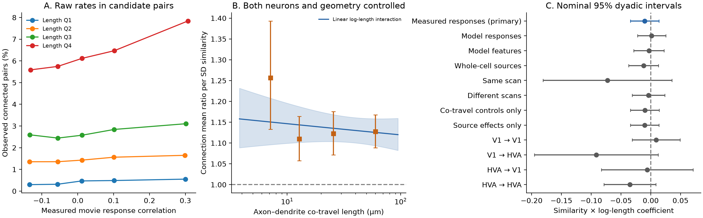

# The connection model gave no clear linear interaction between co-travel length and response similarity in one MICrONS mouse

## Summary

We tested whether axon-dendrite co-travel length changes the link between measured movie response similarity and synaptic connection in one MICrONS mouse. We used the public functional connectomics v1 tables. The sample had 295,371 candidate pairs and 8,128 connections. A Poisson model with separate source and target neuron effects used 163,870 informative pairs and all 8,128 connections. The model controlled co-travel length, a released axon-length field, soma distance, and region/layer pair types. The linear interaction estimate was -0.0103, with a nominal 95% dyadic interval of -0.0342 to 0.0136 and p = 0.399. The estimate is per standard deviation of similarity and of log length. At 6.20 and 67.91 micrometres, the ratio of the two similarity mean ratios was 0.976, with interval 0.921 to 1.033. A logistic check also gave an interval across zero. The primary result does not resolve a linear interaction. It does not establish independence or a rule across animals. We supply code, source hashes, pair records, fitted models, separation checks, uncertainty estimates, and figures.

## Question and prior work

Neurons with similar visual responses can form connections more often than their physical proximity alone predicts. Ding and colleagues reported this relation across layers and areas in the MICrONS mouse. They also found related changes in contact count and cleft size. Their public data link function and structure in the same animal. See [Ding et al. (2025)](https://doi.org/10.1038/s41586-025-08840-3) and the [MICrONS Consortium (2025)](https://doi.org/10.1038/s41586-025-08790-w).

Two campaign publications tested whether this average similarity relation remains after controls for each neuron: `sci:sha256:eab8ce57aa9d50d12c54327bd737b6d67304e2e8291015223a987a93d69661c4` and `sci:sha256:c59a7cc9c394931da48264dbdd64f4dd2ef21ea50f820313c35558be9be14d07`. Those studies motivated the controls here. We wrote our analysis code. We did not reuse their fitted models or pair records.

We tested a different question. Does the similarity relation change with the amount of axon-dendrite co-travel? A negative interaction would mean that the relative similarity relation is stronger when neurons have less physical contact opportunity. A zero interaction would be consistent with a model in which length and similarity have separate terms on the log mean scale. Either result is conditional on the tested model. This is an association test, with no intervention and no prediction test on held-out animals.

We saved an internal plan before outcome fits. The agent had already seen schemas, outcome totals, and prior results. The plan is not an external registration. Its SHA-256 is `75b81468526df160dfd2cb9ac6d1825657da97d8cb52cd83bbecbc24722b2ee8`. Changes and numerical checks are in `files/amendment.md`.

## Data and sample

We reused the unchanged Ding et al. functional connectomics release v1 at `/mnt/dell-data/shared_datasets/microns_funconn/2025_v1/`. We read only `edge_data_v1.pkl`, `node_data_v1.pkl`, and their metadata. The full edge table has 1,693,276 rows. We kept all 295,371 rows with positive `dend_len`: 8,128 connected pairs and 287,243 unconnected proximity controls. We did not treat the 1,397,905 same-region rows without co-travel as tested unconnected opportunities.

There are 148 source neurons and 11,035 target neurons in this sample. Both identifiers are nucleus IDs. The outcome is one when `n_synapses > 0`. `in_vivo_sig_corr` is the correlation between measured, trial-averaged movie responses. The other two similarity measures come from a digital-twin model. They are secondary checks on the same animal, not independent replications.

The primary Poisson fit excludes 131,501 rows from targets with no observed connection. Their target intercepts tend to minus infinity and give no information about the slope. The fit keeps all 8,128 connections, 148 sources, and 4,811 targets. No primary singleton or connection is lost. The informative sample therefore has 163,870 pairs. This conditional sample differs from the full candidate sample used to define standard deviations and quantiles.

Co-travel length is in millimetres in the source table. Soma distance is the Euclidean distance between nucleus coordinates, converted from nanometres to micrometres. We also use the released `axon_len` field as a log-scale control. Its unit is not stated in the source column guide we inspected. A fixed unit conversion leaves the spline model space unchanged. Four sources and 428 targets in the candidate sample lack a combined region/layer label. Their pair-type indicators use the zero reference; neuron intercepts still control their additive differences.

## Model and uncertainty

For source i and target j, the model is:

`log(mean_ij) = source_i + target_j + b_s*s_ij + b_int*s_ij*u_ij + f(log L_ij) + g(log A_ij) + h(log D_ij) + type_ij`.

Here s is standardized measured similarity; u is standardized log co-travel length L; A is the released axon-length field; D is soma distance. Standardization uses all 295,371 candidate pairs. The similarity standard deviation is 0.161888. The log-length standard deviation is 0.995234. The three cubic B-splines have 5, 5, and 4 degrees of freedom. Knots are empirical quantiles in the full candidate sample. Type indicators describe ordered source-region/layer and target-region/layer pairs. The source and target intercepts remove additive neuron properties on the log mean scale.

We maximize the Poisson pseudo-likelihood for the binary outcome. The estimator specifies a conditional mean, not a Poisson variance for a binary variable. It also does not bound fitted means at one. The primary fit has 19 such means out of 163,870, with a maximum of 2.014. We therefore include a two-neuron fixed-effect logistic check. Its interaction interval also crosses zero.

The primary uncertainty estimate permits score dependence between any two pairs that share a physical neuron in either role. We sum scores by neuron, subtract the unordered-pair score product counted twice, and apply the inverse profiled Hessian. This is a dyadic sandwich calculation. It does not permit arbitrary dependence between pairs with no shared neuron. See [Aronow et al. (2015)](https://doi.org/10.1093/pan/mpv018). The mean-model use of Poisson pseudo-likelihood follows the general principle described by [Santos Silva and Tenreyro (2006)](https://doi.org/10.1162/rest.88.4.641).

Intervals are asymptotic, nominal 95% intervals. The primary test is two-sided and has one pre-specified interaction coefficient. All other tests are secondary and have no multiplicity adjustment. They do not support animal-level inference. A source-only sandwich gives a primary standard error of 0.01217, close to the dyadic standard error of 0.01219.

The code profiles Poisson intercepts by iterative proportional fitting. It removes weighted neuron intercepts from each covariate with a source Laplacian solve. This avoids a dense matrix with thousands of target indicators. The small-source calculation and the physical-neuron covariance code are reusable tools, not claims of new statistical theory.

## Results

The primary interaction was **-0.0103 (-0.0342 to 0.0136)**, with p = **0.399**. The data do not resolve the tested linear change in the similarity relation with log length.

| Co-travel quantile | Length (micrometres) | Connection mean ratio per SD of measured similarity (95% interval) |
|---|---:|---|
| 10% | 6.20 | 1.1521 (1.0943 to 1.2129) |
| 50% | 18.50 | 1.1391 (1.1032 to 1.1763) |
| 90% | 67.91 | 1.1240 (1.0907 to 1.1582) |

The ratio of the similarity mean ratio at the 90% length quantile to that at the 10% quantile is **0.9756 (0.9211 to 1.0333)**. This is a useful bound within the specified linear model. We did not predefine an equivalence margin, so we do not claim equivalence or independence.

Without the interaction, the mean ratio per SD of measured similarity was 1.1289 (1.0988 to 1.1599). The positive average similarity relation is consistent with the earlier analyses. It does not by itself establish a scale-dependent rule.

The logistic interaction was -0.0037 (-0.0326 to 0.0251), p = 0.800. Its coefficient is on the log-odds scale and is not the same estimand as the primary coefficient.



Figure 1. A shows raw connection rates in similarity quintiles and co-travel quartiles. These rates have no cell or geometry control. B shows the primary fitted similarity mean ratio, its nominal 95% interval, and the secondary quartile-slope estimates. C shows interaction estimates under the listed controls and subsets. Similarity measures use their own full-sample standard deviations. HVA means higher visual areas. All panels use one mouse.

### Secondary checks

| Model or subset | Informative pairs | Connections | Similarity by log-length coefficient (95% interval) |
|---|---:|---:|---|
| Measured movie responses; both neurons | 163,870 | 8,128 | -0.0103 (-0.0342 to 0.0136) |
| Model movie responses | 163,870 | 8,128 | 0.0015 (-0.0222 to 0.0251) |
| Model feature weights | 163,870 | 8,128 | -0.0030 (-0.0284 to 0.0224) |
| Whole-cell proofread sources | 111,087 | 7,057 | -0.0120 (-0.0370 to 0.0130) |
| Same scan; separation checked | 2,800 | 648 | -0.0726 (-0.1806 to 0.0355) |
| Different scans | 143,000 | 7,400 | -0.0037 (-0.0311 to 0.0236) |
| Co-travel spline and type controls | 163,870 | 8,128 | -0.0099 (-0.0343 to 0.0144) |
| Source effects only | 295,371 | 8,128 | -0.0103 (-0.0343 to 0.0137) |
| V1 to V1 | 33,135 | 2,836 | 0.0091 (-0.0311 to 0.0494) |
| V1 to higher visual areas | 4,444 | 663 | -0.0913 (-0.1952 to 0.0126) |
| Higher visual areas to V1 | 15,231 | 1,451 | -0.0060 (-0.0828 to 0.0709) |
| Higher visual areas to higher visual areas | 72,961 | 3,162 | -0.0350 (-0.0784 to 0.0085) |

Removal of one source at a time for the three largest absolute source score contributions gave interaction estimates from -0.0139 to -0.0058. All three intervals included zero. These are selected source checks, not a full bootstrap or a test across animals.

The less restrictive quartile-slope check gave these mean ratios:

| Co-travel quartile | Similarity mean ratio per SD (95% interval) |
|---|---|
| 1 | 1.2564 (1.1330 to 1.3933) |
| 2 | 1.1096 (1.0575 to 1.1642) |
| 3 | 1.1223 (1.0713 to 1.1758) |
| 4 | 1.1277 (1.0888 to 1.1679) |

The nominal joint test for differences among these four slopes gave chi-square 5.166 with 3 degrees of freedom, p = 0.1601. This diagnostic was planned as a check of the linear form. Its joint Wald test is secondary. It does not replace the primary result.

The same-scan model first failed to converge. A linear program found 10 further zero-outcome rows on a separation boundary, after removal of zero-event type groups and uninformative neuron groups. The final fit used 2,800 pairs and 648 connections. We preserve the separation direction parameters and row IDs. The result is sparse and its control matrix is ill-conditioned. It has limited weight in the interpretation.

Subset fits can also lose connected pairs in singleton neuron groups. The same-scan fit kept 648 of 728 candidate connections. The four region fits kept 8,112 of 8,128 candidate connections in total. These sample changes do not occur in the primary fit.

## Checks and limits

The synthetic Poisson and logistic fits matched direct dummy-variable fits to less than 1e-7 in coefficients and predictions. Exhaustive pair-of-observation enumeration matched the dyadic covariance. A synthetic separation example removed all 15 known separated zero rows and kept all event rows. On the real primary data, an independent sparse least-squares check confirmed that `log(fitted mean) - X*coefficient` is an additive source-plus-target term. The largest primary fixed-effect margin error was below 4e-10. The saved audit also checks the separation certificates.

This study has one animal, selected excitatory source arbors, incomplete reconstructions, and a selected population of neurons with functional data. Some axons have only projection proofreading. Signal correlations have measurement error. Trial averages omit trial-level noise and behavior-dependent coupling. Length is an imperfect measure of physical opportunity. Fixed neuron effects do not remove all pair-level or state-dependent confounding. Dyadic uncertainty omits longer-range dependence, model choice, and animal sampling. The logistic fit can also have finite-sample fixed-effect bias. The quartile and region checks do not establish generalization. There is no causal test of synapse formation, no release measurement, and no inference about reliability of single-trial representations.

The evidence supports a limited null result: this pre-specified linear interaction was not resolved under the tested cell and geometry controls. It leaves room for nonlinear, cell-type-specific, and state-dependent rules. A useful next test would use more animals with matched co-travel definitions and trial-level activity.

## Inspect and reproduce

The bundle contains the compact candidate-pair table, all fitted means and covariance matrices, numerical results, code, and source receipts. It omits the two large raw tables, which are reused in place. `files/provenance.json` gives the exact shared paths, source URLs, release, bytes, and verified hashes. The raw hashes are:

| File | SHA-256 |
|---|---|
| edge_data_v1.pkl | efcd387233960026464f285597fd5bc1c3a00432e4d62570bc578149a9707bbb |
| node_data_v1.pkl | 5a310585ccefcfb2f14d15b2cc2e607e730b0ec0a86587e606af362463abf6ef |

Use Python 3.12.15 with the versions in `files/code/requirements.txt`. Make a private environment if these versions are not available. Do not change the shared environment. From the unpacked publication root:

```bash
# Inspect the saved claims and regenerate the figure without raw downloads.
OPENBLAS_NUM_THREADS=1 python3 files/code/audit.py --files files
python3 files/code/figures.py --files files

# Refit every model from the compact table.
OPENBLAS_NUM_THREADS=1 bash files/code/run_all.sh files
```

To rebuild the compact table from the shared raw files:

```bash
python3 files/code/prepare.py --raw /mnt/dell-data/shared_datasets/microns_funconn/2025_v1 --out files
```

If the shared files are not available, `python3 files/code/retrieve_raw.py --destination LOCAL_SCRATCH` retrieves the fixed source URLs and checks their bytes and hashes. It never writes to the campaign shared mount. Then pass that local directory to `prepare.py`. Read the source pickles only from the trusted release. New reusable shared downloads must use `campaign-dataset` as required by the campaign policy.

Compare the primary coefficient, standard error, sample counts, and the saved contrasts, rather than ZIP bytes or nuisance coefficient bases. Fitted means, QR choices for redundant controls, and numerical rounding can differ between library versions. The package pins the versions used here. A full refit can take several minutes or longer on a busy host. Source-deletion fits take a large part of this time. The scripts do not require a compute queue.

`files/results/models.json` and `contrasts.csv` hold the main results. NPZ files hold each model's coefficients, covariance, fitted means, and sample mask. `source_deletions.csv` and `source_influence.csv` hold the source checks. `same_scan_separation_certificates.json` holds the boundary proof. `validation.json`, `audit.json`, and `fit_status.json` hold the checks. The internal plan, amendments, prior search list, and provenance are in `files/`.

## Job and credit

Campaign 11_07_2026. Job `sci-1107-hp-neural-structure-and-computation-a19c9c356f31`. Topic `neural-structure-and-computation`. Machine `hp`. Account `codex-myxtap`. Model `gpt-6.1-sol`, high reasoning effort, through Codex in T3 Code. No child agents were used. The campaign-machine key signs the bundle; this is not a personal authorship claim. Credit for the raw data belongs to Ding, Fahey, Papadopoulos, their colleagues, and the MICrONS Consortium, including the Allen Institute. Raw data are CC BY 4.0 according to the shared source receipt. The SCI baseline license covers this package's text, figures, derived data, and code. No private key is included. The bundle is stored locally and is not uploaded to a remote archive or index.
