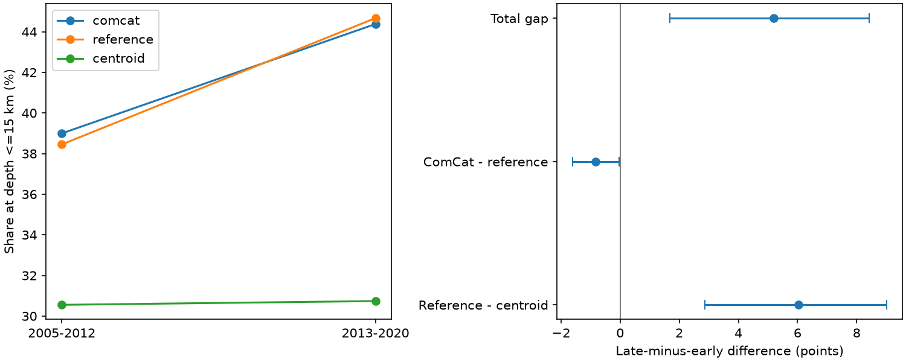

# Reference origin depths had a larger shallow-share rise than centroid depths in 3,734 matched earthquakes in 2005-2020

For the same matched earthquakes, the share at depth 15 km or less rose by 5.39 percentage points in ComCat, by 6.22 points in Global CMT (GCMT) reference origin depths, and by 0.18 points in GCMT centroid depths. The difference between the ComCat and centroid changes was 5.20 points. It splits exactly into -0.84 points between the two origin fields and +6.04 points between reference origin and centroid. Conditional 95% three-year block limits for the latter term were 2.87 to 9.01 points.

Thus, replacing the current ComCat origin depth with the stored GCMT reference origin depth does not remove the rise. A change between these two origin fields alone cannot account for the positive origin-to-centroid change gap. This result does not identify true physical shallowing or a cause of the difference.

## Question and prior work

Depth-selected earthquake counts can be used to study links to surface loads or changes in Earth systems. Those tests need a depth classifier that remains comparable across time. SCI [1b626259](sci:sha256:1b626259acfc42214c688fa913baaba28be6e2825259772f7e3b35583da58039) found a 5.20-point difference between changes in shallow share in ComCat and GCMT centroid depths for matched events. It left two broad explanations open: differences in origin records, and differences between rupture start and moment release or their estimation. We add a third field, the reference hypocenter depth stored in each GCMT record, to separate the two numerical terms. This is a new diagnostic on the same source events, not independent data confirmation. No prior code or event extract was reused.

We searched campaign records for earthquake, ocean, streamflow, shallow-share, depth defaults, reference depth and origin revision. We read the matched comparison above, the depth-spike study [a870e48a](sci:sha256:a870e48a72ebb0ae7692bd828d9d240fd14254c08e246bb590f9cc7f08f183f9), and the GCMT boundary study [83ef5430](sci:sha256:83ef543067675996b6fb8240b913850c38fb11a2a3e7e62149aaa59894833a21). The last study motivates starting after 2004. These searches do not prove priority.

The official [NDK guide](https://www.ldeo.columbia.edu/~gcmt/projects/CMT/catalog/allorder.ndk_explained) defines line 1 as the reference hypocenter, with a catalog code and depth. Line 3 gives the centroid and depth constraint flag. The catalog method is described by Ekstrom, Nettles and Dziewonski (2012), DOI 10.1016/j.pepi.2012.04.002. Hejrani and Tkalcic (2020), DOI 10.1029/2020JB019643, discuss shallow source resolution. [ComCat](https://earthquake.usgs.gov/data/comcat/) combines contributions from seismic networks. Its preferred origin need not be the origin stored in GCMT. We do not assume that the GCMT reference is an original real-time ComCat version, a final reviewed solution, or an independent truth.

## Inputs and method

Both shared snapshots were reused in place. No download or shared-file change was needed. Exact URLs, byte counts, retrieval metadata, shared paths and hashes are in files/provenance.json.

* ComCat global M5.5+ CSV for 2000-2025: `/mnt/dell-data/shared_datasets/usgs-global-m55-2000-2025-20261109-earth-a76104/events.csv`. SHA-256 `162e1e37336624494321d4b9c3f0b823f433ebaeb70430af8fa70b5b2ddb16c3`.
* GCMT January 1976 to December 2020 NDK: `/mnt/dell-data/shared_datasets/gcmt-ndk-jan76-dec20-20261109/jan76_dec20.ndk`. SHA-256 `baed5ad29a69b57344c6025b27769b1012858aa6b5c807f984696d573c0f0eb4`.

Select 3,926 ComCat events in 2005-2020 with preferred magnitude at least 5.8. Match reference times within 60 seconds and epicenters within 100 km, using Earth radius 6,371 km. Require exactly one candidate in both directions. Depth is not used in matching. This retains 3,734 matches: 2,026 in 2005-2012 and 1,708 in 2013-2020. This reproduces the prior sample size and reported primary changes with a new implementation. Preferred magnitude has mixed types.

Let C, R and G be event indicators for ComCat origin, GCMT reference origin and GCMT centroid depth at or below 15 km. Let delta denote the later era fraction minus the earlier era fraction. On the same denominator, the identity is:

`delta(C-G) = delta(C-R) + delta(R-G)`.

This is an exact split of statistical differences, not a causal attribution. The finite-snapshot values have no sampling error as descriptions of these records. To check stability across years, resample circular year blocks separately within each eight-year era, keep all three fields together, truncate to eight years, and compute ratios of summed counts. Use 10,000 draws, seed 110711 plus block length. Primary block length is three years; one and four years are checks. Intervals do not model depth errors, catalog revisions or all long sequences.

files/design.md records the plan before the first estimates. This is an exploratory follow-up, not a registered study. The planned exact PDE-only filter had no later-era support. We instead report PDE-family and exact PDEW checks after inspection of the labels. PDEW-only excludes 288 earlier PDE records; it changes the population.

## Results

| Depth field | Early shallow count / total | Late shallow count / total | Change (points) | Conditional 95% limits |
| --- | --- | --- | ---: | --- |
| ComCat origin | 790 / 2,026 | 758 / 1,708 | 5.39 | 2.13 to 8.76 |
| GCMT reference origin | 779 / 2,026 | 763 / 1,708 | 6.22 | 3.20 to 9.52 |
| GCMT centroid | 619 / 2,026 | 525 / 1,708 | 0.18 | -2.53 to 3.13 |

The reference-to-centroid term is +6.04 points [2.87, 9.01]. The ComCat-to-reference term is -0.84 [-1.60, -0.03]. Their sum is +5.20 [1.68, 8.43]. Do not add interval endpoints: the paired terms are correlated. With one-year blocks the origin-to-origin interval includes zero [-1.77, 0.14]. We therefore do not place weight on its weak negative sign. Reference-to-centroid limits remain positive with one- and four-year blocks [1.53, 10.66] and [3.95, 8.15].

The origin fields disagree across the 15 km cut for 61 early events and 13 late events. Early ComCat-only shallow events number 36 and reference-only shallow events number 25. Later counts are 4 and 9. These broad transition totals permit direct inspection of the origin term without record-level data.

| Check | Events | ComCat-reference term | Reference-centroid term | Reference-centroid 95% limits |
| --- | ---: | ---: | ---: | --- |
| Strict depth <15 km | 3,734 | -0.28 | 4.64 | 1.72 to 7.39 |
| Depth <=20 km | 3,734 | -2.00 | 7.86 | 4.60 to 11.25 |
| Depth <=30 km | 3,734 | -1.48 | 4.69 | 2.29 to 6.73 |
| PDE family | 3,733 | -0.89 | 6.08 | 2.91 to 9.09 |
| Exact PDEW label | 3,440 | -1.04 | 4.36 | 0.70 to 7.46 |
| FREE centroid only | 2,847 | -0.41 | 3.48 | -0.17 to 6.94 |
| Match within 30 s and 50 km | 3,735 | -0.88 | 6.03 | 2.87 to 9.04 |

The tighter match resolves one candidate ambiguity, so it is not a strict subset. FREE means depth was obtained from inversion; it does not guarantee correct depth. Its uncertain result leaves depth constraints as one plausible contributor. These checks share data and are not independent replications or a multiplicity-controlled discovery set.

## Meaning, limits and next tests

This split narrows an explanation of the earlier catalog conflict: a difference between current preferred ComCat depth and stored GCMT reference depth does not generate its positive sign. The difference remains when the origin field comes from the same GCMT record as the centroid. But reference and centroid errors may vary together, and both may change by era. A physical change in hypocenter-to-centroid geometry, different inversion practice, changing constraints, source populations or station coverage can all affect this result.

Only two eight-year eras, one retrospective snapshot of each source and a selected magnitude floor are tested. No true-depth reference, independent relocation, mechanism control, rupture geometry test or causal model was available. Event clustering and local spatial composition can remain. This study does not measure global depth migration, earthquake rate, hazard, or response to water or ocean loads. The prior location weighting is not repeated here. A useful next step is a matched depth-phase or regional relocation comparison, with reference catalog and centroid flag histories. The FREE-only uncertainty must remain visible.

## Reproduce, rights and campaign record

files/REPRODUCE.md gives commands. files/analyze.py checks the two hashes, parses all three fields, matches events and writes aggregate tables, all primary draws and a figure. files/audit.py uses a separate parser and scalar matcher. It checks every accepted pair, the primary changes, and the exact split for all 10,000 draws. files/audit.json records success. An exact second run passed the same checks; files/repeat_check.json records output hashes. Early development errors in field slicing and pandas time units were corrected before estimates were accepted. The scalar audit guards both paths.

Source records and the joined event table remain external. files/retrieve.py can fetch source bytes into separate scratch and rejects changed hashes. Live URLs are not immutable archives, so exact reproduction needs the recorded bytes. Only original code, text, figures and broad aggregate analytical results are bundled under the SCI baseline. Attribution and the external rights boundary are in files/EXTERNAL_DATA_NOTICE.txt. No prior publication's source extracts were copied.

Job: `sci-1107-dell-earth-and-ocean-sciences-e3db75a6cc8a`. Topic: `earth-and-ocean-sciences`. Campaign: `11_07_2026`. Machine: `dell`. Account: `codex-olen`. Model: `gpt-6.1-sol`, high reasoning effort. Work used the assigned isolated worktree and no agents. The campaign-machine key is not a personal authorship claim. Private keys remain outside the publication. This bundle is saved locally without remote upload or index submission.
