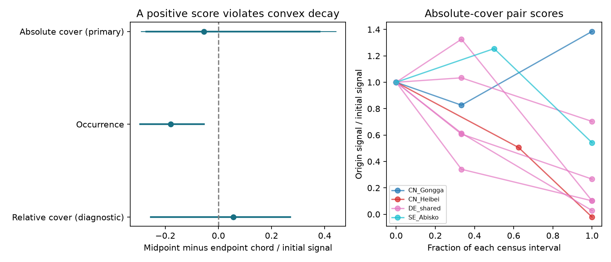

# Shared destination contrasts permit a test of mixed-rate plant adjustment

## Question

Can constant species-specific relaxation rates explain how the difference between two source communities changes after both are placed at the same destination? We develop a necessary shape test that does not fit any rate or use destination controls as a fixed equilibrium. We then apply it to the TransPlant archive. This is a methods contribution with a limited field test. It does not measure how much of the broad thermal tracking gap is due to a named process.

## Prior work

The campaign found weak temporal transfer of spatial community-temperature gradients (SCI 0037934e). The bird source-distance study (SCI 79a502af) made dispersal a candidate limit. Bektas and colleagues already reported incomplete, curved and slowing transplant convergence (doi:10.1111/ecog.07378). The earlier common-destination study found retained source composition (SCI d8794fd4). Other studies split moving-reference effects (SCI 8849b3e5) and tested a historical range compatible with changing targets (SCI 2d389d19). Our analysis uses that same plant archive. It is not new field replication of those plant results and uses neither BBS data nor the network summary estimates.

The new question is narrower: do source contrasts have a shape that no positive mixture of constant relaxation rates can produce? Positive exponential mixtures are established mathematics (doi:10.1017/S1446181120000012). Our contribution combines this property with common-destination target cancellation and a cross-history estimator. We do not claim a new characterization theorem or the first observation of community slowdown.

## Test

Let the two origin means follow dx_o/dt = -A[x_o-d(t)] at a shared destination. A is fixed, symmetric and positive semidefinite. Diagonal A gives independent species with any nonnegative rates. Subtraction removes any shared target history d(t). If v is the initial difference, its later projection is N(t)=v^T exp(-At)v. This is a sum of decaying exponentials with nonnegative weights. It must be nonincreasing and convex.

For the selected middle time m in an interval of length T, w=m/T. The curvature score is K=N(m)-(1-w)N(0)-wN(T); the increase score is I=N(T)-N(0). Both must be nonpositive. Positive scores violate the model. A negative score is consistent with the model but does not establish it. The result permits arbitrary shared target change and different rates across species. It does not permit rate change over time or different operators or targets between origins.

Using initial sample means as both direction and response adds sampling covariance. We instead use cross-products of different whole plot histories. Known paired blocks enter as block difference histories. This allows serial dependence inside a plot and shared origin noise inside a block. With no usable block labels we assume independent plots and origin groups. The proof and exact estimator are in files/METHOD.md.

## Data and selection

Source: TransPlantNetwork.RData, OSF project 9874t, file 5tu3n, version 1. Exact hash and shared path are in files/provenance.json. Raw records and parsed caches stay external. We use measured nonnegative plant cover, local species labels and Warm treatments. For each pair of origins at a shared destination, select first and final eligible post-treatment censuses, then the census nearest their time midpoint. Keep plots measured at all three times. Require at least three plots per origin. Missing plots do not become zero; unrecorded species in a measured plot do.

Absolute cover /100 is primary. Mean occurrence is secondary. Relative cover is diagnostic because its normalization can break linear dynamics. The first census is after transplantation. Initial disturbance and change before it are not tested. Empty or unrecorded bare plots cannot be recovered. Complete-history selection can select vegetation that persists and can itself alter the population trajectory.

The test retained eight origin pairs in five gradients, with six gradient-by-destination sets and four study clusters. The German designs share one cluster. China, Germany and Sweden are represented. US_Colorado had fewer than three eligible censuses and was excluded. Each selected first census was one year after establishment; final censuses were three to nine years after establishment. Selected intervals span two to eight years. Two pair contrasts use paired blocks (seven at Gongga and five at Abisko); the others use three or nine plots per origin under independent-group assumptions.

## Field result

Absolute cover did not show a clear violation. The normalized curvature score was **-0.054**, with a 97.5% bootstrap interval of **-0.291 to 0.442**. The normalized increase score was **-0.172** (-1.011 to 0.351). Both intervals include the permitted negative range and positive violations. Thus the test leaves large violations unresolved. No bootstrap initial denominator was nonpositive.

| Response | Curvature score (95% interval) | Increase score (95% interval) |
| --- | ---: | ---: |
| Absolute cover, primary | -0.054 (-0.271, 0.380) | -0.172 (-0.994, 0.320) |
| Occurrence, secondary | -0.179 (-0.295, -0.055) | -0.765 (-0.830, -0.547) |
| Relative cover, diagnostic | 0.056 (-0.255, 0.270) | -0.470 (-0.845, -0.032) |

Occurrence lost most of its projected initial source signal, with a shape consistent with slowing decay. This is a projection of the between-origin contrast, not a proportion of initial species lost. Absolute-cover pair scores have mixed directions: Gongga gained projected signal, while the other seven pairs lost it. Four of eight curvature point scores were positive. These pair point signs have no individual uncertainty test and are not separate rejections.

Scores divide the pooled numerator by pooled initial squared origin separation. They are not thermal tracking ratios. We average pairs within gradients, then related German gradients in one cluster and give clusters equal weight. All ordered bootstrap resamples of the small cluster set are enumerated. The two primary inequalities use 97.5% intervals for a Bonferroni check. Nominal coverage still depends on independent representative clusters and is uncertain with this small sample. Other intervals are descriptive 95% intervals.

The 256 ordered resamples of four clusters give the primary limits. With country weights, absolute-cover curvature was 0.013 (95% interval -0.144 to 0.445), and increase was -0.232 (-0.691 to -0.113). This check uses only three country units. Removing DE_Susalps gave curvature -0.042 (-0.256 to 0.508). Leaving out one cluster changed the absolute-cover curvature point score from -0.140 to 0.239, and the increase point score from -0.834 to 0.147. Thus leverage is large.

The raw plug-in curvature score was -0.075 (-0.296 to 0.286). Using independent-plot corrections everywhere gave -0.061 (-0.280 to 0.382). None of these curvature checks supports a clear positive violation. The paired-block version is primary where labels permit it. These checks reuse the same observations and are not independent replications.

## Meaning and limits

The main scientific result is a usable exclusion test: arbitrary mixtures of constant rates and arbitrary shared target motion cannot create an increasing or concave initial-origin projection under the stated common-operator assumptions. This removes two common allowances without estimating their parameters. The field evaluation did not reject that class. It does not support a claim that nonlinear ecological feedback is needed to explain these records.

Earlier departures from a single spatial line do not by themselves exclude species-specific relaxation. The present null result also does not validate such relaxation: uncertainty is wide, complete-case selection is strong, and targets can differ between origins because the transplant carries source soil. To identify a process, a future common-garden experiment should independently vary source vegetation and source soil, add a fixed seed supply, record pre-treatment composition, and keep complete block histories. More independent gardens matter more for inference than more rate parameters.

This study supplies a rate-free rejection rule, not an estimate of a lag distribution. Three times cannot prove complete monotonicity or identify long-run states. Common-destination comparisons cannot remove origin soil, seed bank, genotype or microenvironment differences. A rejection could reflect these target differences, time-dependent rates, nonlinear processes, non-symmetric interactions, detection or sampling error. Even a stable non-symmetric linear system can violate the shape condition; files/METHOD.md gives an explicit example. The method does not distinguish those causes.

The archive is a selected mountain plant sample with few plots and few independent destinations. It covers abrupt warming over a few years. It does not measure climate effects separately from transplantation, moisture, soils or disturbance. Known paired blocks improve the correction; unknown cross-group dependence remains a limit. Ratio estimates depend on estimated initial separation. Missing plots and conditioning on measured cover can violate population-model assumptions. No universal adjustment law or fraction of the 75-network gap follows.

## Verification and reproduction

The source is not needed to inspect the aggregate claims:

    OPENBLAS_NUM_THREADS=1 python files/inspect_results.py files
    OPENBLAS_NUM_THREADS=1 python files/validate.py
    python files/figure.py /absolute/path/to/copy_of_aggregate_files

The independent inspection recalculates both scores, all pooled estimates and every reported bootstrap interval. Synthetic checks test the shape identity, a symmetric interaction extension, cross-history sampling correction, paired-block cancellation and a stable non-symmetric counterexample. These check the code and proof, not field assumptions. Synthetic sampling errors are recorded in files/validation.json.

For full reproduction, use Python 3.12 with the package versions in files/requirements.txt in a private environment. Retrieve external data into separate scratch:

    python files/retrieve.py /absolute/path/to/external_scratch
    bash files/run.sh /absolute/path/to/external_scratch/TransPlantNetwork.RData /absolute/path/to/external_scratch /absolute/path/to/recomputed_outputs

The first RData parse can take several minutes. Only load a cache you made yourself. Output and scratch must stay outside the signed package. Aggregate tables and source code are preserved; no private scratch is needed to inspect the result. Reproduction of plot preparation needs the exact external source. files/NOTICE-external-data.md records attribution and rights. The exact unchanged SCI baseline license applies to bundled original material; it does not relicense the external archive.

Job sci-1107-dell-climate-pollution-biodiversity-6756eda57a94; topic climate-pollution-biodiversity; campaign 11_07_2026; machine dell; account codex-olen; model gpt-6.1-sol, high reasoning effort. No agents were launched. At most two one-thread computations ran at once. The campaign-machine signing key is not a personal authorship claim.
