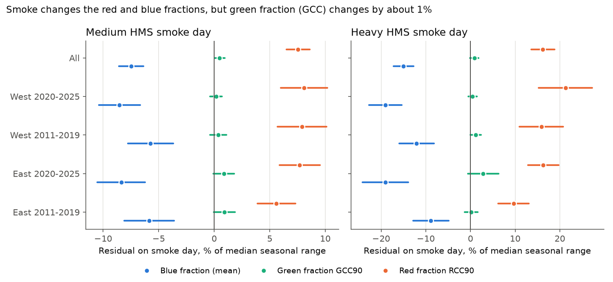
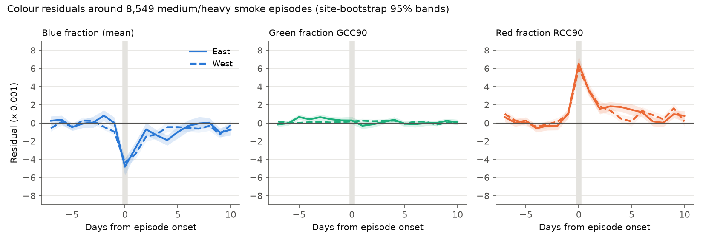
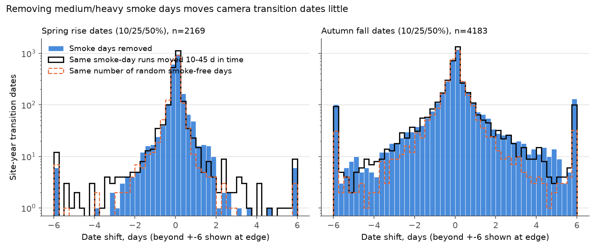

# Wildfire smoke changed PhenoCam red and blue fractions by about 15% of their seasonal range but GCC by under 2%, and moved transition dates little, at 435 North American sites in 2011-2025

## Result

We tested if wildfire smoke changes the canopy colour that PhenoCam cameras record. We also tested if smoke moves the spring and autumn dates that are calculated from camera greenness.

On days with heavy smoke in the NOAA Hazard Mapping System (HMS), the cameras recorded much less blue light and much more red light. The green chromatic coordinate (GCC90), which is the main PhenoCam greenness index, changed very little.

| Heavy HMS smoke day, all 435 sites | Change (x 0.001) | 95% interval | Percent of median seasonal range |
| --- | ---: | --- | ---: |
| Blue fraction of the scene | -9.63 | -11.08 to -8.17 | -15.0 |
| Red chromatic coordinate (RCC90) | +11.42 | +9.59 to +13.26 | +16.2 |
| Green chromatic coordinate (GCC90) | +0.48 | -0.04 to +1.01 | +0.9 |
| Scene brightness (percent) | -1.46 | -1.93 to -0.99 | not applicable |

The red and blue changes occurred in all four independent samples (East and West of 100 W, crossed with 2011-2019 and 2020-2025). All four intervals excluded zero, also with a four-test (Bonferroni) correction. The changes increased from light to medium to heavy smoke. They were largest on the onset day of an episode and decreased as the share of smoke days decreased in the next days (Figure 2). The same calendar days one year earlier or later gave no change (placebo).

The GCC90 change on heavy smoke days did not replicate. All four sample intervals included zero (+0.08, +1.62, +0.68 and +0.27 x 0.001). The pooled upper 95% bound is 1.01 x 0.001, which is 1.8% of the median seasonal GCC90 range. Smoke-free days 1-3 days before a smoke episode had a GCC90 residual of the same size (+0.62 x 0.001, 0.38 to 0.86). Thus the small positive GCC90 residual is not specific to smoke. It agrees with the weather that comes before and with smoke episodes.

When we removed the medium and heavy smoke days and calculated the transition dates again, the median date shift was 0.00-0.01 days for all six date types. The mean shift (clipped at 10 days) was -0.12 to +0.20 days in all date types and regions. Most large shifts also occurred when we removed the same runs of days at other times of the season. The pooled excess share of autumn dates that moved 3 days or more was +1.2 to +2.2 percentage points (Figure 3).

## Why this matters

Camera greenness is a main ground source for plant phenology in North America. Smoke seasons now overlap with autumn colour change in the West and with summer canopy in the East. If smoke changed GCC, phenology records and climate-phenology models would contain an observation bias that increases with fire activity. Our data show that GCC90 is almost not sensitive to smoke. The same data show that indices that use the red or blue channel alone (for example RCC for autumn colour, or red-green ratios) have a large smoke effect. Users of such indices must remove or flag smoke days.

## Question and prior work

We searched the campaign archive for PhenoCam, camera, smoke, ozone and phenology terms. Three earlier campaign studies used PhenoCam autumn and spring dates in the eastern USA (sci:sha256:55541d9120adcdbb64b771ae3ac6723c4423d638c3a5c4e3311a669ce0241b7d, sci:sha256:0299aeb5a247814099b96badce2e2c5991962ff189fabe495bc0a91db622b50f, sci:sha256:05407d959829f2e33063c758370595d92ef7a6c604e61c25bae1830bbabca44f). They did not test smoke. An earlier campaign study tested HMS smoke and bird counts (sci:sha256:64f2d0489d2fffc5f9ec6a95c7447cb78d929c6103ac4fe844bf687e470aec0e). It reported that HMS density classes are consistent from 2011, so we start in 2011. A web search found no study that measured the smoke effect on PhenoCam GCC.

The plan in files/analysis_plan.md was written before we calculated any outcome. The analysis was not registered outside this bundle. One test was added after the first results. It is labelled below.

## Data

- PhenoCam live-archive 1-day ROI summaries (Richardson et al. 2018; Seyednasrollah et al. 2019; V3 dataset Zimmerman et al. 2025). One ROI per site: primary vegetation type DB, EN, GR, SH, DN, TN or WL; the lowest ROI index in the V3 ROI list; 25-55 N and 130-60 W; camera active after June 2011. 462 sites were candidates. 457 files were available. 435 sites had usable residuals (197 East, 238 West; 135 GR, 93 DB, 85 EN, 84 SH, 33 WL, 3 DN, 2 TN).
- NOAA HMS smoke polygons, 1 March - 30 November, 2011-2025 (4,120 days; 5 days were not available). The daily class at a site is the densest polygon that contains the site point.
- NASA POWER daily point values: CERES cloud amount and clearness index, MERRA-2 aerosol optical depth at 550 nm (AOD), precipitation and air temperature.

The analysis table has 564,546 site-days from 1 March to 30 November, 2011-2025. It has 59,185 light, 7,861 medium and 1,983 heavy smoke site-days. Counts per sample are in files/results/sample_counts.csv.

## Method

1. Outcome. For each site-day we calculated the residual of GCC90: the value minus the median of the days d-7 to d+7. The median uses only days without HMS smoke of any class, and needs 6 or more such days. We removed days with a snow flag or a GCC90 outlier flag. We did the same for RCC90, the scene blue fraction b/(r+g+b) from the mean ROI colour, GCC mean, and brightness.
2. Primary model. Residual = light + medium + heavy + cloud-amount decile dummies + wet day (precipitation > 1 mm), with site x year x month fixed effects. Standard errors are clustered two ways, by site and by date. The primary term is heavy smoke on GCC90.
3. Replication. Four samples: East and West, 2011-2019 and 2020-2025. A replicated effect needs the same sign and an interval that excludes zero in all four samples.
4. Secondary tests. Continuous MERRA-2 AOD; smoke-free days 1-3 and 4-7 after the last medium/heavy day, and 1-3 days before the next one; placebo labels from the same calendar day one year earlier and one year later; no cloud control and a clearness-index control; models by vegetation type.
5. Event profile. 8,549 episode onsets (medium/heavy day with no medium/heavy day in the 7 days before) at 428 sites. Mean residual by day from onset, with a site bootstrap.
6. Transition dates. For each site-year, a fixed smoother (7-day median, gap fill up to 14 days, Gaussian mean with sd 5 days) and 10%, 25% and 50% amplitude dates for the spring rise and the autumn fall. We compared all days with medium/heavy smoke days removed. We used 6,352 site-year dates (2,169 spring, 4,183 autumn) at 354 sites that had one or more medium/heavy days within 30 days of the date. The pre-specified null removed the same number of random smoke-free days within 30 days. The run-preserving null was added after the first results: it moves the year's medium/heavy day pattern by 10-45 days, so the removed runs keep their length.

## Detailed results

Replication samples (x 0.001; heavy smoke; 95% intervals):

| Sample | Sites | Blue fraction | RCC90 | GCC90 |
| --- | ---: | --- | --- | --- |
| East 2011-2019 | 175 | -5.69 (-8.26, -3.11) | +6.81 (+4.39, +9.22) | +0.08 (-0.74, +0.91) |
| East 2020-2025 | 139 | -12.23 (-15.54, -8.92) | +11.51 (+9.08, +13.94) | +1.62 (-0.35, +3.59) |
| West 2011-2019 | 136 | -7.76 (-10.25, -5.26) | +11.19 (+7.73, +14.65) | +0.68 (-0.01, +1.36) |
| West 2020-2025 | 200 | -12.23 (-14.56, -9.91) | +15.02 (+10.79, +19.25) | +0.27 (-0.26, +0.80) |

Medium smoke: blue fraction -4.80 (-5.51, -4.09), RCC90 +5.33 (+4.59, +6.08), GCC90 +0.27 (+0.01, +0.53). Light smoke: blue -1.83, RCC +1.90, GCC +0.04 (-0.09, +0.17). The median seasonal ranges (95th minus 5th percentile, March-November, per site-year) are 57 x 0.001 for GCC90, 71 x 0.001 for RCC90 and 64 x 0.001 for the blue fraction.

Secondary results for GCC90 (x 0.001):

- Placebo, one year earlier: heavy +0.02 (-0.36, +0.39). One year later: heavy -0.09 (-0.43, +0.24). The blue fraction placebo was also near zero.
- Without cloud control: heavy +0.42 (-0.11, +0.94). With clearness-index control: +0.38 (-0.15, +0.91).
- Persistence model: smoke-free days 1-3 after: +0.13 (-0.10, +0.36); 4-7 after: +0.30 (+0.14, +0.47); 1-3 before: +0.62 (+0.38, +0.86). The residuals after smoke were smaller than the residual before smoke. We found no sign of a lasting canopy change after smoke.
- Vegetation types: heavy smoke DB +1.44 (+0.30, +2.57), which is 1.7% of the DB median range of 84 x 0.001; EN +1.04 (+0.32, +1.77), 2.8% of the EN range of 37 x 0.001; GR, SH and WL intervals include zero. These per-type estimates do not have a replication split.
- MERRA-2 AOD: +1.96 per 0.5 AOD (+1.43, +2.49). It was positive in all four samples (+1.49 to +2.54). This differs from the HMS result. MERRA-2 AOD also includes non-smoke haze and is linked to summer weather, so we do not interpret it as a smoke effect. It is about 3% of the median GCC90 range per 0.5 AOD.

Transition dates (files/results/transition_shift_summary.csv):

| Date type | Dates | Median shift (d) | Mean shift (d), 95% interval | Share moved >= 3 d | Run-preserving null | Excess (pp), 95% interval |
| --- | ---: | ---: | --- | ---: | ---: | --- |
| Autumn 10% | 1,471 | 0.00 | +0.10 (-0.03, +0.22) | 13.5% | 12.0% | +1.4 (-0.1, +3.0) |
| Autumn 25% | 1,496 | 0.00 | +0.13 (-0.01, +0.27) | 12.0% | 9.8% | +2.2 (+0.7, +3.7) |
| Autumn 50% | 1,216 | 0.00 | +0.10 (-0.00, +0.20) | 6.1% | 4.9% | +1.2 (-0.1, +2.7) |
| Spring 10% | 530 | 0.01 | +0.01 (-0.09, +0.10) | 1.1% | 2.8% | -1.6 (-2.5, -0.7) |
| Spring 25% | 722 | 0.01 | +0.07 (+0.02, +0.12) | 0.6% | 1.5% | -1.0 (-1.6, -0.3) |
| Spring 50% | 917 | 0.01 | +0.04 (-0.01, +0.09) | 0.9% | 1.7% | -0.8 (-1.4, -0.1) |

The random-day null gave smaller shares (2.4-5.9% in autumn) than both the smoke removal and the run-preserving null. Thus most large shifts come from the loss of consecutive days, not from smoke colour. A few very large shifts (more than 50 days) occurred when the removal of many days moved the detected seasonal peak. This is a weakness of the threshold method in gappy years. It is not a smoke effect.

## Interpretation

Smoke attenuates and scatters blue light more than red light. The cameras recorded this change clearly. GCC90 is a ratio of green to the sum of the three channels. In these data, the loss of blue and the gain of red were of almost equal size, so the green fraction stayed nearly constant. This is an empirical result for PhenoCam cameras and ROIs. We did not model the camera spectral response.

## Limitations

- HMS analysts draw smoke only where they can see it from satellites. Smoke days are therefore more often clear days. The cloud-amount control reduces this bias but cannot remove it. CERES can classify thick smoke as cloud, so the cloud control can absorb a part of the smoke effect. Results without cloud control were similar.
- HMS shows smoke in the full air column, not at the surface. The HMS class is for the full day, but camera images are taken in daylight at different times.
- The residual method compares a day with nearby smoke-free days. Long smoke episodes leave few baseline days; those days are removed (6-day minimum). Very long episodes are thus under-represented.
- We used the provisional live archive, not the frozen V3 files, because V3 ends in 2023. A rerun can give slightly different values.
- The sites are not a random sample of North American vegetation. Many western sites are grassland or shrubland with small seasonal ranges.
- The transition method is one fixed smoother and threshold rule. Other PhenoCam methods (for example the V3 spline transition product) can react differently to gaps.
- The run-preserving null was added after we saw the first transition results.

## Reproduce

All scripts are in files/code. External data are not in this bundle (see files/EXTERNAL_DATA_NOTICE.md).

1. Make an empty scratch folder outside this bundle. Put the PhenoCam camera list and V3 ROI list there (shared campaign datasets phenocam-camera-metadata-20261109-d563ef81 and phenocam-v3-roilist-20261109-d563ef81, or the source URLs in the notice).
2. Run `bash files/code/run_all.sh <path to files/code>` with Python 3.12, numpy, pandas, pyarrow, geopandas, shapely, matplotlib and curl. Set CAMS and ROIS if the lists are in other paths.
3. The scripts download about 0.5 GB, build the site-day table (about 5 minutes), fit the models (about 1 minute) and calculate the transition dates (about 10 minutes).
4. Compare the downloaded files with files/results/raw_input_hashes.csv (5,039 files). PhenoCam archive files change daily, so their hashes will differ after 2026-11-09.

Outputs in this bundle: files/results/model_results.csv (all model terms), primary_table.csv, event_profile.csv, amplitudes.csv, transition_shift_summary.csv, sample_counts.csv and sites_used.csv.

## Provenance

- Campaign 11_07_2026, job sci-1107-dell-climate-pollution-biodiversity-55c7d46ee625, topic climate-pollution-biodiversity, machine dell, model claude-opus-5-5 (Claude Code). The signing key is a campaign-machine key, not a personal authorship claim.
- Data were downloaded on 2026-11-09. Analysis was done on 2026-11-09.

## References

- Richardson A.D. et al. 2018. Tracking vegetation phenology across diverse North American biomes using PhenoCam imagery. Scientific Data 5:180028. doi:10.1038/sdata.2018.28
- Seyednasrollah B. et al. 2019. Tracking vegetation phenology across diverse biomes using Version 2.0 of the PhenoCam Dataset. Scientific Data 6:222. doi:10.1038/s41597-019-0229-9
- Zimmerman et al. 2025. PhenoCam Dataset v3.0. ORNL DAAC. doi:10.3334/ORNLDAAC/2389
- Young et al. 2025. Version 3.0 of the PhenoCam Dataset. Earth System Science Data. doi:10.5194/essd-17-6531-2025
- Gelaro R. et al. 2017. The Modern-Era Retrospective Analysis for Research and Applications, Version 2 (MERRA-2). Journal of Climate. doi:10.1175/JCLI-D-16-0758.1
- NOAA OSPO Hazard Mapping System. https://www.ospo.noaa.gov/products/land/hms.html
- NASA POWER. https://power.larc.nasa.gov
