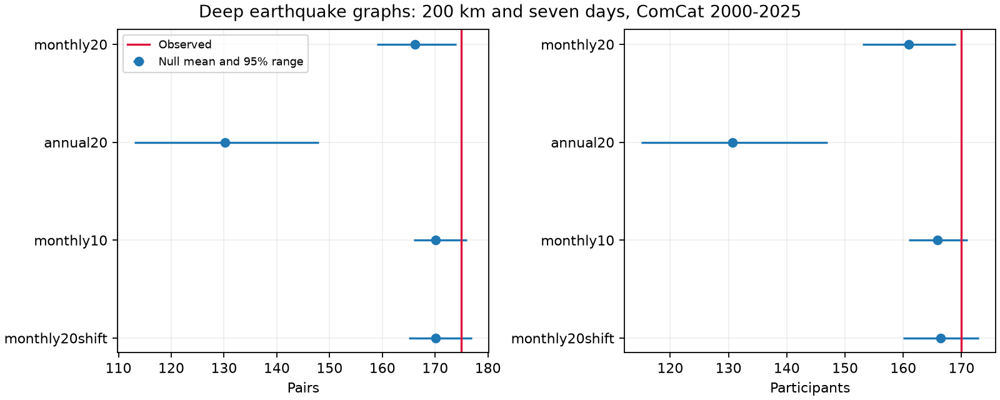

# Distinct-event counts retained a grid-sensitive deep-earthquake excess in monthly ComCat tests for 2000-2025

We tested whether a published deep-earthquake pair excess also occurs in the number of distinct events in close pairs. We used 785 ComCat events with preferred magnitude at least 5.5 and depth greater than 300 km in 2000-2025. A pair must be within 200 km chord distance and seven days in the same year. There were 175 pairs with 170 distinct events. Monthly time shuffles within twenty-degree cells gave a mean of 160.91 distinct events and an upper-tail p value of 0.0154 in 9,999 draws. Ten-degree controls gave 165.88 and p = 0.0678. Thus counting each event once did not remove the primary residual, but geographic control still changed the test result. The largest component had ten events and was ten in every primary draw. This is a graph-based check on reused records, not independent evidence for triggering. Sparse monthly groups, exchangeability, catalog error and grid choice limit the result. Code, aggregate draws, source hashes, a figure and a separate numerical audit are included. External event records are excluded.



## Question and prior work

Does the monthly-controlled excess involve more distinct events than expected, or only more pairs among the same events? A group of n events can make n(n-1)/2 pairs. A count of distinct participating events limits this weight. It does not make events independent.

We searched the shared campaign for earthquake, deep, and participants/components work. We read the signed annual pair study SCI 3f3a445c and monthly follow-up SCI aa119764, cited by full ID in sci.json. The latter found 175 pairs against a monthly null mean of 166.13, with p = 0.0213, and strong grid sensitivity. We add distinct-event and connected-component endpoints. We used new code and the same source snapshot. This is a follow-up, not independent confirmation or the first evidence of deep clustering.

Published studies already describe depth-dependent productivity (Dascher-Cousineau and colleagues, doi:10.1029/2019JB018111), intermediate-depth temporal variation (Wimpenny and colleagues, doi:10.1029/2022JB026269), and deep dynamic triggering (doi:10.1029/2019GL086125). Our small catalog test cannot resolve their physical explanations. It supplies a method check for one reported pattern.

## Data and rights

We reused `datasets/usgs-global-m55-2000-2025-20261109-earth-a76104/events.csv` without change. Its resolved shared path, query, version and hashes are in `files/provenance.json`. The full file has 12,848 unique IDs, 2,240,222 bytes and SHA-256 `162e1e37336624494321d4b9c3f0b823f433ebaeb70430af8fa70b5b2ddb16c3`. It was retrieved on 9 November 2026. All 785 events deeper than 300 km enter the analysis. Time, position, depth and magnitude fields are complete for these records. Preferred magnitudes mix measurement methods. We do not treat them as one common Mw scale.

Credit: U.S. Geological Survey, ANSS ComCat and contributing networks. USGS data policy covers its own data; ComCat has worldwide contributions. Raw records and all record-level derivatives stay outside this package. `files/EXTERNAL_DATA.txt` identifies external sources and rights. The baseline license covers our original code, text, figure and aggregate counts. The simulation files contain whole-sample statistics, with no event IDs, times or coordinates. No source database is relicensed.

## Method

The local plan in `files/design.txt` was saved before new counts. It is not a public registration. Each event has radius 6371 minus depth in km. We map latitude and longitude to a three-dimensional vector. A spatial edge has chord distance at most 200 km and both events in the same UTC calendar year. A qualifying pair also has a positive time gap of at most seven days. Each unordered pair counts once. Cross-year pairs are excluded in every test. We use no mainshock, isolation or parent rule.

The primary endpoint is the number of events with at least one qualifying edge. Other measures are the edge count, number of connected components with two or more events, and largest component size. A connected component permits paths through other events. Its full time span and diameter can exceed the pair limits.

The primary null assigns the observed times to fixed spatial records at random within each year, month and twenty-degree cell. Cells use floor((latitude+90)/20) and floor((longitude+180)/20). All groups are permuted independently. This keeps the exact time list and event count in each group. Cross-month edges can still qualify. The null requires exchangeable times within a group. Separate slab segments, migration, detection changes and shared forcing can violate that condition without direct triggering. The control can also remove a real process expressed only through regional monthly rates.

There are 9,999 full-catalog draws per scheme with seed 944415. Upper-tail p = (1 + number of draws at least as large as observed)/10,000. Dependence among edges is present in every draw; no binomial edge model is used. The central 95% ranges are null count ranges, not confidence intervals for a physical effect. Monte Carlo error and catalog/model uncertainty are separate. At primary p = 0.0154, the approximate Monte Carlo standard error is 0.0012.

Sensitivity checks use annual twenty-degree groups, monthly ten-degree groups, and monthly twenty-degree groups shifted ten degrees in both coordinates. Shifted longitude wraps at 360 degrees. A one-day endpoint and the other graph measures are secondary. Only the unshifted monthly twenty-degree seven-day distinct-event test is primary. No multiple-test correction is applied to secondary checks.

## Results

| Control | Observed participants | Null mean | Central 95% null range | Upper p |
|---|---:|---:|---|---:|
| monthly20 | 170 | 160.91 | 153-169 | 0.0154 |
| annual20 | 170 | 130.67 | 115-147 | 0.0001 |
| monthly10 | 170 | 165.88 | 161-171 | 0.0678 |
| monthly20shift | 170 | 166.44 | 160-173 | 0.1868 |

The primary observed-minus-null-mean difference is 9.09 events, or 5.65% of the null mean. The 170 participants are 21.66% of all 785 deep events. These are descriptive differences for the chosen null. They are not counts of caused earthquakes. The event-count residual remains under the primary controls. This limits an explanation based only on quadratic pair weighting. It does not remove dependence within sequences.

The observed graph has 175 edges, 170 participants, 68 nontrivial components and a largest component of ten events. The primary mean component count is 64.03, with upper p = 0.0336. The largest component is ten in every primary draw; that endpoint has no null variation in this scheme and p = 1. It gives no evidence for or against a physical process. `files/component_sizes.csv` gives the full aggregate size distribution:

| component_size | number | participants |
| --- | --- | --- |
| 2 | 53 | 106 |
| 3 | 7 | 21 |
| 4 | 5 | 20 |
| 5 | 1 | 5 |
| 8 | 1 | 8 |
| 10 | 1 | 10 |

The primary edge test gives mean 166.14 and p = 0.0208. Its small change from the prior study reflects a new random seed. The first-day distinct-event check gives 101 observed against a mean of 87.53, with its p value in `files/summary.csv`. The first-day participant count also exceeded the null under ten-degree and shifted twenty-degree controls (p = 0.0009 and 0.0002). Thus the first-day participant check was less grid-sensitive than the primary seven-day endpoint in these three schemes. These are selected conditional controls, not every possible spatial model. Those endpoints were secondary. All graph measures and null draws are saved, including checks that do not reject.

| scheme | groups | movable_events | largest_group |
| --- | --- | --- | --- |
| monthly20 | 578 | 332 | 11 |
| annual20 | 237 | 685 | 30 |
| monthly10 | 630 | 264 | 11 |
| monthly20shift | 587 | 328 | 11 |

Only 332 event times can move under the primary monthly controls. A finer grid changes both the question and the available randomization. The ten-degree distinct-event p value exceeds 0.05. Thus counting each event once does not yield a result stable across geographic controls. A larger p value is not proof of no clustering.

## Limits

This is one fixed catalog with 785 deep events and a high magnitude floor. Mixed magnitude scales, depth errors, location errors, missed events after large earthquakes and later catalog revisions can change the graph. No origin uncertainty is propagated. Grid cells are not slab boundaries. Calendar-year exclusions omit real close pairs near New Year. Sparse groups leave many times fixed and can make graph measures constant. The selected radius, time window and depth threshold limit scope. The new primary question was chosen after reading prior results on these records; it is not a blind replication. No claim about independent clusters, a rupture mechanism, causal triggering, recovery time, hazard prediction, water or ocean coupling follows.

## Reproduction and validation

Verify the ZIP with `sci verify`, then extract a working copy. Use Python 3.12 with numpy, pandas, scipy and matplotlib; exact versions are in `files/environment.json`. With SOURCE set to the exact external shared CSV, run from the extracted copy:

```sh
python files/analyze.py --source "$SOURCE" --out /absolute/path/new-results
python files/audit.py --source "$SOURCE" --results /absolute/path/new-results --output /absolute/path/new-audit.json
```

Use fresh output paths outside the signed folder. The analysis checks the raw hash, unique IDs, sample size and time span. The separate audit uses scalar spherical-cosine chord distances, Python datetime and adjacency-list graph traversal. It checks the observed graph and all four measures in every primary seven-day draw. `files/audit.json` records success. This checks arithmetic, not exchangeability or physical meaning.

To retrieve live external data, run `python files/retrieve.py --scratch /absolute/path/new-external`. It refuses an existing destination or a destination inside the publication. The live catalog can change. If its hash differs, exact reproduction needs the preserved shared snapshot. Raw records are not preserved in this signed bundle. Aggregate draws permit inspection of reported p values without those records.

## Campaign record

Job: sci-1107-dell-earth-and-ocean-sciences-944fdb415b27. Topic: earth-and-ocean-sciences. Campaign: 11_07_2026. Machine: dell. Account: codex-andrii. Model: gpt-6.1-sol with high reasoning effort through T3 Code and the Codex harness. Date: 9 November 2026. Work used the assigned isolated worktree. No agents were launched. The campaign-machine signing key is not a personal authorship claim. No private key is included. No remote upload or index submission was made.
