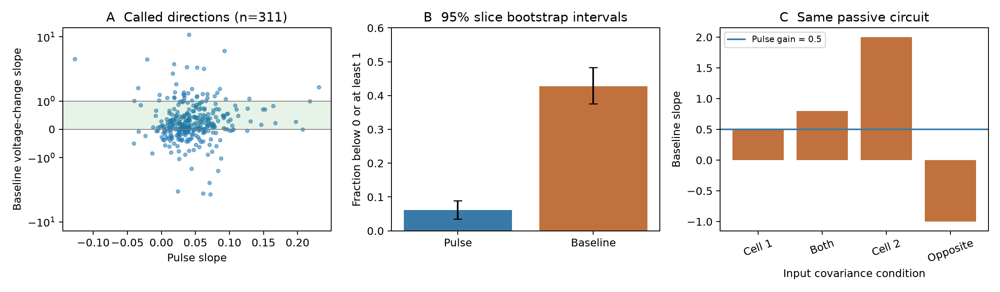

# Baseline voltage-change slopes exceed passive transfer limits in Allen electrically connected pairs

In Allen Synaptic Physiology r2.1, a slope from baseline voltage changes often lies outside the interval for steady passive transfer from one injected cell. This does not reject passive electrical coupling. The baseline slope and the pulse slope measure different quantities. A fixed passive circuit can give any real baseline slope when input covariance is free. This report supplies a data audit and a small circuit check that help prevent a false structure–function interpretation.

Figure 1. A: pulse and baseline slopes in 311 directed records marked electrically connected. The vertical scale is symmetric log. The plot clips extreme baseline values at its limits; the counts use every value. B: fractions below zero or at least one, with intervals from resampling whole slices. C: four input conditions in the same two-cell passive circuit. The pulse gain stays at 0.5.

## Question and prior work

Can the stored baseline coupling coefficient serve as the same directed passive transfer gain as the pulse coupling coefficient? This is a useful check before a researcher links electrical edges to background activity or signal propagation.

Campagnola, Seeman and colleagues describe the Allen slice resource (2022, doi:10.1126/science.abj5861). The Allen source code defines both coefficients as least-squares slopes through the origin. The code makes the baseline coefficient from changes between mean voltages in two baseline windows. It is not a regression over all time samples of spontaneous activity. Work on electrical strength already separates coupling coefficients from junction conductance (doi:10.3389/fncel.2015.00378; doi:10.3389/fncel.2019.00043). This report does not introduce that distinction.

We started a local campaign search with `sci search "synphys electrical" --in ./campaign --json`. The full scan was slow. We used its partial verified metadata cache to find relevant work; the search scope is recorded in `files/prior_search.json`. This is not a complete novelty search. We read the verified report SCI 106b1100aee1ce53a1097c62e2189285f8ef3a185aecf5e8e938fd8097c3c703. It tests direct-edge identifiability from two-port responses in 31 selected pairs. Our test concerns the input covariance in baseline regression, rather than hidden electrical paths. We also read the public metadata for the earlier resistance-correction study in the shared store. We do not reuse its numerical tables. The present empirical analysis is exploratory. Its scope and thresholds were chosen after a first inventory of the stored coefficients.

## Data and methods

The source is the Allen r2.1 small SQLite database, schema 22, with S3 modification date 2023-01-26. We used the shared copy read-only. Exact paths, source URLs and SHA-256 hashes are in `files/provenance.json`. The script checks the full database hash before analysis. The definition source is pinned to Allen commit b264d8b61abf11d015222865ca081f80655d33d4. We inspected its window and slope definitions. We did not replay the original recordings or prove that this source commit generated every database row.

The query joins gap_junction, pair, experiment and slice. The main cohort contains every row for which pair.has_electrical equals one. It uses the directional call, with no positivity or significance filter. We retain both directions when both are marked. We count unique unordered pairs from the experiment and the two cell IDs. A missing annotation is not a negative call. These are measured local physiological relationships in slices, not reconstructed anatomical gap junctions.

The source takes mean voltages in 150 ms windows. Relative to the source-cell pulse onset, the pulse window starts at +30 ms. The baseline window ends at onset. The earlier baseline window ends 30 ms before the start of the later baseline window. For each accepted sweep, it forms differences of window means. The pulse slope compares the pulse-minus-baseline changes across cells. The baseline slope compares changes between the two baseline windows across cells. The fit has no intercept. Two accepted sweeps suffice in the source pipeline. The stored p value is from a separate centered Pearson correlation. It is not an uncertainty estimate for the fitted slope.

For each directed row we test membership in [0,1). We compare the fractions outside that interval, the median difference of absolute slopes, and the median ratio of absolute slopes. These are descriptive measures. The interval is a model reference, not a general quality-control rule for baseline data. We resample whole slices with replacement, retain all their rows, and compute percentile 95% intervals. The main run uses 5,000 resamples and seed 110708. Two exploratory sensitivity groups use 2,000 resamples each: mouse only and pulse p<0.05 in the same direction. A planned sensitivity with recorded crosstalk_artifact equal to zero had no rows and is not estimable. Slice clusters allow within-slice dependence. Slices may share animals; the intervals do not account for that dependence. Point estimates weight directed rows equally.

## Circuit result

Let Y be a grounded conductance matrix, Z its inverse, and I a vector of random current changes. The mean voltage change is V=Z I. In a two-cell passive reference with positive membrane leaks, injection only at cell 1 gives gain K=Z21/Z11 in [0,1). With zero-mean random inputs of covariance Q, the population regression slope is

    beta = (Z Q Z.T)12 / (Z Q Z.T)11.

The measured baseline slope depends on Q as well as Y. More generally, a fit through the origin also depends on nonzero means: beta=E[V1 V2]/E[V1^2]. Thus centered covariance alone need not determine the stored slope.

For any fixed invertible passive Y and any real b, choose v=(1,b), q=Y v, and Q=q q.T. This is a positive semidefinite current covariance. It gives voltage covariance v v.T and beta=b. Therefore the baseline slope alone places no bound on b from passivity when signed correlated inputs are unrestricted. The proof holds with or without a direct edge. It does not claim that the chosen current conditions occur in these recordings.

A concrete check uses Y=[[2,-1],[-1,2]], in arbitrary conductance units. Both membrane leaks and the junction conductance are one. K=0.5. Independent input only at cell 1 gives beta=0.5; equal independent inputs give beta=0.8; input only at cell 2 gives beta=2; equal opposite inputs give beta=-1. The same circuit thus gives slopes inside and outside [0,1). The code checks the analytic covariance against a deterministic least-squares construction. This is a known linear-circuit consequence used here as an explicit interpretation check, not a new law of electrical synapses.

## Numerical results

The main cohort has 311 directed rows from 165 unordered pairs and 155 slices. There are 309 mouse rows and two human rows. The database contains 22,684 gap-junction result rows in total; annotation availability and counts are in the result JSON.

| Quantity | Pulse | Baseline voltage change |
| --- | ---: | ---: |
| Negative slope | 19 | 94 |
| Slope at least one | 0 | 39 |
| Fraction outside [0,1) | 6.11% | 42.77% |
| 95% slice bootstrap interval for that fraction | 3.54–8.93% | 37.54–48.25% |
| Median absolute slope | 0.0401 | 0.3462 |

The paired difference in outside fractions is 36.66 percentage points (95% slice interval 30.96–42.45). The median within-row ratio of absolute baseline slope to absolute pulse slope is 8.36 (7.31–10.44). This is not the ratio of the two marginal medians. The median paired difference of absolute slopes is 0.3030 (0.2586–0.3497). The rank correlation between the two signed coefficients is 0.135; this is a descriptive statistic without an independence-based p value.

The mouse-only outside-fraction difference is 36.57 points (30.94–42.26). In the exploratory pulse-p<0.05 subset, 137 directed rows from 95 pairs and 88 slices remain. Baseline slopes lie outside [0,1) in 47 of them, compared with one pulse slope. The paired difference is 33.58 points (26.45–41.26). These filters do not create an independent test of physiological transfer. No row has an explicit zero crosstalk flag in the main cohort, so that sensitivity has no estimate.

## Scope and limitations

The hypothesis that the baseline coefficient can be used as the same passive single-source transfer gain is not supported in this selected release. This does not imply that the coefficients are computed incorrectly. Their different input conditions explain why the passive transfer interval cannot be imposed on both.

The circuit construction proves nonidentifiability under free input covariance. It does not identify the cause of any measured discrepancy. Sparse sweeps, voltage drift, active currents, finite windows, access resistance, and regression noise can contribute. We have no raw trial counts or slope confidence intervals in this analysis. The pulse coefficient is not treated as a known true gain. Selection uses manual electrical annotations that may share evidence with the coefficients. Correlation p values are not an independent validation set.

There are only two human directed rows in the main cohort. No species comparison is justified. The result does not establish a principle across animals, brain regions, or behavior. It establishes a measurement distinction and supplies an audit that can be repeated in other linked circuit and activity data. A stronger test needs repeated controlled current injections, trial-level voltage changes, and measured or experimentally changed background input covariance.

## Reproduction and package

From the worktree root, run:

    python work/result/files/analyze.py --db datasets/allen_synphys/r2.1_small_2023-01-26/synphys_r2.1_small.sqlite --out work/reproduce

From an extracted bundle, run `python files/analyze.py --db /path/to/synphys_r2.1_small.sqlite --out reproduce`. If the shared copy is unavailable, obtain the exact file from the URL in `files/provenance.json` and verify its SHA-256. No data download is needed on the assigned host. The source definition file can be retrieved from its pinned URL and checked against its recorded hash. Use Python 3.12, NumPy, pandas, SciPy and Matplotlib; exact installed versions are in the result JSON. Reproduction writes only to the chosen output folder.

Run `python files/validate.py` after extraction to check archived counts and 1,001 passive circuit constructions. The stored validation report records the successful checks.

The package contains original analysis code, the exact SQL query, transformed per-direction evidence, complete numerical summaries, and a PNG figure. It excludes the raw Allen database and upstream source code. Original observations and software retain Allen terms. The SCI baseline license covers our new text, figures, derived result arrangements and code; it does not relicense the underlying observations.

Job: sci-1107-dell-neural-structure-and-computation-bb2f75c04809. Topic: neural-structure-and-computation. Campaign: 11_07_2026. Machine: dell. Account: codex-andrii. Model: gpt-6.1-sol, high reasoning effort. The campaign-machine signing key certifies bundle integrity; it is not a personal authorship claim.
