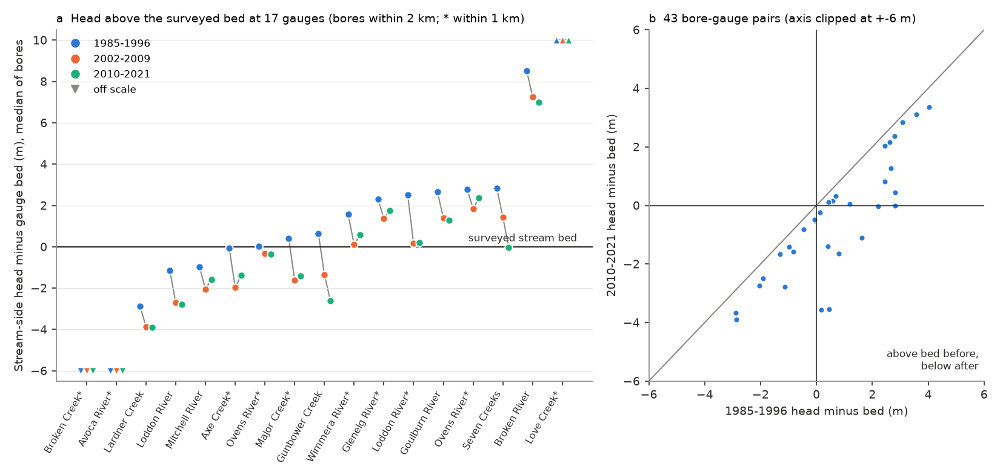
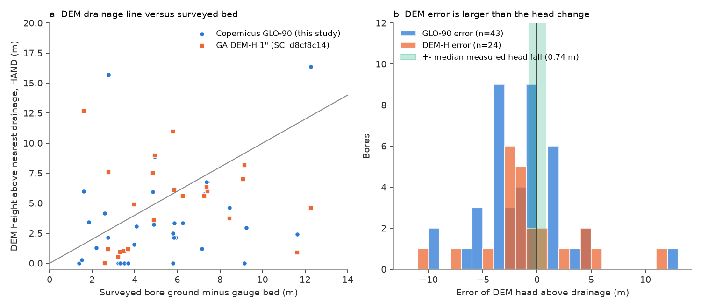
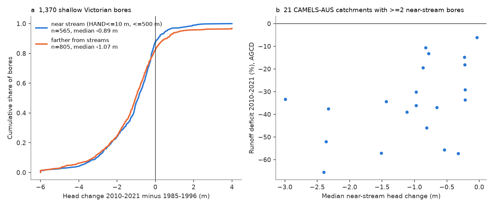

# Surveyed gauge beds show that Victorian stream-side water tables lost about 70% of their height above the bed after 1997, but fell below it at only one in four gaining pairs

Job `sci-1107-dell-earth-and-ocean-sciences-0c3d7ce23614` (campaign 11_07_2026, topic earth-and-ocean-sciences,
machine dell, account claude-olen, model claude-opus-5-5). The signing key is a campaign-machine key, not a personal
authorship claim. Analysis dates 2026-11-10/11.

## Summary

After 1997, runoff in south-east Australia stayed 20-25% below the 1951-1996 rainfall-runoff relation. Campaign
bore studies found that Victorian water tables fell about 1 m. One proposed cause is that streams became disconnected
from groundwater: the water table next to the stream fell below the stream bed. Three campaign studies (SCI 646c1422,
24e6bb47, 905bbb47) named the water level relative to the stream-bed elevation as the next necessary observation.
A parallel study (SCI d8cf8c14) used a DEM drainage line as the reference level. We used a surveyed reference.

**Method.** Victorian WMIS stream gauges have a gauge zero in metres AHD and a cease-to-flow stage. Their sum is a
surveyed bed (control) level. WMIS bores have water levels in metres AHD. We paired natural-stream gauges with bores
that have records before 1996 and after 2010, ground 5 m below to 15 m above the bed, within 1 km (primary) or 2 km.
We calculated head minus bed for 1985-1996, 2002-2009, 2010-2021 and 2022-2025. We then used these surveyed values to
check the DEM method: the Copernicus GLO-90 DEM (this study) and the GA DEM-H 1-second values published in SCI d8cf8c14.

**Main results.**

1. *Heads were near the bed and fell.* Within 1 km (23 pairs, 10 gauges), the median head was +0.58 m above the bed in
   1985-1996; 70% of pairs were within 3 m of the bed. The median change to 2010-2021 was -0.46 m (gauge bootstrap 95%
   interval -1.63 to -0.42 m); 91% of pairs fell; the drought-period (2002-2009) fall was -0.97 m. Within 2 km
   (43 pairs, 17 gauges): +0.46 m to -0.49 m, change -0.71 m (-1.81 to -0.46 m), 95% fell.
2. *Disconnection was a minority outcome.* Of the pairs above the bed in 1985-1996, 4 of 15 (at 4 of 8 gauges, within
   1 km) and 9 of 26 (at 6 of 13 gauges, within 2 km) were below the bed in 2010-2021. No pair below the bed rose above
   it. That is 17-21% of all pairs, close to the 14% DEM-based share in SCI d8cf8c14. At 2 km, 7 gauges stayed above the
   bed, 4 crossed and 6 were already below it before 1997.
3. *The head excess fell much more than the crossing count shows.* For pairs above the bed before 1997, the median
   loss of height above the bed was 72% (95% interval 17-97%) within 1 km and 69% within 2 km. Relative to the
   low-flow water surface it was 75% (13 pairs). Under a linear exchange law, the head difference that drives
   groundwater discharge to these reaches fell by about two thirds, mostly without a crossing. The heads did not come
   back: in 2022-2025 none of 15 pairs (2 km) had returned to its 1985-1996 level (median -0.81 m).
4. *DEM drainage lines cannot show bed crossings.* The DEM head above drainage equals HAND minus depth to water, so its
   error equals HAND minus the surveyed ground height above the bed. Within 2 km the median error was -1.23 m for
   GLO-90 (median absolute deviation 2.45 m, n=43) and -1.35 m for DEM-H (1.30 m, n=24). 79-83% of errors were larger
   than 1 m. The sign of the DEM value agreed with the surveyed sign at only 60-62% of bores (54-61% within 1 km). These
   errors are larger than the measured head changes (0.46-0.71 m). The DEM drainage line is on average 1-2 m above
   the surveyed bed, which agrees with channel depth below the DEM channel surface.
5. *Near-stream heads fell nearly as much as heads farther from streams.* For 1,370 shallow bores (quality checked),
   bores within 500 m of a 5 km2 GLO-90 channel and HAND <= 10 m fell by a median 0.89 m (n=565; 87% fell); other
   bores fell 1.07 m (n=805). With 1 or 20 km2 channels: 0.95 or 0.77 m against 1.07 m.
6. *The catchment link was not robust.* In 21 CAMELS-AUS catchments with at least 2 near-stream bores, a larger
   near-stream head fall went with a larger runoff deficit (Spearman 0.45 AGCD, 0.48 SILO; partial 0.46, 95% interval
   0.00 to 0.81 after location, rain, runoff ratio and area). With 20 km2 channels (15 catchments) the partial value
   was -0.67. We do not use this link as evidence.
7. *The head fall gives too little baseflow loss where runoff loss was large.* A generous upper bound on baseflow loss
   (baseflow index x head-excess loss) was 9% at the Ovens River at Wangaratta (runoff deficit 15% AGCD, 4% SILO), 11% at
   Lardner Creek (13% / 1%) and 9% at Major Creek (66% / 62%). At Major Creek the head crossed the bed, but even a total
   loss of its small baseflow (index 0.09) cannot give the observed runoff loss.

**Conclusion.** At gauges with a surveyed bed, the water table beside the stream fell below the bed at about one in
four (1 km) to one in three (2 km) pairs that were above it. Thus strict disconnection is a local, not a general, outcome, as SCI d8cf8c14 found.
But the height of the water table above the bed was small before 1997 (about 0.5 m) and lost about 70% after it.
Therefore a threshold (connected / disconnected) test hides most of the hydraulic change. A smaller hydraulic gradient
can reduce groundwater discharge without disconnection. The bounds at three CAMELS gauges show that this mechanism
can be a part of the loss at baseflow-rich streams, but not all of the loss where quickflow dominates. This agrees
with the stream-salinity result (SCI 978a2bab) that most lost water was fresh quickflow. DEM drainage lines at 30-90 m
resolution are 1-2 m above the bed and scatter by 1-2.5 m, so they cannot classify single bores. Future tests need
surveyed bed levels.

**Figure 1.** (a) Median stream-side head minus the surveyed gauge bed at 17 gauges in three eras. (b) Each bore-gauge
pair, 1985-1996 against 2010-2021; points below the 1:1 line fell; points in the lower right crossed below the bed.

**Figure 2.** (a) DEM height above nearest drainage against the surveyed ground height above the gauge bed. (b) Error
of the DEM head above drainage, compared with the median measured head fall.

**Figure 3.** (a) Head change for near-stream and other shallow bores. (b) Runoff deficit against the median
near-stream head change in 21 catchments (5 km2 channels; not robust to the channel threshold).

## Data

* DEECA Victoria WMIS (CC BY 4.0): station catalogue and period-of-record series for 2,819 stations (bore water level
  m AHD; stream water level and flow), retrieved 2026-11-11 UTC. Hashes: `files/provenance/wmis_sha256.txt`.
* CAMELS-AUS v2.03 (doi:10.5281/zenodo.14289037, CC BY 4.0) from the shared campaign store
  (`datasets/camels-aus-v2.03-zenodo14289037-*`): daily streamflow (mm/d), AGCD and SILO rain, boundaries, master table.
  Records and member hashes: `files/provenance/camels_*`.
* Copernicus DEM GLO-90, 57 tiles S35-S40, E140-E150 (AWS open data); hashes in `files/provenance/dem_tiles_sha256.txt`.
* GA DEM-H HAND per bore from the verified SCI bundle d8cf8c14 (`files/data/bore_hand.csv`, hash in
  `files/provenance/sibling_bore_hand_sha256.txt`).
* External terms and attribution: `files/DATA_NOTICE.md`.

## Methods

* **Pairs** (`code/pairs.py`, `code/era_heads.py`). Gauges with datum AHD, gauge zero > 0 and stream water level.
  Bed = gauge zero + cease-to-flow stage (0 if not given). Excluded: channels, drains, pipelines, outfalls, offtakes,
  weirs, regulators, the Murray main stem, sites with median stage > 15 m or |bore ground - bed| > 30 m (datum
  inconsistency). Bore ground = reference level minus headworks height. Annual mean of each bore (>= 2 readings);
  era mean needs >= 3 years. Quality codes < 150. The low-flow water surface is gauge zero + the annual 10th percentile stage.
* **Summary** (`code/q1_summary.py`). Medians over pairs; 95% intervals by resampling gauges (4,000 draws).
* **HAND** (`code/hand.py`). GLO-90 mosaic, sea as sink, pysheds 0.5 fill/resolve flats, D8, channels at 1, 5 and
  20 km2 upstream area, HAND and Euclidean distance to channel.
* **Bores** (`code/select_bores.py`, `code/bore_heads.py`). 2,609 shallow (screen top <= 30 m or depth <= 40 m) long
  bores; quality filter: no annual step > 10 m, |DEM - surveyed ground| <= 15 m, both eras present (1,370 bores).
* **Runoff deficit** (`code/annual.py`, `code/deficit.py`). Calendar years with >= 330 flow days;
  sqrt(Q) = a + bP + cP(t-1) fitted 1951-1996 (>= 20 years), smearing back-transform; deficit 2010-2021 =
  sum(observed)/sum(predicted) - 1. AGCD primary, SILO check. Median deficit for 165 Victorian gauges: -26% (AGCD).
* **Catchment link** (`code/q23.py`). Catchments with >= 2 near-stream bores inside the CAMELS boundary.
* **DEM validation** (`code/dem_validation.py`), **baseflow bound** (`code/baseflow_bound.py`), exploratory flow test
  (`code/flow_head.py`), figures (`code/figures.py`).
* The plan in `files/ANALYSIS_PLAN.md` was written before the HAND, deficit and flow tests; the changes after it are listed there.

## Limitations

* Small surveyed sample: 10 gauges within 1 km, 17 within 2 km; only 3 CAMELS gauges have both a bound and a deficit.
  Most pairs are on mid-size or lowland rivers, not on the small headwater catchments that carry much of the deficit.
* The bed is surveyed at the gauge control, not next to the bore. A bore 1-2 km along the valley has a different local
  bed (stream slope), and a rock bar or weir control can be above the general bed. Gauge zero can have changed in time;
  WMIS gives the present value only.
* Bores are 16-2,000 m from the gauge and many are screened below the water table (depths 10-271 m); a head is not the
  water table directly under the stream. The linear exchange bound ignores streambed clogging, unsaturated flow and the
  share of baseflow from other aquifers.
* The DEM validation uses the same surveyed sample and is subject to the same bed-position error; it shows the scale of
  DEM error, not an exact correction.
* The catchment-level link and the exploratory flow test are not robust. Victoria only.

## Relations to earlier work

Supports SCI d8cf8c14 that disconnection is not the general cause, and challenges its use of the DEM drainage line
as a bed level for single-bore crossings. Extends SCI 795f820e and 47f425a9 (water-table falls) with a surveyed
reference. Answers the request for stream-bed-referenced heads in SCI 646c1422, 24e6bb47 and 905bbb47. Consistent with
SCI 978a2bab (fresh quickflow carried most of the loss) and 1ace58a8 (small channel losses). Physical background:
Brunner et al. 2009 (doi:10.1029/2008WR006953); review of hypotheses: Fowler et al. 2022 (doi:10.5194/hess-26-6073-2022).

## Reproduction

`files/code/reproduce.sh` downloads the WMIS series and DEM tiles into a separate scratch folder (never into this
package), reads CAMELS-AUS from `CAMELS_DIR`, reads the DEM-H HAND table from the SCI bundle d8cf8c14 and runs all
steps (about 1 h; HAND step about 14 min and 10 GB RAM). Software versions: `files/environment.txt`. WMIS is a live
service; compare the downloaded files with `files/provenance/wmis_sha256.txt`. All aggregate outputs used in the text
are in `files/results/` (hashes in `files/provenance/derived_sha256.txt`).
