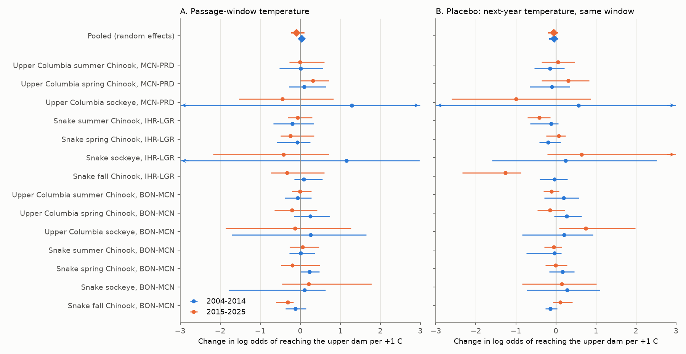
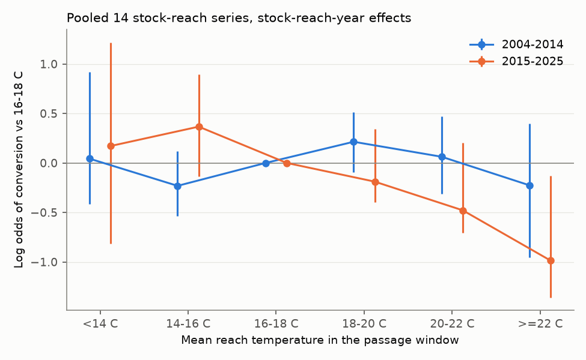
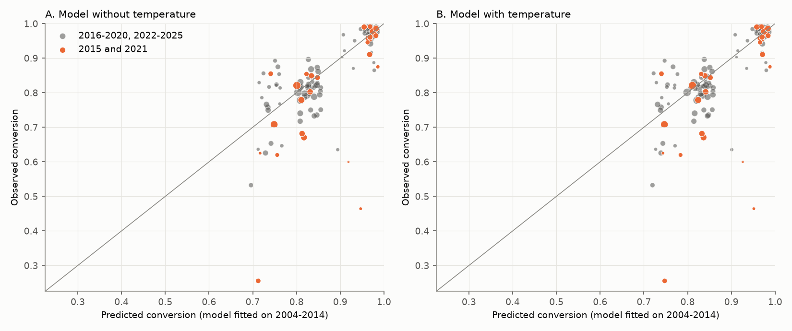

# Water temperature gave no repeated linear decrease in dam-to-dam conversion of PIT-tagged adult salmon in the Columbia Basin in 2004-2025; lower conversion at 22 C or more came mostly from 2015

## Summary

Warm river water can kill adult salmon during their upstream migration. We tested this with individual PIT-tagged adult fish in the Columbia and Snake rivers. A fish "converts" when it is detected at the next upstream dam, or farther upstream.

We used 153,308 fish-reach records (86,813 fish-years) from seven stock groups and three river reaches in 2004-2025 (Columbia River DART). We joined each fish to the mean dam water temperature (T) in its passage window. The main model compared fish of the same stock, reach and year, with a common smooth seasonal curve. Thus the year effects remove each year's fishery level, run size, ocean condition and tagging programme. We wrote the analysis plan before any fish-level model fit (`files/code/PREREGISTRATION.md`). We tested two independent periods: 2004-2014 and 2015-2025.

Main results:

1. **The planned linear test did not find a repeated temperature effect.** The pooled within-season change in the log odds of conversion per +1 C was +0.039 (95% CI -0.022 to +0.110) in 2004-2014 and -0.092 (-0.230 to +0.108) in 2015-2025. Replication criterion R1 failed. Only 7 of 14 stock-reach slopes had the same sign in both periods (R2, sign test p = 0.60). One series had a clear negative slope after correction for 14 tests: Snake fall Chinook, Bonneville to McNary, 2015-2025 (-0.31, -0.60 to -0.17; 0 of 999 bootstrap draws above zero).
2. **Temperature did not improve out-of-period prediction (R3 failed).** A model fitted on 2004-2014 predicted 2015-2025 fish outcomes slightly worse with T than without T (log-loss skill -0.005, 95% CI -0.011 to -0.000). In 2015 the observed conversion of all series together was 0.819. The model with T predicted 0.874 and the model without T predicted 0.866.
3. **Conversion was lower in the hottest water, but this came mostly from one year (exploratory).** In pooled models with stock-reach-year effects, fish with T of 22 C or more had log odds of conversion 0.99 lower than fish at 16-18 C in 2015-2025 (95% CI -1.36 to -0.13; 902 fish). In 2004-2014 the contrast was -0.23 (-0.95 to +0.39; 112 fish). Over 2004-2025 it was -0.71. Without 2015, it was -0.29. Without any one stock group, it stayed between -0.51 and -0.96. In 2015, only 8% of 153 Snake River sockeye with T of 22 C or more reached McNary Dam.
4. **Converted fish moved faster in warmer water, except fall Chinook in the lower river.** Log travel time decreased by 0.051 per +1 C (95% CI -0.077 to -0.029) in 2004-2014 and by 0.076 (-0.115 to -0.040) in 2015-2025. 13 of 14 series had negative slopes in each period. Snake fall Chinook from Bonneville to McNary moved more slowly in warmer water (+0.084 and +0.147 per C, both intervals above zero). This agrees with the known use of cool tributary mouths by fall Chinook in hot water.
5. **Between years, warm seasons had lower conversion only in 2015-2025.** The pooled slope of annual logit conversion on annual mean T (with stock-reach trends) was +0.017 (-0.206 to +0.333) in 2004-2014 and -0.113 (-0.292 to -0.012) in 2015-2025.

Interpretation: inside a season, a temperature difference of about 0.2-0.6 C at the same date (the variation that the year effects leave) did not detectably change conversion. A decrease at 22 C or more is consistent with a thermal threshold. But the data have this exposure mostly in one extreme year (2015), so they cannot separate a general threshold from other features of 2015. Temperature models that are linear and fitted on cooler years did not predict the 2015 losses.



## Job and provenance

- Job: `sci-1107-hp-climate-pollution-biodiversity-bf77f750e2f6`; topic: climate-pollution-biodiversity; campaign 11_07_2026; machine: hp; account: claude-myxtap.
- Model: Claude Opus 5.5 (`claude-opus-5-5`) worked as the researcher in Claude Code. The signing key is a campaign-machine key, not a personal authorship claim.
- Date of data download and analysis: 2026-11-09.
- Software: Python 3.12.15, numpy 2.5.4, pandas 3.1.1, scipy 1.18.1, patsy 1.0.3, matplotlib 3.11.2.

## Data

| Source | Use | Access |
| --- | --- | --- |
| Columbia River DART (Columbia Basin Research, University of Washington), "PIT Tag Adult Returns Conversion Rate", with PIT-tag data from the Pacific States Marine Fisheries Commission (PTAGIS) | One row per PIT-tagged adult: release site, rear type, first adult detection at the lower dam, first detection at the upper dam or upstream, travel time | `https://www.cbr.washington.edu/dart/query/pitadult_conrate`. Query parameters in `files/data/pit_queries.json`; download code `files/code/02_fetch_pit.py` |
| Columbia River DART "Adult Passage Daily Counts" | Daily dam water temperature `TempC` at Bonneville (BON), McNary (MCN), Priest Rapids (PRD), Ice Harbor (IHR) and Lower Granite (LWG), 2002-2026 | `https://www.cbr.washington.edu/dart/query/adult_daily`; code `files/code/01_fetch_temps.py` |

All 443 raw files (304 per-fish HTML pages, 14 annual summaries, 125 daily tables) are in `files/data/raw_dart.tar.gz` (10.3 MB). The SHA-256 of each raw file is in `files/data/raw_sha256.txt`. We did not add the files to the shared campaign dataset store, because the archive is small and is in this bundle. DART data can change after corrections, so the bundled archive is the reference copy for this analysis.

Query settings (DART defaults): fish released below the lower dam excluded, minijacks excluded, fish transported as juveniles excluded, detections upstream of the upper dam counted as conversion. DART marks fish detected only upstream of the upper dam with `UPS`.

### Stock groups and reaches

| Stock group (release river km) | Run code | Reaches | Fish-reach records 2004-2025 in the main model |
| --- | --- | --- | --- |
| Upper Columbia sockeye (730-999) | sockeye, summer | BON-MCN, MCN-PRD | 1,512; 1,161 |
| Upper Columbia spring Chinook (730-999) | spring | BON-MCN, MCN-PRD | 10,454; 8,802 |
| Upper Columbia summer Chinook (730-999) | summer | BON-MCN, MCN-PRD | 15,292; 12,013 |
| Snake sockeye (above Lower Granite) | sockeye, summer | BON-MCN, IHR-LGR | 1,948; 1,028 |
| Snake spring Chinook (above Lower Granite) | spring | BON-MCN, IHR-LGR | 21,434; 17,351 |
| Snake summer Chinook (above Lower Granite) | summer | BON-MCN, IHR-LGR | 8,675; 6,940 |
| Snake fall Chinook (above Lower Granite) | fall | BON-MCN, IHR-LGR | 23,492; 18,965 |

BON-MCN has large tribal and non-tribal fisheries. MCN-PRD and IHR-LGR have smaller fisheries for these stocks.

## Methods

**Exposure.** For each fish, T is the mean of the daily lower-dam and upper-dam `TempC` (mean of the available dams on each day) from the day of the first lower-dam detection to L days later. L is the median travel time of converted fish of that stock and reach (4-6 days; `files/data/reach_windows.csv`). At least half of the days must have a value. We removed `TempC` values at or below 0 C or above 30 C. DART gives `TempC` only on counting days (about April to October), so 11% of BON-MCN fall Chinook records have no T and are not used.

**Main model (planned).** For each stock-reach and period: logistic regression of conversion on T, year fixed effects, a natural cubic spline of the detection day of year (4 df) and rear type (hatchery, wild, unknown). We dropped years with fewer than 10 fish or with no variation in the outcome (they give no information under year effects). Intervals: 999 bootstrap resamples of years (percentile). The same year draws were used for all stock-reaches, so the pooled random-effects (DerSimonian-Laird) mean keeps the correlation from shared years. We fitted the models with our own IRLS code and checked it against statsmodels (coefficients agreed within 0.0001).

**Replication criteria (planned).** R1: pooled slope below zero with the 95% interval below zero in both periods. R2: sign agreement of stock-reach slopes between periods. R3: a model fitted on 2004-2014 (stock-reach intercepts, T, day-of-year spline, rear type; no year effects) predicts 2015-2025 fish outcomes better with T than without T (mean log loss; 999 bootstrap resamples of test years). We report the common-spline version from the plan and a version with stock-reach-specific splines.

**Checks (planned).** Placebo exposures: T of the same calendar window one year later and one year earlier. Detection: conversion counted only at the upper dam. Wild fish only. Conversion within 30 days. Lower-dam temperature on the detection day only. Travel time: log travel time of fish converted at the upper dam, same fixed effects.

**Secondary and exploratory analyses.** Between-season model: weighted least squares of annual logit conversion on annual mean T with stock-reach intercepts and trends, year bootstrap. Pooled temperature bins with stock-reach-year effects and stock-reach splines, 199 year-bootstrap draws (planned as secondary). Hinge models with AIC (exploratory). Leave-one-year-out and leave-one-stock-out refits of the bin model (exploratory, added after we saw the bin result).

**Deviations from the plan.** (1) We added the minimum of 10 fish per year and the removal of years without outcome variation; the plan did not state these rules. (2) The pooled bin and hinge models use stock-reach-year effects and stock-reach-specific splines, because the stocks pass in different seasons. (3) The leave-one-out refits (`files/code/09_hot_bin_jackknife.py`) were not in the plan. (4) Wild-only models were possible for 6 stock-reaches in 2004-2014 and 11 in 2015-2025, because many groups have few wild PIT-tagged adults.

## Results

### Pooled within-season slopes (log odds of conversion per +1 C; 14 stock-reaches)

| Variant | 2004-2014 | 2015-2025 | Negative slopes (of 14) |
| --- | --- | --- | --- |
| Main | +0.039 (-0.022, +0.110) | -0.092 (-0.230, +0.108) | 4; 11 |
| Upper-dam detections only | +0.036 (-0.026, +0.111) | -0.054 (-0.213, +0.181) | 6; 11 |
| Wild fish only | +0.056 (-0.143, +0.374), k=6 | -0.074 (-0.226, +0.321), k=11 | 2; 5 |
| Conversion within 30 days | +0.026 (-0.034, +0.100) | -0.093 (-0.230, +0.098) | 5; 11 |
| Lower-dam T on detection day | +0.002 (-0.064, +0.078) | -0.151 (-0.234, -0.051) | 9; 12 |
| Placebo: next-year T | -0.046 (-0.163, +0.065) | -0.054 (-0.195, +0.051) | 7; 7 |
| Placebo: previous-year T | +0.095 (-0.008, +0.181) | +0.026 (-0.130, +0.152) | 4; 9 |
| Log travel time (converted fish) | -0.051 (-0.077, -0.029) | -0.076 (-0.115, -0.040) | 13; 13 |

All stock-reach estimates with Holm-adjusted p-values are in `files/results/main_slopes_holm.csv` and `files/results/within_slopes.csv`. Only Snake fall Chinook, BON-MCN, 2015-2025 had a Holm-adjusted p below 0.05.

The year effects and the date spline leave little temperature variation. The residual SD of T was 0.22-0.63 C, and the 5-95% range was about -0.9 to +1.0 C (`files/results/identifying_variation.csv`). The pooled interval for 2015-2025 excludes decreases larger than 0.23 log odds per C. At a conversion of 0.8 this is about 3.5 percentage points per C.


### Shape of the response (pooled bins, log odds vs 16-18 C)

| T bin | 2004-2014 | 2015-2025 | 2004-2025 | Fish 2004-2014 / 2015-2025 |
| --- | --- | --- | --- | --- |
| < 14 C | +0.04 (-0.41, +0.92) | +0.17 (-0.82, +1.22) | +0.25 (-0.57, +1.00) | 34,367 / 19,274 |
| 14-16 C | -0.23 (-0.54, +0.12) | +0.37 (-0.13, +0.89) | +0.11 (-0.34, +0.52) | 9,304 / 7,508 |
| 18-20 C | +0.21 (-0.10, +0.51) | -0.19 (-0.40, +0.34) | -0.04 (-0.32, +0.36) | 22,648 / 10,191 |
| 20-22 C | +0.06 (-0.31, +0.47) | -0.48 (-0.71, +0.20) | -0.26 (-0.58, +0.21) | 16,217 / 8,522 |
| >= 22 C | -0.23 (-0.95, +0.39) | -0.99 (-1.36, -0.13) | -0.71 (-1.14, -0.01) | 112 / 902 |

Leave-one-out refits of the 2004-2025 model (`files/results/hot_bin_jackknife.csv`): without 2015, the >= 22 C contrast was -0.29 and the 20-22 C contrast was +0.06. Without any other single year, the >= 22 C contrast stayed between -0.67 and -0.84. Without any one stock group, it stayed between -0.51 and -0.96. Of the 1,014 fish with T of 22 C or more, 434 passed in 2015 and 333 were Snake fall Chinook in 2025.

Exploratory hinge models (all years, stock-reach-year effects) had a lower AIC than the linear model, with the best hinge at 19 C (AIC 89 lower; slope above the hinge -0.27 log odds per C). This AIC assumes independent fish and does not include the year clustering, so it overstates the evidence.



### Out-of-period prediction (R3)

| Test | Spline | Fish | Log loss with T | Log loss without T | Skill (95% CI) |
| --- | --- | --- | --- | --- | --- |
| Fit 2004-2014, test 2015-2025 | common | 57,417 | 0.3527 | 0.3509 | -0.005 (-0.011, -0.000) |
| Fit 2004-2014, test 2015-2025 | per stock-reach | 57,417 | 0.3535 | 0.3515 | -0.006 (-0.013, -0.001) |
| Fit 2004-2025, test 2026 (partial year, supplementary) | common | 4,033 | 0.3354 | 0.3357 | +0.001 (one year only) |

The observed minus predicted annual conversion is in `files/results/oos_annual.csv`. The two 2015 Snake sockeye series had the largest errors (observed 0.26 and 0.47 against predicted 0.71-0.95).



### Between-season slopes (annual logit conversion per +1 C of annual mean T)

Pooled: +0.017 (-0.206, +0.333) in 2004-2014; -0.113 (-0.292, -0.012) in 2015-2025. In 2015-2025, all 10 summer and fall series (sockeye, summer Chinook, fall Chinook) had negative slopes; the four spring Chinook series were near zero. In 2004-2014 the signs were mixed, and three spring Chinook series had positive slopes (`files/results/between_season.csv`). These annual slopes can include any other year-level difference, for example fishery rates or run composition.

### Travel time


## Observation bias

- **Detection.** Upper-dam ladder detection is not complete. Counting upstream detections as conversion (DART "UPS") and counting only upper-dam detections gave the same pooled result.
- **Harvest.** Fisheries remove fish between dams and look like non-conversion. Year effects remove each year's fishery level. Fishery openings inside a season can still correlate with temperature at the same date. The reach comparison gave no consistent pattern: in 2015-2025 the median stock slope was -0.13 in BON-MCN, -0.29 in IHR-LGR and -0.01 in MCN-PRD (in 2004-2014: +0.11, +0.01 and +0.10).
- **Thermal refuges and straying.** Fish that wait in cool tributaries can arrive late. Conversion within 30 days gave the same result as conversion at any time in the year. Fall Chinook from BON to MCN moved more slowly in warmer water, as expected from refuge use.
- **Tagged fish are mostly hatchery fish** (89%). Wild-only models were imprecise.
- **Temperature record.** DART `TempC` is the dam temperature on counting days. The sensor type and location are not documented for each year. Some years have gaps (for example Lower Granite in 2021). The exposure is a reach mean and not the temperature that each fish experienced.
- **Placebo exposures** gave pooled intervals that included zero, but some single series had nonzero placebo slopes (for example Snake fall Chinook IHR-LGR, 2015-2025, next-year placebo -1.26). Temperature at the same date is correlated between years, so placebos are not fully independent of the true exposure.

## Limitations

- The design compares fish inside a season and keeps very little temperature variation (residual SD 0.2-0.6 C). It does not test the large differences between hot and cool years, which year effects remove.
- Exposure of 22 C or more occurred mostly in 2015 and in 2025 for Snake fall Chinook. One year cannot separate temperature from other 2015 conditions (low flow, early migration, disease).
- Conversion includes harvest, fallback without re-ascent, straying and detection loss as well as death.
- One river basin. The upstream dams count many of the same fish, so the two reaches of a stock are not independent.
- PIT-tagged fish may not represent all fish (tag effects, hatchery dominance).
- Many tests were run. The planned main tests are R1-R3. Bins, hinges and leave-one-out refits are secondary or exploratory.
- Inference is correlational.

## Relation to prior work

Keefer, Peery and Heinrich (2008, doi:10.1111/j.1600-0633.2007.00267.x) reported lower en route survival of radio-tagged Snake River sockeye at higher temperatures. Goniea et al. (2006, doi:10.1577/T04-113.1) reported that adult fall Chinook used cool tributary mouths and slowed their migration when Columbia River water was warm; our travel-time result for fall Chinook agrees with this. The 2015 sockeye losses are well documented. This study does not contradict those reports. It shows that, in the PIT-tag conversion records of seven stock groups, a linear within-season temperature effect did not repeat between 2004-2014 and 2015-2025, and that the clear high-temperature decrease depends mainly on 2015. A campaign study of the same DART counts (shad and sockeye passage timing) is cited for context.

## Reproduction

From the publication root:

```
bash files/code/run_all.sh            # uses the bundled raw archive, checks raw hashes
bash files/code/run_all.sh --download # downloads raw data again from DART first (about 40 minutes)
```

Scripts: `01_fetch_temps.py`, `02_fetch_pit.py` (download), `03_build_fish.py` (per-fish table), `04_exposure.py` (temperature exposure), `05_models.py` (within-season models, checks, pooled estimates), `06_pooled_oos.py` (temperature bins, hinges, between-season models, out-of-period test), `07_figures.py`, `08_supplement.py` (identifying variation, Holm p-values, sign test), `09_hot_bin_jackknife.py`. We rebuilt `files/data/fish_exposure.csv.gz` from the bundled raw archive and it was identical. The model runs took about 1.5 hours on a loaded 8-core machine. Console logs are in `files/results/log_*.txt`. Bootstrap draws of all within-season slopes are in `files/results/boot_within.npz`.

Derived data: `files/data/fish.csv.gz` (parsed per-fish table), `files/data/fish_exposure.csv.gz` (with exposures), `files/data/daily_temp.csv.gz`, `files/data/reach_windows.csv`.
