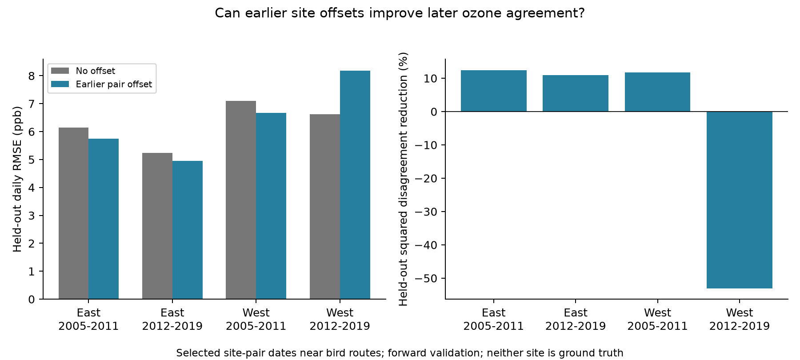
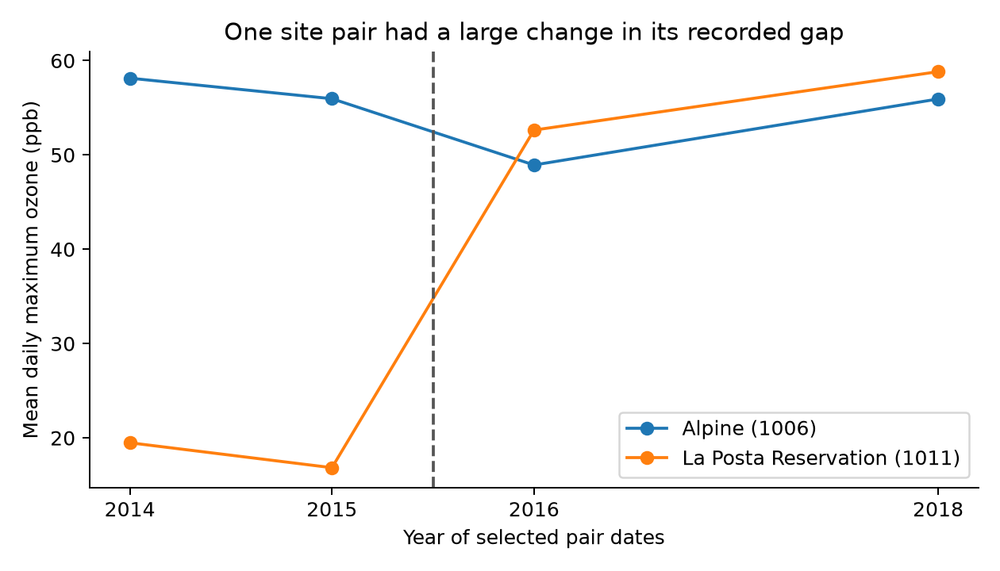

# Earlier ozone site offsets reduced later disagreement in three of four selected US bird-survey samples in 2005-2019

A fixed mean offset from earlier years reduced later squared disagreement between nearby ozone sites in three of four region and period samples. Reductions were 12.4% in early East, 10.9% in later East, and 11.8% in early West. Later West had a 53.0% increase. One site pair accounted for most of that failure. This is a test of exposure measurement near selected bird routes. It does not estimate pollution effects on birds.



## Question and prior work

Can a fixed difference between two nearby sites explain part of their later daily ozone disagreement? This question matters for studies that join biological observations to weather and pollution. A nearby monitor can give an exposure record that differs from another nearby monitor. A simple offset could improve transfer if the difference persists. It could make transfer worse if the difference changes.

Wells and colleagues (2019, [doi:10.1007/s11869-019-00679-8](https://doi.org/10.1007/s11869-019-00679-8)) found that ozone monitor agreement can vary with concentration. Liang and colleagues (2020, [doi:10.1073/pnas.2013568117](https://doi.org/10.1073/pnas.2013568117)) studied air quality policy and bird abundance. Neither result establishes that a constant site offset transfers through time near bird routes. We do not repeat their health or policy analyses.

The published campaign study `sha256:87a455ff1a82f79a12d74a6328ba8e808be5a22ab7110156d2ff58e0c3a16874` found incomplete agreement between the nearest two sites in pre-survey windows. We reuse its verified daily evidence and site assignments. We add an earlier-to-later prediction test, remove repeated pair-date records, and inspect the concentration of prediction loss. This tests an explanation for exposure disagreement, rather than a new biological effect.

We searched campaign publications for phenology, climate, pollution, ozone, calibration, and offset. We read the parent study and relevant published bird and ozone studies. The test rules in `files/analysis_plan.txt` were saved before the first fit. This was an exploratory plan, not a registered study. Diagnostics of the large western loss were added after the results. No agents were launched.

## Data and observation selection

The biological source is the public USGS Breeding Bird Survey 2025 release, [doi:10.5066/P14SNUV4](https://doi.org/10.5066/P14SNUV4). The parent supplies 3,607 filtered surveys with coordinates in 2005-2019. East means New York and Pennsylvania. West means California and Oregon. Route starts and survey dates define ozone windows. We do not use the bird counts as outcomes.

The parent kept accepted standard-protocol surveys with complete weather and assistant records, valid times, and 1-200 recorded taxa. Dates were days 121-212, start times were 02:00-08:00, and durations were 180-480 minutes. Start temperature was -10 to 40 C and end temperature was -10 to 45 C. The included source code gives the full rules. These roadside surveys are selected observations, not random habitat samples. Route starts need not represent whole routes or historical route geometry.

EPA sources are the 15 daily ozone archives for 2005-2019. The parent selected `Ozone 8-hour 2015`, `8-HR RUN AVG BEGIN HOUR`, parts per million, observation percent at least 75, daily maximum values 0-0.3 ppm, and event types `None` or `Included`. It omitted `Excluded` rows, removed repeated site-POC-date-value rows, averaged POCs at each site and date, and converted ppm to ppb. A site value is not necessarily one instrument reading. These rules were inherited and were not selected to improve prediction.

The parent chose the nearest two sites from sites with valid April-July data in each survey year. We retain windows with both sites within 50 km of the route start and at least 24 common valid dates on days 1-30 before the survey. The survey day is excluded. There are 341 early eastern, 629 later eastern, 174 early western, and 455 later western eligible windows. These are only 31-55% of the filtered surveys; the parent found warmer survey starts in the retained sample. Our results apply to this selected support.

Within each region and period we sort the two site IDs as A and B. For each window, we extract common dates, then keep each unordered site pair and date only once. Thus, routes with overlapping windows cannot repeat the same pair-date. Sites can still occur in several pairs and dates can recur across pairs. Pair-date removal does not make observations statistically independent.

## Forward test

The early period trains on 2005-2008 and tests on 2009-2011. The later period trains on 2012-2015 and tests on 2016-2019. Each region has a separate fit. A pair needs at least 30 common training days from at least two training years. Test dates do not enter the fit. No model tuning uses test errors.

For each retained pair, the offset is the training mean of `B-A`. The baseline predicts B as A. The adjusted method predicts B as A plus the offset. We score both on exactly the same later dates. The main score is root mean squared error (RMSE), in ppb. Squared disagreement reduction is `1 - adjusted_MSE / baseline_MSE`. A negative reduction means that the offset made prediction worse. The direction A to B follows sorted IDs only. Reversing the direction gives the same squared and absolute errors.

A constant offset is the least-squares intercept with slope fixed at one. It tests persistent mean differences without fitting a concentration response. It can give negative predictions, and we do not clip them. The target is agreement between sites, not bird dose. Neither site is a truth reference.

We report finite-sample forward scores without population confidence intervals. Days share weather, pairs share sites, and region-period samples share some monitors through time. The East and West have separate geographic records, and the two periods have no overlapping dates. They are useful transfer checks, but they are not four independent population replications. We do not test a trend or a regional difference.

## Results

| Region and period | Test pair-days retained / available | Pairs retained / available | Baseline RMSE | Offset RMSE | Squared disagreement reduction |
|---|---:|---:|---:|---:|---:|
| East 2005-2011 | 2733 / 3438 | 34 / 44 | 6.15 | 5.75 | 12.4% |
| East 2012-2019 | 5727 / 7029 | 49 / 64 | 5.24 | 4.95 | 10.9% |
| West 2005-2011 | 931 / 1806 | 14 / 33 | 7.09 | 6.66 | 11.8% |
| West 2012-2019 | 3469 / 6267 | 38 / 85 | 6.61 | 8.18 | -53.0% |

Available test pair-days already require two-site window support. Training support retains only 52-81% of those dates. These losses select stable monitored pairs. We do not extrapolate to omitted pairs or routes.

Absolute error also fell in the first three samples: from 4.55 to 4.33, 3.89 to 3.69, and 5.35 to 4.69 ppb. It rose from 4.67 to 4.87 ppb in later West. The first three samples improved in every held-out year. Later West worsened in 2016 and 2018, but improved in 2017 and 2019. Only 21 of 34, 34 of 49, 9 of 14, and 19 of 38 pairs improved. Mean improvements do not imply that most site records can substitute without a check.

## Checks of explanations

Each sensitivity check rebuilds its own training and test records. The table reports squared disagreement reduction in percent with date weights, except the equal-pair row. Equal-pair weighting gives each retained pair total test weight one.

| Rule | East early | East later | West early | West later |
|---|---:|---:|---:|---:|
| Primary | 12.4 | 10.9 | 11.8 | -53.0 |
| Equal-pair weights | 16.6 | 12.1 | 9.5 | -86.4 |
| At least 60 training dates | 12.4 | 11.3 | 24.3 | 18.7 |
| Complete 30-day windows | 3.1 | 19.2 | 5.9 | 14.6 |
| Both sites within 25 km | 28.9 | 18.5 | 27.7 | 32.3 |

The primary later western failure does not persist under all support rules. Those rules change the pairs, dates, and fitted offsets. They do not prove that more days or shorter distance causes better transfer. The complete-window early western result uses just five pairs and 327 test dates; equal-pair weighting gives a 15.8% increase in squared disagreement there. All 32 score rows and sample sizes are preserved.

Post-result checks show that omitting any one pair leaves positive reductions in the first three primary samples. Ranges are 7.6-16.2%, 9.3-12.9%, and 6.9-19.5%. Later western leave-one-pair-out results range from a 68.8% increase to a 15.9% reduction. This failure is highly concentrated.



The pair `06_073_1006|06_073_1011` links Alpine and La Posta Reservation. Its 54 training dates in 2014-2015 give an offset of -38.87 ppb. Its 59 test dates in 2016 and 2018 have a mean gap of +3.31 ppb. The offset increases its test RMSE from 6.14 to 42.49 ppb. Omitting this pair changes later West to a 15.9% reduction across 3,410 dates. This is a diagnostic selected after seeing the losses, not an alternative primary estimate.

We checked all 226 site-date values for this pair against the four shared EPA raw archives and verified their source hashes. They match the retained evidence. The recorded coordinates are the same across these years. The raw records have one POC per site in this subset; La Posta rows have event type `Included`. The audited rows are included. This check rules out an error in our transfer of these values from the saved evidence. It does not establish why their gap changed. Instrument history, reporting practice, local chemistry, missingness, and weather remain possible explanations. We do not label the raw record incorrect or remove it from the primary test.

## Limits and use

An earlier mean offset captured a modest part of later disagreement in three samples. It did not give reliable transfer under all tested support rules. The large fourth-sample failure shows why a correction learned from nearby sites needs a later-year check before use in an ecological study. A method that improves average agreement can still fail at particular pairs.

These data do not establish an ozone effect on biodiversity, a weather-pollution interaction, species distribution change, or ecological timing change. The new contribution is an exposure-method benchmark and a reproducible set of forward predictions near biological observations. We add no temperature, drought, habitat, occupancy, or detection model. We cannot explain prior ecological null slopes. Both sites can agree and still fail to represent bird exposure.

Training and test dates follow selected survey windows. Their seasonal mix can change, so an offset shift need not be a sensor shift. Coordinates can be static metadata despite unrecorded historical changes. Daily 8-hour maxima need not occur in the same hours at the two sites. POC averaging, event rules, missing days, and monitor placement affect the result. Only persistent pairs with enough earlier records enter the test. The method has not been validated for unmonitored routes or future climate conditions.

## Provenance and reproduction

`files/input_provenance.json` gives the parent publication ID, ZIP checksum, and hashes of the reused evidence. `parent_verify.json` records complete parent verification. The exact shared raw paths, resolved object paths, source URLs, snapshot hashes, and byte counts are in `provenance.json` and `parent_provenance.json`. Shared aliases are `/mnt/dell-data/shared_datasets/epa-aqs-ozone-daily-YEAR-20261108/daily_44201_YEAR.zip`, `/mnt/dell-data/shared_datasets/usgs-bbs-2025-routes/Routes.csv`, and `/mnt/dell-data/shared_datasets/usgs-bbs-2025-weather/Weather.csv`. This job uses the published derived evidence and directly reads only the four raw ozone archives named in `audited_raw_provenance.json`. No shared data were changed or downloaded. Historical workspace names in inherited provenance are source attribution, not dependencies.

The main calculation runs offline with Python 3, NumPy, Pandas, and Matplotlib. Versions are in `files/environment.json` and `files/requirements.txt`. From an extracted publication directory:

```sh
python files/analyze.py files /tmp/offset-results
python files/validate.py files /tmp/offset-validation.json
python files/diagnose.py files /tmp/offset-diagnostics
```

The validator uses the Python standard library and an independent calendar loop. It rebuilds training and test dates for all four support rules, checks all 32,215 predictions and all 32 RMSE summaries, and checks that test dates do not enter training. `validation.json` records success. A second analysis run and exact table comparison are recorded in `reproduction_checks.json`.

To inspect source construction or rebuild the inherited evidence:

```sh
python files/retrieve.py
python files/build_base.py /mnt/dell-data/shared_datasets/usgs-bbs-2025-weather/Weather.csv /tmp/bird-base
python files/build.py /mnt/dell-data/shared_datasets /tmp/ozone-evidence
python files/audit_pair.py /mnt/dell-data/shared_datasets /tmp/raw-pair-audit
```

The retrieval script prints helper commands and checksums without downloading. The inherited builder reads included `base_runs.csv` and checks raw hashes. Compare rebuilt inputs with the preserved evidence before analysis. Mutable source URLs can change. A different checksum requires the archived snapshot. Raw data are not copied in full; the small inspected raw subset is preserved with attribution.

## Job and rights

Campaign `11_07_2026`; job `sci-1107-dell-climate-pollution-biodiversity-2009e8126572`; topic `climate-pollution-biodiversity`; machine `dell`; account `codex-andrii`; model `gpt-6.1-sol`, high reasoning effort, through the Codex harness in T3 Code. Date: 2026-11-08. No child agents were used. The campaign-machine signing key is not a personal authorship claim. No private key is included. The SCI baseline license applies to new text, figures, code and derived records, subject to upstream rights. Reused campaign material has its cited baseline terms; EPA and USGS retain source attribution. This publication is saved locally without remote submission.
