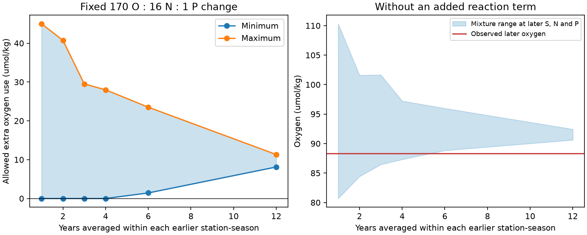

# Averaging earlier CalCOFI water types creates a positive lower bound on added oxygen use in a four-property mixture test

## Result

On sigma0 26.5, a mixture test with salinity, nitrate, phosphate and oxygen does not require added oxygen use to fit the 2007-2020 CalCOFI mean when it retains the observed variation within 1984-1995. The same test requires added oxygen use when it replaces that variation with 12-year station-season means. This is a result about what these four properties can identify under a specified source library. It does not show that actual transport caused the oxygen loss.

We used 225 station-season cells at 57 core CalCOFI stations. Both periods have at least four complete casts in each cell. Equal cell weights give a mean oxygen change from 110.795 to 88.320 umol/kg, a loss of 22.476 umol/kg. The matched changes are +0.02480 in practical salinity, +1.2217 umol/kg in nitrate and +0.12173 umol/kg in phosphate. The change in nitrate minus 16 times phosphate is -0.726 umol/kg. Sampling composition alone thus does not remove the low oxygen state.

The source library contains 1984-1995 local water properties. It is not a set of newly formed surface waters. We allow any nonnegative mixture of the earlier types and a nonnegative added reaction with O:N:P = -170:16:1. Linear programs give the following sharp bounds within each finite library. They match all four later properties exactly.

| Years averaged within each earlier station-season | Minimum added oxygen use | Maximum added oxygen use | Mixture without added reaction fits |
|---|---:|---:|---|
| 1 | 0.000 | 45.003 | Yes |
| 2 | 0.000 | 40.728 | Yes |
| 3 | 0.000 | 29.506 | Yes |
| 4 | 0.000 | 27.993 | Yes |
| 6 | 1.427 | 23.519 | No |
| 12 | 8.114 | 11.324 | No |

Oxygen units are umol/kg. A one-year type is a mean within a station, season and calendar year; it is not necessarily one cast. All block starts are fixed at 1984. Missing observations are not filled. The comparison between one and 12 years holds the observations, later target, properties and reaction law fixed. Only source averaging changes.



At fixed later salinity, nitrate and phosphate, the one-year library permits mixture oxygen from 80.686 to 110.317 umol/kg. The observed 88.320 lies inside that range. The 12-year library permits only 90.605 to 92.433. Adding the reaction changes the mixture's nutrient requirement, so its 8.114 minimum oxygen use is not the simple 2.285 difference between observed oxygen and the latter lower bound.

## Scientific question and prior work

The selected SCI work found persistent low oxygen off California and showed that local salinity ceased to predict oxygen after 2006 (d2aed83c). Other SCI tests found that transient-tracer age changes can have large bias (978770d0), and that unchanged oxygen-use laws can fit some Atlantic oxygen and tracer data (b0b64638). Those results motivate a test that uses no tracer age.

This is not the first use of mixtures and nutrients to study California Current oxygen. Extended optimum multiparameter analysis already fits water types and a reaction term. Bograd et al. (2019), doi:10.1029/2019GL082685, used remote source types to describe water-mass history. Evans et al. (2020), doi:10.1029/2020GL089274, separated changes in water-mass contributions and internal remineralization for 1993-2018. Their abstract reports nearly equal contributions from advection and remineralization. A 2025 paper also studies OMP sensitivity (ScienceDirect article S0967064525000475); we could inspect its search abstract but not its full text. We do not claim that source sensitivity is a new general concept.

Our contribution is a controlled test on the low-oxygen density surface: exact bounds over all mixtures show that time averaging alone can introduce a positive minimum reaction term. This is a local-library identification test, not a repeat of the remote-source OMP studies. It neither verifies nor refutes their numerical shares. It gives a required diagnostic for future attribution: report the admissible reaction range as source variation is retained or removed, rather than report only one fitted share.

Campaign searches before choosing the test used the terms "oxygen ventilation", "CalCOFI phosphate mixing", and "convex hull oxygen CalCOFI". We found no campaign result for this controlled averaging test. The investigation was exploratory; no tests were registered in advance.

## Data and selection

Data were obtained from the California Cooperative Oceanic Fisheries Investigations (CalCOFI), available at https://calcofi.org/. We use its final bottle database, release 16 October 2023, through calendar year 2020 only. No preliminary CTD-product observations are in the analysis or the included input table.

The immediate input is the per-cast table in the verified SCI publication `sci:sha256:d2aed83cfe2b4a27207c5bd10e25b2398ade09b4a6955fb06bb063a7136fb0d2`, member `files/data/core_cast_anomalies.csv.gz`. We retain only `src == bottle_db`, years 1984-2020, and complete salinity, nitrate, phosphate and oxygen on sigma0 26.5. There are 8,023 complete casts, including 2,670 in 1984-1995 and 2,858 in 2007-2020. Intermediate years are included for transparent filtering but do not enter the primary bounds.

The inherited procedure uses observed bottles, blank quality codes, TEOS-10 density, a maximum density interpolation gap of 0.35 kg/m3, 57 core stations, and temperature/salinity quality control. Details and original processing code are preserved by the cited SCI source. We did not recalculate the raw vertical interpolation. The present work uses the absolute property columns, not the published anomalies. This inherited selection is an explicit limitation.

The database reports nutrients in uM and oxygen in umol/kg. We divide nutrients by 1.027 kg/L. This is a fixed-density approximation on the specified density surface, not an exact pressure-dependent conversion. The prior table's temperature is not included as an independent constraint; temperature and salinity are closely linked at fixed density. Practical salinity is treated as a linearly mixed property, an approximation.

Exact immediate-source and input hashes are in `files/provenance.json`. The shared raw database is at `/mnt/dell-data/shared_datasets/calcofi-bottle-db-194903-202105-csv-16oct2023/CalCOFI_Database_194903-202105_csv_16October2023.zip` (also reached through `./datasets/`). Its metadata records SHA-256 `1d074d0581beb662fe141842eb4a4f46ebc4f02340ea9051eb1d894bafe807b7`, 37,779,228 bytes, and source URL https://calcofi.org/downloads/database/CalCOFI_Database_194903-202105_csv_16October2023.zip. We inspected that metadata but did not read the raw ZIP for this analysis. The immediate SCI table, not a new raw-data download, is the file actually used.

## Method and proof of the averaging effect

Let h_i = (S_i, N_i, P_i, O_i) denote an earlier water type and t the later mean. The model is

`t = sum_i w_i h_i + q (0,16,1,-R)`, with `sum_i w_i = 1`, `w_i >= 0`, `q >= 0`.

For R=170, we minimize and maximize `170 q`. This term is oxygen use added to the earlier library. The earlier types already contain respiration products and source disequilibrium. The term is not total AOU, a rate, or a biological change at fixed age. A positive value could result from longer exposure to an unchanged oxygen-use law.

We average the earlier complete casts within each station, season and k-year block. The target is the mean of 2007-2020 cell means on the 225 common cells. The earlier reference mean uses the same cell weights. The donor library can draw from all earlier cells; the sensitivity restricted to common cells gives the same one-year bounds. Arbitrary donor weights deliberately make this a permissive compatibility test. No geographic transport or inventory constraint is imposed.

Every averaged source type is a convex combination of its constituent observations. Therefore averaging cannot enlarge the convex hull of possible mixtures. More generally, if a coarse library averages groups from a fine library, its feasible set with the same reaction ray is a subset of the fine feasible set. Its minimum added oxygen use cannot fall and its maximum cannot rise. This proves the direction of the effect for nested partitions. The 2-, 3-, and 4-year partitions are not all nested with each other; monotonic order between those partitions is an empirical result here. We compute the magnitude on the observed data.

We reduce each source library to its convex hull vertices, which preserves all four properties and the feasible reaction range exactly. SciPy HiGHS solves scaled equalities. An independent audit solves the one- and 12-year programs using every source column and unscaled equalities. It confirms both minima. Main-program normalized residuals are below 1.7e-12 and objective/dual gaps below 1.7e-11. `files/results/audit.json` includes full-column primal witnesses and dual lower-bound certificates. Witnesses specify the earlier cell, time block, concentrations and weights, so they can be checked without trusting the plotting code.

## Robustness and uncertainty

- Individual earlier casts permit 0-48.058 umol/kg of added oxygen use. After removing any cast outside the 1st-99th percentile in any of the four earlier properties, the range is still 0-36.049. The zero bound does not depend on keeping the most extreme individual casts.
- Deleting each earlier year in turn leaves the one-year minimum at zero in all 12 tests. The 12-year model fits 11 of 12 tests, with positive minima from 3.391 to 11.494; one deletion makes the model infeasible. This is source-library sensitivity, not a confidence interval.
- We resampled whole late calendar years 500 times with replacement, retained the fixed 225-cell target, and recomputed within-cell means. All draws retained every cell. Every one-year model fit with a zero minimum. Only 302 of 500 12-year models fit even with the reaction term. Among those feasible draws, the 2.5th-97.5th percentiles of the minimum are 2.339-10.324. These conditional quantiles are not a confidence interval for a physical respiration amount; the 198 infeasible draws must not be discarded when interpreting model adequacy. This bootstrap does not include early-source uncertainty, serial dependence across years, or measurement calibration error.
- The one-year library fits every annual 2007-2020 four-property mean without an added reaction (annual checks do not have fixed cell composition). The 12-year reaction model fits only six annual means. Annual failures are not evidence of a rate change; an inadequate source library can also cause them.
- With O:P ratios 138, 150, 170, 186 and 200, retaining one-year types always gives a zero minimum. The 12-year library is infeasible at 138 and 150. Its minima are 8.114, 5.033 and 4.181 at 170, 186 and 200. N:P remains 16. Thus a narrow interval from one source model is not a reliable attribution interval.

## Meaning and limits

The test supplies a constructive null result: these four later mean properties do not require a reaction added to the range of earlier local water states. It also supplies a positive methodological result: discarding earlier variability changes that lower bound. Neither result shows that the ocean can redistribute these earlier states in the required amounts. There is no current, transit-time, supply, volume or pathway constraint. The earlier local states are comparison types, not independently measured source boundary conditions. Earlier variation could include biological or analytical variation. A real circulation model could exclude our witness mixtures.

We fit a regional mean, not every later cast or local station. Spatial transport constraints, temperature, silicate, isotopes and independent source observations could narrow or remove these solutions. All inputs are exact in the primary LP; we do not estimate observation errors. No new data establish the cause of the California low or separate ventilation from a change in respiration rate. The reliable output is a conditional feasible range and an explicit failure of a positive lower bound to survive a change in source definition. A future causal analysis needs transport and source constraints in addition to these four properties.

## Reproduction and files

From an extracted publication, run:

```sh
python files/analyze.py /path/to/local/scratch/results
python files/audit.py /path/to/local/scratch/audit.json
```

The first command recomputes all primary results, sensitivity tests, 500 resamples and the figure from the included final-only table. It writes to the supplied local scratch folder. Without an output argument it writes to `files/reproduced/`; use a separate output path to keep a signed draft unchanged. The audit reads the preserved `files/results/results.json` and writes to the supplied scratch file (or `audit_reproduced.json` in the current directory). It independently checks the stored primary minima.

To regenerate the included input from the SCI source, first verify the source ZIP, then run `python files/prepare_from_prior.py SOURCE.zip /path/to/local/scratch/input`. The script extracts only the final-data subset specified above. It does not put preliminary rows in its output. `files/provenance.json` records the source member and input hashes. For raw-to-cast reproduction use the original source publication's `profiles.py`, `process_bottle.py` and `build_series.py`; its reproduction instructions and code remain available in that signed source. Our primary numerical result can be reproduced fully offline from this package without that step.

`files/results/bounds.csv` contains the main table. The JSON contains all bounds and sensitivity details. Other CSVs contain every bootstrap draw, deletion test and annual test. Code uses Python, NumPy, pandas, SciPy and Matplotlib; exact versions are in the results JSON. Random seed: 20261110.

## Rights, attribution and provenance

CalCOFI data are available at https://calcofi.org/ under CC BY 4.0. See `files/EXTERNAL_DATA_NOTICE.md`. The included data are final bottle-data derivatives only. We include our code, analysis, figure and final-data table under the exact SCI baseline terms. No external article, restricted database, raw third-party archive, or preliminary data is bundled.

Campaign: 11_07_2026. Job: sci-1107-dell-earth-and-ocean-sciences-e555be7c1b87. Topic: earth-and-ocean-sciences. Machine: dell. Account: codex-myxtap. Model: gpt-6.1-sol, high reasoning effort, through the Codex harness in T3 Code. Analysis date: 2026-11-10. The campaign-machine signing key is not a personal authorship claim. No agents were launched. This package was signed and saved locally; no remote submission was requested or made by this investigation.
