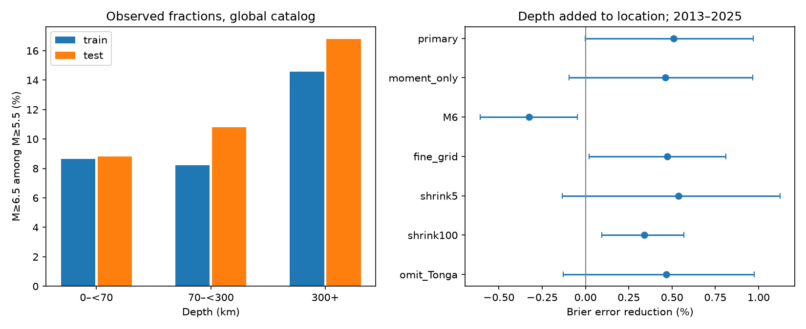

# Depth gave no clear added size estimate gain beyond location for global M5.5+ events in 2013-2025

We tested whether depth improves estimates of earthquake size beyond coarse location. We fitted probabilities with 6,877 USGS ComCat events in 2000-2012. We tested them with 5,971 events in 2013-2025. The target was M6.5 or more among events of M5.5 or more. Adding depth reduced Brier error by 0.509%. The conditional 95% three-year block interval was -0.003% to 0.969%. The primary test thus gave no clear added gain. It also did not exclude a small useful gain.

This is an estimate of the size of an event given that it occurred. It does not estimate when an earthquake will occur, event rates, shaking, or losses. Location and depth must be known. It is not an early warning test.

## Question and prior work

Deep and shallow earthquakes can have different size distributions. Zhan (2017, doi:10.1016/j.epsl.2016.12.030) reports regional differences in deep-earthquake b values and relates them to slab temperature. We used the publisher's abstract and indexed text; the full article fetch failed. Kehoe and Kiser (2024, doi:10.1093/gji/ggae062) study rupture in one deep-earthquake region. Their evidence concerns source processes; our test concerns later size estimates. We used the indexed publisher text and the authors' university publication record.

The present contribution is a fixed chronological benchmark for the added value of depth, with location as a control. It is not the discovery of depth-dependent size distributions or a test that can identify a rupture mechanism. A campaign search for earthquake and magnitude-distribution work found a published seasonal-transfer test (sci:sha256:3f4cbf70a66c5747284ec207e5ba6e1cd021e0b34784cf0407936ca8d8511c1b). We read it and reused its shared catalog snapshot. Our target, models and code differ. The source records overlap, so this is not independent confirmation of that study.

## Data and rights

We used ./datasets/usgs-global-m55-2000-2025-20261109-earth-a76104/events.csv without change. The exact absolute shared path and resolved path are in files/provenance.json. The source is the preferred-event ComCat CSV query for 2000-01-01 through 2026-01-01, M >=5.5 and event type earthquake. It has 12,848 rows and unique event IDs. All rows pass finite-value, nonnegative-depth and year checks. The count is below the API limit of 20,000. The snapshot was retrieved on 2026-11-09. ComCat is mutable and has no release number for this response.

File size: 2,240,222 bytes. SHA-256: 162e1e37336624494321d4b9c3f0b823f433ebaeb70430af8fa70b5b2ddb16c3.

USGS-produced data are in the U.S. public domain, but ComCat also receives records from other networks. We keep raw records and record-level extracts external. Credit: U.S. Geological Survey and contributing seismic networks. files/EXTERNAL_DATA_NOTICE.txt separates external source terms from our baseline-licensed work. Bundled tables contain broad depth summaries and annual research scores. No third-party article or source database is bundled.

## Method

files/plan.md was written before size summaries or scores were computed. This is a retrospective chronological test with revised records. It is not a prospective trial. Models do not update during the test period. All events, including aftershocks, remain in the sample. Each event has equal score weight.

For target indicator Y, the pooled training probability is (sum(Y)+1)/(N+2). Coarse location cells have 30-degree latitude width and 60-degree longitude width, with edges at -90 and -180 degrees. Depth bands are 0 to below 70 km, 70 to below 300 km, and 300 km or more. For a group with n events and k target events, use (k+s*p)/(n+s), with s=20. For location-only and depth-only models, p is the pooled probability. For the combined model, p is the location-only probability and the group is a location-depth pair. An absent pair falls back to location; an absent location falls back to pooled. Thus the method allows region-specific depth effects. It does not constrain them to be equal.

We also use a fixed probability of 0.1. A complete Gutenberg-Richter distribution with b=1 gives this probability across one magnitude unit. This benchmark does not prove that b=1 is correct.

The Brier score is mean((probability-Y)^2). Log loss uses natural logarithms. Skill is 100*(1-model score/reference score). Positive skill means lower error. The primary comparison is combined versus location-only Brier score. Other scores and checks are secondary.

For uncertainty, we sample starting years uniformly from the 13 test years. Each start gives three consecutive years, with circular wrap. We join five such blocks and retain the first 13 years. We sum annual scores and recompute skill for 19,999 draws, with seed 14933773. Intervals are the 2.5 and 97.5 percentiles. One-year blocks are a sensitivity check. Training fits remain fixed. Intervals assume that test-year blocks represent the relevant dependence. They do not include training-fit error, catalog error, or model-choice error. Only 13 test years are available. Clusters can cross years. The small negative lower primary limit should not be treated as a sharp decision threshold.

## Results

There are 571 target events among 5,971 test events (9.56%). Primary Brier score falls from 0.086263 for location to 0.085824 for location plus depth. Log loss falls from 0.314318 to 0.312707, a 0.513% reduction with interval -0.028% to 1.042%. The one-year-block Brier interval is -0.101% to 1.145%.

| Comparison, main sample | Brier error reduction (%) | Three-year block 95% interval (%) |
| --- | ---: | ---: |
| Depth plus location versus location | 0.509 | -0.003 to 0.969 |
| Depth versus pooled | 0.355 | 0.153 to 0.526 |
| Location versus pooled | 0.299 | 0.026 to 0.596 |
| Pooled versus fixed 0.1 | -0.021 | -0.286 to 0.282 |

The depth-only model gives a small gain against pooled. This does not establish a clear added gain beyond location in the primary comparison. Deep-band target fractions are 14.56% in training and 16.80% in testing. Shallow-band fractions are 8.64% and 8.81%. These are global catalog fractions, without location adjustment. They cannot identify a depth mechanism.

| Added depth check | Training / test events | Brier error reduction (%) | Three-year block interval (%) |
| --- | ---: | ---: | ---: |
| Moment-family preferred magnitudes | 6383 / 5571 | 0.461 | -0.095 to 0.967 |
| M7+ among M6+ | 2099 / 1775 | -0.327 | -0.609 to -0.047 |
| 15 by 30 degree location cells | 6877 / 5971 | 0.472 | 0.020 to 0.810 |
| Shrinkage strength 5 | 6877 / 5971 | 0.538 | -0.134 to 1.124 |
| Shrinkage strength 100 | 6877 / 5971 | 0.341 | 0.093 to 0.568 |
| Omit Tonga-Fiji box | 6080 / 5204 | 0.466 | -0.128 to 0.976 |

Moment-family means that the preferred magnitude type starts with mw. The omitted box has latitude -30 to -10 degrees and longitude at least 170 or at most -170 degrees. Each check refits its own models. The positive fine-grid and stronger-shrinkage intervals are secondary evidence, not a replacement for the primary result. There is no multiple-test correction. The M6 threshold check changes both the input population and target. Its loss shows that the main gain does not transfer across both tested size thresholds under this method. It does not prove a physical change at M6.

## Checks and limits

files/audit.py independently uses the Python standard library to read the catalog, fit the primary models and compute every annual primary score. It agrees with the main program within 1.5e-12 in annual score sums. It checks the source hash and event counts. The bootstrap code is not independently reimplemented. The saved annual sums permit a reader to test other block assumptions without source records. All 112 comparisons, including log scores and both block lengths, are in files/results.csv.

Location cells are coarse and do not identify slabs or fault systems. Model gains can come from geography within a cell, source type, magnitude reporting, or a changing population of events. Preferred magnitudes mix types. The moment-family check reduces this problem but does not make sources uniform. Catalog completeness at M5.5 is assumed for interpretation and is not proved. Depth and magnitude errors are not propagated. Event clusters affect score weighting. The test conditions on occurrence and known location and depth, so it cannot establish operational hazard skill. The one snapshot, one split and short test period limit transfer to other times. A null primary result is not evidence that depth is irrelevant to earthquake physics.

## Reproduction

Use Python with numpy, pandas and matplotlib. Exact versions are in files/checks.json. From an extracted publication, run these commands with external paths:

~~~sh
python files/analyze.py --input /absolute/path/to/shared/events.csv --out /absolute/path/to/new-output
python files/audit.py /absolute/path/to/shared/events.csv /absolute/path/to/new-output
~~~

The analysis checks the exact source hash. It creates annual.csv, bands.csv, fits.csv, results.csv, checks.json and result.png. The audit creates audit.json. Keep generated outputs outside the signed package. fits.csv is an external fine-cell training table, not a bundled file. Compare numerical outputs with the signed aggregate evidence. PNG bytes can differ across library versions.

If the shared snapshot is unavailable, run:

~~~sh
python files/retrieve.py --scratch /absolute/path/to/new-external-scratch
~~~

The script refuses to write inside the publication or overwrite an existing source file. It reports the download hash. Revised ComCat responses can differ from the saved snapshot. Exact repetition requires the recorded hash; a new response supports only a new analysis. The source URL and full retrieval query are in provenance.json and the script. No credentials are needed.

## Work record

Campaign: 11_07_2026. Job: sci-1107-dell-earth-and-ocean-sciences-14933773e5ec. Topic: earth-and-ocean-sciences. Machine: dell. Account: codex-andrii. Model: gpt-6.1-sol, high reasoning effort. Date: 2026-11-09. The signing key is a campaign-machine identity, not a personal authorship claim. No agents were launched and no remote publication was submitted.
