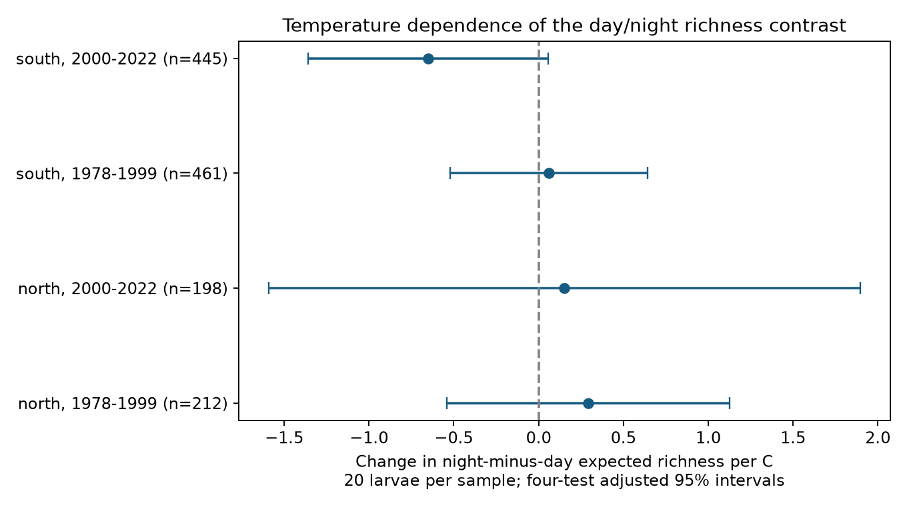

# Spring temperature gave no clear common day-night richness interaction in four CalCOFI samples from 1978-2022

Job: sci-1107-dell-climate-pollution-biodiversity-3ac6fb548d98. Topic: climate-pollution-biodiversity. Campaign: 11_07_2026. Machine: dell. Account: codex-andrii. Model: gpt-6.1-sol, high reasoning effort. Date: 2026-11-09. The signing identity is a campaign-machine key. It is not a personal authorship claim.

## Question and prior work

Does the day-night contrast in recorded larval fish richness change with spring sea temperature? A common temperature relation could make changes in survey time a source of bias in climate studies. We test this relation in separate northern and southern stations, and in two separate periods. These are regional and temporal checks within one survey. They are not independent ocean basins.

Thompson et al. (2022, doi:10.1111/gcb.16010) studied the California marine heatwave and fish larvae. Thompson et al. (2017, CalCOFI Reports 58) studied sampling bias and reviewed evidence for day-night differences and net avoidance. The prior campaign study ee50cdb26490 tested spatial sample differences. Our study uses the same public archive for a new sampling-time test. We searched campaign results for CalCOFI, and for CalCOFI night, before the first model. The latter search returned no result. We changed the initial broad composition question to equal-individual richness before the first fitted output. This is an exploratory analysis, not a registered test.

## Results

| Sector | Period | Tows | Stations | Slope, taxa/C | Adjusted 95% interval |
| --- | --- | --- | --- | --- | --- |
| north | 1978-1999 | 212 | 18 | +0.292 | -0.540 to +1.124 |
| north | 2000-2022 | 198 | 17 | +0.152 | -1.593 to +1.897 |
| south | 1978-1999 | 461 | 32 | +0.060 | -0.522 to +0.642 |
| south | 2000-2022 | 445 | 30 | -0.651 | -1.360 to +0.057 |


The primary sample contains 1,316 tows. All four intervals include zero after adjustment for four tests. The later southern estimate is negative. It does not repeat in the other samples. Wide intervals also allow meaningful effects. These results do not establish that sampling time is free of temperature-dependent bias.



With a stricter light rule, the later southern slope is -0.727 taxa/C, with an adjusted interval from -1.395 to -0.059. The other three strict-rule intervals include zero. The negative later southern estimate persists with no volume control and with station trends, but those intervals include zero. The 10-larva intervals all include zero. The 50-larva rule leaves no northern sample with enough within-station day and night support; both southern intervals include zero. This loss of support is not a null result. All fitted estimates are in files/estimates.csv.

At the reference spring temperature of 14.821 C, the four primary night-minus-day contrasts range from -0.190 to +0.478 expected taxa, and all their four-test intervals include zero. Raw richness has a positive night contrast in each sample under the same model form. Those raw-richness fits use larger and different samples. They do not isolate an abundance or detection mechanism. Equal individual counts cannot remove all detection bias.

## Methods

We use starboard bongo tows (tow type CB, net S) from March-May in 1978-2022. Lines are 76.7, 80, 83.3, 86.7, 90 and 93.3. Stations range from 26 to 90. North has the first three lines; south has the last three. Per year, choose the nominal cruise month closest to April, then the cruise with more core tows, then the lower cruise code. Use the first tow at each station. We apply this cruise rule over the full core grid before the sector split. Actual dates can cross month boundaries.

NOAA solar equations give elevation from UTC date, time, latitude and longitude. We use 366 days for leap years. Day has elevation above +6 degrees; night has elevation below -6. The interval between is excluded. The strict check uses +12 and -12. This geometric estimate ignores horizon and refraction, with large margins from sunrise and sunset. It uses tow timestamps, not the full tow duration.

Counts are summed by tow and scientific-name label. Names can refer to species, genus or family. We retain all labels and do not treat the result as species richness. Positive counts are treated as complete taxon reports. Absent records mean zero. For N larvae and taxon counts n_i, expected richness in m larvae is the sum of [1 - choose(N-n_i,m)/choose(N,m)]. A tow needs at least m larvae. The calculation uses log factorials. The primary m is 20. We also use 10 and 50. Empty tows have zero raw richness and cannot enter rarefaction.

Each model sample requires at least three day and three night observations per station in that sector and period. It also requires positive effective volume (volume sampled times proportion sorted). We require at least 60 tows for a fitted sample. The primary model is:

`expected richness = station effects + year effects + night + night*(SST-reference) + tow day + tow day squared + log effective volume + error`.

Year effects absorb the common SST main term. The interaction is the change in the within-model night-minus-day contrast per C. It is not a slope of mean biodiversity on temperature. The reference is the mean SST over the selected tows before rarefaction and light exclusions. Day of year is centred at 100. Regional SST is the cosine-latitude weighted March-May ERSSTv5 mean for grid centres in 31-35 N, 124-117 W. Latitude is stored in descending order. Both sectors share this coarse predictor (two latitudes and four longitudes).

Separate models use 1978-1999 and 2000-2022. Primary samples have 21 or 22 sampled years. Standard errors use year-cluster covariance, with G/(G-1) and (n-1)/(n-k) corrections. Intervals use t with G-1 degrees of freedom and the 0.99375 quantile, to give Bonferroni 95% coverage for four interaction tests. Auxiliary tables apply the same four-test rule within each outcome/specification family. No simultaneous coverage is claimed over every sensitivity fit or over both main and interaction terms together. Errors can be correlated across years, which this calculation does not cover. Checks omit volume, add relative station trends, or change light and individual-count rules. All primary and check rules were chosen before the first successful estimates; coding errors in weather latitude selection and a redundant trend column were corrected before those estimates. The final models have full column rank.

## Coverage and limits

There are 2,147 selected tows before light, count and station-support rules. North has 411 early and 427 late; south has 640 early and 669 late. Twilight removes 35, 35, 59 and 62 tows. Counts below 20 occur in 145, 173, 124 and 149 tows. These exclusion counts overlap. Primary retained counts are 212, 198, 461 and 445. Coverage.csv gives the audit.

Sparse catches, selected stations and changing taxon labels limit the target population. Richness at fixed counts is a conditional sample property. It does not estimate total local diversity. Larval size, behaviour, migration, net avoidance, lunar light, advection and true ecological change can all affect the contrast. Station effects do not control station-specific year shocks. Year clustering has only 21-22 groups. The two sectors share water masses, weather, taxonomic practice and a survey system. They are not independent environmental experiments. We have no visit histories or full light conditions. We do not infer a species range shift, a causal climate-change effect, heatwave damage or an air-pollution effect.

## Reproduce and inspect

Use Python 3.12 and packages listed in files/software.json. From the worktree run:

```sh
OPENBLAS_NUM_THREADS=1 OMP_NUM_THREADS=1 python work/result/files/analyze.py --datasets ./datasets --output ./work/reproduce
OPENBLAS_NUM_THREADS=1 python work/result/files/validate.py ./work/reproduce ./datasets
```

After extraction on another machine, run `python files/fetch.py /absolute/scratch/data`, then use that data root and a separate output directory in the same commands. Do not write into the signed draft. Fetch verifies exact source hashes and stops on change. Use the shared snapshots if an upstream URL changes. No data download was needed for this investigation. No random draws are used. One numerical-library thread avoids overhead on this host; it is not a campaign limit.

The analysis exports record-level panels only into external scratch. They are excluded from this publication. Files/validation.csv checks all fitted parameters with NumPy least squares. Files/independent_checks.json checks full rank, a separate manual cluster covariance calculation and 200 rarefaction values with SciPy's hypergeometric distribution. Maximum standard-error disagreement is below 5e-9 and richness disagreement is below 8e-12. Source code and these aggregate checks are included.

## Data and rights

NOAA SWFSC provided the CalCOFI tables; NOAA PSL, Boulder, Colorado, USA, provided ERSSTv5. Exact shared paths, source URLs, retrieval metadata, file sizes and SHA-256 hashes are in files/provenance.json. The three relative shared paths are:

- datasets/calcofi-erddap-ichthyoplankton-tows-20261109/tows.csv
- datasets/calcofi-erddap-larvae-counts-1951-2023-20261109/lrvcnt.csv
- datasets/ersst-v5-psl-sst-mnmean-20261108-olen/sst.mnmean.nc

The CalCOFI snapshots were retrieved on 2026-11-09; the SST snapshot was retrieved on 2026-11-08. We hashed only these inputs. External raw tables and record-level extracts are excluded. The signed files contain our code, narrative, figure and aggregate statistical results. The exact SCI baseline LICENSE applies to bundled work. Files/NOTICE.md identifies external terms and attribution. The signing key is not included.
