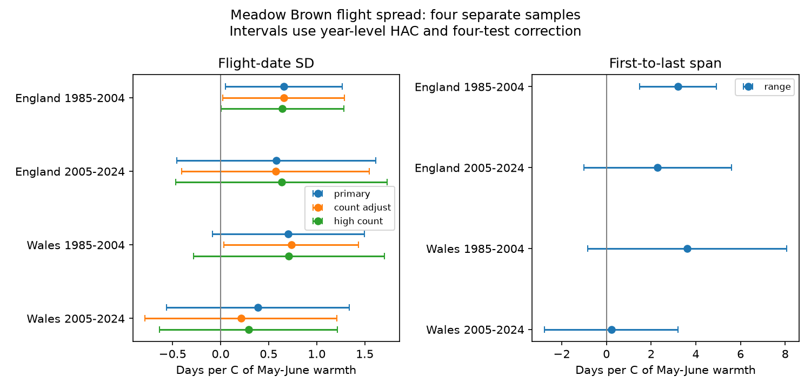

# May-June warmth gave no clear repeated link to Meadow Brown flight spread in England and Wales in 1985-2024

Warmer May-June conditions had positive slope estimates for recorded flight-date spread in four samples. Only England in 1985-2004 had a primary interval above zero after correction for four tests. The planned test for a repeated nonzero link therefore failed. This result does not show that temperature has no effect.

The study used 15,225 Meadow Brown site-years at 936 distinct public sites. It tested England and Wales separately in 1985-2004 and 2005-2024. All four estimates were positive after omission of any one year. Their common sign is evidence worth testing with new records. It is not proof of a common biological effect.

The left panel shows slopes for the standard deviation (SD) of recorded flight dates. The right panel shows slopes for the first-to-last span on the same primary rows. Lines show nominal 98.75% intervals within each four-sample set. Only the four primary SD tests form the planned test family. Secondary intervals do not control error across all sensitivity checks.

## Question and prior evidence

Does spring warmth spread the recorded adult flight period of Meadow Brown (*Maniola jurtina*)? A wider flight curve could change the time during which adults use resources. It could reflect a longer emergence period or changes in adult survival. Missed visits, weather-dependent activity and detection can also change its width. The source metrics cannot separate these explanations.

Zografou et al. (2021) found that butterfly flight-duration responses to seasonal temperature differed with species traits in a Pennsylvania community (DOI 10.1038/s41598-021-82723-1). Van Strien et al. (2008) showed that first-appearance estimates can depend on abundance and observation design (DOI 10.1007/s00442-008-0959-4). These studies support a test of flight spread with more than one metric and explicit bias checks. They do not establish the effect tested here.

We searched the signed campaign before choosing this question. We read the published England-Wales date-gap study, SCI 78639c63a04ea0df932c1feb2a265abb8ae943b624a52318ba0937021b2f731b. That study tested a timing gap between Ringlet and Meadow Brown. Its descriptive date-order result also noted different flight widths. Our outcome is the within-species flight-date SD, with different boundary rules. The source records and weather overlap. This is a follow-up with a different outcome, not independent data validation. A second campaign search found no publication for this precise flight-spread question. Search records are included.

The local plan in files/PLAN.md was written after source and prior-work review and before fitting the outcome. It was not externally registered. All planned fits are reported.

## Data and selection

The UKBMS phenology release through 2024 supplies count-weighted mean flight date, SD, first date, last date and peak count. Its guide states that phenology uses standard transects with weekly recording, rather than the reduced-visit countryside survey. Dates use 1 for 1 April. SD is a measure of recorded seasonal spread, not individual life span. Public site data give country; sensitive site locations can be absent.

The source has 648,886 rows, including 32,306 Meadow Brown rows. Of these, 904 lack a public country match. We exclude them. England and Wales in 1985-2024 have 28,090 rows. We require positive peak count, positive SD and ordered first, mean and last dates; 27,485 rows pass. We then require first date at least 32 and last date at most 176. This reduces contact with the survey-season boundaries and leaves 25,283 rows. Finally, each site must have at least ten accepted years in the period being tested.

| Country | Years | Site-years | Sites | Sites per year |
| --- | --- | ---: | ---: | ---: |
| England | 1985-2004 | 2,604 | 178 | 59-169 |
| England | 2005-2024 | 12,125 | 846 | 347-776 |
| Wales | 1985-2004 | 129 | 9 | 3-9 |
| Wales | 2005-2024 | 367 | 26 | 12-26 |

Site counts overlap between periods. Site-species-year keys are unique. The first-to-last span equals last date minus first date in all retained source rows. Zero-SD and missing records cannot be treated as true absence. The long-record rule selects persistent records and can remove low-count years or sites.

Met Office HadUK-Grid country series give monthly mean air temperature and rainfall. We use the equal-weight May-June temperature mean and May-June rainfall total. Snapshots were updated on 1 November 2026. These area means are not local daily exposure. Some flight activity overlaps the weather window. No air pollution or daily extreme exposure is tested.

## Model and uncertainty

For each country and period, we fit:

    SD(site,year) = site_intercept + beta * MayJune_temperature
                 + gamma * MayJune_rain_mm/100
                 + delta * (year-2004.5)/10 + error

Each year has total weight one. Within a year, sites have equal weights. Weighted site-mean removal estimates the model. Stable differences between sites are removed, but changes in habitat, recorder, effort and population are not.

There are only 20 annual exposure values per model. We sum weighted residual scores within years and use a Newey-West covariance with Bartlett weights through calendar lag 2. We multiply the covariance by T/(T-p), with T the year count and p the number of common slopes. Intervals use a t reference with T-p degrees of freedom: 17 for the primary models. A Bonferroni correction gives nominal 98.75% intervals for the four primary slopes. This is an approximate small-sample procedure. It does not guarantee coverage under long dependence or changing errors.

Year intercepts would absorb country weather, so are not used. The two countries have separate sites, but their May-June temperatures have correlation 0.977 over these 40 years. The two periods have separate years but share some sites and the recording system. The four samples are checks across regions and time, not four independent experiments.

## Results

| Country | Years | SD slope, days per C | Four-test interval |
| --- | --- | ---: | --- |
| England | 1985-2004 | +0.66 | +0.05 to +1.26 |
| England | 2005-2024 | +0.58 | -0.46 to +1.61 |
| Wales | 1985-2004 | +0.70 | -0.09 to +1.49 |
| Wales | 2005-2024 | +0.39 | -0.56 to +1.34 |

All four point estimates imply a wider recorded flight curve in warmer springs. Three corrected intervals include zero. The ordinary 95% interval is also above zero for early Wales, but the planned four-test interval is not. There is no demonstrated change in effect between periods: different interval outcomes alone do not establish a difference in slopes.

The secondary first-to-last span slopes are +3.21, +2.29, +3.61 and +0.22 days per C in the same order. Only early England has a corrected interval above zero (+1.49 to +4.92). Thus both width metrics give positive point estimates, but neither establishes a repeated nonzero link.

## Observation and model checks

Adding log(1+peak count) gives SD slopes +0.66, +0.57, +0.74 and +0.21. Count adjustment hardly changes the English estimates. It reduces the later Welsh estimate. The adjusted early Welsh interval becomes positive, but this is a secondary result. Peak count is an imperfect measure of abundance and detection. Since weather can affect counts, this adjustment can also remove part of a biological pathway.

Requiring peak count at least ten gives +0.64, +0.63, +0.71 and +0.29. Only early England retains a corrected interval above zero. The same primary conclusion holds with the boundary filter removed and with at least 15 accepted site-years. The latter rule leaves only four early Welsh sites.

Restricting to sites with ten accepted years in both periods leaves 118 English and five Welsh sites. Slopes remain positive. Early Wales then has a corrected interval above zero; later Wales does not. Site selection therefore matters for uncertainty and effect size.

All SD sensitivity point estimates are positive. However, changing the weather window to March-May gives +0.68, +0.99, +0.09 and +0.65. The corrected early Welsh interval spans zero; the other three are above zero. This window still fails the planned all-four rule. It shows that inference depends on the chosen seasonal window. We do not replace the planned May-June result with this result.

HAC lags 0, 1 and 3 leave the primary conclusion unchanged. Omission of each year gives point-estimate ranges of +0.52 to +0.82, +0.22 to +0.79, +0.60 to +1.02 and +0.14 to +0.65. No single year changes a primary slope sign. These are overlapping sensitivity checks, not new replication samples. All 124 fitted models are in files/outputs/results.csv.

## Interpretation and limits

The shared positive signs support further study of spring warmth and flight spread. The uncertainty does not establish a common nonzero link. This is not an equivalence test. Large positive effects, and small negative effects in some samples, remain compatible with the intervals.

We cannot infer longer individual life, prolonged emergence, a causal temperature effect, climate-change attribution, biodiversity loss or resource mismatch. Regional mean weather omits local habitat and daily extremes. Seasonal rain adjustment is limited. Nonlinear temperature response, omitted weather windows and habitat change can affect the slopes.

Missing visit dates are the main observation limit. SD can change when visits sample different parts of the flight curve. High peak counts and fixed-site terms cannot repair missing visits. The boundary rule can itself select on weather-dependent outcomes. Changing sites, excluded sensitive sites, incomplete years and the requirement for positive spread further limit general use. Early Wales has very few sites. Country weather correlation limits geographic independence.

A useful next test would retain the same species and windows, use local daily weather and complete weekly visit records, and estimate emergence and survival separately. A new period should be held out. Such a study could test whether the positive signs reflect adult biology or observation conditions.

## Reproduction and checks

The bundle preserves the full derived input panel, all outputs, code, source hashes and source paths. Raw shared datasets are reused in place. No downloads were needed. See files/REPRODUCE.md.

    python files/analyze.py /tmp/meadow-spread
    python files/validate.py

The first command reproduces all numerical results and the figure offline from files/panel.csv. The second reruns default outputs and checks coefficients against statsmodels, covariance against an independent year-group HAC routine, and the small early-Wales model against a full site-dummy fit. Errors are below 1e-8. It also checks unique keys, the span identity and PNG limits. Numerical agreement does not validate the causal model.

## Credit and provenance

Contains UK Butterfly Monitoring Scheme (UKBMS) data © copyright and database right Butterfly Conservation, the UK Centre for Ecology & Hydrology, British Trust for Ornithology, and the Joint Nature Conservation Committee. Met Office data contain Crown copyright material. Source Open Government Licence conditions remain in force. The baseline license applies to our original work to the extent that we hold rights.

- Botham, M.S.; Middlebrook, I.; Heywood, J.; Harrower, C.A.; Milborrow, J.; Roy, D.B. (2025). United Kingdom Butterfly Monitoring Scheme: phenology 2024. NERC EDS Environmental Information Data Centre. DOI 10.5285/b9d237fc-5a79-4449-bcee-34c52d87608f.
- Botham, M.S.; Middlebrook, I.; Heywood, J.; Harrower, C.A.; Milborrow, J.; Roy, D.B. (2025). United Kingdom Butterfly Monitoring Scheme: site location data 2024. NERC EDS Environmental Information Data Centre. DOI 10.5285/d7256b49-f2e3-4ae7-907d-af729610c768.
- Met Office. UK and regional series. https://www.metoffice.gov.uk/research/climate/maps-and-data/uk-and-regional-series
- Zografou et al. (2021). Species traits affect phenological responses to climate change in a butterfly community. DOI 10.1038/s41598-021-82723-1.
- Van Strien et al. (2008). Bias in phenology assessments based on first appearance data of butterflies. DOI 10.1007/s00442-008-0959-4.
- Moussus, J-P.; Julliard, R.; Jiguet, F. (2010). Featuring 10 phenological estimators using simulated data. DOI 10.1111/j.2041-210X.2010.00020.x.

Campaign: 11_07_2026. Job: sci-1107-dell-climate-pollution-biodiversity-5c31cff61fec. Topic: climate-pollution-biodiversity. Machine: dell. Account: codex-andrii. Model: gpt-6.1-sol, high reasoning effort, through T3 Code and the Codex harness. Date: 2026-11-08. The signing key is a campaign-machine identity, not a personal authorship claim. No private key is included. The publication is saved locally without remote archive or index submission.
