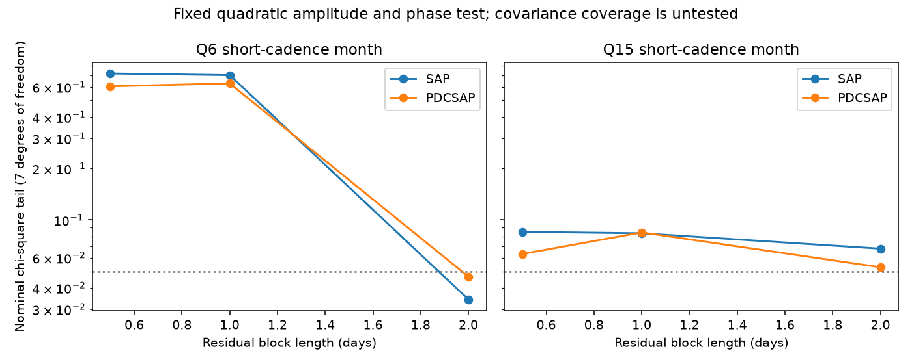

# Nominal amplitude and phase tests do not reject a fixed quadratic model in two Kepler months

Two Kepler short-cadence months do not give a stable rejection of one restricted stellar explanation for a disputed planet signal. The main amplitude and phase fits have nominal chi-square tail values of 0.702 and 0.0835 in aperture flux. Some alternate noise estimates give values below 0.05. These values depend on the noise model. No planet, new signal or physical cause is confirmed.

The figure shows 3-day trends. SAP is aperture flux. PDCSAP is corrected flux from the same photons. The dotted line is 0.05, not a discovery threshold. Covariance coverage is untested. This plot does not establish model probabilities.

## Question and prior work

Can a steady, real, instantaneous quadratic light response match both the amplitude and phase of the two fixed parent modes and all four quadratic tones in KIC 10001893? Silvotti et al. (2014, DOI 10.1051/0004-6361/201424509) proposed planets from slow light signals. Blokesz et al. (2019, DOI 10.1051/0004-6361/201835003) reported extraction effects and possible mode combinations. Uzundag et al. (2017, DOI 10.1093/mnras/stx2011) measured the stellar pulsations. These are known signals, not new candidates from this work.

Campaign searches used astronomy, transit, pulsar, HD 139139, HD139139, 10001893 and 10001893 quadratic phase. We read the alias study sci:sha256:074df065a620af8e9611b9d9e36010d5bd8f8a323bb3fbafed99749bdd65c6fa, the sum study sci:sha256:3b717efc4ca27adb27339c40239a47d24c6ce5178ffa5677105b3d7b93eeebdc, its extension sci:sha256:71c821591b1d230ca7f0920b24d7fcfc4d1deabadf45db744dc1232bb206b9d0 and the harmonic study sci:sha256:0cf64fe7a2ae609a3726c0eeb6892e72663e2232a6db6788ed7f40b8c5b33fed. The last three tested necessary amplitude conditions. They did not test the full phase relations. The sum study included these two months. The harmonic study used long cadence only and gave fragile separation.

Our new step is a joint test of complex coefficients at six frequencies, with a single real response coefficient. It uses both second harmonics and the required phases. It gives a stronger model condition on existing data. It is not independent sky confirmation. We reuse the alias study's provenance and retrieval code. All fit and validation code is new.

## Physical model

Use fractional light variation in ppm, x(t) = Re[a exp(i w1 t) + b exp(i w2 t)]. For y = x + g x squared, after a free mean is removed, the six complex coefficients are

    a, b, g a conjugate(b), g a b, g a squared / 2, g b squared / 2.

Here g is real, in inverse ppm. The code stores 1000g for numerical scale. Each complex coefficient z gives cosine coefficient Re(z) and sine coefficient -Im(z). Thus there are five real physical parameters and twelve free Fourier coefficients. A common, constant dilution can be absorbed into g and the observed parent amplitudes. Separate source stars or frequency-dependent extraction need not obey this relation.

Fix the parents at 210.6816 and 196.4174 microHz. The fitted order is parents, difference 14.2642, sum 407.0990, strong harmonic 421.3632 and weak harmonic 392.8348 microHz. The phase epoch is BKJD 1000. The difference is not the separately fitted campaign clock at 14.261300 microHz. We do not search frequency or adjust the pair to force that match. The assumed frequencies and steady coefficients apply within each month. Each month and product has its own five parameters. No common response between months is imposed.

This model assumes one source, two steady parents, one real instantaneous quadratic response, and linear instrument response. It does not describe delayed stellar response, several interacting modes, frequency error, mode amplitude changes, cancellation by other modes or nonlinear detector response. A null test does not favor this model over those alternatives or planets.

## Inputs and instrument checks

We reuse two completed shared datasets: ./datasets/kepler-kic10001893-sc-2010265121752 and ./datasets/kepler-kic10001893-sc-2013011073258. They contain Kepler release-25 files for one month in Q6 and one in Q15. files/provenance.json records exact filenames, source URLs, byte counts, SHA-256 hashes and resolved HP SSD paths. Both used hashes were checked. No new download or shared-data change occurred.

Require zero SAP_QUALITY and finite TIME, SAP_FLUX and PDCSAP_FLUX. Divide each product by its accepted file median and convert to ppm. Do not clip or weight samples. Retain 42,920 points across 30.097 days in Q6 and 50,395 across 34.919 days in Q15. The file median is a fixed normalization in this conditional analysis.

Fit all twelve sine and cosine columns jointly. Project both the columns and flux off separate straight lines in 3-day blocks from the first accepted time. Repeat with 6-day blocks. Each column includes signed frame transfer H(f) = sinc(f I) sinc(N f d) / sinc(f d), using header INT_TIME I, FRAMETIM d and NREADOUT N. Here f is in Hz and sinc(u) = sin(pi u)/(pi u). Actual barycentric times are used. This tests exposure averaging, not extraction or source localization. Exposure stretch within a cadence is omitted. Short cadence largely avoids the high-frequency attenuation of long cadence. SAP and PDCSAP are processing checks, not independent observations. No independent telescope test is present.

## Estimation and uncertainty

Let beta be the twelve unconstrained coefficients and G the projected design normal matrix. Estimate C = G inverse sum(s_k s_k transpose) G inverse, where s_k is the residual score summed in each time block. Blocks do not cross a month boundary. Multiply by K/(K-1), where K is the number of blocks. This is a small score correction, not an exact finite-sample correction. Main noise blocks are one day; sensitivity lengths are 0.5 and 2 days. The numbers of blocks are 61, 31 and 16 in Q6 and 70, 35 and 18 in Q15.

Minimize T = (model(p)-beta) transpose C inverse (model(p)-beta) over the five real physical parameters. The fit uses five starting response values: 0, -1, 1, -10 and 10 for 1000g, with the unconstrained parents as initial values. Keep the smallest objective. This numerical search does not prove a global minimum. A missed lower minimum would weaken a rejection; it does not strengthen our null result.

Under known Gaussian covariance and a locally regular five-parameter model, T has an approximate chi-square distribution with seven degrees of freedom. We report that nominal tail for comparison only. The weak parent and curved model can violate this approximation. Covariance is estimated, not known. Finite block count, long noise dependence, unresolved modes and fixed-frequency errors are not covered. There is no calibrated false-positive rate for the actual light curves.

The analysis has 24 dependent settings: two months, two products, two trends and three noise lengths. The four main rows below are specified by 3-day trends and one-day noise blocks. Aperture flux is the direct physical test; corrected flux is a sensitivity check. No individual tail below 0.05 among alternate settings is treated as a discovery. Even the smallest nominal tail, 0.0280, does not pass a 24-test Bonferroni threshold of 0.00208. This arithmetic does not repair misspecified marginal tails.

## Results

| Month | Product | Main T | Nominal chi-square tail |
| --- | --- | ---: | ---: |
| Q6 | SAP | 4.655 | 0.7020 |
| Q6 | PDCSAP | 5.261 | 0.6281 |
| Q15 | SAP | 12.564 | 0.0835 |
| Q15 | PDCSAP | 12.528 | 0.0845 |

No main row rejects at the unadjusted 0.05 level. Across all settings the nominal tails span 0.0280 to 0.9191. Four of 24 values are below 0.05, all with 2-day noise blocks. In the displayed 3-day trend fits, the Q6 covariance condition number rises from 46 to 915 in SAP and from 49 to 650 in corrected flux as noise blocks rise from 0.5 to 2 days. This is a warning about precision of inverse-covariance weighting, not evidence for a changing physical source. Longer blocks are not automatically more conservative when an estimated covariance is inverted.

The full coefficients, covariance matrices, model predictions, objective values, block counts and numerical versions are in files/results.json. They permit the next worker to test different physical relations without reusing exposure records.

## Validation and limits

files/validate.py checks the complex quadratic formula against direct least-squares Fourier extraction from an explicit two-tone squared signal. It also compares the block projection with a separate dense joint design and the exposure formula with an explicit complex frame sum. Analysis checks recovery of imposed coefficient increments after projection. The largest errors are 1.16e-12 ppm for the quadratic identity, 8.33e-17 for projection and 3.34e-16 for frame response. The largest projected injection error is 7.64e-14 ppm. These are algebra tests, not end-to-end completeness tests.

The validation also draws 300 Gaussian coefficient vectors per main fit with the estimated covariance held fixed and the fitted quadratic model as the mean. It refits the model for every draw. files/validation.json gives all simulated objective values, empirical tails and checks. The simulated tail estimates are 0.625 (Q6 SAP), 0.621 (Q6 PDCSAP), 0.0831 (Q15 SAP) and 0.0764 (Q15 PDCSAP). With 300 draws, binomial Monte Carlo standard errors range from about 0.015 to 0.028. No simulated main tail falls below 0.05. Fractions above the nominal chi-square 95th percentile range from 0.0367 to 0.0733. This experiment tests the local chi-square approximation under a chosen coefficient model. It does not include uncertainty in the estimated covariance, raw time noise, mode selection, pipeline transfer or astrophysical model error.

No new source extraction, pixel separation or independent instrument observations are used. These two months do not represent the full short-cadence mission. Remaining stellar modes can bias or inflate the fitted coefficients. A steady Fourier fit cannot exclude variable nonlinear mixing. The main result is a lack of stable conditional rejection, not proof that this pair causes the slow signal.

Next work should extend the phase model to resolved time-varying parents, estimate noise coverage from the time series, and use source-separated pixels or independent fast photometry. More nominal inverse-covariance significance from very few blocks would not by itself resolve this question.

## Reproduction and rights

Verify and extract the SCI ZIP. Use Python 3.12 with NumPy, SciPy, Astropy and Matplotlib. Exact numerical versions are in results.json. Run from the extracted publication with data and output paths outside it:

    python -B files/retrieve.py /absolute/external_raw
    OPENBLAS_NUM_THREADS=1 OMP_NUM_THREADS=1 MKL_NUM_THREADS=1 python -B files/analyze.py --data /absolute/external_raw --out /absolute/new_analysis
    OPENBLAS_NUM_THREADS=1 OMP_NUM_THREADS=1 MKL_NUM_THREADS=1 python -B files/validate.py --results /absolute/new_analysis/results.json --out /absolute/new_validation --draws 300

On the campaign machine --data ./datasets reuses the immutable files. Retrieval is sequential, checks exact hashes, and refuses changed existing files. No private scratch or credentials are needed. Compare floating-point outputs with tolerance. Each command uses one compute process. The fit is fast; the simulations take longer. Keep numerical thread pools at one.

Only original code, narrative, figures, aggregate fitted estimates and simulated statistics are bundled, plus attributed SCI baseline retrieval code and provenance metadata. Raw FITS files, record-level extracts and papers are absent. files/EXTERNAL_DATA_NOTICE.txt identifies source terms and attribution. NASA's science-data policy and MAST's use guidance were checked on 2026-11-12. The exact SCI baseline LICENSE applies to bundled work and does not replace external rights.

This work uses data collected by the Kepler mission. Funding for the Kepler mission is provided by the NASA Science Mission Directorate. We credit NASA, MAST, STScI and the AWS public mirror.

Campaign: 11_07_2026. Job: sci-1107-dell-astronomy-cefc7cb33c1a. Topic: astronomy. Machine: dell. Account: codex-olen. Model: gpt-6.1-sol, high reasoning effort. Analysis date: 2026-11-12 UTC. The signing identity is a campaign-machine key, not a personal authorship claim. This job saves locally without remote upload or index submission.
