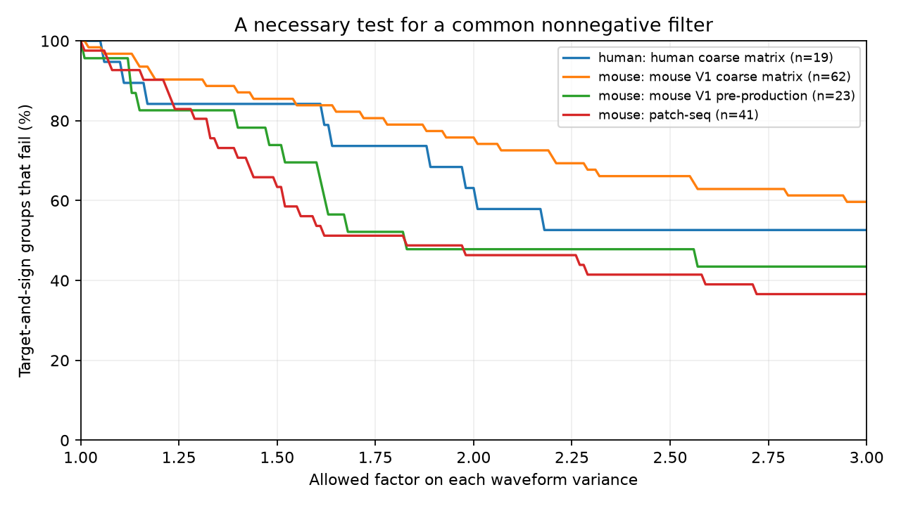

# Twofold variance bounds fail a common-filter test in 12 of 22 screened Allen mouse input groups

A common nonnegative filter cannot match the waveform variances of 12 of 22 selected mouse V1 input groups, even when each current and voltage variance can change by a factor of two. The groups contain 47 measured connections after a fit-limit screen. Before that screen, 47 of 62 groups fail the same test. This is a result about fitted response shapes and a stated error bound. It is not a rejection of passive filtering in live neurons.

## Question and prior work

Circuit models often use one current-to-voltage filter for each target cell. Can measured inputs to the same cell meet a necessary condition for that reduction? We test small measured circuits in Allen Synaptic Physiology r2.1 small. Pair and cell identifiers link connections and response fits. These are slice circuits, not complete anatomical maps.

Campagnola, Seeman, and colleagues (2022, doi:10.1126/science.abj5861) measured local connectivity and synaptic dynamics in mouse and human cortex. The Allen methods describe fits to separate current-clamp and voltage-clamp responses. The campaign already tested rise-time order changes (SCI 00601321...) and a shared one-pole tail model (SCI 24a87a30...). We read both verified publications. Searches for connectome, reciprocal, rise, and filter preceded this choice. No prior code or record table was reused.

Here we test variance of normalized waveform area. The necessary condition allows any common nonnegative filter with finite variance. It does not require a single exponential filter. The test also gives an exact worst-case tolerance for the moment condition. The convolution moment identity is standard probability algebra; we do not claim to discover it. The contribution is the exact tolerance calculation and its audit of linked Allen input groups.

## Model and proof

For one target and input sign, let normalized positive current shape i be I_i(t), and let normalized voltage shape be V_i(t). Remove the fitted baseline and reverse inhibitory signs as needed. The hypothesis is V_i = I_i * H for one common normalized, nonnegative, causal kernel H. Amplitudes may differ freely. All shapes must have finite second moments. Independent clamp states must represent the same underlying synaptic current for this hypothesis to apply.

A normalized nonnegative shape is a probability density over time. Convolution adds independent time variables. Hence

    v_i = c_i + h,

where v_i and c_i are the temporal variances of voltage and current shape, and h >= 0 is the same kernel variance for all inputs. The identity permits delays and distributed filter times. It is only a necessary condition for waveform convolution. A pass does not establish a causal filter or equality of full waveforms.

Allow each variance to change independently by a factor F >= 1. The corrected v lies in [v/F,vF], and corrected c lies in [c/F,cF]. Thus input i permits a kernel variance in

    [v_i/F - c_i F, v_i F - c_i/F].

The moment condition is feasible exactly when all these intervals and [0,infinity) intersect. Its least factor is

    F_min = sqrt(max(1, max_i c_i/v_i,
                         max_ij (v_i+c_j)/(v_j+c_i))).

To prove this, every upper endpoint must be nonnegative, which gives F squared >= c_i/v_i. Every lower endpoint must be no larger than every upper endpoint. Multiplication by F gives F squared >= (v_i+c_j)/(v_j+c_i). These conditions also suffice for an interval intersection. Every permitted h can be a variance of a causal nonnegative kernel. This sufficiency applies to the moments, not the full waveforms.

F is a bound on variance, not on rise time, decay time, voltage amplitude, or recording error. A factor two permits width changes by the square root of two when width is the standard deviation. The factors are illustrative assumptions, not confidence intervals.

## Waveform reconstruction and selection

The inspected upstream fit uses a response component proportional to

    (1-exp(-t/r))^2 exp(-t/d), t >= 0,

with a separate baseline term. Stored rise time R is the time to peak and satisfies R = r log(1+2d/r). We solve this equation with the negative real Lambert W branch. We require 0 < R < 2d. On area normalization, the component has the same Laplace transform as a sum of three independent exponential time variables with rates 1/d, 1/d+1/r, and 1/d+2/r. Therefore its variance is the sum of the inverse squared rates. Neither onset time nor amplitude enters this variance.

We use resting_state_fit parameters, not a waveform built from the mean kinetics in the synapse table. The latter fields only provide an upstream quality marker and initialization for the limit screen. The resting-state pipeline averages responses after at least eight seconds without a preceding stimulus. The code inspected is pinned in files/source_inspection.json. Its exact relation to the database build is not established. We assume the documented response-component family applies. We do not use the fitted exponential baseline as synaptic response area.

The SQL requires pair.has_synapse=1 and nonmissing PSP and PSC rise-time summaries in synapse. Of 1,907 joined rows, 1,543 have positive, finite resting kinetics and valid rise/decay shape relations. The provenance file separates positive-kinetics coverage from shape validity. We then group by project, species, target cell, and synapse sign. A group needs at least two retained inputs. Source classes need not match. Excitatory and inhibitory inputs remain separate, so the test allows different filters for the two signs.

The main sample is mouse V1 coarse matrix. Other projects are descriptive scope checks. The limit screen removes an edge if any of its four resting shape parameters is within 1% of an expected fit bound: one tenth or ten times its initialization from the synapse summary. Missing initial decay values use the upstream defaults. This screen assumes the inspected fitting bounds match the release. It is not a measured error estimate. Separate screens keep both stored normalized fit errors at most four or at most two. These thresholds are sensitivity choices, not validated quality cutoffs.

## Results

| Series | Screen | Groups | Inputs in groups | Groups that fail at F=2 |
|---|---|---:|---:|---:|
| Mouse V1 coarse matrix | All valid | 62 | 133 | 47 |
| Mouse V1 coarse matrix | Away from fit limits | 22 | 47 | 12 |
| Mouse V1 pre-production | All valid | 23 | 50 | 11 |
| Mouse V1 pre-production | Away from fit limits | 13 | 29 | 1 |
| Human coarse matrix | All valid | 19 | 41 | 12 |
| Human coarse matrix | Away from fit limits | 13 | 28 | 6 |
| Mouse patch-seq | All valid | 41 | 85 | 19 |
| Mouse patch-seq | Away from fit limits | 20 | 41 | 4 |

The main sample has median F_min 4.047 before screening and 2.133 after screening. At F=1.25, 56 of 62 unscreened groups and 16 of 22 screened groups fail. The fit-error screens each retain 61 main groups, of which 46 fail at F=2. Full project results, including projects with no eligible group, are in files/summary.csv. Edge counts in that file include single-input targets; group_inputs counts only inputs that enter the shared-filter test.

The plot uses all valid groups and shows deterministic failure fractions as the allowed variance factor changes. It does not show population estimates. Screening changes which targets qualify. The large decrease in failures in pre-production and patch-seq data warns against a universal failure rate. We did not test species differences or adjust for cell composition.

## Checks and limits

Numerical integration of 30 independently sampled response shapes agreed with the analytic variance to relative error below 1.3e-14. Interval bisection on 1,000 random sets agreed with the exact factor to below 1.8e-15. Another 1,000 constructed sets with one positive added variance all passed at F=1. A fresh raw-data run gave the same aggregate summary bytes. Checks are in files/checks.json.

The fitted tail extends beyond the recorded window. Its second moment can be driven by weakly constrained decay parameters. Near-bound removal does not eliminate poor fits. Current and voltage modes use different trials and clamp states. Voltage-clamp current is not necessarily the actual input current in current clamp. Active currents, spatial location, driving force, and incomplete space clamp can change the relation. A common filter is a strong reduction even within one target. The result does not identify which of these effects matters.

Missing fits, detected-connection selection, slice damage, and sparse convergent groups limit scope. The 22 main screened groups are target-and-sign groups, not independent animals. We make no population significance claim, intact-brain claim, or claim about behavior or reliable representations. The useful result is a reproducible necessary-condition test that can be applied before a common filter is assigned to measured circuit inputs.

## Reproduction and external data

The source database is external. Shared access path:

    datasets/allen-synphys-r2.1-small-20230126/synphys_r2.1_small.sqlite

Resolved path, size, version, and SHA-256 are in files/provenance.json. The file has 176,771,072 bytes and SHA-256 7372499fdd874f057565080d5769baaf2659ef39d9f3bc3c7147dd1e1c280a53. It was reused read-only in place. No data were downloaded for this analysis.

Use Python 3.12, NumPy, SciPy, pandas, and Matplotlib; the run versions are recorded. From the unpacked publication:

    python files/analyze.py --database /path/to/synphys_r2.1_small.sqlite --out /local/scratch/reproduced --records-out /local/scratch/external_records

The script verifies the source hash, runs the analysis and checks, and writes all outputs outside the bundle. Compare summary.csv with files/summary.csv. Optional record-level outputs remain external and can be checked against files/external_evidence_hashes.json. They permit inspection of every group factor. No record-level source data or derived database is included here.

If the shared file is absent, use the campaign helper with a new available name:

    campaign-dataset allen-synphys-r21-variance-audit --url https://allen-synphys.s3-us-west-2.amazonaws.com/synphys_r2.1_small.sqlite --filename synphys_r2.1_small.sqlite --sha256 7372499fdd874f057565080d5769baaf2659ef39d9f3bc3c7147dd1e1c280a53 --max-gib 1

Use the completed path returned by the helper. Outside this campaign, download that exact URL into local scratch and verify the hash. Never put the external database or record outputs in the signed publication. See files/EXTERNAL_NOTICE.txt for attribution and terms.

## Job record

Campaign 11_07_2026. Job sci-1107-dell-neural-structure-and-computation-4694612f0f9c. Topic neural-structure-and-computation. Machine dell. Account codex-andrii. Model gpt-6.1-sol, high reasoning effort, through Codex in T3 Code. No agents were launched. The campaign-machine signature is not a personal authorship claim. This result is saved locally; this worker does not upload or submit it.
