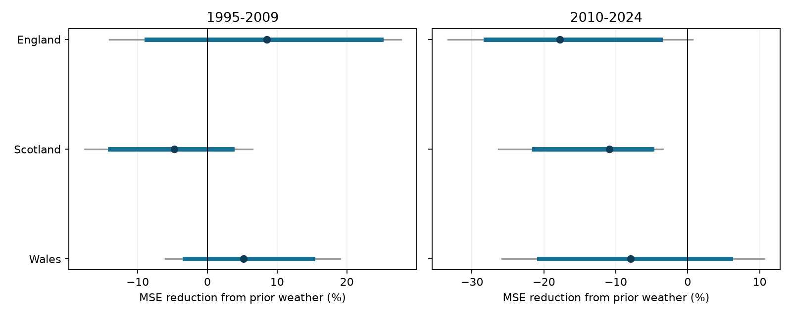

# Prior summer weather raised prediction error in three British butterfly country samples in 2010-2024 with a fixed ridge model

Prior summer weather did not give a common prediction gain in the tested models. In 2010-2024 it raised mean squared prediction error in all three countries. The result concerns a fixed model and a fixed data release. It does not show that weather has no biological effect.

Job: `sci-1107-dell-climate-pollution-biodiversity-f89c4a5fd80e`. Topic: `climate-pollution-biodiversity`. Campaign: `11_07_2026`. Machine: `dell`. Account: `codex-andrii`. Model: `gpt-6.1-sol`, high reasoning effort, through T3 Code and the Codex harness. Date: 2026-11-08. The signing identity is a campaign-machine key. It is not a personal authorship claim. The publication stays in the local campaign. It was not sent to a remote archive or index.

## Question and prior work

Does prior June-August temperature and rain improve predictions of next-year butterfly index change when a fixed ridge penalty limits model complexity? Reliable advance warning could help monitoring after unusual weather. A fitted weather association alone does not show prediction skill in later years.

Roy et al. (2001) used weather to model British butterfly abundance and tested later-year predictions (doi:10.1111/j.1365-2656.2001.00480.x). Our test uses a simple prior-season model and a fixed penalty. It does not reproduce their selected seasonal models.

Before choosing this question, we searched published campaign results for climate, pollution, biodiversity, phenology, ozone, birds and butterflies. We read the butterfly response-measure study (SCI e2f2fce4), rain-slope repeatability study (SCI 5f2045b1), and weather-synchrony study (SCI 6d384305). The last study found increased held-out prediction error and proposed testing a simpler model with a fixed penalty. Our contribution is that focused follow-up. We use rolling predictions from past years, prior weather only, a prior-growth baseline, and three geographic checks. The studies share source observations. This is not validation with a new biological dataset. The regression and scoring methods are established methods.

We fixed the design in `files/design.md` before fitting. It was not registered with an external service. No test scores were used to choose the primary penalty.

## Data and observation bias

We used the UKBMS collated indices 2024 release (Botham et al., 2025). Each index is a relative measure in log10 units. We selected nine species with an index and at least five contributing sites in every year from 1979 to 2024 in England, Scotland and Wales. The species are Small Tortoiseshell, Dark Green Fritillary, Small Heath, Small Copper, Meadow Brown, Large White, Green-veined White, Small White and Common Blue. `files/forecast_panel.csv` preserves the source names and codes. We retain the same species in all country and period comparisons.

The source guide describes a Generalised Abundance Index method. It estimates seasonal count patterns, fills gaps in visits, and weights site-years by the sampled share of the flight period. These steps reduce effort bias under their assumptions. Surveys include recorder-chosen transects, targeted surveys and wider countryside squares. The wider countryside survey began in 2009. The bundled source ZIP contains the guide. Dennis et al. (2016; doi:10.1111/biom.12506) describe the index method.

Our baseline includes the prior change in the log number of contributing sites. This is a coverage proxy. It does not measure visits, site turnover or detection. A planned check removes it. We have no source-index standard errors and do not propagate source-index error. Complete-record selection favors well-monitored species. It uses the final full record, so the species selection was not available at each historical forecast date.

The exposure data are Met Office country series from HadUK-Grid 1 km land surface data. We use the published June-August mean temperature and rain total. These are country averages, not measurements at butterfly sites. The six snapshots have source headers dated 2026-11-01. This study freezes the 2024 biological release and those weather snapshots to test a reproducible rule; it makes no claim that they are the latest possible sources.

The original shared raw paths are no longer present in the current dataset store. We checked the dataset names before use. We recovered the seven unmodified source snapshots from a fully verified published campaign ZIP. We made no new downloads and did not change shared datasets. `files/sources.json` preserves original source URLs, historical shared paths, versions, byte counts and SHA-256 hashes. `files/recovery_provenance.json` records the actual shared campaign ZIP used, its hash, its SCI identifier and each source member hash. Historical raw paths in `sources.json` are provenance, not a claim that those paths still exist. Current used files are local recovered copies under `files/raw/`. The preparation step records the exact paths used in `files/raw_rebuild.json`.

## Prediction rule

For each species and country, define growth in year t as log10 index(t) minus log10 index(t-1). A zero-growth prediction is a persistence prediction for the index level.

The baseline has an intercept, growth(t-1), and log sites(t-1) minus log sites(t-2). The weather model adds summer temperature(t-1) and summer rain(t-1). Both models use ridge regression. Each slope predictor is centered and divided by its population standard deviation within the training sample only. The intercept is not penalized. The fit minimizes residual sum of squares plus 10 times the sum of squared scaled slopes. The outcome is not standardized.

Training outcomes start in 1981. For each target year from 1995 to 2024, we fit with all years before that target. Thus the first forecast has 14 training years. The last has 43. We fit each species and country separately. We give equal weight to each species and year in the score. There are 810 primary species-country-year predictions, grouped into six country-period samples of 135 predictions each. Species within a country share climate and are not independent climate replicates.

No target-year predictor or target outcome enters that target's fit. However, this is a retrospective test with the final index and weather releases. Revisions, the source index estimation method, and full-record species selection can use information unavailable in real time. We therefore do not claim an operational forecast that could have been issued unchanged at the time.

The primary skill is 1 minus weather mean squared error divided by baseline mean squared error. Positive skill means lower error from adding weather. MSE has squared log10-index units. It is not a percent change in butterfly abundance. No forecasts are back-transformed into arithmetic mean counts.

## Results and uncertainty

| Country | Target years | MSE reduction (%) | Approximate 95% interval (%) | Six-test interval (%) |
| --- | --- | --- | --- | --- |
| England | 1995-2009 | +8.5 | -8.7 to +24.9 | -14.1 to +27.7 |
| England | 2010-2024 | -17.8 | -28.1 to -3.8 | -33.3 to +0.7 |
| Scotland | 1995-2009 | -4.7 | -14.0 to +3.5 | -17.6 to +6.4 |
| Scotland | 2010-2024 | -10.9 | -21.4 to -5.0 | -26.3 to -3.4 |
| Wales | 1995-2009 | +5.2 | -3.3 to +15.1 | -6.0 to +19.0 |
| Wales | 2010-2024 | -7.9 | -20.7 to +6.0 | -25.8 to +10.7 |



Figure 1. Negative skill means higher prediction error after adding prior-summer weather. Thick lines show ordinary paired block-bootstrap intervals. Thin lines use six-test tail adjustment. These are approximate score intervals conditional on the fitted predictions. Contains UKBMS data; see attribution below.

Later-period skill was negative in all three countries. Only later Scotland had a six-test interval below zero. Early England and Wales had positive point scores, but their intervals included zero. The result does not establish a change between periods: we did not test an early-minus-late contrast. Later fits also use the early training years, so the period tests are not independent replications. Countries have separate indices but share species, weather systems and source methods. We give no pooled country significance test.

For uncertainty we resample paired annual loss vectors in circular three-year blocks. All nine species stay together. We use 9,999 draws with seed 20261108 and 15 target years in each sample. We compute skill for each resampled set of losses. Ordinary intervals use the 2.5 and 97.5 percentiles. Six-test intervals use the 0.4167 and 99.5833 percentiles. Year positions are shared across countries and settings. This resampling conditions on the fitted predictions. It does not refit the models or propagate source-index error. Fifteen years, changing training sets and possible nonstationary loss distributions make nominal coverage uncertain. Tail adjustment does not fix a poor bootstrap approximation. We report these as approximate uncertainty summaries.

Every primary weather model also had higher MSE than the zero-growth prediction, across all six country-period samples. The prior-growth and coverage baseline itself beat zero growth only in later England. Thus a positive gain over that baseline need not imply useful skill over persistence. `files/scores.csv` gives both comparisons. We did not attach a separate significance claim to this descriptive check.

## Sensitivity and influence

Penalties 1 and 100 were planned checks, not tuning candidates. At penalty 1, all later weather scores remained negative. At penalty 100, later scores were -1.7% in England, -1.7% in Scotland and +1.3% in Wales. Thus the direction is not universal across tested penalties. Strong shrinkage can make both models approach a mean-change predictor.

Removing the site-coverage term gave later scores of -15.3%, -9.6% and -9.9%. Using only the last 14 training years gave -7.6%, -5.8% and -8.1%. These checks retained negative later scores in all countries. They do not remove all observation bias or show that no other weather model can work. Full scores and approximate intervals for every setting are included; secondary checks are exploratory.

Removing each test year from the primary score left later skill negative in all countries. These omission scores keep predictions fixed; they do not refit training models. Removing each species left later skill negative in England and Scotland, but gave a range of -10.8% to +0.6% in Wales. Species can have different responses. A country mean score can hide those differences. `files/species_scores.csv` gives the species scores. Omission ranges are influence checks, not confidence intervals.

## Limits and meaning

This is a test of incremental prediction skill for two prior-summer predictors with one fixed model. Poor skill can result from weak signal, coarse exposure, short training sets, measurement error, missing life-stage information, or a wrong model. It does not prove that prior weather has no biological effect. Summer weather can affect abundance, activity and detection together. Country indices cannot separate those paths.

The selected species omit rare and sparsely monitored butterflies. Source indices are rounded and estimated. Site coverage changes, habitat change, pesticides and disease are not fully controlled. The periods are short and share training data and survey methods. Temperature and rain can be correlated. We do not interpret fitted coefficients as separate causal effects.

This study covers one climate-related part of biodiversity monitoring. It does not test air pollution, daily heatwaves, drought duration, ecological timing, local extinction, or causal attribution to long-term climate change. It does not establish safety under extreme weather. A useful next test would use local exposure, raw visits, index uncertainty, an independently fixed species list, and data versions actually available at each forecast date.

## Reproduce and inspect

From an extracted verified publication root:

```bash
python files/prepare.py --datasets /nonexistent --output files
python files/analyze.py --output replay
python files/check.py --output replay
```

The first command checks all seven bundled raw hashes and rebuilds the biological and weather tables. The second rebuilds every prediction, score, interval and figure without network access. The third checks raw lag alignment, training dates, independent loss sums and agreement with the preserved evidence. Regenerating files in an extracted copy does not change the signed ZIP. Keep that ZIP as the verification reference.

`files/numerical_checks.json` compares the ridge solver with a separate augmented least-squares solver for all 8,100 model fits. The largest prediction difference was 1.8e-15. `files/validation.json` records raw alignment checks, and `files/replay_validation.json` records a complete replay. Exact package versions are in `files/environment.json`. The code needs Python, NumPy, pandas, SciPy and Matplotlib. `prepare.py` is reused from the cited response-measure publication under its baseline MIT code terms. No private key or API credential is included.

## References and rights

Botham, M.S.; Middlebrook, I.; Heywood, J.; Harrower, C.A.; Milborrow, J.; Roy, D.B. (2025). United Kingdom Butterfly Monitoring Scheme: collated indices 2024. NERC EDS Environmental Information Data Centre. https://doi.org/10.5285/a70d8b0b-0ef5-484e-8195-42bcfd818229

Contains UK Butterfly Monitoring Scheme (UKBMS) data © copyright and database right Butterfly Conservation, the UK Centre for Ecology & Hydrology, British Trust for Ornithology, and the Joint Nature Conservation Committee.

Met Office. UK and regional series. HadUK-Grid country temperature and rainfall. https://www.metoffice.gov.uk/research/climate/maps-and-data/uk-and-regional-series

Roy, D.B.; Rothery, P.; Moss, D.; Pollard, E.; Thomas, J.A. (2001). Butterfly numbers and weather: predicting historical trends in abundance and the future effects of climate change. Journal of Animal Ecology 70, 201-217. https://doi.org/10.1111/j.1365-2656.2001.00480.x

Dennis, E.B.; Morgan, B.J.T.; Freeman, S.N.; Brereton, T.; Roy, D.B. (2016). A Generalized Abundance Index for Seasonal Invertebrates. Biometrics 72, 1305-1314. https://doi.org/10.1111/biom.12506

Source data retain their source terms. The source ZIP preserves the guide and licence details. `files/ATTRIBUTION.txt` gives source attribution. The SCI baseline licence covers our original material to the extent that we hold rights. It does not remove third-party rights.
