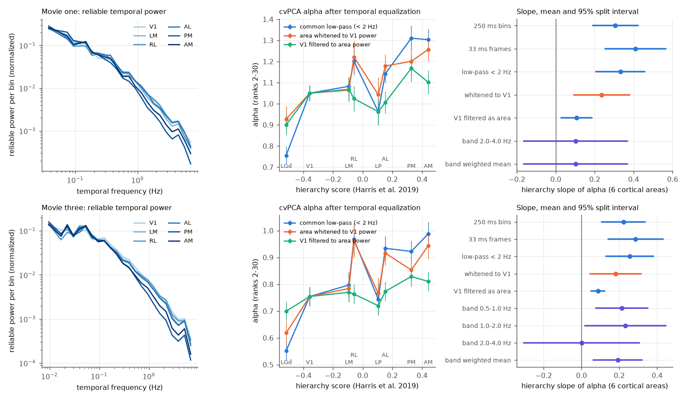
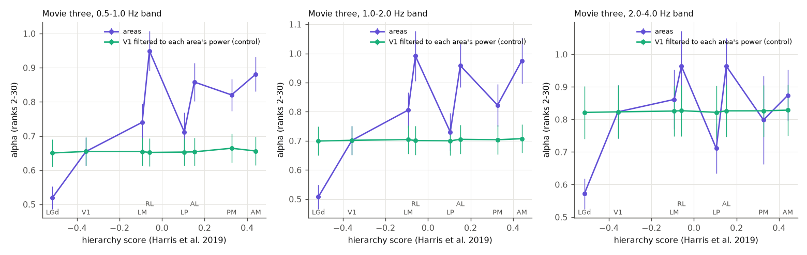
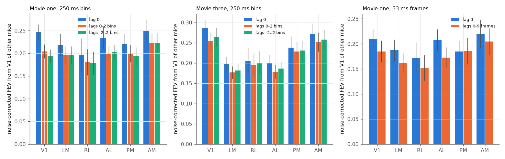

# Higher mouse visual areas are temporally smoother in natural movies, but this explains only about 30% of their faster spectral decay, which stays inside 0.5-2 Hz bands (32 Allen Neuropixels mice)

## Summary

Higher mouse visual areas (HVAs) have cvPCA response spectra that decay faster (larger exponent alpha) than
VISp. For natural movies, earlier campaign work found that this compression is not on VISp stimulus axes
(sci:sha256:2817482c...) and that it is in the part of the HVA response that an *instantaneous* linear read-out
of VISp cannot predict (sci:sha256:831e5770...). In a movie, each "stimulus" is a time bin. A higher area that
integrates its input over a longer time gives more weight to the slow movie features, and slow features are few.
Such a temporal filter can make a spectrum steeper without a new spatial computation. A filter of the VISp signal
is also outside the instantaneous VISp span. Thus temporal integration was a simple candidate explanation of both
earlier findings. We tested it with a pre-set plan (`files/code/PLAN.md`).

Data: all 32 Allen Visual Coding Neuropixels `brain_observatory_1.1` mice, 11,559 quality units in LGd, LP and
six cortical areas (the same units as the earlier work), spikes per movie frame (33 ms) for natural movie one
(30 s, 20 repeats) and natural movie three (120 s, 10 repeats), and 10 ms bins for natural scenes. Intervals are
mean +/- 1.96 SD over 100 random 16/16 splits of the mice (30 splits for the read-out models). "Slope" is the
hierarchy slope of alpha over the 6 cortical areas (Harris et al. 2019 scores), unless we say otherwise.

Main results:

1. **Reproduction.** At 250 ms bins, the cortical slope was 0.31 (0.19 to 0.42) for movie one and 0.22 (0.11 to
   0.34) for movie three. The earlier values were 0.36 and 0.22 (sci:sha256:27b767c0...).
2. **HVAs are temporally smoother (H1 supported).** The half-width of the reliable signal autocorrelation rose
   from 0.31-0.32 s in VISp to 0.52-0.62 s in VISpm and 0.44-0.52 s in VISam (slope 0.20, 0.12 to 0.29 for movie
   one; 0.36, 0.28 to 0.45 for movie three). The share of reliable power at or above 1 Hz fell along the
   hierarchy (slope -0.11 and -0.12, intervals below 0).
3. **Temporal equalization removes only about 30% of the slope (H2b: not explained).** After a common low-pass
   (< 2 Hz) the slope was 0.33 (0.21 to 0.46) for movie one and 0.26 (0.13 to 0.38) for movie three. When we
   whitened each area's temporal power to that of VISp (filters from the other half of the mice), the slope fell
   to 0.24 (0.09 to 0.38) and 0.18 (0.05 to 0.31). This is 71% and 70% of the low-pass slope; the paired drop was
   -0.10 (-0.16 to -0.03) and -0.08 (-0.11 to -0.04). The reverse test agrees: VISp filtered to the temporal power
   of each area gave a slope of only 0.11 (0.03 to 0.19) and 0.09 (0.05 to 0.12).
4. **The compression stays inside narrow temporal-frequency bands (H2a).** For movie three, inside the 0.5-1 Hz
   and 1-2 Hz octave bands the slope was 0.21 (0.08 to 0.35) and 0.23 (0.02 to 0.45); the pre-set weighted mean
   over the 0.5-4 Hz bands was 0.19 (0.06 to 0.32). A pure temporal filter leaves almost no slope inside a band:
   VISp filtered to each area's power gave in-band slopes of 0.008, 0.006 and 0.004 (all intervals within
   +/- 0.04). In the 2-4 Hz band the slope was 0.00 (-0.31 to 0.31) and in the exploratory 4-8 Hz band -0.28
   (-0.63 to 0.06); there the HVA signal power is small. For movie one only the 2-4 Hz band has enough degrees
   of freedom for the pre-set rule (0.10, -0.16 to 0.37: inconclusive); the exploratory 1-2 Hz band gave 0.25
   (0.04 to 0.45). Pre-set verdict: movie three "not explained by temporal filtering"; movie one "partly /
   inconclusive" (H2b not explained, H2a not determined). With all 8 structures both movies are "not
   explained".
5. **A lagged VISp read-out does not close the gap (H3: not supported).** With kernel ridge from 400 VISp units
   of the other mice, adding VISp history (lags 0-2 bins of 250 ms, or 0-9 frames of 33 ms) or leads and lags
   (-2 to 2 bins) did not raise the absolute noise-corrected explained variance (FEV) of any cortical area. The
   paired FEV changes were -0.052 to +0.001 (no interval above 0; VISp had the largest loss). The ratio rho = FEV(HVA)/FEV(VISp) rose
   (movie three 0.78 to 0.82; movie one 0.91 to 0.98) only because VISp itself lost more. The hierarchy slope of
   the VISp-residual alpha stayed the same: movie one 0.38 (0.22 to 0.55) with lag 0 and 0.38 (0.21 to 0.54) with
   lags; movie three 0.29 (0.16 to 0.41) and 0.27 (0.14 to 0.41).
6. **Natural scenes (descriptive, S1).** The scene compression appears in the 80-130 ms window after onset
   (slope 0.26, 0.14 to 0.38) and stays in the 130-250 ms window (0.17, 0.06 to 0.28). In the 30-80 ms window
   the slope was not determined (-0.13, -0.52 to 0.26), because many HVA units have little signal before 80 ms.

Conclusion: HVAs integrate movie input over longer times than VISp, and this temporal smoothing accounts for
about 30% of the movie spectral compression. Most of the compression remains when the temporal power spectra are
made equal and inside 0.5-2 Hz bands, where a temporal filter has no effect. A linear read-out of the VISp history
does not predict the HVA-specific signal. Thus the movie compression is mainly a property of *which* stimulus
features the HVAs represent at a given temporal frequency, not of how they filter VISp in time. The compression
is largest at slow (< 2 Hz) frequencies. All results are correlational and come from one data set.

## Question

The cause of the faster spectral decay in HVAs is open. For gratings, HVAs are a linear read-out of VISp and
the compression is on VISp axes (sci:sha256:2817482c..., sci:sha256:831e5770...). For movies, it is not. Matched
receptive-field size, position, spatial frequency, phase modulation, latency and sparseness did not explain the
effect (sci:sha256:27b767c0..., sci:sha256:62a723e5...). None of those studies tested time. Movie responses in
HVAs are known to be slower and more sustained. We asked:

- H1: Are HVA movie responses temporally smoother than VISp responses?
- H2: If all areas have the same temporal power spectrum, does the hierarchy slope of alpha go away?
- H3: Does a *lagged* (history-dependent) linear read-out of VISp predict the HVA signal and its compression?
- S1 (descriptive): when after image onset does the natural-scene compression appear?

## Data

- Allen Brain Observatory Visual Coding Neuropixels (Siegle et al. 2021), all 32 `brain_observatory_1.1`
  sessions (one mouse each). We streamed the spike times of the quality units (ISI violations < 0.5, amplitude
  cutoff < 0.1, presence ratio > 0.9) in LGd (961 units, 20 mice), LP (1,540; 21), VISp (2,230; 32), VISl
  (1,016; 24), VISrl (1,563; 28), VISal (1,675; 24), VISpm (950; 20) and VISam (1,624; 26). Total 11,559, the
  same set as the earlier work. S3 ETags: `files/provenance/source_nwb_etags.tsv` (identical to those of
  sci:sha256:831e5770...). Metadata tables were read from the campaign shared datasets
  (`files/provenance/shared_datasets_used.tsv`, with SHA-256).
- Stimuli: natural movie one (900 frames, 20 repeats in two blocks), natural movie three (3,600 frames, 10
  repeats in two blocks), natural scenes (118 images, 50 repeats). For each movie frame we counted spikes in its
  [start, stop) interval from the Allen presentation table. One session (754312389) has three movie-one frames
  out of start-time order in one repeat; we placed frames by frame index.
- Hierarchy scores (Harris et al. 2019): LGd -0.515, VISp -0.357, VISl -0.093, VISrl -0.059, LP 0.105, VISal
  0.152, VISpm 0.327, VISam 0.441.

No Allen file and no record-level derivative is in this bundle (`files/NOTICE_EXTERNAL_DATA.md`).

## Methods

**Populations and splits.** In each of 100 splits the 32 mice are divided at random into G1 (16) and G2 (16).
For each structure we draw 200 units from G1 (statistics) and 200 other units from G2 (filter estimation). Each
unit is scaled by its single-trial SD at the analysis resolution. The movie repeats are split at random into two
halves, one split for all time points and all areas, so temporal filters never mix the trials of the two halves.

**Spectra.** cvPCA (Stringer et al. 2019): principal axes from half A, reliable variance per axis = covariance of
the projections of halves A and B, both directions averaged. alpha = minus the OLS slope of log variance on log
rank, ranks 2-30 (truncated at the first non-positive value). The hierarchy slope is the OLS slope of alpha on
the hierarchy score.

**Temporal statistics (H1).** Reliable temporal power S(f) of an area = population mean of
Re(F_A(f) conj F_B(f)) / T, where F_A and F_B are the Fourier transforms of the half means (DC removed; the movie
repeats are back to back, so we treat each repeat as circular). The half-width tau is the lag where the implied
autocorrelation (f < 5 Hz) first falls below 0.5. hf1 = share of the reliable power (0 < f < 5 Hz) at f >= 1 Hz.

**Temporal equalization (H2b).** All filters are zero-phase and act in the Fourier domain on both halves.
"lp2": common low-pass 0 < f < 2 Hz. "white": gain sqrt(S_VISp(f) / S_area(f)) for 0 < f < 2 Hz, from G2 spectra
averaged in 0.1 Hz bins (floor 1e-3 of the maximum). "vispas": VISp of G1 filtered with sqrt(S_area / S_VISp).
Rule: "explained" if the "white" slope is below 50% of the "lp2" slope and its interval includes 0; "not
explained" if it keeps at least 50% and its interval excludes 0.

**Band-limited spectra (H2a).** Common octave band-pass filters. Inside a narrow band any temporal filter is
almost a constant gain, so it cannot change alpha (we checked this with "bandvispas": VISp filtered to the
area's power below 8 Hz, then band-passed). The pre-set decision uses bands with at least 80 degrees of freedom
(2 x bandwidth x duration): movie one 2-4 Hz; movie three 0.5-1, 1-2 and 2-4 Hz. We combine the band slopes per
split with fixed inverse-variance weights. Rule: "explained" if the interval of the weighted mean includes 0 and
the mean is below 50% of the frame-level slope; "not explained" if the interval excludes 0.

**Lagged read-out (H3).** For 30 splits: target 150 units of a structure in G1 (repeat halves A and B), predictor
400 VISp units of G2 (mean over all repeats). Kernel ridge with K = sum over lags l of X(t-l) X(t'-l)' (circular
shift), normalized to unit mean diagonal. Lag sets: 250 ms bins with {0}, {0, 1, 2} and {-2, ..., 2}; 33 ms frames
(movie one) with {0} and {0, ..., 9}. Outer CV: 10 contiguous time blocks; lambda (13 values, 1e-3 to 1e3) per
outer fold by inner 5-fold CV on the mean of both halves. Noise-corrected FEV =
(<P_A, Y_B> + <P_B, Y_A> - <P_A, P_B>) / <Y_A, Y_B>; it uses only products of independent halves. Spectra of the
predicted part (P_A, P_B) and the residual part (Y_A - P_B, Y_B - P_A). Rule: "closes the gap" if the mean HVA
rho >= 0.95 and the interval of the residual-part slope includes 0.

**Natural scenes (S1).** Spike counts in 30-80, 80-130, 130-250 and 0-250 ms after onset (10 ms bins), repeat
halves drawn per image as in the earlier work, alpha over ranks 2-30 (and 2-20).

## Results

### H1: HVAs are temporally smoother

| Structure | LGd | VISp | VISl | VISrl | LP | VISal | VISpm | VISam |
| --- | --- | --- | --- | --- | --- | --- | --- | --- |
| tau, movie one (s) | 0.16 | 0.32 | 0.37 | 0.31 | 0.26 | 0.32 | 0.52 | 0.44 |
| tau, movie three (s) | 0.17 | 0.31 | 0.34 | 0.30 | 0.22 | 0.34 | 0.62 | 0.52 |
| power share >= 1 Hz, movie three | 0.35 | 0.24 | 0.23 | 0.25 | 0.31 | 0.23 | 0.13 | 0.17 |

Cortical slopes: tau 0.20 (0.12 to 0.29) and 0.36 (0.28 to 0.45); power share >= 1 Hz -0.11 (-0.15 to -0.07)
and -0.12 (-0.17 to -0.08). The smoothing is largest in VISpm and VISam; VISrl and VISal are like VISp. The
temporal power spectra of all areas fall steeply with frequency (Figure 1, left).

### H2: spectra after temporal equalization

Cortical hierarchy slopes of alpha (6 areas; mean and 95% split interval):

| Analysis | Movie one | Movie three |
| --- | --- | --- |
| 250 ms bins (prior resolution) | 0.31 (0.19, 0.42) | 0.22 (0.11, 0.34) |
| 33 ms frames | 0.41 (0.25, 0.56) | 0.29 (0.14, 0.43) |
| common low-pass < 2 Hz | 0.33 (0.21, 0.46) | 0.26 (0.13, 0.38) |
| each area whitened to VISp power | 0.24 (0.09, 0.38) | 0.18 (0.05, 0.31) |
| whitened minus low-pass (paired) | -0.10 (-0.16, -0.03) | -0.08 (-0.11, -0.04) |
| VISp filtered to each area's power | 0.11 (0.03, 0.19) | 0.09 (0.05, 0.12) |
| band 0.25-0.5 Hz (exploratory) | - | 0.13 (-0.00, 0.25) |
| band 0.5-1 Hz | - | 0.21 (0.08, 0.35) |
| band 1-2 Hz | 0.25 (0.04, 0.45) (exploratory) | 0.23 (0.02, 0.45) |
| band 2-4 Hz | 0.10 (-0.16, 0.37) | 0.00 (-0.31, 0.31) |
| band 4-8 Hz (exploratory) | -0.16 (-0.48, 0.15) | -0.28 (-0.63, 0.06) |
| pre-set weighted band mean | 0.10 (-0.16, 0.37) | 0.19 (0.06, 0.32) |
| control: VISp filtered to area power, in band | -0.00 (2-4 Hz) | 0.004 to 0.008 |
| pre-set verdict | partly / inconclusive | not explained by temporal filtering |

With all 8 structures (LGd and LP included) the slopes are larger, whitening keeps 62% (movie one) and 72%
(movie three) of the low-pass slope, and the band means are 0.26 (0.08 to 0.44) and 0.31 (0.22 to 0.41): both
movies are "not explained". Full tables: `files/results/slopes.csv`, `files/results/tests.json`,
`files/results/area_summary.csv`.

In the 0.5-1 and 1-2 Hz bands every HVA had a larger alpha than VISp, while VISp filtered to each area's power
did not change (Figure 2). VISrl and VISal, which are not smoother than VISp, had some of the largest in-band
alphas. This is direct evidence that the compression does not need temporal smoothing.

### H3: lagged read-out

Noise-corrected FEV from 400 VISp units of other mice (mean over 30 splits; `files/results/lag_area_summary.csv`):

| Movie, resolution | Lags | VISp | VISl | VISrl | VISal | VISpm | VISam | mean HVA rho | residual-alpha slope |
| --- | --- | --- | --- | --- | --- | --- | --- | --- | --- |
| one, 250 ms | 0 | 0.25 | 0.22 | 0.20 | 0.23 | 0.22 | 0.25 | 0.91 | 0.38 (0.22, 0.55) |
| one, 250 ms | 0 to 2 | 0.20 | 0.20 | 0.18 | 0.20 | 0.20 | 0.22 | 0.98 | 0.38 (0.21, 0.54) |
| one, 33 ms | 0 | 0.21 | 0.19 | 0.17 | 0.20 | 0.18 | 0.22 | 0.93 | 0.46 (0.25, 0.67) |
| one, 33 ms | 0 to 9 | 0.19 | 0.16 | 0.15 | 0.17 | 0.19 | 0.20 | 0.96 | 0.46 (0.26, 0.66) |
| three, 250 ms | 0 | 0.29 | 0.20 | 0.20 | 0.20 | 0.24 | 0.27 | 0.78 | 0.29 (0.16, 0.41) |
| three, 250 ms | 0 to 2 | 0.25 | 0.18 | 0.19 | 0.18 | 0.23 | 0.25 | 0.82 | 0.27 (0.14, 0.41) |

No lag set raised the FEV of any cortical area (paired changes -0.052 to +0.001; no interval above 0, most
below 0). The
rise of rho comes from the larger loss in VISp. The rule "closes the gap" failed for all lag sets. The
instantaneous ratios for movie three (0.69 to 0.96) agree with the earlier work (0.63 to 0.88).

### S1: natural-scene time windows

Cortical slopes of alpha (ranks 2-30): 0-250 ms 0.19 (0.08 to 0.30); 30-80 ms -0.13 (-0.52 to 0.26);
80-130 ms 0.26 (0.14 to 0.38); 130-250 ms 0.17 (0.06 to 0.28). The figure is
`files/figures/fig3_scene_windows.png`. The early window has small and uneven signal in HVAs, so a feedforward
origin cannot be excluded or confirmed.

## Interpretation

Temporal integration is a real HVA property during movies (H1), and it adds a part of the movie compression
(about 30% by both whitening tests). But the main part of the movie compression remains at equal temporal
frequency (H2a, movie three) and with equal temporal power spectra (H2b). Together with the failed lagged
read-out (H3), this means that the HVA-specific movie signal is not a temporal transform of the recorded VISp
population. It agrees with the earlier finding that the HVA-specific movie signal is shared among HVAs and is not
a linear function of VISp (sci:sha256:831e5770...). The in-band compression is clear at 0.5-2 Hz and absent at
2-8 Hz. A candidate for later work is that HVAs represent few slow, global movie features (for example
self-motion or optic-flow-like components) that change at 0.5-2 Hz. Our data do not test this.

## Limitations

- One data set (Allen Visual Coding Neuropixels), 6 cortical areas and 2 movies. Units are pooled across mice;
  each split uses 16 mice. The split intervals are not formal confidence intervals.
- The band test is decisive only for movie three. For movie one the 30 s movie gives too few degrees of freedom
  in the pre-set bands; the exploratory 1-2 Hz band agrees with movie three.
- HVA signal power at 2-8 Hz is small. Null in-band slopes there may come from noise, not from absent
  compression.
- The whitening filters are limited to f < 2 Hz and use 0.1 Hz smoothing; finer equalization could remove more.
  But the in-band test does not depend on these choices.
- The lagged kernel ridge has more free parameters than the instantaneous one; it lowered FEV even in VISp. A
  better regularized model of VISp history (for example a low-rank temporal kernel) could still find a small gain.
  Our result excludes a large lagged-linear contribution, not a small one.
- The movie frames are treated as circular within a repeat. The repeats are back to back, so this is nearly
  exact, but the first frame of each block follows a grey screen.
- Running and pupil state were not controlled; the cross-validated estimators remove trial-to-trial state
  variance, but state could differ between areas' recording depths.

## Reproduction

`files/code/reproduce.sh SCRATCH OUT [DATASETS]` regenerates all results. It streams about 9.6 GB of byte ranges
from the public Allen S3 bucket (about 25 min with 2 x 12 threads on our host), builds a 2.5 GB pooled response
cache in SCRATCH, runs `run_main.py` (100 splits, seeds 20000 + split) and `encode_lag.py` (30 splits, seeds
30000 + split), then `stats.py`, `aggregate.py` and `figures.py`. Compute time was about 2 h for each of the two
analysis scripts on one core. Software: `files/provenance/python_versions_used.txt`. Code is in `files/code/`:

- `extract_windows.py`: HTTP-range reads of the quality units' spike times; counts per movie frame and 10 ms
  scene bins (output stays in scratch).
- `build_cache.py`: per-structure tensors; `tlib.py`: cvPCA, filters, decay fits.
- `run_main.py` (T0, H1, H2a, H2b, S1), `encode_lag.py` (H3), `stats.py` (summaries and pre-set rules),
  `aggregate.py` (mean spectra), `figures.py`.
- `PLAN.md`: the plan written before the first statistic, with dated changes.

Bundled results (aggregates of 150-400-unit populations only): `results/tests.json`, `results/slopes.csv`,
`results/area_summary.csv`, `results/lag_area_summary.csv`, `results/split_rows.csv` (per-split population
statistics), `results/mean_spectra.npz` (mean cvPCA spectra and mean reliable temporal power per area).

## Provenance

Job sci-1107-dell-neural-structure-and-computation-1171a542a7c7; topic neural-structure-and-computation;
campaign 11_07_2026; machine dell; account claude-olen; model claude-opus-5-5 (Claude Code). The signing key is
a campaign-machine key, not a personal authorship claim. Analysis dates 2026-11-11 to 2026-11-12.

## References

- Siegle et al. 2021, Nature 592:86-92, doi:10.1038/s41586-020-03171-x (Allen Visual Coding Neuropixels).
- Harris et al. 2019, Nature 575:195-202, doi:10.1038/s41586-019-1716-z (hierarchy scores).
- Stringer et al. 2019, Nature 571:361-365, doi:10.1038/s41586-019-1346-5 (cvPCA).
- Campaign work: sci:sha256:528cd305..., 62a723e5..., 27b767c0..., 2817482c..., 831e5770..., 7e07cef0...,
  5f29c35b..., 6571e24a... (full IDs in sci.json).
