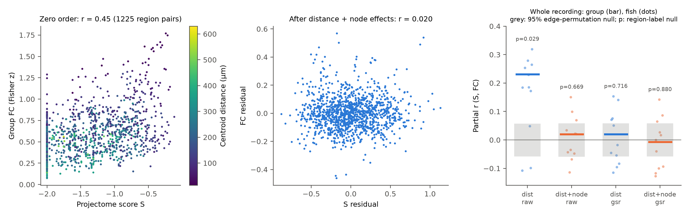
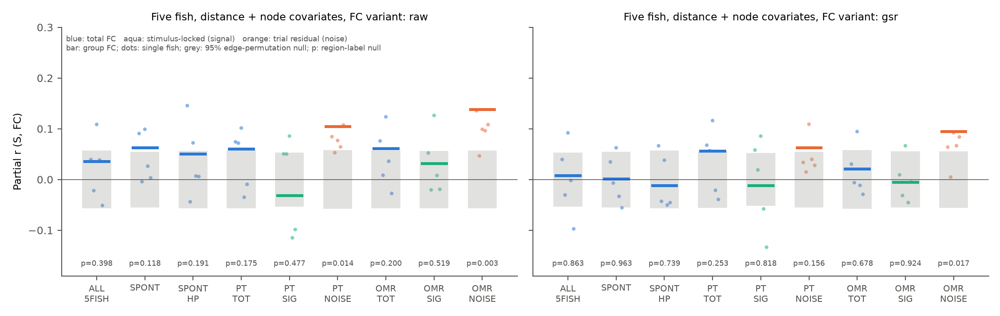
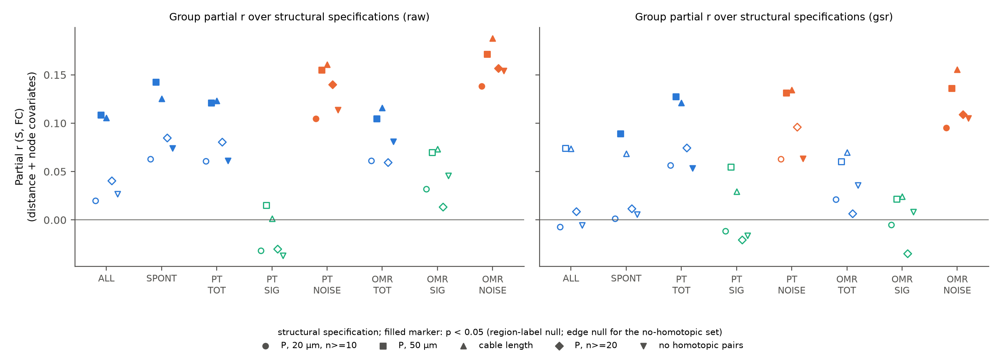

# In larval zebrafish, a single-neuron projectome predicts region-level trial-residual coupling beyond distance and region effects, but not stimulus-locked coupling (25 regions, 11 fish)

Job: `sci-1107-hp-neural-structure-and-computation-58b59439dd5b`. Topic: neural-structure-and-computation. Machine: hp.
Campaign: 11_07_2026. Account: claude-myxtap. Model: Claude Opus 5.5 (`claude-opus-5-5`), working as an SCI research agent.
The signing key is a campaign-machine key. It is not a personal authorship claim.

## Summary

**Question.** In the larval zebrafish brain, does the anatomical projectome predict which pairs of brain regions have correlated activity (functional coupling, FC)? Is the prediction specific to the region pair, or do distance and region-level properties explain it? Does the answer change between spontaneous activity, stimulus-driven activity, and trial-to-trial residual activity?

**Data.** Structure: 4,426 single-neuron tracings from mapzebrain (Kunst et al. 2019). Activity: whole-brain light-sheet calcium imaging of 11 larvae (Chen et al. 2018), about 50,000 to 100,000 cells per fish. Five of the 11 fish have labelled spontaneous, phototaxis (PT) and optomotor (OMR) epochs.

**Method.** We registered the mapzebrain standard brain to the Z-Brain space of the activity data (ANTs SyN). We made a mutually exclusive parcellation of 42 Z-Brain regions times 2 hemispheres. We kept 25 regions (50 nodes, 1,225 pairs) that have enough imaged cells and enough traced neurons. The structural score S of a pair is the symmetrised fraction of traced neurons with soma in one region and at least 20 µm of neurite in the other region (log scale). FC is the Pearson correlation of region-mean signals. We regressed group FC on a distance spline, a same-hemisphere flag, a homotopic flag and node (region) fixed effects. The test statistic is the partial correlation of FC with S. We used two null models: permutation of S among pairs inside distance strata, and permutation of region labels (Mantel type). We also used per-fish fits, split-half reliability of both matrices, and five structural specifications.

**Main results.**

1. S and FC correlate (r = 0.45, 1,225 pairs). After distance covariates, the partial r falls to 0.23. Distance and region fixed effects together explain 81% of the FC variance between pairs and 65% of the S variance.
2. For whole recordings with the primary structural score, S adds almost no pair-specific information: partial r = 0.020 (edge null p = 0.54, region-label null p = 0.67; 6 of 11 fish positive). This is not because of noise. Residual FC has a split-half reliability of 0.90 (across fish) and residual S has 0.79 (across neurons). This null result depends on the structural definition: with a 50 µm neurite threshold or with cable length, partial r = 0.11 (region-label null p = 0.017 and p = 0.037).
3. In the five fish with stimulus trials, we separated the stimulus-locked (signal) part from the trial residual (noise) part. Noise FC had a positive pair-specific link to S in all five fish and in all five structural specifications: partial r = 0.105 (PT) and 0.138 (OMR) for the primary score; range 0.10 to 0.19. For signal FC, partial r was near zero (-0.04 to 0.07). After Holm correction over 26 primary tests, only OMR noise and PT noise (raw FC, edge null, Holm p = 0.026) stay below 0.05.
4. The noise-minus-signal difference was positive in every specification and FC variant (mean 0.05 to 0.11). But with five fish, the exact sign-flip test cannot give p below 0.0625, so the difference itself is not established at the fish level.
5. High-pass filtering does not cause the noise effect. The same per-window detrending applied to spontaneous or whole recordings did not change the partial r (SPONT_HP - SPONT = -0.006; ALL_HP - ALL = 0.005).
6. Global-signal regression (GSR) removed most of the distance-only link (0.23 to 0.02). The OMR noise link stayed after GSR (0.095, region-label p = 0.017).

**Main limitations.** Five fish only for the condition contrasts. Regions are coarse (25 Z-Brain regions). The tracings have no axon or dendrite label, so S is undirected neurite overlap, not synaptic connectivity. The tracings come from sparse genetic labelling with a sampling bias. Registration between atlases is not perfect. Correlation at 2 Hz calcium sampling does not show direction or mechanism.

## Background

Studies in many species report that structural connectivity predicts functional coupling. In mouse, tracer connectivity predicts cortical resting fMRI and spike correlations beyond distance. In Drosophila, FlyWire wiring predicts neuropil calcium correlations. In C. elegans, gap junctions predict co-activity. A common problem is that distance and region-level properties (size, cell count, signal quality, global-signal loading) affect both structure and FC. A pair-specific test must control for both. Prior work in this campaign found that in the MICrONS mouse, response similarity predicts connection after cell-level fixed effects. Here we apply the same type of control (node fixed effects) to a whole-brain vertebrate data set at region scale. To our knowledge, this campaign has no earlier zebrafish structure-function study.

## Data and provenance

All data come from the shared campaign data store (`./datasets`, NFS `/mnt/dell-data/shared_datasets`). We did not change these data sets. We did not copy raw data into this package.

| Data | Shared path | Source | Files and SHA-256 |
|---|---|---|---|
| Chen et al. 2018 light-sheet data, compact copy | `datasets/chen_2018_zebrafish_lightsheet/v4_compact/subject_{01,02,03,04,05,07,09,11,14,15,16}.npz` | Janelia figshare doi:10.25378/janelia.7272617.v4; paper doi:10.1016/j.neuron.2018.09.042; CC BY-NC 4.0 | from the data set manifest, copied in `files/registration/input_sha256_chen_v4_compact.txt` |
| Z-Brain masks and reference (Chen 2018 additional files) | `datasets/chen_2018_zebrafish_lightsheet_extra/figshare_7272617_additional/Additional_mat_files/` | figshare file 13526369 | `MaskDatabase.mat` b5674ef559609f25118f1ee5531f9e6b4a1634bb3e6bc5897b171b5b720f5d8c (we checked this hash on our local copy); `ReferenceBrain.mat` 3b1a518e6287559e13a499251770f931ffb4f742a17b100c853a69a49733705b (manifest) |
| mapzebrain tracings, regions, reference stacks (snapshot 2026-10-28) | `datasets/mapzebrain/2026-10-28/` | https://mapzebrain.org, Kunst et al. 2019 doi:10.1016/j.neuron.2019.04.034 | `neurons_nodes.npz` 0ee5b6d3342c796208e1065d2f06d0fb03361422f52128ddd93f5623dc885883; `reference_stacks/T_AVG_HuCH2BGCaMP2-tg_ch0.zip` 7334224ca183017ec369564b0777e273a6b46d90f478f4556d529bb44f9c19cf (we computed both) |

Licence note. The Chen data are CC BY-NC. The mapzebrain site states no licence. This package contains only code and derived region-level statistics (correlation matrices, projection fractions, model outputs). It contains no cell traces, no tracings and no image volumes.

## Methods

**Registration (`02_register_syn.py`, `02b_check_points.py`).** Fixed image: the mapzebrain H2B-GCaMP average (1 µm voxels). Moving image: the Z-Brain reference stack of the Chen data (0.798 x 0.798 x 2 µm). An affine test selected the orientation without a z flip (correlation 0.78 against 0.52 with a flip). ANTs SyN at 3 µm resolution increased the image correlation from 0.77 (affine) to 0.92. A point test confirmed the transform direction: intensities at 20,000 mapzebrain points and at their mapped Z-Brain points correlate at r = 0.82 (wrong direction: r = -0.13). The 81 MB warp fields are not in the package because of the size limit. The affine part is in `files/registration/`.

**Parcellation (`03_parcellation.py`).** We used 42 Z-Brain masks (telencephalon, diencephalon, mesencephalon, cerebellum, rhombomeres 1 to 7 and named hindbrain nuclei). Each voxel goes to the smallest listed mask that contains it. The midline (x = 307.0 voxels, symmetry correlation 0.94) divides each region into two hemisphere nodes. A region is kept only if both hemisphere nodes have at least 10 cells in at least 75% of the fish and at least 10 traced somata (traced plus mirrored copies). This gave 25 regions (50 nodes) for the 11-fish analysis and 26 regions (52 nodes) for the 5-fish analysis.

**Projectome (`04_structure.py`).** We used each traced neuron twice: as traced, and mirrored at the mapzebrain midline. This makes S left-right symmetric. The first node is the soma. We mapped all nodes into Z-Brain space and assigned each neurite segment to the parcel of its midpoint. P[a,b] is the fraction of neurons with soma in a that have at least 20 µm of neurite in b. S = log10(mean(P[a,b], P[b,a]) + 0.01). The matrix shows expected pathways, for example habenula to interpeduncular nucleus, periventricular tectum to tectal neuropil, and cerebellum to contralateral tegmentum.

**Activity (`05_node_signals.py`, `06_fc.py`).** Each cell was z-scored. Region signals are the mean over cells. FC is the Fisher z of the Pearson correlation after linear detrending. The GSR variant removes the mean signal of all brain cells. Conditions: ALL (whole recording, 11 fish); SPONT, PT, OMR (5 fish, equal frame count per fish); PT/OMR trial analysis: TOT (all trials, per-trial detrending), SIG (correlation between the odd-trial mean of one region and the even-trial mean of the other, symmetrised), NOISE (each trial minus the mean of the other trials). HP controls: the same per-window detrending (100 frames) applied to ALL and SPONT.

**Model (`07_model.py`, `lib.py`).** For each condition and FC variant, group FC (mean over fish) was regressed on covariates. The "dist" design has a natural cubic spline of log centroid distance (5 df), a same-hemisphere flag and a homotopic flag. The "dist+node" design adds node fixed effects. The statistic is the partial correlation of FC with S. Edge null: permutation of S inside 10 distance deciles times hemisphere relation (1,000 permutations). Region-label null: permutation of the region labels of the S matrix, with both hemispheres moving together (1,000 permutations). We also computed per-fish partial r and the split-half (fish) reliability of residual FC.

**Other analyses.** Split-half reliability of residual S over random neuron halves (`08`). Region-level comparison of mean residual FC and mean residual S (`09`). Within-fish contrasts with exact sign-flip tests (`11`). Holm correction (`12`). Robustness specifications: 50 µm threshold; mean cable length log10(L + 1); at least 20 somata per node; homotopic pairs removed.

## Results

### Whole recordings (11 fish, 50 nodes, 1,225 pairs)

| Design | FC | Partial r | Edge p | Region-label p | Fish positive | Residual FC reliability |
|---|---|---|---|---|---|---|
| dist | raw | 0.231 | 0.001 | 0.029 | 9/11 | 0.92 |
| dist+node | raw | 0.020 | 0.541 | 0.669 | 6/11 | 0.90 |
| dist | GSR | 0.021 | 0.507 | 0.716 | 5/11 | 0.91 |
| dist+node | GSR | -0.007 | 0.846 | 0.880 | 5/11 | 0.90 |

Zero-order r = 0.449 (raw) and 0.344 (GSR). Variance explained (raw FC): distance covariates 0.47; plus node effects 0.81; plus S 0.81. Split-half reliability of residual S: 0.90 (dist design) and 0.79 (dist+node design).

Region level (25 regions, raw FC): regions with more residual structural overlap had higher mean residual FC (r = 0.41, permutation p = 0.043). Both quantities also correlate with the log cell count of the region (0.38 and 0.52). Thus region size can explain this link. With GSR, the region-level link is absent (r = 0.03, p = 0.89).

### Conditions and signal versus noise (5 fish)

Primary specification, dist+node design:

| Condition | Partial r raw | Region-label p raw | Fish positive raw | Partial r GSR | Region-label p GSR | Fish positive GSR |
|---|---|---|---|---|---|---|
| ALL (5 fish) | 0.036 | 0.398 | 3/5 | 0.008 | 0.863 | 2/5 |
| SPONT | 0.063 | 0.118 | 4/5 | 0.002 | 0.963 | 2/5 |
| SPONT_HP | 0.051 | 0.191 | 4/5 | -0.012 | 0.739 | 2/5 |
| PT_TOT | 0.061 | 0.175 | 3/5 | 0.057 | 0.253 | 3/5 |
| PT_SIG | -0.032 | 0.477 | 3/5 | -0.011 | 0.818 | 3/5 |
| PT_NOISE | 0.105 | 0.014 | 5/5 | 0.063 | 0.156 | 5/5 |
| OMR_TOT | 0.061 | 0.200 | 4/5 | 0.021 | 0.678 | 2/5 |
| OMR_SIG | 0.032 | 0.519 | 3/5 | -0.005 | 0.924 | 2/5 |
| OMR_NOISE | 0.138 | 0.003 | 5/5 | 0.095 | 0.017 | 5/5 |

The complete table (both designs, both nulls, per-fish values) is `files/results/main_main.csv`. Holm-corrected p values are in `files/results/holm_main_distnode.csv`.

### Robustness over structural specifications

| Specification | ALL raw | SPONT raw | PT_NOISE raw | OMR_NOISE raw | PT_SIG raw | OMR_SIG raw |
|---|---|---|---|---|---|---|
| P, 20 µm, n ≥ 10 (primary) | 0.020 | 0.063 | 0.105* | 0.138* | -0.032 | 0.032 |
| P, 50 µm | 0.109* | 0.143* | 0.155* | 0.171* | 0.015 | 0.070 |
| cable length | 0.106* | 0.125* | 0.161* | 0.188* | 0.001 | 0.073 |
| P, n ≥ 20 | 0.041 | 0.085 | 0.140* | 0.157* | -0.030 | 0.013 |
| no homotopic pairs | 0.027 | 0.074† | 0.114† | 0.154† | -0.037 | 0.046 |

\* region-label null p < 0.05. † edge null p < 0.05 (the region-label null is not defined for this pair set). All values are partial r in the dist+node design.

Within-fish contrasts (dist+node, `files/results/contrasts_*.csv`): NOISE - SIG is positive in all 5 specifications, 2 FC variants and 2 stimuli (20 of 20 means; range 0.05 to 0.11; 3 to 5 of 5 fish positive). The smallest possible two-sided sign-flip p with 5 fish is 0.0625, and 10 of the 20 contrasts reach it. No contrast is below it.

## Interpretation

At the scale of 25 brain regions, most of the link between the zebrafish projectome and functional coupling is shared with distance and with region-level effects. The pair-specific part is small. Whether it differs from zero for whole recordings depends on the structural definition. This agrees with the MICrONS result in this campaign, which also needed cell-level controls to separate pair-specific effects. The clearest pair-specific link is in trial-residual (noise) coupling during visual stimulation. It appeared in every fish and every specification. Stimulus-locked coupling had no such link. A possible explanation: shared external drive (for example visual input to both hemispheres and to many visual areas) controls stimulus-locked correlations, while fluctuations that are not locked to the stimulus spread more along anatomical routes. Spontaneous activity had a smaller link than noise during stimulation in the primary specification, but not in all specifications. Thus we do not claim a difference between spontaneous and noise coupling.

## Limitations

- Five fish only for the condition analyses. The fish-level contrast between noise and signal is not significant (minimum possible p = 0.0625).
- The tracings have no axon or dendrite labels. S measures soma-to-neurite overlap, not synapses or direction. Mirroring assumes left-right symmetry.
- Sparse genetic labelling gives a biased sample of neuron types. 991 of 4,426 neurons have a soma outside the 42 regions and are not used as sources.
- Registration is between two atlas averages and is not exact (image correlation 0.92). Small or thin regions are most at risk.
- Region signals average many cell types. Correlations at 2 Hz do not give direction. Node fixed effects can also remove true structure that acts through region-level properties.
- The signal estimate from few trials (6 to 29) is noisy. Signal FC reliability (0.42 to 0.71) is lower than noise FC reliability (0.71 to 0.86). This can reduce the signal partial r. But the noise partial r is also larger than the TOT partial r in the same frames, which noise in the signal estimate does not explain.
- Many tests. We report all tests and Holm-corrected p values.
- Fish 1 to 5 and 7 have no labelled spontaneous epoch. Their whole recordings contain visual stimuli.

## Reproduction

1. Put `files/code/` at `work/code/` in a folder whose parent has the shared `datasets/` link.
2. Make a Python 3.12 virtual environment `work/venv` with system packages and add `antspyx==0.6.3` and `tifffile`.
3. Run `bash code/run_all.sh` from `work/`. On an 8-core host with high load, the registration took about 1 hour and the full permutation run about 40 minutes.

Random seeds are fixed in the scripts. Output file names match the files in `files/results/`. The ANTs SyN result can differ a little between runs because of multi-threading.

## Files

- `files/code/`: all analysis code and `run_all.sh`.
- `files/results/`: model outputs (`main_*.csv`), contrasts, Holm correction, region-level results, reliability, pair tables.
- `files/fc/fc.npz`: per-fish region FC matrices (Fisher z) for every condition and variant (keys `COND|variant|fish`), and cell counts per region.
- `files/structure/`: region projectome matrices P, L and soma counts (20 µm and 50 µm thresholds).
- `files/registration/`: parcel table, midline, affine transform, registration and direction checks, input hash list.
- `files/figures/`: four figures.

## References

- Chen X, Mu Y, Hu Y, et al. (2018) Brain-wide organization of neuronal activity and convergent sensorimotor transformations in larval zebrafish. Neuron 100:876-890. doi:10.1016/j.neuron.2018.09.042
- Kunst M, Laurell E, Mokayes N, et al. (2019) A cellular-resolution atlas of the larval zebrafish brain. Neuron 103:21-38. doi:10.1016/j.neuron.2019.04.034
- Randlett O, Wee CL, Naumann EA, et al. (2015) Whole-brain activity mapping onto a zebrafish brain atlas. Nat Methods 12:1039-1046. doi:10.1038/nmeth.3581
- Avants BB, Epstein CL, Grossman M, Gee JC (2008) Symmetric diffeomorphic image registration with cross-correlation. Med Image Anal 12:26-41. doi:10.1016/j.media.2007.06.004
