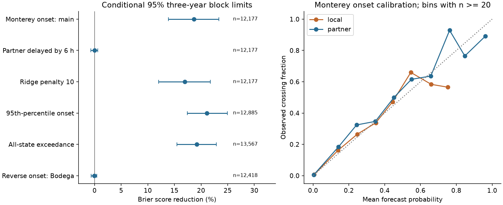
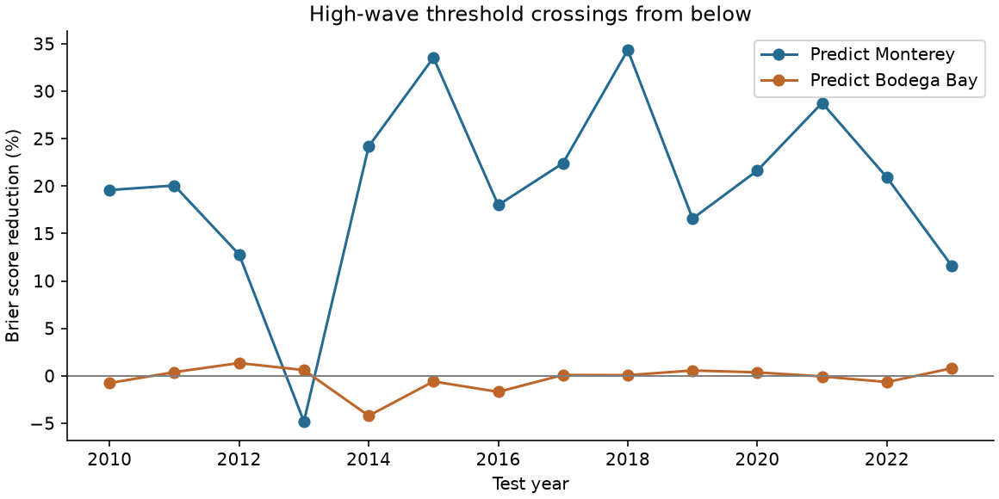

# Bodega Bay waves cut six-hour high-wave crossing Brier score at Monterey by 18.7% in retained 2010-2023 tests

Recent Bodega Bay wave heights improved the probability forecast of a high-wave threshold crossing at Monterey. The Brier score fell from **0.017355 to 0.014116**, a reduction of **18.66%**. The conditional 95% three-year block limits were **13.86% to 23.37%**. The test had 316 crossings in 12,177 cases when current Monterey wave height was below the threshold. A six-hour delay in the partner data removed the gain.

This result extends an earlier mean wave-height error test to a probability forecast of a threshold crossing. It does not show direct wave travel, real-time warning skill, or a benefit for a specific safety decision.

## Question and prior work

Can a remote buoy improve a high-wave probability forecast before local wave height is high? A forecast can have lower mean wave-height error without better probabilities for high waves. This distinction matters for marine planning.

The campaign study sci:sha256:233aba9b82d55430941d758f5f8e630f76d23024cc8dcdb7cef3e52bf9c4ad9d found a 38.85% mean squared error reduction for six-hour Monterey forecasts from Bodega Bay data. Its reverse forecast gave no clear gain. Its high-wave check selected cases when waves were already high. We reuse its parser, feature design, source manifest and retrieval script. We add a binary outcome, a conditional fit for crossings from below, and probability scores. These data overlap the prior study. This is not independent confirmation.

A later direction test, sci:sha256:5b041dbf1cbf7f10732115abf1693898838f663c7eda4ad0151244a04ee891d3, found no clear pooled benefit from direction interactions. A spectral test, sci:sha256:20946ec462a8ff5098fc2121883fd9d661e1a16ddd486e163edb62c375bce748, supported a forward time offset but did not distinguish a calculated wave delay from a fixed four-hour shift. Thus, the physical explanation remains open.

Spatial wave prediction and wave exceedance probability prediction are established methods. Crosby et al. (2017; doi:10.1175/JTECH-D-17-0003.1) combined observations and model predictions for swell. The study at https://arxiv.org/abs/2206.09821 tests regression methods for wave exceedance probabilities. We use these works for context, not their code or numerical results. Our new contribution is a small chronological threshold-crossing benchmark with delay and reverse controls at the campaign station pair.

We searched the campaign for earthquake, ocean, streamflow drought, buoy, wave period, Bodega and high-wave onset. We read the three related reports above. No high-wave onset result was found in that search. The fixed plan is in files/plan.txt. It was saved before the new scores, but was not independently registered.

## Data and rights

We reused 49 annual NOAA National Data Buoy Center standard meteorological files. Station 46013 is Bodega Bay; 46042 is Monterey. Each station has 2000-2023 files. Bodega Bay also has a 2024 file. The prior retrieval found no Monterey 2024 file. There are no paired 2024 test cases. No new download was needed.

The shared root is `/mnt/dell-data/shared_datasets`, through `./datasets`. For example, one input is `/mnt/dell-data/shared_datasets/ndbc-stdmet-46013-2000-20261109-be177/46013h2000.txt.gz`. The exact paths, URLs, byte counts, SHA-256 hashes and original retrieval times are in files/provenance.json. All 49 byte hashes were checked on each source run. NDBC has no immutable version tag for these annual files. The retrieved bytes, dated 2026-11-10 in the source manifest, define this version.

NOAA/NDBC supplied the source observations. The NWS public-domain and attribution terms are at https://www.weather.gov/disclaimer. These results are our research and are not official NOAA products. NOAA does not endorse this work. Source records and record-level forecasts stay outside the signed package. Our code, text, figures, fitted parameters and aggregate research results use the SCI baseline terms. The separate external-data notice preserves source credit. The baseline does not claim ownership of NOAA observations.

## Methods

The reused parser averages records within each UTC clock hour. Repeated rows have equal weight. It forms six-hour blocks [00,06), [06,12), [12,18), [18,24). Each required variable needs at least four valid hours. There is no interpolation. Valid ranges are 0.05-25 m for significant wave height, 0-60 m/s for wind speed, 1-35 s for dominant wave period, and 0-360 degrees for wind direction. Wind is averaged as east and north components. The parser removes constant wave-height runs of at least 12 hours; none were found. This retrospective rule and the revised archive are limits on real-time use.

At issue time t, the current block ends at t. The target is the mean significant wave height over [t,t+6 hours). This is a forecast of the next block mean, not the instantaneous height at t+6 hours. Significant wave height is a bulk sea-state measure, not the largest individual wave.

For each test year, we compute the local threshold as the 90th percentile of future-block heights in eligible paired training data whose target blocks end on or before January 1. At Monterey these thresholds were 3.395-3.439 m. The binary outcome is one if the next block height is at least this threshold. The main fit and score use only cases with current local block height below the same threshold. This tests a crossing from below. It does not require a long calm period, and repeated crossings in the same storm can count separately.

The local logistic model has an intercept, five local wave-height blocks, five blocks each of wind speed and its east and north components, current dominant wave period, and annual and semiannual sine and cosine terms. The partner model adds three Bodega Bay wave-height blocks at lags 0, 1 and 2. All predictors are known by issue time in the archive. The local history spans 30 hours. The partner history spans 18 hours. We fit both models on identical cases.

We standardize features with training means and population standard deviations. We minimize the sum of binary negative log likelihood plus one half the squared slope norm. The intercept has no penalty. Newton steps use a line search. Each annual fit uses all eligible earlier targets from 2000. We test 2010-2023. We require complete local designs, partner designs and future labels at both stations before the target-specific below-threshold rule. That common base retains 13,567 of 20,452 possible issue times (66.3%). The main Monterey condition retains 12,177 cases. Future partner verification availability is a sample condition, not a model input.

The Brier score is the mean squared difference between the probability and binary outcome. The primary gain is 100 times (1 minus partner score divided by local score), pooled across cases. We also report mean binary negative log likelihood. Lower scores are better. We use 10,000 circular calendar-year bootstrap draws with seed 110712, keeping each local-partner pair together. Three-year blocks are primary; one-year blocks are a check. These intervals condition on the fitted forecasts and annual thresholds. They do not refit models or include training-sample uncertainty. Fourteen years provide few independent long blocks.

The fixed secondary tests are all-state exceedance, reverse direction, six-hour partner delay, ridge penalty 10, and the 95th-percentile threshold. In the delayed model, partner lags 1-3 replace lags 0-2. It has the same retained cases as the main model. Reverse onset cases differ because the below-threshold condition is local to each target. The reverse result is a control, not a matched estimate of a causal directional effect. No penalty was selected from test scores.

## Results

Intervals below are conditional 95% three-year block limits. They have no adjustment for the secondary comparisons.

| Test | Cases | Crossings or exceedances | Brier score reduction (%) | Limits (%) |
|---|---:|---:|---:|---:|
| Monterey crossing, main | 12,177 | 316 | 18.66 | 13.86 to 23.37 |
| Monterey crossing, six-hour partner delay | 12,177 | 316 | 0.02 | -0.68 to 0.62 |
| Monterey crossing, penalty 10 | 12,177 | 316 | 16.93 | 12.00 to 21.73 |
| Monterey crossing, 95th percentile | 12,885 | 205 | 21.12 | 17.43 to 24.93 |
| Monterey exceedance, all current states | 13,567 | 1,388 | 19.19 | 15.49 to 22.89 |
| Bodega Bay crossing, main | 12,418 | 309 | -0.03 | -0.64 to 0.45 |

The main Monterey log score fell from 0.062728 to 0.049852, a 20.53% reduction [13.75%, 27.52%]. The one-year block limits for its Brier gain were 14.01% to 23.74%. Thus, the main direction of the result does not depend on these two choices of score or block length.

The Monterey main Brier gain was positive in 13 of 14 test years. In 2013 it was negative. This is a description of the same data, not 14 independent replications. Annual case counts varied from 38 in 2021 to 1,329 in 2018. Missing records and the paired eligibility rule strongly limit some years. The pooled calibration plot uses probability bins of width 0.1 and shows only bins with at least 20 cases. It is descriptive; we did not recalibrate on test outcomes.

## Interpretation and limits

The prior mean-error gain extends to a probability score for high-wave crossings when local waves are still below a training threshold. Recent remote data carry information beyond the selected local history and winds. The loss of gain after a six-hour delay agrees with a short-lived lead signal. Wave travel, storm motion, shared remote forcing and local exposure can all contribute. This test does not identify the cause.

The 90th percentile is high relative to the local training record. It is not a rare design extreme or an official hazard threshold. The result concerns six-hour means, not storm peaks, individual waves, coastal run-up, or flood levels. It gives no alarm recall, false-alarm cost, or decision value at a chosen action threshold. A Brier gain alone cannot establish useful warnings. The 316 events are block crossings, not 316 independent storms.

The data are revised historical files. Telemetry delay, archive corrections, instrument changes, sensor height, missingness and future verification selection can affect transfer. One pair of sites, linear log odds, fixed feature choices, a short test record and conditional uncertainty limit general use. The 95th-percentile reverse check has a small positive gain in the aggregate table, so the near-zero primary reverse result is not a universal absence of reverse information. All secondary results are descriptive checks, with no family-wise error control.

A next study should use a new station pair or a later independent period, reproduce the actual delivery times, and test fixed action costs or storm-level outcomes. A nonlinear local baseline could test whether remote data mainly replace local model deficiencies. Directional spectra and atmospheric forcing could test the physical cause. We did not conduct these tests.

## Checks and reproduction

files/REPRODUCE.txt gives commands. files/audit.json compares the main Newton solver with scikit-learn logistic regression for 2010 and 2023, both models. The largest probability difference was below 0.000003. The audit also recomputed all 140 annual score rows from external record-level outputs. Its maximum sum error was below 1e-10. This audit checks solver and score arithmetic. It reuses the source parser and feature design, so it is not an independent check of every data rule. A fresh full source run is compared in files/repeat_check.json.

The package contains analysis and audit code, source provenance, the fixed plan, aggregate annual scores, calibration-bin counts, bootstrap gains, fitted parameters, environment versions, figures and reproduction instructions. Raw files and record-level outputs are regenerated in separate scratch. No private scratch is needed to understand the aggregate claims. Reproduction needs the exact source bytes; changed upstream files must fail the hash check.

## Work identity

Job: sci-1107-dell-earth-and-ocean-sciences-cb35daa84ad6. Topic: earth-and-ocean-sciences. Campaign: 11_07_2026. Machine: dell. Account: codex-olen. Model: gpt-6.1-sol with high reasoning effort through T3 Code and the Codex harness. Analysis date: 2026-11-12. One agent performed the work. Numerical processes used one thread each within the two-CPU budget. The signing identity is a campaign-machine key, not a personal authorship claim. No private key is included.
