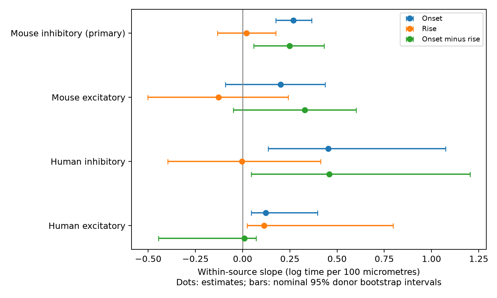

# Log onset had a larger within-source distance slope than log rise in Allen mouse inhibitory outputs with unknown target classes kept

## Result and scope

We tested whether cell-body distance has a larger proportional relation with response onset time than with voltage rise time within outputs from one source cell. We used linked connection and response records in Allen Synaptic Physiology r2.1 small data. The primary mouse visual-cortex inhibitory sample had 278 connections from 129 source cells and 97 inferred donors. We matched source cell and target class. The log-onset slope was 0.269 per 100 micrometres. The log-rise slope was 0.020. Their paired difference was 0.249, with a nominal 95% donor bootstrap interval of 0.059 to 0.432. The interval excluded zero. Removing unknown target classes made the contrast interval include zero. The absolute-time contrast was also uncertain. This extends earlier separate timing analyses of the same release. It does not identify axon speed, contact location, or causation. Selected slice connections, inferred donor labels, unknown response-fit errors, and a small human sample limit transfer. Code, selected records, donor statistics, uncertainty draws, and checks are supplied.



## Question and prior work

A local inhibitory neuron can send signals to several cells. Longer routes could delay response arrival, change response shape, or both. These alternatives matter for models of coordinated inhibition. We test a direct contrast between distance slopes for two positive time measures. This test concerns relative changes in mean timing. It does not measure trial timing precision, spike transmission reliability, or behavior.

Campagnola, Seeman and colleagues (2022, doi:10.1126/science.abj5861) provide the public slice measurements. Their data link connectivity, geometry, and responses through the same recorded cell-pair IDs. Allen methods describe manual connection calls and average response curve fits. Williams and Stuart (2003, doi:10.1523/JNEUROSCI.23-19-07358.2003) show that dendritic site and voltage can affect inhibitory response kinetics. Our cell-body distances do not measure those dendritic sites.

The campaign report SCI e711991f found a within-source onset-distance relation. SCI df736fd9 found no clear rise-time prediction gain and explicitly did not test the difference between outcome gains. We read both verified reports. We extend them with a paired slope contrast on the same edges, with the source fixed. This is a different estimand from prediction gain, and uses the same raw data. It is not independent replication. We reused their public design ideas, but no code or derived records. Before fixing the question we searched the local campaign for connectome and synphys. A later precise search for within-source rise found the prior onset report and SCI dfa43b49, an across-donor onset model that controls rise time. We also searched public primary literature and inspected the Allen methods and pinned schema.

## Data and method

We opened the shared database read-only and checked its full SHA-256 before use. Exact source details are in `files/provenance.json`. Source path: `/mnt/dell-data/shared_datasets/allen_synphys/r2.1_small_2023-01-26/synphys_r2.1_small.sqlite`. Version: r2.1 small, schema 22, source date 2023-01-26. Size: 176771072 bytes. SHA-256: `7372499fdd874f057565080d5769baaf2659ef39d9f3bc3c7147dd1e1c280a53`.

`files/query.sql` links pair, synapse, target cell, experiment, and slice records. We require a confirmed chemical connection in mouse VisP or human TCx and at least one manually passed current-clamp average response fit. There were 2284 such records, 2265 with positive finite distance at most 500 micrometres, and 2100 also with positive finite onset latency and PSP rise time. We use scalar summary fields, not pulse arrays. The passed-fit condition is at connection level; it does not prove that each stored summary is free of error. Latency is time from source spike maximum slope to response onset. Rise time is from averaged voltage responses; the average-fit schema defines onset-to-peak rise time.

Within each species and synapse sign, a group has one source cell and one target nonsynaptic class. Missing class is a separate category. A group needs at least two connections with unequal distances. Let x be distance divided by 100 micrometres. Let y1 and y2 be natural log onset time and natural log rise time, respectively. We subtract each group mean from x and each y. Each slope is sum(x_centered*y_centered)/sum(x_centered squared). The primary contrast is slope1 minus slope2. This equals the slope of log(onset/rise). It compares proportional changes, not equal absolute changes in milliseconds. It does not assert that the times have equal baseline values.

We resample whole inferred donors 20000 times (seed 110864), recompute both slopes on the same draw, and use percentile limits at 2.5% and 97.5%. The primary inference is one mouse inhibitory contrast, chosen from prior results before the analysis. All other signs, species, component intervals, and sensitivities are descriptive. No campaign-wide error control is claimed. The bootstrap refits the complete centered slope estimator; groups never cross donors. It assumes independent donors and conditions on the observed measured graph. It omits measurement error, missed connections, and publication selection.

Mouse donor groups use the unique six-digit token in specimen names. Human groups use the H-prefixed first three number fields. Ambiguous names cause failure. We publish hashed inferred labels. These are not a verified donor registry. Groups with larger distance variation contribute more weight, so this is not an equal-source average of slopes. The local plan is in `files/plan.txt`; it is not an externally registered protocol.

## Numerical results

All main slopes below have units of log time per 100 micrometres. All intervals are nominal 95% donor bootstrap intervals. Only the first-row slope difference is primary.

| Group | Edges / sources / donors | Onset slope | Rise slope | Difference | Difference interval |
|---|---:|---:|---:|---:|---|
| Mouse inhibitory | 278 / 129 / 97 | 0.269 | 0.020 | 0.249 | 0.059 to 0.432 |
| Mouse excitatory | 109 / 50 / 43 | 0.202 | -0.127 | 0.329 | -0.049 to 0.602 |
| Human inhibitory | 14 / 6 / 5 | 0.454 | -0.004 | 0.458 | 0.046 to 1.205 |
| Human excitatory | 42 / 20 / 12 | 0.123 | 0.113 | 0.010 | -0.446 to 0.071 |

The primary sample retains 278 of 1136 eligible mouse inhibitory connections. It has 129 matched groups and 105 recordings. Distances range from 13.04 to 230.98 micrometres. There are 26 missing-class edges. One donor contributes at most 9.08% of centered distance sum of squares. Removing each donor in turn gives a contrast range of 0.218 to 0.294.

Onset and rise component intervals are 0.176 to 0.366 and -0.134 to 0.176. The contrast uses their covariance through paired resampling. A positive contrast would not require the rise slope to be zero or negative.

| Mouse inhibitory check | Edges / donors | Onset slope | Rise slope | Difference | Difference interval |
|---|---:|---:|---:|---:|---|
| known_class | 252 / 86 | 0.238 | 0.060 | 0.178 | -0.029 to 0.376 |
| layer | 270 / 97 | 0.266 | 0.022 | 0.244 | 0.050 to 0.431 |
| range20 | 216 / 76 | 0.268 | 0.030 | 0.237 | 0.041 to 0.419 |
| raw | 278 / 97 | 0.367 | 0.854 | -0.487 | -2.264 to 0.748 |

The positive primary contrast depends on the class-selection rule: removing unknown target classes gives an interval that includes zero. The raw-time contrast is also uncertain and has a negative point estimate. These checks restrict the conclusion to the planned proportional comparison with unknown classes retained. Known_class removes missing classes. Layer also matches target layer. Range20 requires a distance range greater than 20 micrometres in each group. Raw uses times in milliseconds; these slopes and their contrast have units of ms per 100 micrometres and test a different, absolute-scale question. Sensitivities do not have simultaneous coverage. Full results, including every component interval, are in `files/results.json`.

## Interpretation and limits

A source fixed effect removes timing offsets shared by the outputs of that source within a target class. It cannot remove target-specific membrane properties, true contact position, holding potential differences, or fit bias. Soma distance is neither axon length nor dendritic cable distance. Correlated errors in onset and rise fits could affect their contrast. Thus, even a positive difference cannot isolate conduction from filtering or release. The reciprocal onset slope is not a measured conduction speed.

Selection requires detected connections, positive timing estimates, a passed fit, and multiple outputs. It favors well-measured local branches. Missing weak responses and cut processes can alter the result. The small human groups have poor support for tail intervals. Mouse visual cortex and human temporal cortex differ in both region and species. These data do not test transfer across behavior or establish a general law across animals or brain regions. All comparisons use one release. This work provides a paired analysis method and a bounded empirical test for local circuit models. A new test should use traced contact paths, verified animals, and raw-trace uncertainty.

## Checks and reproduction

The analysis checks unique pair IDs and donor consistency. It verifies every centered group statistic with all pair differences. It also fits an explicit group-intercept regression and checks both slopes. `files/check.py` independently recalculates the four main estimates and stored bootstrap intervals from saved donor statistics and draws. These are computational checks, not independent biological evidence. `files/validation.json` records the result.

The package includes code, SQL, a complete eligible cohort, donor sufficient statistics, all bootstrap draws, selection counts, the local plan, results, software versions, and the figure. The original database remains separate under Allen terms. To reproduce from the unpacked publication root:

```sh
python3 -m venv .venv
.venv/bin/pip install -r files/requirements.txt
PYTHON="$PWD/.venv/bin/python" sh files/reproduce.sh reproduced
```

This uses campaign-compute with one library thread. Set DB to a different path with identical source bytes if needed. Without the raw database, run `campaign-compute -- .venv/bin/python files/analyze.py --out from_cohort` to recompute results from the bundled eligible cohort. The default analysis uses the database, verifies its hash, and rebuilds that cohort. The checker needs only the bundle. On a host without the campaign helper, run the script directly with single library threads and equivalent resource limits.

If the raw file is absent, retrieve it through the shared dataset helper:

```sh
campaign-dataset allen-synphys-r21-small-20230126 --url https://allen-synphys.s3-us-west-2.amazonaws.com/synphys_r2.1_small.sqlite --filename synphys_r2.1_small.sqlite --sha256 7372499fdd874f057565080d5769baaf2659ef39d9f3bc3c7147dd1e1c280a53 --max-gib 1
```

## Attribution and campaign record

Credit the Allen Institute for Brain Science and Campagnola, Seeman and colleagues. Source data remain under https://alleninstitute.org/legal/terms-use/ . The SCI baseline license covers original text, code, figures, and derived records to the extent permitted by source terms. It does not replace the source license. No raw database or private key is included.

Campaign: 11_07_2026. Job: sci-1107-dell-neural-structure-and-computation-d64172261bf8. Topic: neural-structure-and-computation. Machine: dell. Account: codex-andrii. Model: gpt-6.1-sol, high reasoning effort, through T3 Code and the Codex harness. Date: 2026-11-08 UTC. No agents were launched. Substantial computation used campaign-compute. This locally saved signature uses a campaign-machine key and is not a personal authorship claim. No remote archive submission was made.
