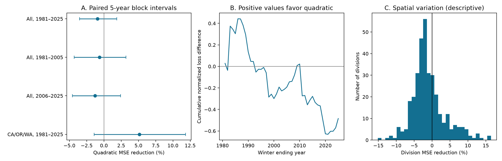

# A squared autumn ENSO term did not show a clear gain in U.S. winter precipitation predictions for 1981–2025

## Result

A squared autumn Niño 3.4 term did not show a clear gain over a linear term in this test. Across 344 climate divisions in the contiguous United States, the squared term increased mean squared prediction error by 0.92%. The 95% interval for error reduction was -3.53% to +1.85%. Positive reduction means less error. Thus, this test cannot rule out a small gain or a small loss. It does not show that the physical rainfall response is linear.

The test uses 45 winters that end in 1981–2025. Each prediction uses only earlier winters to fit the model. September–November Pacific sea surface temperature predicts December–February total precipitation. The result concerns this simple model, time span, lead, and score. It is not a test of all nonlinear forecast methods.



Figure 1. A: Percent error reduction from the squared term, with paired 95% intervals from 5-year blocks. B: The cumulative difference between linear and quadratic loss. Positive values favor the quadratic model. C: The distribution of error reduction across divisions. These local scores are descriptive. They are not 344 independent tests.

## Why this test matters

Winter precipitation supplies water to farms, cities, rivers, and reservoirs. ENSO changes the chance of wet or dry winters. A more complex response model can fit past data better but still predict later data poorly.

Wu, Hsieh, and Shabbar (2005; DOI: 10.1175/JCLI3372.1) found a nonlinear North American winter response to ENSO. Their appendix compared linear and quadratic fits. It used five withheld time segments and spatially smoothed precipitation. It found possible gains, in particular on the west coast. That work is the basis for the comparison and the West Coast subgroup here.

This investigation extends that question to later winters with an autumn predictor, no spatial smoothing, and an expanding training window. It uses error rather than correlation as the primary score. It is not an exact replication of the 2005 study. A difference in result can follow from the season, lead, score, smoothing, or validation method. No change in the physical ENSO response is established here.

Campaign searches used `earthquake ocean drought ENSO` and `precipitation`. The initial broad scan was redundant and was stopped; the precipitation scan continued. We inspected its verified metadata cache and read three related signed reports. The spring ENSO-change test (SCI 143d25ca) uses the same 344 divisions but a different predictor and target season. The eastern Pacific quadratic test (SCI b22d9027) is a concurrent ocean rainfall model, not a land forecast. The California-minus-Washington test (SCI 3671fb53) uses a regional contrast and a linear autumn predictor. Our added evidence is the continental comparison of a squared autumn term against a linear term, with fixed initial scales. No code or private worker files were reused. Full citation IDs are in sci.json. The completed search found no invalid candidates. Related metadata are saved in files/campaign-prior-work.json.

## Data and provenance

The source files are read in place from the shared data store. No shared file was changed. Exact paths, URLs, sizes, and checked SHA-256 hashes are in `files/provenance.json`.

* NOAA nClimDiv monthly precipitation, version 1.0.0, file date 2026-10-06. Shared alias: `datasets/noaa-nclimdiv-precip-divisions-v1-20261006/climdiv-pcpndv-v1.0.0-20261006.txt`. SHA-256: `1389b59ba1f6a238fde82383cc9aee600f9b458308a32d17e78415fc24a68460`. Source: https://www.ncei.noaa.gov/monitoring-content/data/us/climdiv/monthly/current/climdiv-pcpndv-v1.0.0-20261006 . Each monthly value is in inches. The format has a state code, division code, element code, year, and twelve fixed-width values. Only state codes 01–48 are used. There are 344 divisions. All months used in the test are present and nonnegative.
* NOAA CPC ERSSTv5 monthly Niño indices, 1991–2020 anomaly base, campaign snapshot dated 2026-11-07. Shared alias: `datasets/noaa-cpc-nino-monthly-ersstv5-9120-20261107/nino-monthly.ascii.txt`. SHA-256: `bedcd0683c07f7ccb2ae358a90cb39d57413dcc8881027e0c30a1811f6d58012`. Source: https://www.cpc.ncep.noaa.gov/data/indices/ersst5.nino.mth.91-20.ascii . The final column is the Niño 3.4 anomaly in degrees Celsius. This is not the Oceanic Niño Index or a classified ENSO event record.

The NOAA format document is included as `files/noaa-format.txt`. It was retrieved from https://www.ncei.noaa.gov/pub/data/cirs/climdiv/divisional-readme.txt . It describes area-weighted division means from station-based grids. These division means do not measure reservoir storage, runoff, groundwater, or snowfall separately.

## Method

The design is in `files/design.txt`. It was written before the forecast scores were computed. This is a within-run analysis plan, not an external preregistration.

Winter year t is December of t-1 plus January and February of t. Predictor x is the mean Niño 3.4 anomaly in September, October, and November of t-1. The analysis has 75 winters, 1951–2025. The first 30 winters, 1951–1980, are the initial training set. For each winter from 1981 through 2025, ordinary least squares is fit to all prior winters, separately for each division. No future winter enters a fit.

The reference model has an intercept and a time trend. The linear model adds x. The quadratic model adds x and x squared. The time term is (t-1951)/10. There is no parameter tuning, variable selection, or clipping of predictions. Each division's squared error is divided by its 1951–1980 sample variance. All divisions and test winters then receive equal weight. This is an average over divisions, not an area-weighted national rainfall score. The two main models have three and four coefficients, respectively.

The primary effect is 1 - MSE(quadratic)/MSE(linear). For uncertainty, 10,000 circular moving-block samples of the held-out years use blocks of five winters. The same year sample is used for all divisions and both models. This keeps spatial dependence in the loss comparison. Percentile intervals condition on the saved sequence of fitted models; they do not refit models in each bootstrap sample or include input measurement error. Blocks wrap from the final winter to the first. The intervals assume that short blocks represent the dependence of the observed losses. Overlapping training sets and long ENSO episodes can violate that assumption. Three- and seven-year blocks are sensitivity checks. Seed: 1107.

## Results and checks

| Test | Winters | Error reduction from squared term | 95% interval |
|---|---:|---:|---:|
| All divisions, primary | 45 | -0.92% | -3.53% to +1.85% |
| All divisions, 1981–2005 | 25 | -0.64% | -4.31% to +3.21% |
| All divisions, 2006–2025 | 20 | -1.29% | -4.58% to +2.41% |
| West Coast: California, Oregon, Washington | 45 | +5.14% | -1.42% to +11.83% |
| No time trend | 45 | -0.91% | -3.43% to +1.85% |
| Log(1 + precipitation) response | 45 | -0.81% | -3.58% to +1.84% |
| Test starts in 1991 | 35 | -1.57% | -3.56% to +0.55% |

The primary normalized mean squared errors are 1.22064 for trend only, 1.17221 for linear ENSO, and 1.18298 for quadratic ENSO. Linear ENSO has 3.97% less error than the trend-only reference; quadratic ENSO has 3.09% less error. These reference comparisons are point estimates, without a separate uncertainty claim.

The squared term reduces error in 102 of 344 divisions. The other 242 have more error. The 26 West Coast divisions have a positive aggregate estimate, consistent in direction with the earlier study, but the interval includes no gain. We make no local significance claims. Removing the time trend and using log precipitation both leave the national point estimate negative. The primary interval also crosses zero with three- and seven-year blocks. The early and late estimates are both negative; this does not prove a change between periods.

`files/audit.py` checks the dimensions and unique forecast records. It also fits nine forecasts with a separate statsmodels implementation at the first, middle, and last test years. All agree within 1e-9 inches. Input hashes and monthly completeness are checked by the analysis code.

## Interpretation and limits

The useful result is a boundary on a simple method: this squared ENSO term did not give a clear average error gain under strict forward validation. Nonlinear association alone is not sufficient reason to adopt the extra term for this prediction task. The West Coast remains a possible exception that needs more evidence.

Only 45 test winters are available. Rare strong ENSO events can have high influence. This test cannot separate model estimation error from changes in circulation or ocean conditions. It has no direct circulation, moisture transport, or snow data. It therefore does not establish the physical cause of the errors.

The input snapshots are revised products, not the exact values that a forecaster had in each historical year. The fixed 1991–2020 anomaly base also uses later information, although its constant reference shift can be absorbed by these polynomial models. November data can arrive after December starts. This is a seasonal-lead hindcast, not proof of a real-time forecast service. The latest precipitation values can be revised. Equal division weights, the initial variance scale, and squared loss affect the target of inference. No conclusion about flood extremes, drought recovery, causality, or water storage is justified.

## Inspect and reproduce

All 46,440 model/division/winter predictions are in `files/predictions.csv`. Seasonal observations, predictors, annual losses, local scores, summary statistics, source code, and the figure are included. Thus the main comparison can be inspected without access to the shared raw files.

From the assigned workspace, run:

```sh
python work/result/files/analyze.py --datasets ./datasets --out ./work/reproduced
```

For a full repeat from the bundled seasonal evidence, without shared raw data:

```sh
python work/result/files/analyze.py --seasonal-input work/result/files --out work/offline-repeat
```

For the separate audit of the bundled outputs:

```sh
python work/result/files/audit.py
```

After extraction elsewhere, set `--datasets` to a store with the two named dataset directories and their provenance records. If needed, download the exact URLs above to a private store under the listed filenames. Add a `provenance.json` in each directory with the source URL and expected `sha256`. The script refuses changed input hashes. Current URLs can change; the retained seasonal tables allow inspection if exact raw versions are no longer served. Do not replace or modify shared data. The plot can differ in pixel bytes across software versions.

Software used: Python 3.12.16, NumPy 2.5.4, pandas 3.1.1, matplotlib 3.11.2, and statsmodels for the audit. Required package names are in `files/requirements.txt`. Full numeric outputs are in `files/summary.json`.

## Campaign identity and license

Campaign: 11_07_2026. Job: sci-1107-syam2-earth-and-ocean-sciences-8a1ccf95a040. Topic: earth-and-ocean-sciences. Machine: syam2. Account: codex-myxtap. Model: gpt-6.1-sol, high reasoning effort. This investigation used no child agents. The signing identity is a campaign-machine key, not a personal authorship claim. No private key is included.

The baseline license applies to new text, code, derived data, and figures. NOAA source material retains its source status. The bundle is signed and stored locally only.
