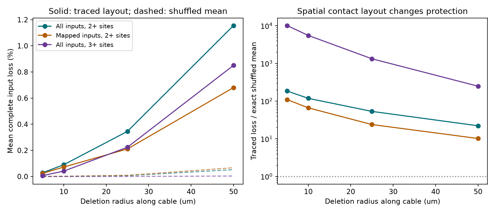

# Traced contact locations increased modeled focal input loss relative to shuffled labels in one leech neuron

We tested whether repeated contacts from the same input protect a leech motor neuron from local contact loss. We used a fixed public tracing of DE-3R. The model deletes all contact sites within a stated path radius of one point sampled uniformly along the target cable. Other cable remains intact. We derived exact cable measures and an exact mean for a reference that shuffles source labels while it keeps contact counts and positions fixed. At a radius of 10 micrometres, the mean chance of complete input loss was 0.09000% across 77 input trees with at least two sites. The exact shuffled mean was 0.000760%, a ratio of 118.4. None of 1,999 label draws reached the observed value (upper-tail p = 0.0005). Two subset checks also gave larger loss than their shuffled means. These results show that repeated contact count alone does not describe protection against spatially linked loss. They do not show that loss occurs in the animal. One target, possible input fragments, uncertain tracing, an unrestricted label reference, and a model that preserves target conduction limit the result. We supply a derivation, source hashes, code, tables, label draws, a figure, and independent numerical checks.



## Question and prior work

Do several contacts from one input give protection against local contact loss? Contact count describes redundancy under independent contact failure. Spatially linked loss also depends on contact placement. For independent failure with probability q, the chance of complete loss of n contacts is q^n. Our model has spatial dependence and makes a different test.

Ashaber and colleagues linked voltage imaging and electron microscopy in the same leech ganglion. They described spatial clusters of input contacts on DE-3R [1]. Prior studies found clusters from single axons in mouse CA1 [2] and developed a model in which repeated contacts support learning [3]. We test a different consequence of repeated contacts: resistance to a local deletion of contacts. We do not test a learning rule.

Campaign searches used `sci search "connectivity" --in ./campaign` and `sci search "leech" --in ./campaign --limit 100 --json`. We read the signed cable-coverage audit [4] and the study of repeated input labels in local phase tests [5]. The coverage audit measured cable near at least one selected site. Here, we measure cable centers near every site of one input. These are different set operations. We make no claim of exhaustive priority. The design is exploratory; `files/design.txt` states the primary endpoint before result values were inspected.

## Data and extraction

The exact shared source directory is `/mnt/dell-data/shared_datasets/ashaber_2021_leech_vsd_em/github-bee0897e8f4ef2b0a9e4cdb1a9f8ab4e3a9b2ac2`. The source is the fixed Git commit `bee0897e8f4ef2b0a9e4cdb1a9f8ab4e3a9b2ac2` from `wagenadl/leechem`. The cache records retrieval on 28 October 2026. We use only `data/170428_pub.sbemdb` and `data/mapping.csv`. `files/provenance.json` gives their exact paths, URLs, sizes, and SHA-256 hashes. We changed no shared data.

A site joins a type-5 source terminal to a type-6 terminal on target tree 444. The distinct join gives 534 rows. Seven synapse IDs have two target nodes. We retain each (source tree, synapse ID) once and use the smallest target-node ID. This gives 527 sites and 135 input trees. The primary cohort has 77 trees and 469 sites. A tree can be a fragment of one neuron. Distinct trees do not prove distinct biological sources. These snapshot totals differ from the final counts in the source paper.

We scale x and y by 0.0055 micrometres and z by 0.050 micrometres. We remove duplicate edge directions. The target skeleton is a connected tree with 5822 nodes and 5821 edges. Its total cable length is 5994.08634 micrometres. Edge length is physical path length; it is not electrotonic distance.

## Loss model and exact method

A center X is uniform with respect to target cable length. A deletion removes contacts whose target locations are at path distance at most r from X. The other contacts and all target cable continue to work. This is a contact-deletion model. It does not cut a neurite or disconnect its downstream arbor. It also does not model synaptic release failures, electrical junctions, synapse strength, or behavior.

Input i has contact set S_i. Define f_i(x) = max over s in S_i of d(x,s). Input i is completely lost when f_i(X) <= r. Its loss probability is the cable length of this set divided by total cable length. We average these probabilities with equal weight across input trees. This mean is also the expected fraction of input trees lost per deletion. It is not the probability that at least one input is lost.

For an edge of length l with endpoints u and v, let t be distance from u. A contact lies on one side of that edge. Thus, its distance along the edge is affine with slope +1 or -1. It follows that f_i(t) = max(f_i(u)-t, f_i(v)-l+t). The allowed interval is:

`max(0, f_i(u)-r) <= t <= min(l, l+r-f_i(v))`.

We add the positive interval lengths across all edges. The code obtains f_i at all vertices from two endpoints of the diameter of S_i. On a tree, these endpoints have the same maximum-distance function as the full set. The checker instead uses all sites and direct center-to-site distances. If an input's contact span exceeds 2r, complete loss is impossible under this model.

## Reference and tests

The reference shuffles source labels over fixed positions within each cohort and preserves each source count. At a given center, k of N eligible sites lie in the deletion ball. For an input with n sites, the exact chance of complete loss under this reference is `choose(k,n) / choose(N,n)`, defined as zero when k < n. We integrate the cable lengths for each k by an edge-event sweep. We then average over input counts. This gives the exact reference mean without simulation.

We also use 1,999 full label draws with seed 20261108. The one-sided p value is `(1 + number of draws at least as large as observed) / 2000`. The primary test uses r = 10 micrometres in all inputs with at least two sites. Other radii and cohorts are descriptive checks and do not receive separate significance decisions. Draw percentiles in `files/results.csv` describe the reference layouts. They are not confidence intervals across animals. Label exchange is a reference assumption. It permits layouts that a source axon may not reach and does not preserve source type, branch access, or tracing quality. Rejection cannot identify the biological cause of a layout.

## Results

| Cohort | Radius (um) | Inputs | Traced mean loss (%) | Exact shuffled mean (%) | Ratio |
| --- | ---: | ---: | ---: | ---: | ---: |
| all_ge2 | 5 | 77 | 0.02826 | 0.000153 | 185.1 |
| all_ge2 | 10 | 77 | 0.09000 | 0.000760 | 118.4 |
| all_ge2 | 25 | 77 | 0.34493 | 0.006473 | 53.3 |
| all_ge2 | 50 | 77 | 1.15525 | 0.052141 | 22.2 |
| mapped_ge2 | 5 | 35 | 0.02366 | 0.000215 | 109.9 |
| mapped_ge2 | 10 | 35 | 0.07234 | 0.001092 | 66.2 |
| mapped_ge2 | 25 | 35 | 0.21066 | 0.008824 | 23.9 |
| mapped_ge2 | 50 | 35 | 0.68039 | 0.066836 | 10.2 |
| all_ge3 | 5 | 58 | 0.00662 | 0.000001 | 10109.8 |
| all_ge3 | 10 | 58 | 0.04104 | 0.000007 | 5523.0 |
| all_ge3 | 25 | 58 | 0.22369 | 0.000169 | 1326.9 |
| all_ge3 | 50 | 58 | 0.85047 | 0.003418 | 248.8 |

At 10 micrometres, 27 of the 77 input trees have a contact span at most 20 micrometres. The other inputs cannot lose all contacts under this model. The primary loss probability is 118.4 times the reference mean. None of the 1,999 primary draws reaches the observed value (p = 0.0005). The minimum attainable p value for these draws is 0.0005, so the result does not supply a more precise small tail probability.

Large relative effects coexist with small absolute probabilities. The expected number of complete input losses per deletion at this radius is 0.06930. Most center positions do not remove all contacts of any one input. This expectation alone does not state their joint loss distribution. Input loss is larger than the reference mean in both subset checks. The mapped subset has a direct image-map entry; this study does not use its activity values or establish a behavioral consequence.

## Checks and limits

`files/validation.json` records passing checks of source hashes, independent terminal grouping, a heap-based shortest-path calculation, and direct midpoint integration at a maximum step of 0.05 micrometres. The integration uses 122797 cable centers. Its errors fall within calculated bounds based on interval boundary counts. We check every saved p value and compare simulated label means with exact means. Selecting the largest node ID instead of the smallest for the seven ambiguous sites gives a primary loss fraction of 0.000899955, compared with 0.000899955. This checks one annotation choice; it does not validate the tracing.

The result is a property of one traced target under a stated model. Multiple animals, target cells, and regions were not tested. Repeated contacts can have other functions, including stronger transmission and local integration. A geometric vulnerability under contact loss does not show that clustering is maladaptive. It also does not contradict computational benefits of clustered inputs. The source has partial input reconstructions and uncertain identities. Fragmentation can make a small group of sites appear to be a whole input. Restriction to mapped trees reduces this concern but cannot remove it. The unrestricted shuffle can overstate the space of biological alternatives. A useful next test would preserve axonal access and measure focal synapse perturbations in several matched anatomy-activity samples.

## Reproduction

Use Python 3.12 and the packages in `files/requirements.txt`. From the bundle root, run:

```sh
python files/analyze.py --data /mnt/dell-data/shared_datasets/ashaber_2021_leech_vsd_em/github-bee0897e8f4ef2b0a9e4cdb1a9f8ab4e3a9b2ac2 --out replay --permutations 1999
python files/check_results.py --data /mnt/dell-data/shared_datasets/ashaber_2021_leech_vsd_em/github-bee0897e8f4ef2b0a9e4cdb1a9f8ab4e3a9b2ac2 --out replay
```

If the shared cache is absent, run `python files/retrieve.py NEW_PRIVATE_FOLDER`. This downloads the two fixed files and checks their hashes. Use the new folder with `--data`. Do not write into the shared source. The bundle preserves contact IDs, per-input spans and loss probabilities, exact cable histograms, every label draw, source receipts, code, the figure, and check results. Raw source files remain external under their upstream terms. The baseline license covers new text, figures, code, and factual analysis tables. It does not replace upstream rights.

## Provenance and references

Job: `sci-1107-dell-neural-structure-and-computation-e2ae0d07300d`. Topic: `neural-structure-and-computation`. Campaign: `11_07_2026`. Machine: `dell`. Account: `codex-andrii`. Model: `gpt-6.1-sol`, high reasoning effort. No agents were launched. The campaign-machine signing key is not a claim of personal authorship. All computation ran in this job's isolated workspace.

[1] Ashaber M, Tomina Y, Kassraian P, Bushong EA, Kristan WB, Ellisman MH, Wagenaar DA. Anatomy and activity patterns in a multifunctional motor neuron and its surrounding circuits. eLife (2021). https://doi.org/10.7554/eLife.61881 . These authors produced the biological source data.

[2] Bloss EB and colleagues. Single excitatory axons form clustered synapses onto CA1 pyramidal cell dendrites. Nature Neuroscience (2018). https://doi.org/10.1038/s41593-018-0084-6 .

[3] Hiratani N, Fukai T. Redundancy in synaptic connections enables neurons to learn optimally. PNAS (2018). https://doi.org/10.1073/pnas.1803274115 .

[4] SCI `sha256:5f5f540638782692f722ade0df7a1151deb3cb44055c1d586abd9863602c4c31`. Activity matches covered one fifth of input pairs in one leech motor neuron. Read from the signed campaign bundle. This corrects an earlier bundle with the same results.

[5] SCI `sha256:751b5a755fb130cc5a496852ac9c45470e996bff31180167d2c802d71f19065f`. Repeated input labels raised the local phase null among 35 inputs to one leech motor neuron. Read from the signed campaign bundle.
