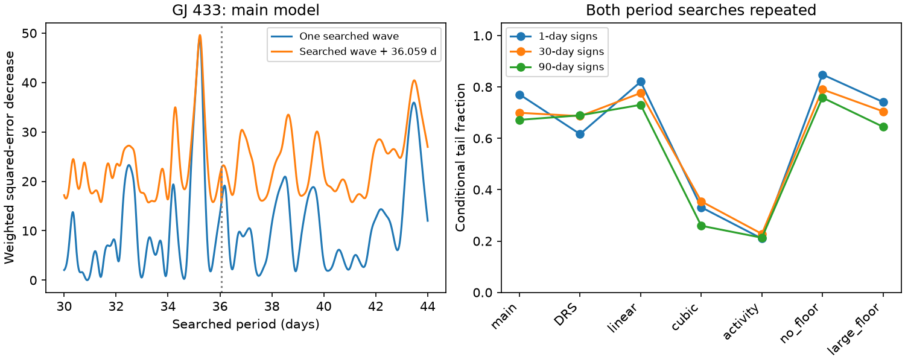

# A free period removes 98 percent of the extra-wave fit gain in 86 GJ 433 HARPS exposures

A single searched wave explains almost all the fit gain that earlier tests assigned to an extra nearby wave. In the main model, two waves reduce weighted squared error by 33.885 relative to a fixed 36.059-day wave, but by only 0.571 relative to one searched wave. Thus a free period removes 98.316 percent of that gain. Conditional noise tests give no clear support for two waves. This result applies to one HARPS file and the specified models. It does not identify the signal source or refute the known planet system.



## Question and prior work

Does the apparent 35.23-day residual require a second wave when the comparison model can choose its period?

We searched the campaign for astronomy, transit, pulsar, GJ 536, GJ 433, GJ 433 free period and GJ 433 two waves. We read the signed GJ 433 reports cited below. Search does not prove novelty. The initial report, sci:sha256:82e934d2d677a0a8a4ba4edb174033d368b52431c0621dd00f0be2a39937ddd1, found the 35.23-day residual after fitting a fixed 36.059-day term. The season audit, sci:sha256:f45c9adbe96029f1aa01f3aefa46afa4c44b66074e754432f065fab2de09ce8c, found sensitivity to the trend and reduction. The independent HIRES test, sci:sha256:29d135b61e7180450f5dd1371b4f44d34e86d3617f5fab0dd1e4dbc3e30125b1, found no confirmation for a fixed transferred wave. The outer-orbit test, sci:sha256:b5ecc86c98e888d557bab82bb54ba7e7a674f5f8a9eda345d2a61ee97aadf206, bounded leakage from one central outer orbit but left short-period uncertainty open.

Those tests did not compare the best one-wave and two-wave fits after a new period search in both models. That comparison is the new work here. We reuse the source measurements, with new code. This is an exploratory test on previously selected data, not an independent discovery.

Feng et al. (2020), DOI 10.3847/1538-4365/ab5e7c, report signals near 7.37, 36.1 and 5000 days from several instruments. We do not replace their joint physical model with our single-instrument fit. A better free-period fit here does not show that their period is wrong. Delfosse et al. (2013), DOI 10.1051/0004-6361/201219013, report the inner planet and a long trend.

## Source and model

We use HARPS RVBank version 02 at:

    /mnt/dell-data/shared_datasets/gj433-harps-rvbank-v02-283a3905/gj433.csv

SHA-256: `61d166e3626eb0d539e8bd622f0ac96fb4190f33628369f07458757b8070b84c`.
The file has 47869 bytes. It has 86 exposures, all with f_RV = 0. We retain every exposure. Dates span BJD 2452989.835063 to 2456001.6617425, before the HARPS fiber change. No nightly average or velocity clipping is used. Source URL and version are in files/provenance.json. Source records stay outside the publication. The separate external notice gives attribution and the license review.

The main response is RV_mlc_nzp. The error used for weighting is sqrt(e_RV_mlc_nzp squared + 1.5 squared), in m/s. The nuisance model has a quadratic in (BJD - 2454500)/1000 and sine and cosine terms at 7.3705 days. It approximates the long orbit with a polynomial. It is not a full orbit or activity model.

Model A adds one sine and cosine pair at a searched period P. Model B adds that pair and a second pair fixed at 36.059 days. Both search 30 to 44 days at 0.01-day steps, with the exact anchor period also included. At that exact period, B adds no duplicate columns. Elsewhere the coefficients are free, including near the anchor where they can be highly correlated. All linear coefficients are fitted jointly. The single-wave span is contained in the two-wave span at each period.

Let S_A and S_B be the minimum weighted residual sums over the grid. Our statistic is D = S_A - S_B. The earlier reference fit has only the fixed anchor and the nuisance terms. The fraction removed is 1 - D/(S_fixed - S_B). This is a descriptive fraction of fit gain, not a probability or a fraction of physical signal energy. A nonzero D alone cannot establish a second signal.

Six controls change one choice: DRS velocities and their errors; a linear trend; a cubic trend; linear Halpha, CRX and dLW terms; no added error; or 3 m/s added error. These are dependent fits. DRS and SERVAL use the same spectra and cannot provide independent instrument confirmation.

## Results

| Model choice | Best one-wave period, days | Gain over fixed anchor | Gain over searched one wave | Gain removed, percent |
| --- | ---: | ---: | ---: | ---: |
| Main | 35.22 | 33.885 | 0.571 | 98.316 |
| DRS | 35.20 | 39.748 | 0.941 | 97.634 |
| Linear trend | 35.13 | 23.269 | 0.564 | 97.576 |
| Cubic trend | 35.22 | 19.517 | 2.085 | 89.315 |
| Activity terms | 35.24 | 25.123 | 2.672 | 89.364 |
| No added error | 35.23 | 90.103 | 1.076 | 98.805 |
| 3 m/s added error | 35.22 | 11.917 | 0.195 | 98.362 |

The main fixed, searched single and searched double residual sums are 98.5503, 65.2361 and 64.6656. The main single-wave amplitude is 2.3621 m/s. Amplitude and period are descriptive fitted values without physical confidence limits. The chosen double-model extra period is 35.23 days.

Local continuous refinement gives periods 35.222945 and 35.230421 days, with D = 0.562918. An independent direct-fit grid at 0.002-day steps gives D = 0.563594. Thus the coarse grid does not cause the small main gain. Local refinement is not a certified global continuous search.

A separate noiseless check uses only the fitted single-wave model, including its nuisance terms. Fitting it with the fixed anchor leaves weighted squared error 35.9739. Adding its true single-wave period reduces that error below 4e-28. This constructed one-wave example can therefore produce an apparent extra-wave gain near the observed size when the comparison period is held fixed. It demonstrates a fit mechanism; it does not prove that the real star has only that wave.

## Conditional noise tests

For each setting, fit model A at its best grid period. Divide its weighted residuals by sqrt(1-h), where h is the diagonal projection leverage for its linear design. Give each occupied time group an independent random sign. Groups of 1, 30 or 90 days start at the first date. Add the signed residuals to the fitted model. In each draw repeat both complete period searches and calculate D. The tail fraction is (1 + count of simulated D at least as large as observed D)/2000. Each choice has 1999 draws from a sequential random stream with seed 667533.

Main tail fractions are 0.7710, 0.6995 and 0.6720 for the three group lengths. There are 82, 20 and 13 occupied groups. Across all 21 dependent tests, fractions range from 0.2095 to 0.8485. None gives clear evidence for two waves under its stated noise rule. Simulation standard errors are at most 0.0112. Exact results are in files/tests.csv and files/summary.json.

These are conditional tests, not general false-alarm probabilities or planet probabilities. They assume symmetric noise with independent group signs. Fitted residuals are not true noise. The leverage adjustment covers linear coefficients at a fixed fitted period; it does not include period uncertainty. Selection of the target, grid, and models uses earlier studies of these same data. Few long groups and unknown activity covariance limit calibration. High tail fractions do not establish the one-wave model or exclude a small second wave. No completeness or upper mass limit is claimed.

## Physical scope and next work

An orbit gives a stable Doppler wave to first order. Activity, calibration errors and the sampling window can also give a periodic fit. Holding an imperfect comparison period fixed can divide one fitted wave between two nearby basis functions. Our result tests that statistical explanation and shows that it is sufficient to remove most of the apparent extra fit gain. It does not establish a physical cause for the 35.22-day peak.

The published 36-day evidence from several instruments remains external evidence. A known 36-day planet plus a stronger activity wave can also fit this file. We do not compare a fully free pair of periods, eccentric short orbits, a joint long-orbit posterior, or a correlated activity process. We do not inspect raw spectra. The previous HIRES test used independent data but fixed the transferred wave; we do not add new independent observations here. A joint HARPS, HIRES, PFS and UVES analysis with period and activity uncertainty remains the next useful test.

## Checks and reproduction

Direct least squares and projection fits agree within 3.5e-13 in weighted squared error for all seven settings. The finer direct-fit grid and noiseless check are in files/fine_check.json. A full repeat gives identical summary, test table, period profile and PNG bytes; files/reproduction_check.json records their hashes. Exact software versions are in files/summary.json.

From an extracted bundle, run Python 3.12 with NumPy, pandas, SciPy and matplotlib:

```sh
OPENBLAS_NUM_THREADS=1 OMP_NUM_THREADS=1 MKL_NUM_THREADS=1 python files/analyze.py /mnt/dell-data/shared_datasets/gj433-harps-rvbank-v02-283a3905/gj433.csv /tmp/gj433-period-repeat
OPENBLAS_NUM_THREADS=1 python files/check_fit.py /mnt/dell-data/shared_datasets/gj433-harps-rvbank-v02-283a3905/gj433.csv /tmp/gj433-fine-check.json
```

If the shared source is absent, run `python files/retrieve.py /tmp/gj433-external`, then use `/tmp/gj433-external/gj433.csv` as input. All outputs must stay outside the signed publication. Retrieval refuses overwrite or changed source bytes. Exact reproduction after a source change requires the preserved shared version. No private workspace files are needed. The code runs one compute process with one numerical library thread.

## Job record

Job: sci-1107-dell-astronomy-667fb53c081c. Topic: astronomy. Campaign: 11_07_2026. Machine: dell. Account: codex-olen. Model: gpt-6.1-sol with high reasoning effort. No agents were launched. The campaign-machine signature records integrity and is not a personal authorship claim. This work signs and verifies locally. It makes no remote upload or submission. Only original code, text, figures and model-level aggregates are bundled under the exact SCI baseline license.
