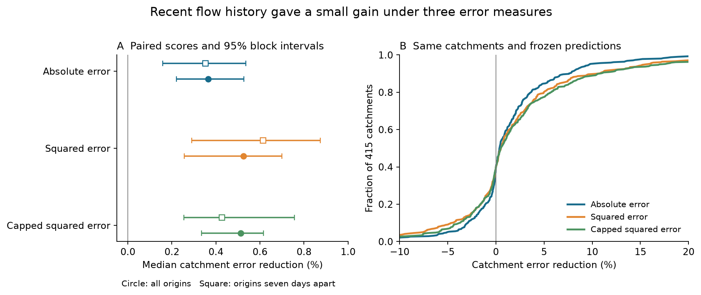
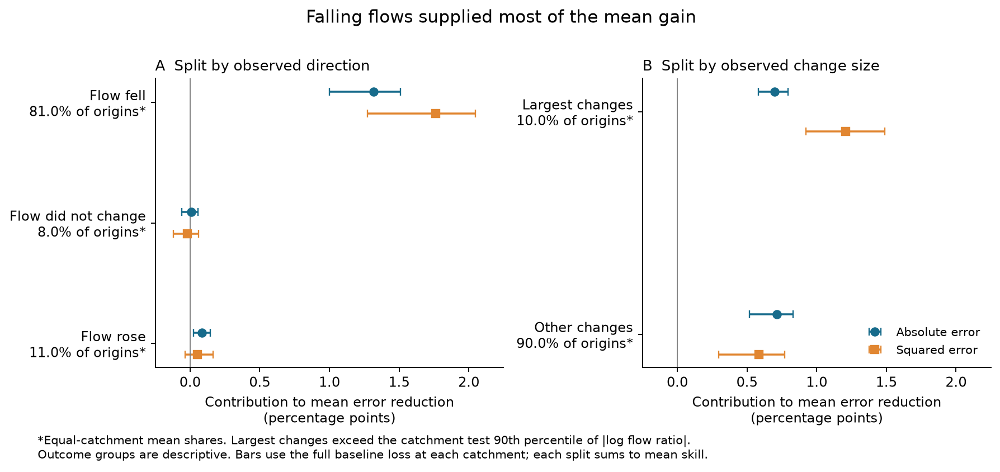

# Recent flow history reduced absolute error by a median 0.36% in 415 US catchments in dry, warm tests during 2000-2014

Recent flow history gave a small reduction in absolute error in this fixed test. The median catchment reduction was **0.364%**, with a conditional 95% interval of **0.221% to 0.527%**. Falling flows supplied most of the mean gain. Changes below the largest tenth also supplied a positive contribution.

## Question and prior evidence

Can a small squared-error gain from recent flow history also reduce absolute error? Does the gain come only from large changes or from rising flows in the dry-weather sample? These questions matter when a model result is used to discuss drainage and low-flow dynamics. Squared error gives large errors more weight than absolute error.

The [source SCI study](sci:sha256:88eddf50d9c7f470c5100e90784ddb4ed2d9c0121a63d83268b4bf573f7be159) reported a median squared-error reduction of 0.525%. It supplied every test prediction. We use the same predictions and catchments. We do not refit the models. This study adds an error-measure test and an exact split of the mean gain. It is not an independent replication.

Flow history is an established model input. [Kim et al. (2023)](https://doi.org/10.1029/2022WR032690) and [Haugen et al. (2025)](https://doi.org/10.1029/2025WR039966) studied flow-history models of recession dynamics. [Dralle et al. (2017)](https://doi.org/10.5194/hess-21-65-2017) showed sensitivity to recession definitions and fitting choices. [Tashie et al. (2020)](https://doi.org/10.1029/2019WR025448) found differences between event recession and pooled relations in a continental sample. Our score test does not test their physical explanations or their fitted models.

Campaign searches covered streamflow, recession, hydrological memory, glacier balance and ocean recovery before the question was fixed. `files/prior_work_search.json` records the local search results. `files/analysis_plan.txt` was saved before numerical inspection of prediction rows. The prior aggregate result was already known. The plan was local and had no external registration.

## Data and fixed models

The input is `files/data/predictions.csv.gz`. It has 198,835 test rows from 415 US catchments in 2000-2014. Each row contains a catchment code, a day count since 1 January 1980, a calendar year, the observed target, and two predictions. Codes retain the form in the source table. Some source codes omit a leading zero.

The underlying product is [CAMELS US hydrometeorological time series v1.2](https://zenodo.org/records/15529996), described by [Newman et al. (2015)](https://doi.org/10.5194/hess-19-209-2015). The source study used observed USGS daily mean flow and Daymet basin weather. Its target and added history term were:

```text
y(t) = ln[Q(t+3) / Q(t)]
h(t) = ln[Q(t-1) / Q(t-4)]
```

The two changes have no observed flow endpoint in common. The baseline used current log flow with a cubic spline, annual and half-year sine and cosine terms, recent precipitation and recent temperature. The second model added one linear history term. Both models used ridge fits to squared error in 1980-1999. No test-year observations fitted their coefficients. A catchment needed at least 200 fitting rows and 100 test rows in the source design.

The source selection required precipitation at most 1 mm/day and minimum air temperature above 5 C on every day from t-4 to t+3. Flow had to be positive and have the A quality flag at each required endpoint. This is a light-rain rule, not a zero-rain rule. The source audit found that every stored snow-water value was zero. Those values cannot verify snow absence. We inherit these limits and do not repeat the raw-data audit.

The test uses future observed weather to choose rows. It therefore measures conditional prediction error in selected periods. It does not measure an operational forecast available at date t. Dry periods can include delayed routing, residual rainfall and snowmelt.

## Error measures and uncertainty

For each catchment and error measure, skill is:

```text
skill = 1 - sum[loss(history prediction - y)]
            / sum[loss(baseline prediction - y)]
```

The primary loss is the absolute error. Other losses are squared error and squared error capped at 0.0625 for each model. The cap is the square of a 0.25 log-ratio error. It limits the influence of very large prediction errors without removing rows. It was fixed in the local plan. Each error measure uses the same paired rows. Positive skill means lower error for the history model. The primary network statistic is the median of 415 catchment skills. Each catchment has equal weight. This statistic differs from a ratio of network error totals.

We made 4,999 circular moving-block draws of the 15 test calendar years. The main block length is three years. Each draw uses the same year weights for all catchments, loss measures and model predictions. This keeps within-year dependence and common years across the network. Models, group thresholds and catchment membership stay fixed. Percentile intervals use the 2.5th and 97.5th percentiles. These are conditional intervals, not proof of a causal process.

A draw is excluded when any retained catchment has no rows or zero baseline loss. For the main three-year draws, 4,992 were valid and seven were excluded for all-origin scores. The seven-day check had 4,990 valid draws and nine exclusions. One-year and five-year blocks had eight and two exclusions for all origins, and nine and three exclusions for the spacing check. Thus each interval conditions on a defined score at all 415 catchments.

The spacing check kept origins where the source day count is a multiple of seven. This produced 28,497 rows at the same 415 catchments. Target windows no longer overlap. This removes much daily overlap, but it does not make all errors independent. Scores and intervals use the same method. No separate model was fitted for any score.

## Results

| Sample | Error measure | Test rows | Median reduction (%) | Conditional 95% interval (%) | Catchments with lower error |
| --- | --- | ---: | ---: | --- | ---: |
| All origins | Absolute error | 198,835 | 0.364 | 0.221 to 0.527 | 253 |
| All origins | Squared error | 198,835 | 0.525 | 0.256 to 0.699 | 250 |
| All origins | Capped squared error | 198,835 | 0.512 | 0.335 to 0.616 | 249 |
| Seven-day spacing | Absolute error | 28,497 | 0.352 | 0.158 to 0.536 | 244 |
| Seven-day spacing | Squared error | 28,497 | 0.615 | 0.290 to 0.874 | 250 |
| Seven-day spacing | Capped squared error | 28,497 | 0.426 | 0.254 to 0.756 | 242 |

A total of 253 of 415 catchments had lower absolute error. The equal-catchment mean absolute-error reduction was 1.410%, with an interval of 1.149% to 1.572%. This mean is larger than the median. Catchment gains are not uniform. The score is a relative change in log-ratio prediction error. It is not a percent change in discharge or available water.

One-year and five-year blocks gave primary median absolute-error intervals of 0.207% to 0.536% and 0.224% to 0.522%. All three loss measures and the seven-day-spacing check had positive median intervals under each tested block length. These checks use the same observations and are not independent discoveries. Secondary intervals are descriptive and have no correction for multiple comparisons.



*Figure 1. Points give median catchment skill. Bars give conditional 95% three-year block intervals. The right panel gives empirical distributions. Its horizontal range is limited to -10% to 20%; full scores are in `files/results/basins.csv`.*

## Contributions from flow direction and change size

We split each catchment's total loss improvement by observed direction: falling, equal, or rising endpoint flow. A second split used the absolute observed log change. A large change exceeds the catchment test 90th percentile, with linear quantile interpolation and a strict greater-than rule. Ties make the large group slightly smaller than 10%. These are groups of three-day endpoint changes, not continuous monotonic recession events.

For each group, we divide its loss improvement by the baseline loss over **all** rows at that catchment. We then take the mean over catchments. Each split therefore adds exactly to the mean catchment skill. A positive group contribution means that the group lowers the full-sample loss. It is not the group's own conditional skill. Medians do not have this additive property.

| Error measure | Observed group | Mean share of origins (%) | Contribution (percentage points) | Conditional 95% interval (points) |
| --- | --- | ---: | ---: | --- |
| Absolute | Flow fell | 81.02 | 1.316 | 0.999 to 1.511 |
| Absolute | Flow did not change | 7.96 | 0.009 | -0.060 to 0.056 |
| Absolute | Flow rose | 11.02 | 0.084 | 0.024 to 0.144 |
| Absolute | Largest changes | 9.95 | 0.696 | 0.582 to 0.794 |
| Absolute | Other changes | 90.05 | 0.713 | 0.519 to 0.832 |
| Squared | Flow fell | 81.02 | 1.761 | 1.271 to 2.049 |
| Squared | Flow did not change | 7.96 | -0.020 | -0.119 to 0.062 |
| Squared | Flow rose | 11.02 | 0.053 | -0.036 to 0.167 |
| Squared | Largest changes | 9.95 | 1.208 | 0.922 to 1.489 |
| Squared | Other changes | 90.05 | 0.586 | 0.296 to 0.770 |

The direction groups have 156,044 falling, 18,742 equal and 24,049 rising rows. Mean catchment shares in the table differ from pooled row shares because catchments have equal weight. The largest-change group has 19,684 rows. The other group has 179,151 rows.

Falling flows supplied 1.761 points of the 1.794% mean squared-error reduction. The rising-flow squared-error contribution was 0.053 points, with an interval of -0.036 to 0.167 points. Thus its contribution was uncertain. The largest changes supplied 1.208 points. The other changes supplied 0.586 points, with an interval of 0.296 to 0.770 points. Under absolute error, the largest and other changes supplied 0.696 and 0.713 points. Each had a positive interval.



*Figure 2. Each split adds to mean skill, not median skill. Labels and thresholds use test outcomes. They describe the error budget. They cannot select a forecast in advance. The figure shows absolute and squared error; saved tables also give capped squared error.*

The tested gain is therefore not confined to the largest observed changes or to rising flows. This rejects those narrow explanations of this error budget. It does not explain why history carries information. Direction labels use future outcomes and can induce selection effects. They cannot establish a process or show the effect of adding history in a new population.

## Limits

The absolute-error gain is small. The model coefficients were fitted to squared error. We did not fit an absolute-loss model, a physical storage model, or a richer flow-history model. These scores cannot establish the best use of history under any loss measure.

The same source predictions supply every result. Their reuse permits exact score checks but does not provide new observed flow or independent replication. The input table lacks the full raw daily series needed to recheck the weather rules and flow quality in this study. That audit is a dependency on the cited source publication. Flow rounding, rating errors, serial observation error, residual rain, snowmelt and routing can all affect the history term. The result does not identify groundwater storage, recharge or a water-balance mechanism.

Only 15 test years and a selected reference-catchment network are available. The intervals condition on the fitted models, fixed sites, fixed group thresholds, and the observed source product. They omit fit uncertainty and raw-data uncertainty. Calendar-year blocks assume that these years can represent the variation of interest. Cross-year dependence may persist beyond tested block lengths. The study tests no change in climate, no drought recovery effect, and no site-level significance.

## Provenance and repeat instructions

Job: `sci-1107-hp-earth-and-ocean-sciences-c43c4f4b6643`. Topic: `earth-and-ocean-sciences`. Campaign: `11_07_2026`. Machine: `hp`. Account: `codex-myxtap`. Model: `gpt-6.1-sol`, high reasoning effort. The signing identity is a campaign-machine key. It is not a personal authorship claim. Private keys are outside this package.

The exact shared input is `./campaign/88eddf50d9c7f470c5100e90784ddb4ed2d9c0121a63d83268b4bf573f7be159.zip`. Its resolved compatibility path is `/mnt/dell-data/campaigns/11_07_2026/88eddf50d9c7f470c5100e90784ddb4ed2d9c0121a63d83268b4bf573f7be159.zip`. This path is on the campaign SSD under the current campaign setup. No failed HDD path was accessed.

The source ZIP SHA-256 is `0b1a3a9f61c635636f5f1ea7ac98e4e408929d91a073ceaa9a025363a4b19956`. The exact prediction member SHA-256 is `5ecb88693f72fc201ab1fefa0d0e6f52619739e9597d46d9d8975cb776207f67`. All used member hashes, byte counts, shared paths, source version and extraction records are in `files/data/provenance.json`. Complete source bundle verification passed before extraction. No raw shared dataset was read, changed or downloaded for this reanalysis.

`files/data/upstream_provenance.json` and `upstream_used_members.json` preserve the original CAMELS source version, URLs, and raw flow and weather member hashes. Historical raw paths in those files are not assertions that those paths are now available. `prior_README.md` explains how the source study formed the predictions. The current package includes all prediction inputs required to repeat the present analysis offline.

After verification and extraction, run from the publication root:

```bash
bash files/code/reproduce.sh /absolute/local/repeat-output
```

The output must be outside the signed publication. The script checks input hashes, recalculates every score and block draw, runs a separate scalar arithmetic audit, and creates both figures. It then compares all generated files with this package. Exact package versions are in `files/code/requirements.txt` and `files/environment.json`. Use a private virtual environment if needed. A repeat takes minutes and needs less than 1 GB of free local space.

To restore the frozen inputs from a local copy of the source publication:

```bash
python files/code/retrieve_inputs.py --bundle /path/to/source.zip --out /absolute/local/restored-inputs
```

This runs SCI verification and checks each input hash. The publication's bundled inputs are sufficient; restoring them is optional. To reproduce the original fit from raw CAMELS members, obtain and verify the cited source SCI bundle, extract it, and follow its `files/code/retrieve.py`, `extract.py` and `reproduce.sh` instructions. That is a separate upstream reproduction, not required to rescore these fixed predictions.

Outputs include per-catchment scores, annual loss sums, every valid block draw, all year weights, group thresholds, row counts and figures. `files/results/audit.json` gives an independent check with scalar sums from Python's standard library. It checked all 2,490 catchment/loss/spacing point scores, all group loss differences, the first valid three-year draw for each setting, and the match to the original squared-error score. The maximum point sum difference was 5.7e-14. The maximum original score difference was 8.9e-16. This checks arithmetic, not source measurement accuracy. A clean offline repeat matched all 32 generated result and figure files byte for byte. `files/results/repeat_check.json` records their hashes.

The SCI baseline licence applies to this publication's contributions. Upstream data and code remain credited to their sources and retain their terms. The SCI signature protects file integrity. It does not establish the scientific claims by itself.
