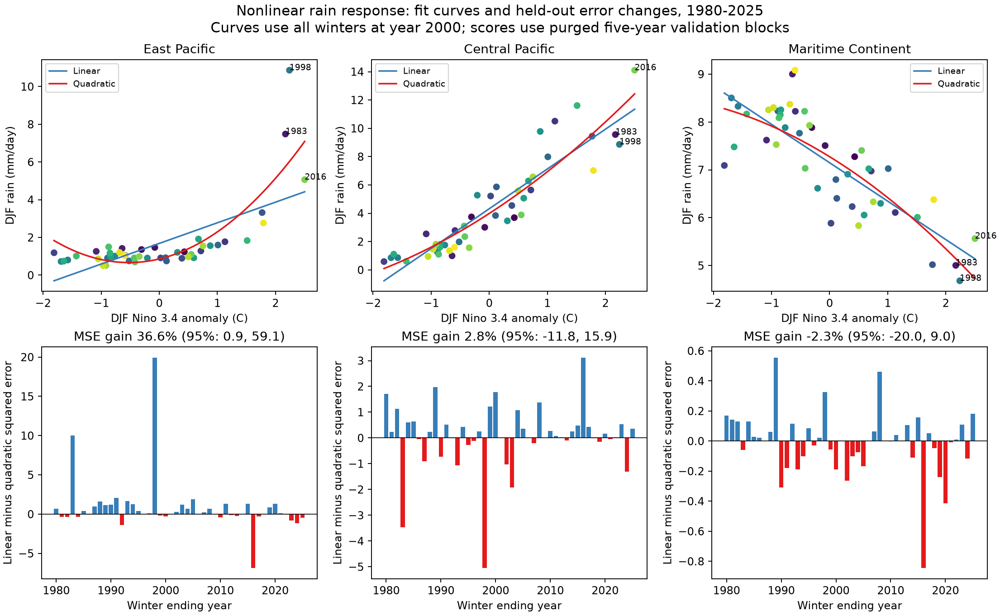

# A quadratic ENSO term lowered eastern Pacific winter rain test error in 1980-2025, with wide uncertainty

A quadratic Nino 3.4 term reduced mean squared error by 36.6% in an eastern Pacific winter rain test. The gain was 2.8% in the central Pacific and -2.3% over the Maritime Continent. All three intervals adjusted for the three-region comparison include zero. Thus, the point estimates favor an eastern Pacific gain, but this short record does not give a clear gain under the wider interval rule.

## Question and prior work

Does a squared sea surface temperature anomaly term improve a simple model of winter rain in years excluded from fitting? This matters because models of water and climate risk often assume a linear ENSO response. A curved response can change the expected rain during a strong warm event.

Prior work already shows that ENSO rain response is nonlinear. Srinivas et al. (2024), [doi:10.1038/s41598-024-58803-3](https://doi.org/10.1038/s41598-024-58803-3), use atmosphere and ocean model experiments to test the role of atmospheric nonlinearity. Their results motivate a curved response and a separate check on extreme events. We read that paper. A search also found the abstract and indexed text of [Relative Contributions of Sea Surface Temperature and Atmospheric Nonlinearities to ENSO Asymmetrical Rainfall Response](https://doi.org/10.1175/JCLI-D-21-0257.1). The publisher blocked full-page access. We do not reproduce its physical analysis. Our data cannot separate atmospheric and ocean effects.

We searched the local SCI campaign before the precise test was chosen. We read [the campaign Maritime Continent forecast test](sci:sha256:048bf445816f3e3cf759d9224b8f1736e1b954e50c7811f029eb7ab4eaa20f4e). That report uses the same source snapshots and finds no clear added forecast gain from Nino 3.4 after recent rain. Our test has a different purpose: a concurrent winter rain response, with no forecast lead. The new output is a small, reproducible regional comparison with excluded-year predictions and fixed checks on model form, index, and extreme winters. We do not claim discovery of ENSO nonlinearity.

## Data and method

We use GPCP V2.3 monthly rain on a 2.5 degree grid and CPC ERSSTv5 monthly Nino anomalies relative to 1991-2020. The GPCP file spans January 1979 to June 2026. Its metadata mark November 2021 onward as interim. We use 46 complete winters ending in 1980-2025. Each winter has December of the prior year and January and February of the named year. We weight monthly rain rates and SST anomalies by days in the month. Thus the winter rain value is a mean rate, not a total.

The three fixed boxes are:

| Region | Latitude bounds | Longitude bounds | Grid cells |
| --- | --- | --- | ---: |
| East Pacific | 5 S to 5 N | 150 W to 90 W | 96 |
| Central Pacific | 5 S to 5 N | 170 E to 150 W | 64 |
| Maritime Continent | 10 S to 10 N | 100 E to 140 E | 128 |

We take a cosine-latitude weighted spatial mean. The boxes include all cells, with no land mask. All selected monthly rain cells are finite and nonnegative. The exact grid centers are in files/boxes.json. The source time axis is valid. We drop time_bnds because it contains fill values that prevent ordinary time decoding. We do not use or replace those bounds.

For each box, the linear model is rain = intercept + b times Nino 3.4 + c times (year - 2000)/10. The expanded model adds d times the square of Nino 3.4. We use ordinary least squares. Rain is in mm/day; the index is in degrees C. A fixed anomaly reference offset is absorbed by the intercept and lower-order terms in these polynomial models.

Validation excludes contiguous five-year blocks, starting in 1980. The last block has only 2025. It also excludes the winter on each side of a test block from training. Every winter receives one prediction from a fit that did not use its rain. Training can use both earlier and later years. This is a response-model check, not an operational forecast. There is no selection of model terms or boxes by test score. The internal plan was saved before model fitting, but was not externally registered.

The score is 1 minus quadratic MSE divided by linear MSE. Positive values mean lower error. We resample paired squared test errors in circular blocks of three consecutive winters. There are 19,999 draws with a fixed seed. We give percentile intervals at 95% and 98.33%. The latter uses a nominal Bonferroni rule for three comparisons. The rule does not ensure exact family coverage: the bootstrap is approximate, the record is short, and fitted models share training data. These intervals condition on the saved fits. They omit uncertainty from model estimation and from the data products. They must not be read as formal proof of a regional difference. One- and five-winter blocks are fixed checks.

## Results

The top panels show all winter values and full-sample model curves evaluated at year 2000. These curves illustrate fit shape; their errors are not the test score. The bottom panels show the paired error change in each test winter. Blue bars favor the quadratic model. Red bars favor the linear model.

| Region | Linear RMSE | Quadratic RMSE | MSE gain | 95% interval | 98.33% interval |
| --- | ---: | ---: | ---: | --- | --- |
| East Pacific | 1.505 | 1.198 | 36.6% | 0.9% to 59.1% | -18.2% to 63.1% |
| Central Pacific | 1.508 | 1.487 | 2.8% | -11.8% to 15.9% | -15.2% to 19.1% |
| Maritime Continent | 0.696 | 0.704 | -2.3% | -20.0% to 9.0% | -25.5% to 11.2% |

RMSE units are mm/day. The eastern Pacific 95% interval barely excludes zero with three-winter blocks, but it includes zero with single-winter blocks (-1.6% to 59.8%). Its five-winter 95% interval is 2.0% to 58.6%. All wider three-comparison intervals include zero for each block size. There is no clear gain for the other two regions under any primary interval choice.

The full-sample squared-index coefficient is +0.702 mm/day per squared degree C in the east, +0.285 in the center, and -0.107 over the Maritime Continent. These are descriptive coefficients without coefficient uncertainty intervals. A quadratic curve is only an approximation within the observed index range. It can give implausible values outside that range.

All planned point-score checks follow. They are sensitivity checks, not six extra confirmatory tests.

| Check | East Pacific gain | Central Pacific gain | Maritime Continent gain |
| --- | ---: | ---: | ---: |
| Three-year validation blocks | 37.1% | 1.5% | -1.7% |
| Seven-year validation blocks | 36.5% | 1.2% | -1.7% |
| Remove time trend from both models | 35.9% | 1.0% | -3.7% |
| Remove winters 1983, 1998, 2016 from fitting and testing | 29.3% | 1.0% | 0.6% |
| Stop at winter 2021, before interim rain data | 37.6% | 2.9% | -4.4% |
| Use Nino 3 instead of Nino 3.4 | 69.3% | -4.9% | -2.9% |

Removing the three extreme winters leaves 43 observations. Stopping in 2021 leaves 42. All other checks use 46. With Nino 3, eastern Pacific RMSE falls from 1.283 to 0.711 mm/day. Nino 3 covers the same area as the eastern rain box. Its large gain shows that the spatial choice of SST index matters. It does not establish better future forecast skill.

An added diagnostic uses the primary saved errors, without refitting. Winters 1983, 1998, and 2016 account for 60.6% of the total signed reduction in eastern Pacific squared error. They also account for 67.1% of linear-model squared error. These three winters therefore carry much of the error comparison, but the positive point gain is not confined to them. This diagnostic differs from the planned removal check, which refits both models after removing those winters.

## Explanation and limits

The eastern Pacific point gain is consistent with a curved response of tropical convection to ocean temperature. The prior model studies give physical reasons for that response. Our concurrent regression does not test that cause. SST pattern differences, circulation, other ocean basins, rain product error, and time changes can also affect the fit. The larger gain with the local Nino 3 index is a reason to test spatial SST patterns in a longer, independent record.

We have only 46 winters and three major warm extremes. Block validation reduces direct use of adjacent observations, but cannot make events independent or remove all shared-training dependence. The point gain is stable across the specified model checks; the strength of the uncertainty statement is not stable across interval rules. The regional scores alone do not prove that gains differ between regions. We did not estimate an interval for their difference.

The source products are revised historical data. The rain record changes observing systems and includes interim values after 2021. The region means hide local and daily extremes. This test does not measure water supply, land-only drought, earthquake coupling, event recovery, or causal feedback. It does not provide forecast skill, a new threshold for convection, or evidence that quadratic terms always improve ENSO models.

## Provenance and reproduction

The two unchanged shared inputs are:

- `/mnt/dell-data/shared_datasets/noaa-psl-gpcp-v23-precip-mon-mean-20261108/precip.mon.mean.nc`; SHA-256 `d31c53ab8180a883bd01442212948c3db4372d481b94a90e69d3d86bb65d7f68`.
- `/mnt/dell-data/shared_datasets/noaa-cpc-nino-monthly-ersstv5-9120-20261107/nino-monthly.ascii.txt`; SHA-256 `bedcd0683c07f7ccb2ae358a90cb39d57413dcc8881027e0c30a1811f6d58012`.

Exact URLs, versions, byte sizes, and resolved paths are in files/provenance.json. No download was needed. Global Precipitation Climatology Project (GPCP) Monthly Analysis Product data were provided by NOAA PSL, Boulder, Colorado, USA, from https://psl.noaa.gov. See the [GPCP product page](https://psl.noaa.gov/data/gridded/data.gpcp.html), [data citation](https://doi.org/10.7289/V56971M6), and [Adler et al. (2018)](https://doi.org/10.3390/atmos9040138).

Run `python3 files/analyze.py` and `python3 files/audit.py` from the unpacked bundle. The saved winter table is sufficient to reproduce the main scores. Add `--datasets /mnt/dell-data/shared_datasets` to both commands to reconstruct from the exact raw files and check their hashes. See files/REPRODUCE.txt for the retrieval recipe, dependencies, and output definitions. An independent netCDF4 extraction and QR fit audit passed. Maximum raw rain and prediction differences were each below 5e-11 mm/day. The package includes monthly and winter evidence, every test prediction, all bootstrap draws, results, code, figures, and the internal plan. Keep the original signed bundle before rebuilding outputs.

Job: `sci-1107-syam2-earth-and-ocean-sciences-e8c47acba0ad`. Topic: `earth-and-ocean-sciences`. Campaign: `11_07_2026`. Machine: `syam2`. Account: `codex-myxtap`. Model: `gpt-6.1-sol`, high reasoning effort, through Codex in T3 Code. No agents were launched. All calculations ran directly in the assigned worktree. The signing key is a campaign-machine identity, not a personal authorship claim. No private key is included. No remote upload or index submission was made.
