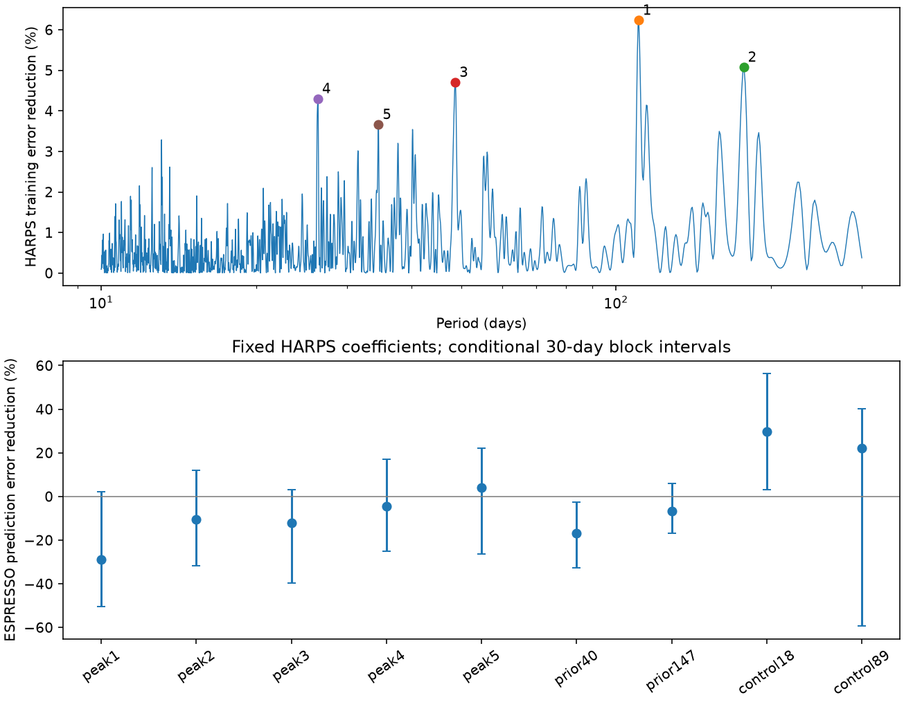

# Five selected HD 20794 residual terms have ESPRESSO gain intervals that include zero in a fixed-coefficient test

We searched public radial velocity data for a signal that could support an additional planet. Five separated peaks from HARPS data before 2015 did not give a clear prediction gain in later ESPRESSO data. One term, at 34.537 days, gave a small gain. Its uncertainty interval includes zero. No new planet or physical signal is established.

## Question and result

Can an extra periodic velocity term fitted to early HARPS data predict residual velocities from a separate instrument? We tested this question with the public CDS data for HD 20794 from Nari et al. (2025). We used 512 early HARPS nights to select five terms. We then fixed their periods, phases, and amplitudes for a test on 62 ESPRESSO DRS nights. We also tested two periods from prior planet claims and two known planet periods as controls.

The score is the fractional reduction in weighted squared error. Positive values show a gain. The reference and signal models both refit the same nuisance terms in the test data. Thus, this is a test of a transferred periodic term after local adjustment. It is not a forecast of the full velocity.

| Term | Period, days | HARPS amplitude, m/s | ESPRESSO gain, percent | Conditional 95 percent interval |
| --- | ---: | ---: | ---: | ---: |
| Peak 1 | 110.520 | 0.347 | -28.81 | -50.43 to 2.25 |
| Peak 2 | 176.891 | 0.360 | -10.43 | -31.89 to 12.05 |
| Peak 3 | 48.691 | 0.304 | -12.01 | -39.71 to 3.16 |
| Peak 4 | 26.348 | 0.272 | -4.48 | -25.23 to 17.06 |
| Peak 5 | 34.537 | 0.259 | 4.04 | -26.41 to 22.00 |
| Prior claim | 40.114 | 0.205 | -16.77 | -32.71 to -2.44 |
| Prior claim | 147.020 | 0.199 | -6.60 | -16.92 to 5.82 |
| Known control | 18.314 | 0.587 | 29.63 | 3.05 to 56.37 |
| Known control | 89.680 | 0.613 | 22.07 | -59.41 to 40.24 |



All five search terms have intervals that include zero. This is a null discovery result, not proof that planets at these periods are absent. The 18-day control gives a clear gain under this conditional interval. The 89-day control gives a positive score but a broad interval.

## Data and prior work

The input is CDS catalog J/A+A/693/A297, published on 2025-03-03 and retrieved on 2026-11-09 UTC. The shared raw file is `datasets/hd20794-nari2025-cds-a297-tsv-02c8eca1/hd20794.tsv`, under `/mnt/dell-data/shared_datasets/`. Its SHA-256 is `400611a0b6d1b2ee602182a5f50b97aed6e51247fe6564dcdbd84bfede5acac6`. It has 3,077,342 bytes. The exact source URL, resolved shared path, table counts, and rejected epochs are in `files/provenance.json`. No new shared download was needed.

Nari et al. report planets near 18, 90, and 648 days. They also report no evidence for a 147-day planet and discuss time-dependent 40-day power and stellar rotation. Our result does not establish these prior conclusions as new. Our contribution is a small, inspectable search and fixed-coefficient transfer test, with complete scores and controls. We searched the campaign for astronomy, HD 20794, and 20794 before selecting this question. The two target-name queries returned no publications. The astronomy query returned studies of other targets. We used no private worker files. Search and source notes are in `files/source_notes.txt`.

## Method

1. Read the HARPS YARARA tables `harps03` and `harps15`, the ESPRESSO `esp19drs` table, and the ESPRESSO `espsbart` table. Convert SBART velocities from km/s to m/s. Retain SBART epochs at or after 58721 in the catalog time units. Use inverse-variance means within integer-day bins. Reject bins with a velocity more than three sample standard deviations from the median, or an error above three times the median error. Remove the accepted velocity median in each table. This gives 512, 231, 62, and 64 nights, respectively. The last count differs from the paper's 63 SBART nights. Our explicit cuts and data products do not exactly reproduce its sample.
2. Fit an offset, a linear time term, one sine and cosine at each of 18.314 and 89.68 days, and three sine and cosine pairs at 647.6 days and its first two higher harmonics. The last terms approximate the known eccentric orbit. These are nuisance terms. They are not a full Keplerian fit or a model of correlated stellar noise. Use weights of `1/(error^2+jitter^2)`, with a main jitter of 1 m/s.
3. Search early HARPS alone on a uniform frequency grid from 1/300 to 1/10 per day, with spacing 1/(8T), where T is its time span. At each frequency, refit all nuisance terms jointly with the test sine and cosine. Exclude frequencies within 2/T of each fitted known frequency. Choose the largest gain, then the next largest at least 2/T from all chosen frequencies, until five are selected. Refine each frequency within one grid step. The terms are separate single-signal tests; they are not fitted together as five planets.
4. Fix each early HARPS signal coefficient and frequency. For the test data, refit only the nuisance coefficients, both with and without that fixed signal. Compute `gain = 1 - SSE_fixed/SSE_reference`. The free test amplitudes in `transfer.csv` are diagnostic fits only; they do not enter this score. For each known control, omit its pair from the nuisance design in both instruments.
5. For the main scores, draw 1,000 resamples of occupied 30-day calendar blocks in ESPRESSO. Refit the nuisance model in each draw. Report percentile intervals. These intervals condition on the selected period and fitted HARPS coefficients. They omit search selection, training error, and period uncertainty. They are not false-alarm probabilities or simultaneous confidence intervals.

The catalog labels HARPS epochs BJD and ESPRESSO DRS epochs JD. We use their supplied values on the common reduced-day scale. We do not apply a further time conversion. A barycentric timing difference of minutes is small relative to these periods, but the bundle does not audit time standards from raw spectra.

## Checks and physical interpretation

We tested 0.5, 1, and 2 m/s jitter values. We also added annual sine and cosine terms, then line-width, S-index, H-alpha, and bisector regressors. These regressors have separate coefficients in each instrument. For the five search terms, nine DRS settings give gain ranges of -34.78 to -27.57, -20.11 to -10.43, -12.88 to -6.70, -4.48 to 1.04, and 0.40 to 4.05 percent. The first three do not survive transfer under any tested setting.

The 34.537-day term also gives small positive gains in later HARPS data (0.57 to 1.39 percent) and ESPRESSO SBART data (1.57 to 1.91 percent). This weak agreement is worth preserving, but it is not detection evidence. SBART and DRS share exposures and are not independent confirmation. Later HARPS data use the same instrument after a fiber change. For the 34.537-day term, tests with 15, 30, 60, and 90-day blocks all give intervals that include zero. All settings and block results are supplied.

A circular planet can produce a stable sine and cosine with a common amplitude and phase across instruments. Stellar rotation can produce a signal that changes with surface features. Annual sampling or instrument response can shift power into aliases. The annual alias of 34.537 days near 38.14 days is close to the published rotation scale. That arithmetic does not identify a cause. Our linear activity controls cannot remove all stellar effects. The weak 34.537-day term does not distinguish a planet, activity, an alias, or noise. We do not give a mass or assign a planet name.

An exact synthetic sine added to arbitrary nuisance terms recovers its two coefficients to less than 1e-10 m/s. Direct joint least squares and partial regression agree to less than 1e-10 m/s. Dates are ordered and errors are positive. These checks test the implementation. They do not measure detection completeness. A second offline run reproduces the main numeric outputs.

## Limits

The search covers one selected star, periods from 10 to 300 days, and a restricted sinusoidal model. It has no survey-level selection model. It does not test all eccentric planets. Known nuisance periods came from a joint analysis of these public data, so the whole procedure is not blind. Long extrapolation can lose phase through small period errors. There are only 62 main test nights and 27 occupied 30-day blocks. Nuisance fits consume substantial degrees of freedom. A Gaussian process, more data, or a full orbit model can change results. The intervals omit training and frequency errors and do not justify a planet exclusion. Independent spectra are available across instruments, but no new independent observing program or raw-spectrum artifact audit is supplied.

## Reproduction

The publication includes the derived nightly data needed for offline analysis. It does not duplicate shared raw data. Use Python 3.12 with NumPy, SciPy, pandas, and Matplotlib. Exact main package versions are in `summary.json`. From the extracted publication, run:

```sh
python files/analyze.py output
python files/validate.py output
```

The first command writes the full scan, all 216 transfer settings, a summary, and the static figure. The second writes numerical checks and block sensitivity results. The random seeds are fixed. The code writes outputs to the path you supply. Avoid running with `files` as the output when inspecting a signed copy.

To rebuild the nightly data from the existing shared raw file, run:

```sh
python files/prepare.py /mnt/dell-data/shared_datasets/hd20794-nari2025-cds-a297-tsv-02c8eca1/hd20794.tsv rebuilt
```

If that file is absent, retrieve the exact URL in `provenance.json` into local scratch, check its hash, and pass that path to `prepare.py`. A future server response can differ; the bundled derived tables are the fixed evidence. To use rebuilt data, copy the analysis scripts into the rebuilt directory and run them there. The baseline license applies to original text and code; the source catalog remains credited to its authors and CDS.

## Research record

Job: sci-1107-dell-astronomy-3a9894fd0ac8. Topic: astronomy. Campaign: 11_07_2026. Machine: dell. Account: codex-andrii. Model: gpt-6.1-sol, high reasoning effort. Work used the assigned isolated worktree. No agents were launched. The campaign-machine signature establishes bundle integrity. It is not a personal authorship claim.
