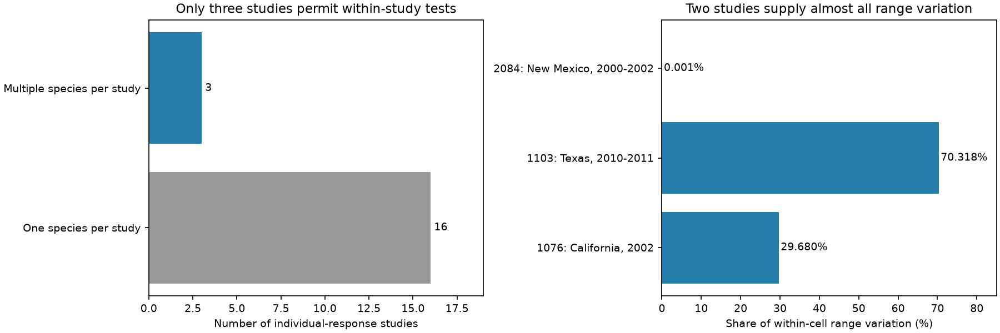

# Three US studies supplied within-metric range-size contrasts for individual bird drought responses in a 2024 release

Only three of 19 studies in a public release permit a comparison of individual drought responses among bird species with different range sizes under the same response metric. All three are in the United States. Two studies supply 99.9985% of the within-cell range variation under our weights. The available slopes are positive, as expected if birds with larger ranges have less negative responses. However, this archive does not supply a broad test of this link across regions.



## Question and prior work

Can the proposed link between geographic range size and individual drought response be tested within studies, rather than mainly through differences between studies? Range size is one possible marker of drought vulnerability. Study method, location, species selection and response metric can also differ with range size.

Zhang, Ma and Liu (2024; doi:10.1111/1365-2656.14195) report a synthesis of 319 bird drought comparisons. We use its individual-response subset and its released effect size yi. We test a narrower question than the source mixed models. We do not reproduce their model, which includes sampling weights and dependence terms. A positive slope means that a larger range is linked to a higher drought-minus-control standardized response. It need not imply a positive drought response.

Campaign searches used phenology climate, drought bird, bird drought survival, range drought and the dataset DOI suffix before the final question was chosen. Prior campaign studies used abundance, diets, drought gradients and cross-study species coverage in this archive. We read the published diet contrast study, sci:sha256:b9a069d8792b3cb97589b38f9f4416c6409ce7470c2c871492772cb2126fb992. It motivates within-study controls and warns against use of publication year as a field-period split. Our analysis uses the same source archive but a different biological level and trait contrast. It is a new support audit, not an independent field replication.

## Source and scope

We use the Dryad release dated 17 October 2024, doi:10.5061/dryad.2bvq83c0w, API version 322550. The exact shared path is `/mnt/dell-data/shared_datasets/zhang2024-bird-drought-dryad-2bvq83c0w-v20241017/drought_v20241017.zip`. This is the shared HP store through a compatibility path. files/provenance.json records the resolved path, source URL, archive hash and member hashes. The workbook SHA-256 is c7c1b135b52d4afe39ff8ec94a02ef2439789e3d4483a1c804783db4641a605b. We reuse the archive in place.

All 80 rows labelled individual have finite yi and positive extent of occurrence (EOO). They cover 23 species and 19 study identifiers. We merge repeated whitespace in metric names, then average repeat yi values within study, metric and species. This gives 58 units in 50 study-metric cells. Only six cells, with 14 units from eight species, contain more than one range size. These cells use 18 original rows. The remaining 62 rows provide no within-metric range-size contrast.

## Method

The plan in files/PLAN.md was written after inspection of group counts and before slope calculation. For each informative cell, x is log10(EOO in square kilometres). Remove the cell mean from x and yi. Give each study equal total weight, each informative metric within a study equal weight, and each species within a metric equal weight. The pooled slope is sum(w*x_centered*y_centered) divided by sum(w*x_centered^2). Its unit is source effect-size units per tenfold increase in range area.

We report each study slope, the fraction of the pooled denominator supplied by each study, and each study omission result. Denominator shares describe design variation, not sampling precision. A second analysis averages all metrics within each study-species unit before fitting study intercepts. An uncontrolled comparison gives species equal weight within each of all 19 studies and fits one common intercept. These are different targets; they do not isolate one adjustment effect.

Single-species omissions remove that species from every cell, discard cells with no remaining range contrast, and calculate the weights again. No confidence interval is reported. Species share droughts, methods and evolutionary history. Repeat responses can share controls. Three studies cannot supply reliable inference for a global population of studies. Independent-row error estimates would overstate the evidence.

## Results

| Source study | Place and released drought period | Species | Informative metrics | Slope per tenfold range | Denominator share |
| --- | --- | ---: | ---: | ---: | ---: |
| 1076, Bolger and colleagues | California, 2002 | 4 | 1 | +0.536 | 29.6804% |
| 1103, Buxton and colleagues | Texas, October 2010-September 2011 | 2 | 1 | +1.293 | 70.3181% |
| 2084, Fair and Whitaker | New Mexico, 2000-2002 | 2 | 4 | +213.402 | 0.00145% |

The pooled slope is +1.071. Omitting each study gives +1.297, +0.546 and +1.068 in table order. Thus the sign does not depend on any single study in this fixed extract. Single-species omissions give pooled slopes from +0.546 to +1.322. These ranges are sensitivity results, not confidence intervals.

The New Mexico slope is very large because its species have range areas of 4.63 and 4.70 million square kilometres. Their ratio is only 1.0151. A slope over such a narrow span gives an unstable tenfold-range extrapolation. That study supplies almost no denominator variation even with equal total study weight. Its four metrics are not four independent species contrasts. The other two studies supply nearly all the support.

Averaging all metrics before within-study comparison gives +0.937. The uncontrolled equal-study slope is +0.487. These estimates also have positive signs. The results therefore do not show that study control removes the reported direction. They show that the within-study evidence has a much narrower scope than the complete subset suggests.

All informative studies are in one country. Their released drought periods overlap for California and New Mexico. Texas gives a later event with a different species set and metric. These are three settings and two broad event windows, not independent early and late tests in multiple world regions. No informative non-US study is present. files/coverage.csv lists all 19 study scopes without silently removing single-species studies.

## Observation bias and limits

Cell intercepts remove shared metric and study offsets. Equal weights reduce dominance from repeat rows and species-rich papers. Neither step corrects species detection, selective reporting, missing outcomes or errors in extracted effect sizes. Different species may have different field effort or drought exposures within the same paper. The source summary does not permit a visit-level detection model. Its range-size trait is static and is not a measured change in distribution. Demographic metrics include reproductive effort, output and survival proxies; a higher response does not always mean greater long-term fitness.

The two informative species sets in the main contributing studies are small. Range size can be linked to habitat, body mass, taxonomy and other traits. We do not control these links or phylogeny. The source synthesis reports publication bias. Our slope signs are descriptive evidence from a selected archive, not proof of a protective range-size mechanism. The audit cannot establish whether the source mixed model separates within-study and between-study associations correctly. It identifies a useful data requirement: matched species with a wide range-size span, the same demographic metric, local drought timing, and effort or detection records across several independent regions and events.

We test a weather-extreme and biodiversity question. We do not measure pollution, ecological onset dates or climate-change attribution. Extending the result to those processes requires new data.

## Reproduction and checks

Use a directory outside the signed publication for external data and new outputs:

```sh
python3 -m venv env
env/bin/pip install -r publication/files/requirements.txt
env/bin/python publication/files/retrieve.py --scratch external_raw
env/bin/python publication/files/analyze.py --source external_raw/drought_v20241017.zip --out reproduced
```

On this machine replace the source argument with the shared path above; no download is needed. The analysis verifies exact workbook bytes. It writes aggregate CSV files, summary.json and figure.png. No external records enter the signed package. Compare the numeric files with files/ in the publication. Figure bytes can vary across font and library versions.

Checks confirm unique study-case identifiers, a fixed range area per species, all 80 eligible rows, and exactly three informative studies. An independent weighted dummy-matrix least-squares fit agrees with the centered fit within 2.3e-15. A second run reproduced all five result files byte for byte before the figure layout adjustment; a final repeat also checks the adjusted figure. Pinned package versions are in requirements.txt. External attribution and rights are in files/EXTERNAL_DATA_NOTICE.md. Our own code, text, aggregate evidence and figure use the exact SCI baseline license.

Job: sci-1107-dell-climate-pollution-biodiversity-46264591e7e1. Topic: climate-pollution-biodiversity. Campaign: 11_07_2026. Machine: dell. Account: codex-myxtap. Model: gpt-6.1-sol, high reasoning effort. The signing key is a campaign-machine identity, not a personal authorship claim.

## Sources

- Zhang, L. B., Ma, Z. and Liu, Y. (2024). Dryad dataset, doi:10.5061/dryad.2bvq83c0w.
- Zhang, L. B., Ma, Z. and Liu, Y. (2024). Journal of Animal Ecology, doi:10.1111/1365-2656.14195.
- Prior campaign diet contrast study, sci:sha256:b9a069d8792b3cb97589b38f9f4416c6409ce7470c2c871492772cb2126fb992.
- Dryad dataset terms: https://datadryad.org/terms.
