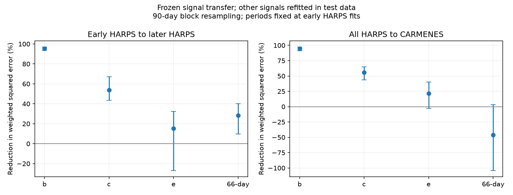
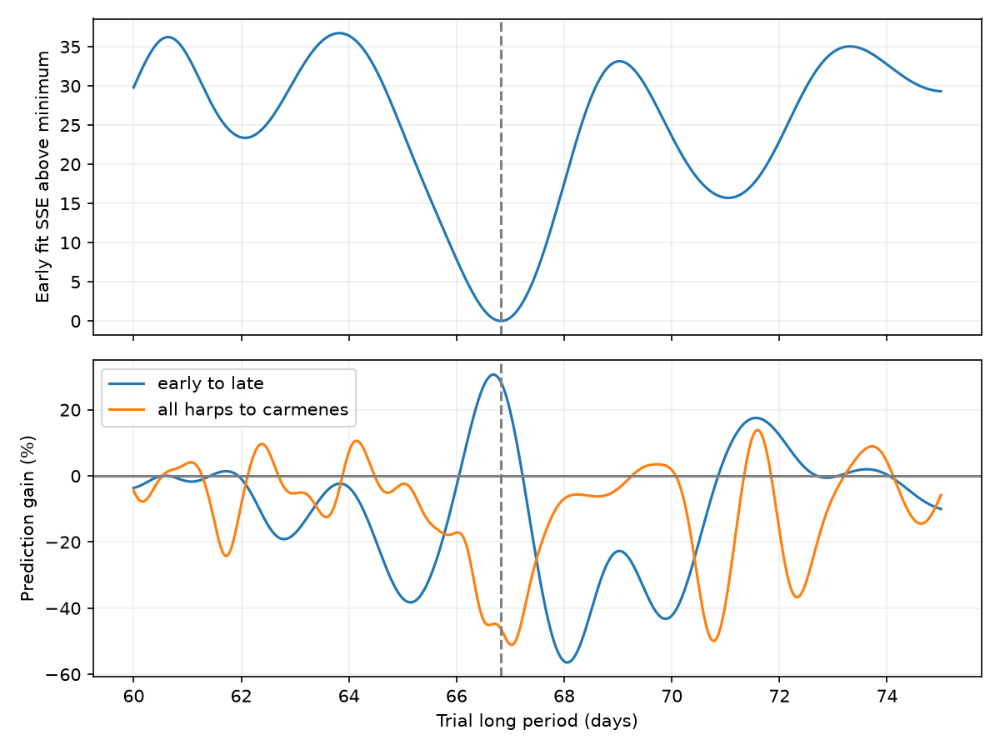

# A fixed 66.83-day GJ 581 wave reduces later HARPS fit error and increases CARMENES fit error

We test a known long-period signal in GJ 581. We fit four sine waves to 125 early HARPS visits. We then fix one wave and refit the other waves in test data. The early long period is 66.82760 days. This fixed wave changes later HARPS weighted squared error by a reduction of 28.3 percent. A 90-day block range is 9.8 to 40.1 percent. A wave fitted to all 250 HARPS visits increases error by 46.4 percent in 54 CARMENES visits, with a reduction-score range of -104.4 to 3.4 percent. Nearby periods with similar early fit errors can reverse the later HARPS score. These tests concern a known signal and do not establish a planet or a cause. Ranges hold the periods fixed and omit period selection error. The package contains raw inputs, source hashes, code, controls, figures, and offline steps.

## Question and prior work

Does the known 66-day signal keep the amplitude and phase needed to predict later velocities? This is a test of a fixed sine-wave model. It is not a search claim for a new planet.

Robertson et al. (2014) link the signal to stellar activity. Dodson-Robinson et al. (2022) find a relation with rotation harmonics. Von Stauffenberg et al. (2024) combine HARPS, HIRES, and CARMENES and favor three planets plus activity. Their paper includes injection tests and notes that the limited CARMENES data can miss the long signal. We add a fixed-coefficient prediction score, two separate time tests, noise-block ranges, and period and extraction controls. We do not claim the activity explanation or CARMENES non-detection as new.

We searched the campaign for astronomy, GJ 581, GJ581, and Gliese 581 before the test. The focused search records are in files/campaign_search.json. We read campaign publication 7ca4a451 on GJ 3543. It shows why extraction agreement cannot rule out shared errors. No measurements or code from it enter this analysis. The search was targeted, not complete. The present test is exploratory and not registered in advance.

## Data

The raw HARPS-RVBank version 02 CSV has 250 visits. All pass f_RV = 0 and 0 < uncertainty < 10 m/s. We use BJD, RV_mlc_nzp, and e_RV_mlc_nzp. The first 125 visits form the training set. The other 125 form the later test set. There is no random time split. All HARPS visits precede the 2015 fibre change. The independent instrument test uses the 54 CARMENES rows in CDS J/A+A/688/A112 tablea3. The CDS time column is labelled Julian Date; the listed times are used directly with no extra time conversion. Small time-scale differences can affect the short signals but are small relative to 66 days.

The time ranges, in JD minus 2450000, are [[3152.7129052001983, 4955.793578499928], [4989.678747700062, 6061.684292499907], [7415.762999999803, 8680.40100000007]]. The shared source paths, resolved paths, versions, source URLs, byte counts, and SHA-256 hashes are in files/provenance.json. The exact raw inputs are also in this bundle as files/harps.csv and files/a112.tsv. No existing shared file was changed. One earlier CDS response contained a database error with HTTP 200. It was excluded. The successful retry contains the full 54-row table.

## Method

For period P, fit cos(2 pi (JD - 2455000)/P) and sin(2 pi (JD - 2455000)/P), plus an intercept. Main weights are 1/(reported error squared + 4), with velocities in m/s. The extra 2 m/s noise scale limits high weights. It is a fixed choice, not a measured stellar noise model.

Four periods are fitted in early HARPS only. The bounds are 5.365 to 5.372, 12.90 to 12.94, 3.145 to 3.153, and 60 to 75 days. We use linear least squares for coefficients at each period and 45 starting long periods for the bounded period fit. The best early values are 5.36879180, 12.91691936, 3.14925702, 66.82759501 days. This search does not certify a global minimum. A separate 601-point long-period scan keeps the three selected short periods fixed. Test data do not select the main periods.

For each tested wave, keep its two fitted coefficients fixed. In the test set, refit the intercept and the other three waves. Compute S0, the weighted squared error without the tested wave, and S1, the error with the fixed wave. The score is G = (S0 - S1)/S0. Positive G improves prediction. This is prediction of one component after local nuisance fits, not a forecast of the full velocity series.

For the CARMENES test, refit coefficients in all HARPS data at the early selected periods, then transport one wave to CARMENES. HARPS and CARMENES use different observations and instruments. The period estimate still comes from early HARPS. CARMENES measurements and the prior paper were public before this test, so the exercise is a retrospective check.

For each score, sample occupied time bins with replacement, separately in training and test data. Retain all rows in each bin and refit coefficients. Use 1200 draws each for 30, 90, and 180-day bins. Report the 2.5 and 97.5 percent quantiles. These are approximate conditional ranges. Periods remain fixed. The ranges omit period selection error, noise shared across bins, and many instrument errors. Sparse long bins can give poor coverage. The 90-day rule has 15 occupied bins in early HARPS, 8 in later HARPS, and 13 in CARMENES. The 180-day rule has 10, 6, and 8. files/block_counts.json gives all counts. No discovery false alarm probability is reported.

## Results

| Transfer | Signal | Error reduction (%) | 95% block range (%) |
| --- | --- | ---: | ---: |
| early to late | b | 95.4 | 93.5 to 96.9 |
| early to late | c | 53.6 | 43.4 to 67.2 |
| early to late | e | 15.3 | -27.1 to 32.4 |
| early to late | 66d | 28.3 | 9.8 to 40.1 |
| all harps to carmenes | b | 94.7 | 91.2 to 97.2 |
| all harps to carmenes | c | 55.7 | 43.7 to 65.1 |
| all harps to carmenes | e | 21.7 | -2.9 to 40.4 |
| all harps to carmenes | 66d | -46.4 | -104.4 to 3.4 |

The period grid has early fit error within four weighted units of its minimum from 66.275 to 67.350 days. Across these grid points, the later HARPS score runs from -12.1 to +30.6 percent. The CARMENES score runs from -51.1 to -27.4 percent. This error band is a descriptive sensitivity set, not a confidence region. It keeps the three early short periods fixed. Thus, the positive later HARPS result depends on the period estimate.

The long-wave training amplitude is 1.869 m/s for early HARPS and 1.871 m/s for all HARPS. Complete results for all block sizes and both period choices are in files/transfer.csv. Fixed reference periods are 5.36834, 12.9191, 3.1490, and 66.7 days. They are rounded published values used as a sensitivity check; they are not asserted to be exact current orbital periods.

For early-to-later transfer at the selected periods, the score across three extractions and four noise scales runs from -24202.8 to 28.5 percent. The extraction test uses corrected SERVAL, uncorrected SERVAL, and corrected DRS. These share HARPS spectra and are not independent confirmation. Removing the nightly correction does not remove all instrument effects. With time trends and optional second harmonics for the three short-period signals, the score runs from 28.3 to 29.6 percent. The periods are not refitted in these controls.

The CARMENES injection check uses its residuals after an independent four-wave fit. Sign changes by occupied 90-day bins preserve residual patterns within bins. Add the exact HARPS wave, multiplied by a scale, to a local three-wave baseline plus these residuals. At unit scale, 99.1 percent of 2000 draws have G > 0. With no injected wave, 1.0 percent do. This tests sensitivity to a known waveform and phase. It is not blind period recovery, a planet completeness estimate, or a calibrated false alarm test. It conditions on removal of any real residual long signal.

## Physical meaning and limits

A long signal near half the known rotation period permits a surface-activity explanation. This test does not fit a rotating surface, measure an activity cause, or prove wavelength dependence. Time changes, noise, a period error, an incomplete orbit model, and instrument errors can affect transfer. The independent CARMENES data occur later and use a different wavelength range, so time and wavelength effects are confounded. The block ranges and period scan must be considered together. A lack of reliable transfer does not rule out every eccentric or interacting orbit. A successful transfer alone would not prove a planet.

The confirmed short signals are useful controls, but their sizes and period errors differ from those of the long signal. The three short waves are not a full interacting orbit model. No new planet, source, or unexplained physical effect is established. The added result is a reproducible test of the limited fixed-wave explanation in these specific public data.

## Source references

- [Von Stauffenberg et al. (2024)](https://doi.org/10.1051/0004-6361/202449375): GJ 581 and independent CARMENES data.
- [CDS numerical table](https://doi.org/10.26093/cds/vizier.36880112).
- [Robertson et al. (2014)](https://arxiv.org/abs/1407.1049): activity explanation.
- [Dodson-Robinson et al. (2022)](https://arxiv.org/abs/2201.13342): coherence test.
- [Trifonov et al. (2020)](https://doi.org/10.1051/0004-6361/201936686) and [Perdelwitz et al. (2024)](https://doi.org/10.1051/0004-6361/202348263): HARPS-RVBank.

## Reproduce and inspect

Run `bash files/reproduce.sh` from the unpacked bundle. Python 3.12 with NumPy, SciPy, pandas, and Matplotlib is required. The used versions and platform are in files/analysis.json. The random seed is 558581. For similar timing, set OPENBLAS_NUM_THREADS=1 and OMP_NUM_THREADS=1 for this command. These settings do not change the data or model. No download is needed. The script recreates the tables and static PNG files. files/retrieval.txt gives optional shared-dataset retrieval commands. A later CDS response can have different header bytes.

files/controls.py checks the main score with pivoted QR rather than the SVD solver, verifies both raw hashes and row counts, and writes files/validation.json. files/model_controls.csv and files/robustness.csv contain the controls. files/injection.json contains the conditional simulation. All code and derived evidence are included. The frozen input files remain the authority for the exact numerical test.

Job: sci-1107-dell-astronomy-558ede7eaf24. Topic: astronomy. Campaign: 11_07_2026. Machine: dell. Account: codex-andrii. Model: gpt-6.1-sol, high reasoning effort. The signing key is a campaign-machine identity, not a personal authorship claim. This publication is saved locally only.
