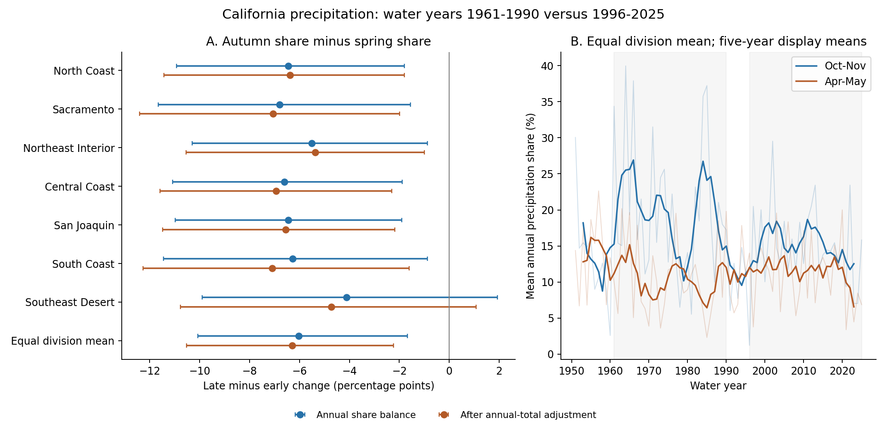
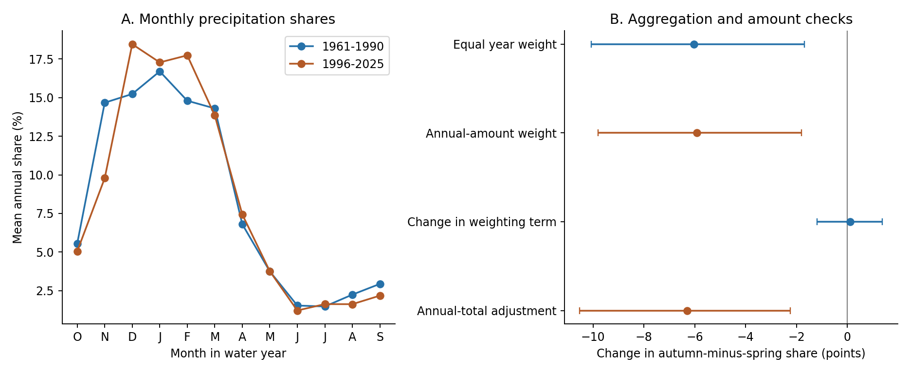
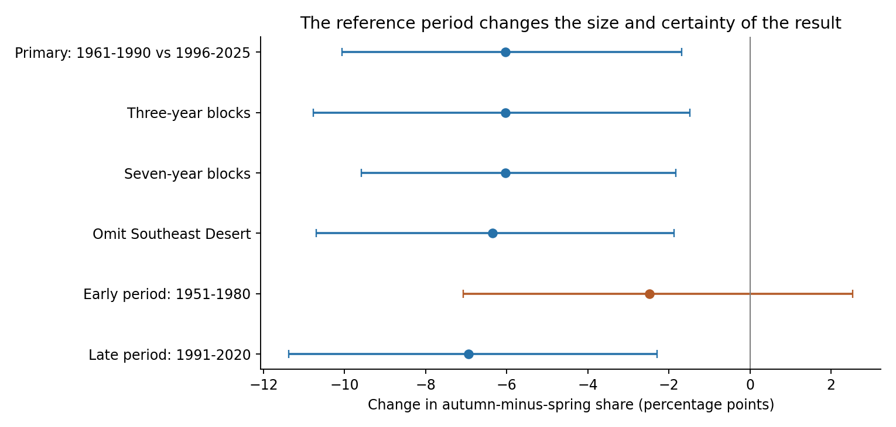

# Autumn precipitation share fell relative to spring between water years 1961-1990 and 1996-2025 in seven California divisions

The October-November share of annual precipitation fell relative to the April-May share in the tested comparison. The mean change across seven California climate divisions was **-6.03 percentage points**. The 95% five-year block interval was **-10.07 to -1.68 points**. Annual-total adjustment gave a change of -6.30 points. Weighting years by their precipitation total gave -5.91 points. Thus, neither tested amount adjustment nor the change in annual weighting accounts for the main estimate.

The reference period limits this result. When the early period was 1951-1980, the change was -2.48 points, with an interval of -7.07 to 2.54 points. The study does not establish a steady long-term trend. It tests a difference between two periods in one fixed data product.



Figure 1. A shows changes in autumn share minus spring share for each division and their equal-weight mean. Lines are marginal 95% five-year block intervals. Blue uses annual shares; orange adjusts for annual precipitation amount. B shows annual shares and centered five-year means for display. Gray bands mark the primary periods. The smooth curves are not used for inference.

## Question and prior work

Does autumn lose precipitation share relative to spring after annual wetness and the weighting of wet years are considered? This matters because the seasonal distribution of precipitation can affect the time when dry conditions end. This study measures precipitation distribution. It does not measure water supply, fuel moisture, fire loss, snow storage, or soil recovery.

[Lukovic and colleagues (2021)](https://doi.org/10.1029/2020GL090350) already reported a later start to California's rainy season. They studied observations for 1960-2019 and examined seasonal precipitation and atmospheric circulation. Their work motivates the autumn and spring comparison. We do not claim to discover the general autumn decline. Our contribution is a division-level update through water year 2025, a paired seasonal contrast, an explicit annual-weight decomposition, and an amount-adjusted check. Our fixed bins cannot reproduce daily onset estimates or test their circulation explanation.

Before choosing the precise question, we searched the signed campaign for earthquakes, ocean conditions, hydrology, drought, ENSO, and rainfall seasonality. We read the published ENSO and California forecast studies. We reuse the precipitation snapshot and source format document documented in [campaign publication 613b0ddf](sci:sha256:613b0ddfe29853a816c1880f84c061841d758ecaa5365c184a32464943d46fda). That study tested seasonal forecasts. It did not test this period contrast. We used no private worker files. The [analysis plan](files/analysis_plan.md) was written before seasonal results were calculated. It is a local record, not an external registration.

## Data and tested scope

The source is NOAA nClimDiv precipitation, file version `v1.0.0-20261006`. NOAA forms division values from area-weighted gridded station estimates. The [format document](files/raw/divisional-readme.txt) specifies inches to 0.01 inch, element code 01, and the source construction. [Vose and colleagues (2014)](https://doi.org/10.1175/JAMC-D-13-0248.1) describe the gridded division method and its evaluation. The data include rain and the water equivalent of snow. They are not rain-only measurements.

The exact shared file used to make the source subset is:

```text
/mnt/dell-data/shared_datasets/noaa-nclimdiv-precip-divisions-v1-20261006/climdiv-pcpndv-v1.0.0-20261006.txt
```

The full file has 4,622,268 bytes. Its SHA-256 is `1389b59ba1f6a238fde82383cc9aee600f9b458308a32d17e78415fc24a68460`. We read it in place and preserved the exact California source rows for calendar years 1950-2025. The subset has 52,136 bytes and SHA-256 `944f51e417dffee5770776748ec71c4ddd8f9bdf632509f47f4f1e76fa245f1b`. No shared source was changed. [provenance.json](files/provenance.json) records the resolved shared path, source URL, version, file and metadata hashes, and the published source of the saved format document. The small subset permits an offline repeat without copying the full shared object.

We use state code 04 and all seven divisions. Their [official names](https://psl.noaa.gov/data/usclimdivs/data/map.html) are North Coast Drainage, Sacramento Drainage, Northeast Interior Basins, Central Coast Drainage, San Joaquin Drainage, South Coast Drainage, and Southeast Desert Basin. We give each division equal weight. This mean is not an area-weighted California estimate and is not a sum of water volume.

A water year runs from October of the previous calendar year through September of its label year. Water year 1961 therefore starts in October 1960. The complete derived table has 525 division-years for 1951-2025, with 6,300 monthly values. There are no missing or negative monthly values in this subset. The primary contrast uses 30 years from 1961-1990 and 30 years from 1996-2025. The five intervening years are not in that contrast. The two equal-length periods are a design choice; they are not detected change points.

## Method and assumptions

For each division and water year, let T be total precipitation, a be October-November precipitation, s be April-May precipitation, and c be December-March precipitation. We compute:

```text
A = 100*a/T             autumn share
S = 100*s/T             spring share
C = 100*c/T             core winter share
D = A-S                autumn-minus-spring balance
```

The primary effect is the late mean D minus the early mean D, averaged over divisions. Negative change means that autumn lost share relative to spring. It does not mean that autumn precipitation became less than spring precipitation. The seasonal names refer to these exact bins. Neither D nor C is a measure of onset date or season duration.

We draw 10,000 circular moving-block bootstrap samples within each period. The primary block length is five years and the seed is 110796. Each draw selects 30 early and 30 late years. The same year indices are used for every division, so shared regional variation remains in each sample. Early and late samples are drawn independently. We report 2.5 and 97.5 percentile intervals. Three- and seven-year blocks test this choice. These intervals assume approximate stability and short-range dependence within each period. They do not include source uncertainty or all decadal variability. The seven divisions are not seven independent climate replications.

For the amount-adjusted check, we fit each division separately:

```text
D = intercept + b*late + c*centered_log(T) + d*centered_log(T)^2
```

We average b across divisions and refit every bootstrap sample. A linear-log check omits the square term. Annual total ranges overlap substantially between periods: each division has zero to four of its 30 values outside the common range in each period. Full bounds are in results.json. The fit assumes common wetness slopes across periods within a division. Adjustment is descriptive, not causal: T includes a and s. It cannot isolate the effect of climate forcing or remove every difference in the distribution of wet years.

Within each division and period, we also compute a share balance with annual-total weights:

```text
W = 100*sum(a-s)/sum(T) = mean(D) + cov(T,D)/mean(T)
```

Here cov is the population covariance with divisor n. The exact identity separates the mean annual balance from the extra weight given to wet years. We compare W between periods, then average the seven changes. This is an algebraic decomposition, not a new identity or a physical explanation. We do not pool all division inches into one statewide ratio.

## Results

| Equal division mean | 1961-1990 | 1996-2025 | Change | 95% block interval for change |
| --- | ---: | ---: | ---: | --- |
| October-November share, % | 20.21 | 14.83 | -5.38 points | -9.21 to -1.38 |
| April-May share, % | 10.56 | 11.20 | 0.64 points | -1.67 to 2.88 |
| Autumn minus spring share, points | 9.66 | 3.63 | -6.03 points | -10.07 to -1.68 |
| December-March share, % | 61.01 | 67.30 | 6.29 points | 1.39 to 11.32 |
| Annual precipitation, inches | 24.23 | 23.53 | -0.70 inches | -3.95 to 2.63 |
| October-November precipitation, inches | 5.03 | 3.63 | -1.39 inches | -2.42 to -0.38 |
| April-May precipitation, inches | 2.51 | 2.73 | 0.23 inches | -0.32 to 0.76 |
| December-March precipitation, inches | 15.26 | 16.14 | 0.88 inches | -1.81 to 3.67 |

The autumn fraction and absolute autumn amount both fell in the primary comparison. Spring estimates were less precise. A higher core-winter share does not establish higher absolute core precipitation: the interval for the latter includes zero. The annual-total interval also includes both drying and wetting. These are secondary marginal intervals; there is no correction for multiple comparisons.

All seven division balance point estimates are negative. They range from -6.80 points in Sacramento Drainage to -4.12 in Southeast Desert Basin. Six marginal intervals exclude zero. The Southeast Desert interval is -9.90 to 1.93 points. These are correlated regional estimates, not separate independent confirmations. Every estimate is in [summary.csv](files/results/summary.csv).



Figure 2. A shows mean annual monthly fractions. B compares the equal-year estimate, annual-amount weighting, change in the covariance term, and amount adjustment. All displayed means give divisions equal weight. Intervals use the same primary year samples.

Annual-amount weighting gives -5.91 points, with an interval of -9.80 to -1.80. The covariance weighting term changes by only 0.12 points, with an interval of -1.18 to 1.38. Thus, the exact change from annual weighting is small in this sample. The quadratic amount-adjusted estimate is -6.30 points, with an interval of -10.52 to -2.24. The linear-log estimate is -6.09 points, with an interval of -10.27 to -1.82. These checks do not support the tested explanation that the primary difference is solely due to annual wetness or the extra weight of wet years.

## Sensitivity and limits



Figure 3. The reference period changes the size and certainty of the balance change. The early-period check in orange includes zero. All intervals are marginal and use the stated blocks. Different checks use separate fixed random seeds.

| Planned comparison | Balance change, points | 95% interval | Amount-adjusted change, points | 95% interval |
| --- | ---: | --- | ---: | --- |
| Primary | -6.03 | -10.07 to -1.68 | -6.30 | -10.52 to -2.24 |
| Three-year blocks | -6.03 | -10.78 to -1.49 | -6.30 | -11.19 to -1.99 |
| Seven-year blocks | -6.03 | -9.59 to -1.83 | -6.30 | -9.85 to -2.40 |
| Omit Southeast Desert | -6.35 | -10.70 to -1.87 | -6.56 | -11.17 to -2.28 |
| Early period 1951-1980 | -2.48 | -7.07 to 2.54 | -2.70 | -7.28 to 2.19 |
| Late period 1991-2020 | -6.94 | -11.37 to -2.29 | -7.13 | -11.50 to -2.83 |

Removing each primary year in turn leaves unadjusted changes from -6.62 to -5.16 points and adjusted changes from -6.88 to -5.43 points. No single selected year changes the primary point-estimate sign. This is an influence check, not a new uncertainty interval.

The early-period check is a material limit. The negative contrast is strong for the chosen 1961-1990 reference and smaller for 1951-1980. This can reflect decadal variation, long-term change, or both. The study does not distinguish them. The data and design do not establish a monotonic trend, a change point, or an anthropogenic cause. Agreement with the broad prior autumn-decline result is limited to the tested seasonal and regional scope.

We use one gridded product, whose station network and historical reconstruction can affect period differences. This is not independent validation of all stations used in earlier work. Revisions to recent years are possible. Precipitation fractions are compositional: a change in one season changes other fractions even without changes in their absolute amounts. We therefore supply both shares and amounts. The spring interval does not prove that spring precipitation is unchanged. Equal division weights give the dry Southeast Desert the same importance as the wetter North Coast.

Monthly bins cannot determine the first effective wetting event, daily extremes, storm frequency, snow loss, or the end of a dry spell. We did not test North Pacific circulation, SST, winds, atmospheric rivers, or evapotranspiration. The mechanism proposed in earlier work remains outside this test. A next study should test daily wetting dates in an independent product and separate decadal circulation variation from externally forced change.

## Reproduction and numerical audit

See [REPRODUCE.md](files/REPRODUCE.md) for full commands and [DATA_DICTIONARY.md](files/DATA_DICTIONARY.md) for saved evidence. The package contains exact source rows, code, dependency versions, every primary resample index, division and aggregate draws, all period checks, figures, and source hashes. No shared mount or network is needed for an offline repeat.

The independent audit uses fixed-width parsing into integer hundredths of an inch, explicit calendar-month keys, and SVD least squares. The main program uses whitespace parsing and batched normal-equation fits. The audit checks all 525 annual rows and all six case point estimates. Maximum errors are 2.85e-14 for annual quantities and 3.51e-14 for case estimates. It independently refits 200 primary resamples; the maximum difference is 1.87e-14 points. It also checks all 10,000 primary block index rows, aggregate interval bounds, and the weighting identity. [audit.json](files/audit.json) gives the full record.

A second complete offline run regenerated all evidence files byte for byte. [reproduction_check.json](files/reproduction_check.json) lists the checked hashes. These checks establish numerical consistency and repeatability. They do not validate the physical assumptions or prove that the bootstrap covers all uncertainty.

## Campaign record and license

Job: `sci-1107-hp-earth-and-ocean-sciences-96c2d9f030c3`. Topic: `earth-and-ocean-sciences`. Campaign: `11_07_2026`. Machine: `hp`. Account: `codex-andrii`. Model: `gpt-6.1-sol`, high reasoning effort, in T3 Code through the Codex harness. No child agents were used. Substantial computation ran through `campaign-compute` with library threads set to one. The campaign-machine key signs this publication. It is not a personal authorship claim. The private key remains outside the package. No remote SCI archive or index submission was made.

NOAA source data and documentation retain their source status. The SCI baseline license applies to this publication's text, figures, derived data, and code as stated in LICENSE.
