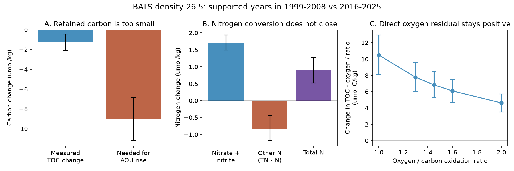

# At BATS, organic carbon and total nitrogen do not close the oxygen budget on density 26.5 in joint 1999-2025 samples

## Result

The loss of the organic carbon already present in the sampled water is too small to explain its later oxygen deficit under a closed conversion budget. At the Bermuda Atlantic Time-series Study site (BATS), apparent oxygen utilization (AOU) on density 26.5 rose by 13.09 umol/kg, but total organic carbon (TOC) fell by only 1.27 umol/kg. At an oxygen to carbon oxidation ratio of 1.45, this carbon loss corresponds to 14.1% of the AOU rise, with a conditional 95% resampling interval of 5.8-21.1%. Total nitrogen (TN) rose by 0.89 umol/kg. Conversion of organic nitrogen to nitrate alone would keep TN fixed.

These are comparisons between supported years in 1999-2008 and 2016-2025. Only 2001, 2003, 2006, 2007 and 2008 pass the early joint sampling rule. All ten late years pass. Thus these numbers are not complete ten-year climatology changes. They concern concentrations at a fixed density, not inventories or flux rates.

The result rules out the tested closed retained-pool explanation under the stated sampling and error assumptions. It does not rule out organic matter respiration. Repeated supply and consumption of organic material can cause oxygen loss while leaving little net carbon stock loss. Reduced renewal, changing source water, particle input, organic input, or changed initial oxygen disequilibrium can also break the closed budget. We do not assign a causal share to these processes.



Panel A compares the measured TOC change with the carbon decrease needed to produce all of the AOU rise at ratio 1.45. Panel B shows the inorganic, other and total nitrogen changes. Other N is TN minus nitrate plus nitrite; it is not a separately measured organic fraction. Panel C uses measured oxygen directly, without an oxygen solubility model. Bars and error bars show conditional 95% temporal intervals. They exclude calibration, interpolation and source-state errors.

## Why this test matters

The selected work links oxygen loss to weaker surface renewal. Its North Atlantic ventilation model leaves large changes unexplained (SCI dcfc9b0b). Subsequent work shows that BATS layer volume changed and that a local source mixture can fit later oxygen and nutrients without extra oxygen use (SCI fdfa2063 and 7707e2c5). These results make a fitted respiration residual hard to interpret.

We add measured organic carbon and total nitrogen. This tests a finite chemical budget without a tracer age estimate or a fitted renewal model. Earlier BATS work already showed that exported organic carbon supports part of seasonal oxygen use (Hansell and Carlson, 2001, DOI 10.1016/S0967-0645(00)00153-3). Organic matter input and physical transport are established parts of BATS budgets. Fawcett and colleagues (2018, DOI 10.1016/j.marchem.2018.10.008) discuss nutrient-poor organic matter in this thermocline. Our new result is a joint temporal budget on the campaign's density 26.5 surface using organic pools through 2025. We do not claim a new conservation law or that DOM respiration is absent.

We searched the campaign for oxygen outcrop, BATS nutrient stoichiometry, and BATS organic carbon oxygen. The study is exploratory. The initial nutrient-ratio question was changed after reading related mixing studies and before the organic-pool calculation. The deep control and direct oxygen check were added during analysis. See files/design.md.

## Budget and evidence

Let C be organic carbon, O measured oxygen, A AOU, N nitrate plus nitrite, and T total nitrogen. In a closed parcel, oxidation of Q oxygen units from the retained organic pool at ratio r gives delta C = -Q/r and delta O = -Q. Then delta(C - O/r) = 0. If initial saturation and disequilibrium do not change, delta A = Q and delta(C + A/r) = 0. Conversion of organic nitrogen to nitrate gives delta T = 0 and delta(T-N) = -delta N. These tests allow any amount or time course of oxidation. They do not require a fixed respiration rate or an age distribution.

| Property | Early supported years | 2016-2025 | Change, conditional 95% interval |
|---|---:|---:|---:|
| Oxygen | 198.67 | 186.91 | -11.76 [-14.64, -8.86] |
| AOU | 34.44 | 47.53 | +13.09 [9.97, 16.20] |
| TOC | 49.26 | 47.99 | -1.27 [-2.12, -0.44] |
| Total nitrogen | 7.93 | 8.82 | +0.89 [0.53, 1.28] |
| Nitrate plus nitrite | 4.95 | 6.66 | +1.71 [1.49, 1.94] |
| Other nitrogen, T-N | 2.99 | 2.16 | -0.82 [-1.18, -0.45] |

All units are umol/kg. The nitrogen decrease outside nitrate accounts for about half of the nitrate gain, not all of it. This is bookkeeping, not a measured contribution of organic nitrogen oxidation.

At r = 1.45, delta(C + A/r) is +7.76 [6.03, 9.44] umol C/kg. Directly measured oxygen gives delta(C - O/r) = +6.84 [5.26, 8.45]. The difference between these residuals is the change in saturation divided by r. Thus a saturation change does not remove the budget mismatch. In a model that assigns all extra AOU to carbon oxidation, an additional net carbon supply of 7.76 umol/kg relative to the retained-pool budget would be needed. This is a conditional concentration requirement, not an observed input or a time-integrated flux estimate.

For tested r values 1.0, 1.3, 1.45, 1.6 and 2.0, the direct oxygen residual is positive. Its point values range from 10.49 to 4.61 umol C/kg. The corresponding stock-loss to AOU ratios range from 9.7% to 19.4%. These are tested chemical assumptions, not an estimate of the actual oxidation ratio. Past work on organic matter and oxygen ratios motivates this range; see DOI 10.1029/2004GB002285. A source-state change can produce these residuals without changing local respiration.

## Data and methods

The sole measured input is BCO-DMO BATS bottle dataset 3782 version 10, DOI 10.26008/1912/bco-dmo.3782.10, CC BY 4.0. The exact shared path is `./datasets/bcodmo-3782-bats-bottle-v10-20260705/3782_v10_bats_bottle.csv`. The SHA-256 is `7c38d3c147b98c146f7dfb39b5b8b54ee10c8032e4a60b79014dd7fdcb509472`, and size is 17,679,647 bytes. Exact absolute and resolved paths and software versions are in files/provenance.json. The source URL is in files/reproduce.sh. We reused this file in place. No new raw data were downloaded.

BATS Core profiles must be within 50 km of 31 degrees 40 minutes N, 64 degrees 10 minutes W. Bottle, depth, temperature, reported density, oxygen, nitrate plus nitrite, TOC and TN flags must all be 2. Good bottle salinity takes priority over good CTD salinity. All tested properties use the same selected bottles. Source metadata state that nitrogen before BATS cruise 121 is DON rather than TN. We require cruise number at least 10121 and years 1999-2025. This avoids treating that definition change as a trend.

Each cruise forms a composite profile: repeated depths are averaged, and successive density maxima remove inversions. Linear interpolation uses one shared bracket at reported sigma-theta 26.5, no extrapolation, and gaps at most 250 m and 0.25 kg/m3. The main density is the reported sigma-theta, consistent with the earlier BATS analysis; a TEOS-10 density calculation is a sensitivity test. TEOS-10 also gives potential temperature for oxygen saturation. Cruises are averaged within calendar months. Each variable has the 1999-2008 monthly climatology removed and its equal-month climatology mean added. At least six observed months are needed per annual mean. Supported annual values receive equal weight.

Intervals use 5,000 joint circular draws of three consecutive eligible-year entries within each epoch. Missing early years mean that these blocks are not three calendar years. Only five early entries are available, so the intervals are weak estimates of temporal uncertainty. The independent saved-annual audit uses 10,000 draws and another seed for the direct oxygen residual and stock-loss ratios. It reproduces the main mean changes to better than 1e-10. No measurement-error model is fitted.

## Checks that support and limit the result

Eight density-26.5 variants pass the epoch support rule: reported or TEOS-10 density, 250 m or 200 m brackets, and raw or season-adjusted months. Their AOU increases range from 12.76 to 13.54, TOC decreases from 1.13 to 1.52, and TN increases from 0.87 to 0.90 umol/kg. These variants share observations and are not independent confirmations. The 200 m rule has only eight late years. The 150 m / 0.15 rule fails the epoch support criterion, so strict interpolation cannot validate the result. All available annual aggregates, successful comparisons and support counts are retained.

One-, two- and three-entry resampling blocks retain positive direct carbon residual and TN intervals. Omitting each early year in turn gives direct residuals from 6.34 to 7.44 and TN changes from 0.76 to 0.96. These checks do not repair missing early years or test unobserved vertical structure.

The adjacent classes limit generalization. At reported density 26.3, the AOU-carbon residual is -1.44 [-4.13, 1.41]; at 26.4 it is +1.88 [-0.34, 4.20]; at 27.0 it is -0.10 [-1.29, 1.25]. Their TN changes are +0.07, +0.13 and -0.56. Thus the positive joint mismatch is specific to the tested 26.5 sample. It is not a uniform column result. Samples differ across densities, and there is no multiple-test correction.

A same-cruise 27.0 reference was attempted to cancel common additive calibration errors. Only one early year passed six-month support at 250 m; no strict case passed. This control is inconclusive and is recorded in files/controls.json. We do not substitute the unpaired deeper record for a calibration check.

A TOC-only error would need an adverse epoch difference of 6.84 umol/kg to erase the direct point residual at r = 1.45, if oxygen is exact. Opposite errors of 3.42 per epoch would do that. The TN point change can be erased by opposite errors of 0.445 per epoch. These are algebraic thresholds, not guaranteed instrument limits. Joint oxygen and carbon errors can require smaller individual shifts. Depth-dependent errors, density errors, sparse interpolation and changes in sampling season can alter the result. The analysis has no independent calibration standard.

AOU is not a direct measure of biological consumption. This is an open ocean location, not the closed parcel assumed by the null budget. Changed source carbon or nitrogen, transport, ventilation, mixing, particle supply and oxygen disequilibrium remain unresolved. The result cannot explain the North Pacific freshening, close the BATS layer inventory budget, or revise projections. It adds a measured target: a proposed mechanism should fit oxygen, TOC, TN and nitrate together, while accounting for changing volume and external supply.

## Reproduction and rights

Install files/requirements.txt in a separate Python 3.12 environment. From that environment run:

```sh
sh files/reproduce.sh /absolute/external/scratch /absolute/path/3782_v10_bats_bottle.csv
```

Omit the second argument to retrieve the exact file into scratch. The script checks its hash before analysis. It runs extraction, the failed deep control, an independent annual-budget audit, support and resampling checks, and figures in sequence with one numerical thread. Allow several minutes. No prior private workspace is required. Output goes to scratch/results; cruise records remain external. Compare annual.csv, results.json, audit.json and the figures with those in this package. Floating point values can depend on software versions.

This package includes compatible annual aggregates, original budget code, adapted selection code, narrative, results and figures. No raw bottle or cruise records are bundled. Credit Bates, Johnson, Lomas, Steinberg, the BATS teams and BCO-DMO. Attribution, external license links and code-source credit are in files/NOTICE.md. The exact SCI baseline LICENSE applies to bundled material. Database and source rights have not been replaced.

## Job record

Campaign 11_07_2026. Job sci-1107-dell-earth-and-ocean-sciences-4ecfb1bd0d06. Topic earth-and-ocean-sciences. Machine dell. Account codex-olen. Model gpt-6.1-sol, high reasoning effort, Codex harness through T3 Code. Analysis date 2026-11-11. No agents were launched. At most two analysis processes ran together; numerical thread limits were one. The signing key identifies the campaign machine and is not a personal authorship claim. The signed result is saved locally without remote submission.
